<!-- Generated by scripts/grid_initialization_campaign/report.py; edit that generator. -->
# Initial bonus differences and exploration

Updated 2026-11-01 01:34 PT.

## Contents

| Section | First written | Last changed | Status |
|---|---|---|---|
| [Metrics and comparison rules](#metrics-and-comparison-rules) | 2026-10-31 22:56 PT | 2026-10-31 22:56 PT | unread |
| [Completed confirmation findings](#completed-confirmation-findings) | 2026-11-01 01:36 PT | 2026-11-01 01:36 PT | unread |
| [Numerical results](#numerical-results) | 2026-10-31 22:56 PT | 2026-11-01 01:21 PT | unread |
| [Paired confirmation comparisons](#paired-confirmation-comparisons) | 2026-11-01 00:16 PT | 2026-11-01 01:21 PT | unread |
| [Behavior](#behavior) | 2026-10-31 22:56 PT | 2026-11-01 01:21 PT | unread |
| [Repeatability of tabular training](#repeatability-of-tabular-training) | 2026-11-01 01:36 PT | 2026-11-01 01:36 PT | unread |
| [Records and visualization sources](#records-and-visualization-sources) | 2026-10-31 22:56 PT | 2026-10-31 22:56 PT | unread |

[Read with section colors](analysis.html). No section marks itself read.

## Metrics and comparison rules

For policy seed $i$, let $T_i$ be the number of training transitions before its first goal, $B$ its transition budget, and $K$ the number of completed independent copies. A failure contributes $B$. The primary metric is the mean capped first-goal time, lower being better.

$$ M = \frac{1}{K} \sum_{i=1}^{K} \min(T_i,B). $$

A missing first goal is treated as $T_i$ exceeding $B$. Goal-found percentage counts every seed. Coverage is the mean fraction of traversable states visited. Brackets give 95% bootstrap intervals. For random initial fields, entire field seeds are resampled with their policy seeds kept together. For deterministic fields, policy seeds are resampled. One independent group gives no interval.

Development rows choose settings using development results. Confirmation comparisons retain settings chosen before their fresh seeds ran. Shared and independently tuned settings appear separately. These results concern the recorded finite budget; they do not establish permanent trapping.

## Completed confirmation findings

Straight-grid cases compare the frozen selected adversarial initial field with uniform bonuses. Snake-grid cases compare frozen coordinate-network initial fields with uniform bonuses. Ratios are capped mean first-goal times relative to uniform initialization. Intervals adjust for four cases within each settings protocol and budget. The study measures delays and failures within fixed transition budgets.

### Primary confirmation: about 4 million transitions; independently tuned settings

| Case | Ratio [98.75% interval] | Adverse goals | Uniform goals | Paired policies |
|---|---:|---:|---:|---:|
| Straight grid, neural policy | 2641.269 [2184.937, 3166.425] | 32/128 | 128/128 | 128 |
| Straight grid, tabular policy | 7.225 [2.031, 24.244] | 127/128 | 128/128 | 128 |
| Snake grid, neural policy | 19.593 [13.353, 26.700] | 119/128 | 128/128 | 128 |
| Snake grid, tabular policy | 42.610 [28.422, 64.287] | 88/128 | 128/128 | 128 |

### Primary confirmation: about 4 million transitions; shared settings

| Case | Ratio [98.75% interval] | Adverse goals | Uniform goals | Paired policies |
|---|---:|---:|---:|---:|
| Straight grid, neural policy | 3438.166 [3038.208, 3927.328] | 3/128 | 128/128 | 128 |
| Straight grid, tabular policy | 577.635 [414.342, 886.832] | 5/128 | 128/128 | 128 |
| Snake grid, neural policy | 63.169 [52.196, 77.043] | 46/128 | 128/128 | 128 |
| Snake grid, tabular policy | 20.913 [12.932, 32.436] | 117/128 | 128/128 | 128 |

### Secondary confirmation: about 16 million transitions; independently tuned settings

| Case | Ratio [98.75% interval] | Adverse goals | Uniform goals | Paired policies |
|---|---:|---:|---:|---:|
| Straight grid, neural policy | 9560.040 [7663.569, 11716.547] | 41/128 | 128/128 | 128 |
| Straight grid, tabular policy | 25.462 [2.567, 103.676] | 127/128 | 128/128 | 128 |
| Snake grid, neural policy | 18.277 [11.794, 27.754] | 128/128 | 128/128 | 128 |
| Snake grid, tabular policy | 171.199 [104.369, 273.636] | 83/128 | 128/128 | 128 |

### Secondary confirmation: about 16 million transitions; shared settings

| Case | Ratio [98.75% interval] | Adverse goals | Uniform goals | Paired policies |
|---|---:|---:|---:|---:|
| Straight grid, neural policy | 13515.334 [11924.375, 15435.532] | 5/128 | 128/128 | 128 |
| Straight grid, tabular policy | 2578.590 [1774.991, 3941.588] | 5/128 | 128/128 | 128 |
| Snake grid, neural policy | 151.502 [103.810, 223.711] | 70/128 | 128/128 | 128 |
| Snake grid, tabular policy | 47.568 [22.903, 84.419] | 118/128 | 128/128 | 128 |

The 16-million-transition stage restarted from initialization with the same frozen seeds and settings. Its learning-rate annealing spans the longer budget; these are separate restarted runs.

All 128 independently tuned neural-policy seeds on the snake grid reached the goal within the longer budget. Their capped mean first-goal-time ratio was 18.277 [11.794, 27.754]; this case demonstrates delayed discovery with eventual success within the measured budget.

## Numerical results

Every measured map remains in these summaries and in the seed records. Large figures and the main document use only the maps already chosen by the campaign.

### calibration; Snake grid, width 128, turns 16; neural; 262144; development best; primary

| Initialization | Mean steps [95% interval] | Goal found, % | Coverage, % | Seeds |
|---|---:|---:|---:|---:|
| No intrinsic bonus | 262144.0 [262144.0, 262144.0] | 0.0 [0.0, 0.0] | 5.0 | 16 |
| Uniform initial bonuses | 230800.9 [195181.4, 262144.0] | 18.8 [0.0, 37.5] | 68.3 | 16 |

### calibration; Snake grid, width 128, turns 16; tabular; 262144; development best; primary

| Initialization | Mean steps [95% interval] | Goal found, % | Coverage, % | Seeds |
|---|---:|---:|---:|---:|
| No intrinsic bonus | 262144.0 [262144.0, 262144.0] | 0.0 [0.0, 0.0] | 11.2 | 16 |
| Uniform initial bonuses | 262144.0 [262144.0, 262144.0] | 0.0 [0.0, 0.0] | 12.6 | 16 |

### calibration; Snake grid, width 128, turns 2; neural; 262144; development best; primary

| Initialization | Mean steps [95% interval] | Goal found, % | Coverage, % | Seeds |
|---|---:|---:|---:|---:|
| No intrinsic bonus | 249320.3 [223672.9, 262144.0] | 6.2 [0.0, 18.8] | 40.5 | 16 |
| Uniform initial bonuses | 34921.2 [26776.9, 44056.8] | 100.0 [100.0, 100.0] | 100.0 | 16 |

### calibration; Snake grid, width 128, turns 2; tabular; 262144; development best; primary

| Initialization | Mean steps [95% interval] | Goal found, % | Coverage, % | Seeds |
|---|---:|---:|---:|---:|
| No intrinsic bonus | 262144.0 [262144.0, 262144.0] | 0.0 [0.0, 0.0] | 33.1 | 16 |
| Uniform initial bonuses | 262144.0 [262144.0, 262144.0] | 0.0 [0.0, 0.0] | 34.2 | 16 |

### calibration; Snake grid, width 128, turns 4; neural; 262144; development best; primary

| Initialization | Mean steps [95% interval] | Goal found, % | Coverage, % | Seeds |
|---|---:|---:|---:|---:|
| No intrinsic bonus | 246257.6 [214484.7, 262144.0] | 6.2 [0.0, 18.8] | 25.8 | 16 |
| Uniform initial bonuses | 74714.8 [42089.1, 118642.9] | 87.5 [68.8, 100.0] | 97.7 | 16 |

### calibration; Snake grid, width 128, turns 4; tabular; 262144; development best; primary

| Initialization | Mean steps [95% interval] | Goal found, % | Coverage, % | Seeds |
|---|---:|---:|---:|---:|
| No intrinsic bonus | 262144.0 [262144.0, 262144.0] | 0.0 [0.0, 0.0] | 25.7 | 16 |
| Uniform initial bonuses | 262144.0 [262144.0, 262144.0] | 0.0 [0.0, 0.0] | 27.6 | 16 |

### calibration; Snake grid, width 128, turns 8; neural; 262144; development best; primary

| Initialization | Mean steps [95% interval] | Goal found, % | Coverage, % | Seeds |
|---|---:|---:|---:|---:|
| No intrinsic bonus | 262144.0 [262144.0, 262144.0] | 0.0 [0.0, 0.0] | 8.4 | 16 |
| Uniform initial bonuses | 172951.4 [131444.1, 216122.3] | 56.2 [31.2, 81.2] | 91.9 | 16 |

### calibration; Snake grid, width 128, turns 8; tabular; 262144; development best; primary

| Initialization | Mean steps [95% interval] | Goal found, % | Coverage, % | Seeds |
|---|---:|---:|---:|---:|
| No intrinsic bonus | 262144.0 [262144.0, 262144.0] | 0.0 [0.0, 0.0] | 17.3 | 16 |
| Uniform initial bonuses | 262144.0 [262144.0, 262144.0] | 0.0 [0.0, 0.0] | 18.2 | 16 |

### calibration; Snake grid, width 16, turns 16; neural; 262144; development best; primary

| Initialization | Mean steps [95% interval] | Goal found, % | Coverage, % | Seeds |
|---|---:|---:|---:|---:|
| No intrinsic bonus | 262144.0 [262144.0, 262144.0] | 0.0 [0.0, 0.0] | 37.2 | 16 |
| Uniform initial bonuses | 259810.6 [255143.9, 262144.0] | 6.2 [0.0, 18.8] | 65.7 | 16 |

### calibration; Snake grid, width 16, turns 16; tabular; 262144; development best; primary

| Initialization | Mean steps [95% interval] | Goal found, % | Coverage, % | Seeds |
|---|---:|---:|---:|---:|
| No intrinsic bonus | 262144.0 [262144.0, 262144.0] | 0.0 [0.0, 0.0] | 41.9 | 16 |
| Uniform initial bonuses | 251570.1 [230422.4, 262144.0] | 6.2 [0.0, 18.8] | 53.5 | 16 |

### calibration; Snake grid, width 16, turns 2; neural; 262144; development best; primary

| Initialization | Mean steps [95% interval] | Goal found, % | Coverage, % | Seeds |
|---|---:|---:|---:|---:|
| No intrinsic bonus | 185654.9 [137144.1, 231766.4] | 43.8 [18.8, 68.8] | 92.0 | 16 |
| Uniform initial bonuses | 52700.4 [42122.4, 65022.6] | 100.0 [100.0, 100.0] | 100.0 | 16 |

### calibration; Snake grid, width 16, turns 2; tabular; 262144; development best; primary

| Initialization | Mean steps [95% interval] | Goal found, % | Coverage, % | Seeds |
|---|---:|---:|---:|---:|
| No intrinsic bonus | 132637.3 [90491.4, 174901.7] | 81.2 [62.5, 100.0] | 99.1 | 16 |
| Uniform initial bonuses | 39076.4 [26221.8, 52744.5] | 100.0 [100.0, 100.0] | 100.0 | 16 |

### calibration; Snake grid, width 16, turns 4; neural; 262144; development best; primary

| Initialization | Mean steps [95% interval] | Goal found, % | Coverage, % | Seeds |
|---|---:|---:|---:|---:|
| No intrinsic bonus | 250750.5 [227963.5, 262144.0] | 6.2 [0.0, 18.8] | 75.9 | 16 |
| Uniform initial bonuses | 142087.2 [95852.1, 189252.4] | 75.0 [56.1, 93.8] | 96.2 | 16 |

### calibration; Snake grid, width 16, turns 4; tabular; 262144; development best; primary

| Initialization | Mean steps [95% interval] | Goal found, % | Coverage, % | Seeds |
|---|---:|---:|---:|---:|
| No intrinsic bonus | 246905.9 [220274.4, 262144.0] | 12.5 [0.0, 31.2] | 88.1 | 16 |
| Uniform initial bonuses | 90813.8 [64232.1, 118331.5] | 100.0 [100.0, 100.0] | 100.0 | 16 |

### calibration; Snake grid, width 16, turns 8; neural; 262144; development best; primary

| Initialization | Mean steps [95% interval] | Goal found, % | Coverage, % | Seeds |
|---|---:|---:|---:|---:|
| No intrinsic bonus | 262144.0 [262144.0, 262144.0] | 0.0 [0.0, 0.0] | 52.8 | 16 |
| Uniform initial bonuses | 253801.8 [240845.4, 262144.0] | 12.5 [0.0, 31.2] | 84.2 | 16 |

### calibration; Snake grid, width 16, turns 8; tabular; 262144; development best; primary

| Initialization | Mean steps [95% interval] | Goal found, % | Coverage, % | Seeds |
|---|---:|---:|---:|---:|
| No intrinsic bonus | 262144.0 [262144.0, 262144.0] | 0.0 [0.0, 0.0] | 61.7 | 16 |
| Uniform initial bonuses | 215780.3 [181847.0, 242818.0] | 50.0 [25.0, 75.0] | 84.5 | 16 |

### calibration; Snake grid, width 32, turns 16; neural; 262144; development best; primary

| Initialization | Mean steps [95% interval] | Goal found, % | Coverage, % | Seeds |
|---|---:|---:|---:|---:|
| No intrinsic bonus | 262144.0 [262144.0, 262144.0] | 0.0 [0.0, 0.0] | 19.3 | 16 |
| Uniform initial bonuses | 262144.0 [262144.0, 262144.0] | 0.0 [0.0, 0.0] | 19.9 | 16 |

### calibration; Snake grid, width 32, turns 16; tabular; 262144; development best; primary

| Initialization | Mean steps [95% interval] | Goal found, % | Coverage, % | Seeds |
|---|---:|---:|---:|---:|
| No intrinsic bonus | 262144.0 [262144.0, 262144.0] | 0.0 [0.0, 0.0] | 29.9 | 16 |
| Uniform initial bonuses | 262144.0 [262144.0, 262144.0] | 0.0 [0.0, 0.0] | 31.0 | 16 |

### calibration; Snake grid, width 32, turns 2; neural; 262144; development best; primary

| Initialization | Mean steps [95% interval] | Goal found, % | Coverage, % | Seeds |
|---|---:|---:|---:|---:|
| No intrinsic bonus | 262144.0 [262144.0, 262144.0] | 0.0 [0.0, 0.0] | 55.8 | 16 |
| Uniform initial bonuses | 188380.8 [136216.0, 233274.9] | 37.5 [12.5, 62.5] | 90.0 | 16 |

### calibration; Snake grid, width 32, turns 2; tabular; 262144; development best; primary

| Initialization | Mean steps [95% interval] | Goal found, % | Coverage, % | Seeds |
|---|---:|---:|---:|---:|
| No intrinsic bonus | 262144.0 [262144.0, 262144.0] | 0.0 [0.0, 0.0] | 78.1 | 16 |
| Uniform initial bonuses | 156536.8 [125285.1, 188622.5] | 81.2 [62.5, 100.0] | 97.5 | 16 |

### calibration; Snake grid, width 32, turns 4; neural; 262144; development best; primary

| Initialization | Mean steps [95% interval] | Goal found, % | Coverage, % | Seeds |
|---|---:|---:|---:|---:|
| No intrinsic bonus | 262144.0 [262144.0, 262144.0] | 0.0 [0.0, 0.0] | 40.3 | 16 |
| Uniform initial bonuses | 249063.4 [222902.1, 262144.0] | 6.2 [0.0, 18.8] | 84.8 | 16 |

### calibration; Snake grid, width 32, turns 4; tabular; 262144; development best; primary

| Initialization | Mean steps [95% interval] | Goal found, % | Coverage, % | Seeds |
|---|---:|---:|---:|---:|
| No intrinsic bonus | 262144.0 [262144.0, 262144.0] | 0.0 [0.0, 0.0] | 60.2 | 16 |
| Uniform initial bonuses | 219783.8 [192862.2, 243806.7] | 56.2 [31.2, 81.2] | 88.1 | 16 |

### calibration; Snake grid, width 32, turns 8; neural; 262144; development best; primary

| Initialization | Mean steps [95% interval] | Goal found, % | Coverage, % | Seeds |
|---|---:|---:|---:|---:|
| No intrinsic bonus | 262144.0 [262144.0, 262144.0] | 0.0 [0.0, 0.0] | 29.3 | 16 |
| Uniform initial bonuses | 255990.0 [243682.0, 262144.0] | 6.2 [0.0, 18.8] | 69.1 | 16 |

### calibration; Snake grid, width 32, turns 8; tabular; 262144; development best; primary

| Initialization | Mean steps [95% interval] | Goal found, % | Coverage, % | Seeds |
|---|---:|---:|---:|---:|
| No intrinsic bonus | 262144.0 [262144.0, 262144.0] | 0.0 [0.0, 0.0] | 43.6 | 16 |
| Uniform initial bonuses | 260295.1 [256597.4, 262144.0] | 6.2 [0.0, 18.8] | 57.2 | 16 |

### calibration; Snake grid, width 64, turns 16; neural; 262144; development best; primary

| Initialization | Mean steps [95% interval] | Goal found, % | Coverage, % | Seeds |
|---|---:|---:|---:|---:|
| No intrinsic bonus | 262144.0 [262144.0, 262144.0] | 0.0 [0.0, 0.0] | 8.5 | 16 |
| Uniform initial bonuses | 243581.7 [214713.1, 262144.0] | 12.5 [0.0, 31.2] | 70.6 | 16 |

### calibration; Snake grid, width 64, turns 16; tabular; 262144; development best; primary

| Initialization | Mean steps [95% interval] | Goal found, % | Coverage, % | Seeds |
|---|---:|---:|---:|---:|
| No intrinsic bonus | 262144.0 [262144.0, 262144.0] | 0.0 [0.0, 0.0] | 19.0 | 16 |
| Uniform initial bonuses | 262144.0 [262144.0, 262144.0] | 0.0 [0.0, 0.0] | 19.6 | 16 |

### calibration; Snake grid, width 64, turns 2; neural; 262144; development best; primary

| Initialization | Mean steps [95% interval] | Goal found, % | Coverage, % | Seeds |
|---|---:|---:|---:|---:|
| No intrinsic bonus | 262144.0 [262144.0, 262144.0] | 0.0 [0.0, 0.0] | 36.0 | 16 |
| Uniform initial bonuses | 77264.2 [43851.6, 120420.6] | 87.5 [68.8, 100.0] | 97.1 | 16 |

### calibration; Snake grid, width 64, turns 2; tabular; 262144; development best; primary

| Initialization | Mean steps [95% interval] | Goal found, % | Coverage, % | Seeds |
|---|---:|---:|---:|---:|
| No intrinsic bonus | 262144.0 [262144.0, 262144.0] | 0.0 [0.0, 0.0] | 50.2 | 16 |
| Uniform initial bonuses | 243188.1 [213224.1, 262144.0] | 18.8 [0.0, 37.5] | 76.1 | 16 |

### calibration; Snake grid, width 64, turns 4; neural; 262144; development best; primary

| Initialization | Mean steps [95% interval] | Goal found, % | Coverage, % | Seeds |
|---|---:|---:|---:|---:|
| No intrinsic bonus | 262144.0 [262144.0, 262144.0] | 0.0 [0.0, 0.0] | 24.6 | 16 |
| Uniform initial bonuses | 113494.4 [64559.6, 166314.6] | 68.8 [43.8, 87.5] | 93.2 | 16 |

### calibration; Snake grid, width 64, turns 4; tabular; 262144; development best; primary

| Initialization | Mean steps [95% interval] | Goal found, % | Coverage, % | Seeds |
|---|---:|---:|---:|---:|
| No intrinsic bonus | 262144.0 [262144.0, 262144.0] | 0.0 [0.0, 0.0] | 39.9 | 16 |
| Uniform initial bonuses | 262144.0 [262144.0, 262144.0] | 0.0 [0.0, 0.0] | 42.0 | 16 |

### calibration; Snake grid, width 64, turns 8; neural; 262144; development best; primary

| Initialization | Mean steps [95% interval] | Goal found, % | Coverage, % | Seeds |
|---|---:|---:|---:|---:|
| No intrinsic bonus | 262144.0 [262144.0, 262144.0] | 0.0 [0.0, 0.0] | 13.5 | 16 |
| Uniform initial bonuses | 199938.0 [155257.5, 238522.1] | 37.5 [18.8, 62.5] | 84.0 | 16 |

### calibration; Snake grid, width 64, turns 8; tabular; 262144; development best; primary

| Initialization | Mean steps [95% interval] | Goal found, % | Coverage, % | Seeds |
|---|---:|---:|---:|---:|
| No intrinsic bonus | 262144.0 [262144.0, 262144.0] | 0.0 [0.0, 0.0] | 28.7 | 16 |
| Uniform initial bonuses | 262144.0 [262144.0, 262144.0] | 0.0 [0.0, 0.0] | 30.6 | 16 |

### calibration; Straight grid, width 1024, turns 0; neural; 262144; development best; primary

| Initialization | Mean steps [95% interval] | Goal found, % | Coverage, % | Seeds |
|---|---:|---:|---:|---:|
| No intrinsic bonus | 92580.5 [40039.6, 151924.2] | 68.8 [43.8, 87.5] | 79.7 | 16 |
| Uniform initial bonuses | 3254.5 [3072.6, 3451.8] | 100.0 [100.0, 100.0] | 100.0 | 16 |

### calibration; Straight grid, width 1024, turns 0; tabular; 262144; development best; primary

| Initialization | Mean steps [95% interval] | Goal found, % | Coverage, % | Seeds |
|---|---:|---:|---:|---:|
| No intrinsic bonus | 262144.0 [262144.0, 262144.0] | 0.0 [0.0, 0.0] | 16.6 | 16 |
| Uniform initial bonuses | 262144.0 [262144.0, 262144.0] | 0.0 [0.0, 0.0] | 17.6 | 16 |

### calibration; Straight grid, width 128, turns 0; neural; 262144; development best; primary

| Initialization | Mean steps [95% interval] | Goal found, % | Coverage, % | Seeds |
|---|---:|---:|---:|---:|
| No intrinsic bonus | 20297.6 [2424.0, 53271.6] | 93.8 [81.2, 100.0] | 98.6 | 16 |
| Uniform initial bonuses | 1903.8 [1363.1, 2592.0] | 100.0 [100.0, 100.0] | 100.0 | 16 |

### calibration; Straight grid, width 128, turns 0; tabular; 262144; development best; primary

| Initialization | Mean steps [95% interval] | Goal found, % | Coverage, % | Seeds |
|---|---:|---:|---:|---:|
| No intrinsic bonus | 262144.0 [262144.0, 262144.0] | 0.0 [0.0, 0.0] | 57.3 | 16 |
| Uniform initial bonuses | 208406.4 [179956.5, 234289.4] | 68.8 [43.8, 87.5] | 93.1 | 16 |

### calibration; Straight grid, width 256, turns 0; neural; 262144; development best; primary

| Initialization | Mean steps [95% interval] | Goal found, % | Coverage, % | Seeds |
|---|---:|---:|---:|---:|
| No intrinsic bonus | 61542.9 [17229.5, 110522.0] | 81.2 [62.5, 100.0] | 82.8 | 16 |
| Uniform initial bonuses | 1588.1 [1503.2, 1683.6] | 100.0 [100.0, 100.0] | 100.0 | 16 |

### calibration; Straight grid, width 256, turns 0; tabular; 262144; development best; primary

| Initialization | Mean steps [95% interval] | Goal found, % | Coverage, % | Seeds |
|---|---:|---:|---:|---:|
| No intrinsic bonus | 262144.0 [262144.0, 262144.0] | 0.0 [0.0, 0.0] | 37.2 | 16 |
| Uniform initial bonuses | 262144.0 [262144.0, 262144.0] | 0.0 [0.0, 0.0] | 38.8 | 16 |

### calibration; Straight grid, width 32, turns 0; neural; 262144; development best; primary

| Initialization | Mean steps [95% interval] | Goal found, % | Coverage, % | Seeds |
|---|---:|---:|---:|---:|
| No intrinsic bonus | 35723.8 [2595.6, 84160.2] | 87.5 [68.8, 100.0] | 96.7 | 16 |
| Uniform initial bonuses | 1069.6 [766.4, 1426.4] | 100.0 [100.0, 100.0] | 100.0 | 16 |

### calibration; Straight grid, width 32, turns 0; tabular; 262144; development best; primary

| Initialization | Mean steps [95% interval] | Goal found, % | Coverage, % | Seeds |
|---|---:|---:|---:|---:|
| No intrinsic bonus | 25720.1 [15670.3, 39265.0] | 100.0 [100.0, 100.0] | 100.0 | 16 |
| Uniform initial bonuses | 8303.2 [3460.8, 14007.4] | 100.0 [100.0, 100.0] | 100.0 | 16 |

### calibration; Straight grid, width 512, turns 0; neural; 262144; development best; primary

| Initialization | Mean steps [95% interval] | Goal found, % | Coverage, % | Seeds |
|---|---:|---:|---:|---:|
| No intrinsic bonus | 40327.2 [7397.9, 88132.1] | 87.5 [68.8, 100.0] | 91.3 | 16 |
| Uniform initial bonuses | 2257.9 [2138.8, 2382.9] | 100.0 [100.0, 100.0] | 100.0 | 16 |

### calibration; Straight grid, width 512, turns 0; tabular; 262144; development best; primary

| Initialization | Mean steps [95% interval] | Goal found, % | Coverage, % | Seeds |
|---|---:|---:|---:|---:|
| No intrinsic bonus | 262144.0 [262144.0, 262144.0] | 0.0 [0.0, 0.0] | 25.1 | 16 |
| Uniform initial bonuses | 262144.0 [262144.0, 262144.0] | 0.0 [0.0, 0.0] | 26.2 | 16 |

### calibration; Straight grid, width 64, turns 0; neural; 262144; development best; primary

| Initialization | Mean steps [95% interval] | Goal found, % | Coverage, % | Seeds |
|---|---:|---:|---:|---:|
| No intrinsic bonus | 53567.5 [6324.2, 102916.5] | 81.2 [62.5, 100.0] | 87.4 | 16 |
| Uniform initial bonuses | 1524.3 [1119.9, 1989.9] | 100.0 [100.0, 100.0] | 100.0 | 16 |

### calibration; Straight grid, width 64, turns 0; tabular; 262144; development best; primary

| Initialization | Mean steps [95% interval] | Goal found, % | Coverage, % | Seeds |
|---|---:|---:|---:|---:|
| No intrinsic bonus | 262144.0 [262144.0, 262144.0] | 0.0 [0.0, 0.0] | 83.2 | 16 |
| Uniform initial bonuses | 95194.8 [67099.7, 128310.6] | 93.8 [81.2, 100.0] | 98.0 | 16 |

### field-search; Snake grid, width 16, turns 2; neural; 1048576; development best; primary

| Initialization | Mean steps [95% interval] | Goal found, % | Coverage, % | Seeds |
|---|---:|---:|---:|---:|
| Alternating high low; severity exponent 2 | 196716.4 [102311.8, 337387.9] | 93.8 [81.2, 100.0] | 98.6 | 16 |
| Alternating high low; severity exponent 4 | 657505.1 [428322.6, 876857.9] | 43.8 [18.8, 68.8] | 87.5 | 16 |
| Alternating high low; severity exponent 6 | 860596.8 [671916.0, 1048576.0] | 18.8 [0.0, 37.5] | 56.8 | 16 |
| Alternating high low; severity exponent 8 | 854872.9 [660428.1, 1048576.0] | 18.8 [0.0, 37.5] | 61.3 | 16 |
| Decreasing exponential; severity exponent 2 | 96970.0 [59434.7, 138735.1] | 100.0 [100.0, 100.0] | 100.0 | 16 |
| Decreasing exponential; severity exponent 4 | 125451.6 [70487.1, 185830.7] | 100.0 [100.0, 100.0] | 100.0 | 16 |
| Decreasing exponential; severity exponent 6 | 237540.4 [137967.3, 341081.0] | 100.0 [100.0, 100.0] | 100.0 | 16 |
| Decreasing exponential; severity exponent 8 | 373919.1 [197472.1, 556821.8] | 87.5 [68.8, 100.0] | 97.9 | 16 |
| Decreasing steps; severity exponent 2 | 87695.4 [55529.6, 122008.5] | 100.0 [100.0, 100.0] | 100.0 | 16 |
| Decreasing steps; severity exponent 4 | 236254.2 [83057.9, 418862.9] | 87.5 [68.8, 100.0] | 97.5 | 16 |
| Decreasing steps; severity exponent 6 | 411725.6 [215880.2, 641585.2] | 68.8 [43.8, 87.5] | 95.9 | 16 |
| Decreasing steps; severity exponent 8 | 361002.4 [175002.7, 576094.5] | 81.2 [62.5, 100.0] | 96.0 | 16 |
| Frozen coordinate networks | 662781.4 [565698.8, 779776.6] | 56.2 [37.5, 75.0] | 94.5 | 16 |
| High interior pair; severity exponent 2 | 302963.9 [113579.5, 541525.2] | 75.0 [56.2, 93.8] | 97.0 | 16 |
| High interior pair; severity exponent 4 | 733996.6 [486361.1, 925443.5] | 31.2 [6.2, 56.2] | 84.9 | 16 |
| High interior pair; severity exponent 6 | 859989.6 [612685.8, 1048576.0] | 18.8 [0.0, 37.5] | 81.4 | 16 |
| High interior pair; severity exponent 8 | 922485.3 [734821.8, 1048576.0] | 12.5 [0.0, 31.2] | 77.6 | 16 |
| High start cell; severity exponent 2 | 120809.4 [80583.8, 165398.3] | 100.0 [100.0, 100.0] | 100.0 | 16 |
| High start cell; severity exponent 4 | 843063.9 [680056.5, 973482.4] | 31.2 [12.5, 56.2] | 65.8 | 16 |
| High start cell; severity exponent 6 | 1048576.0 [1048576.0, 1048576.0] | 0.0 [0.0, 0.0] | 64.8 | 16 |
| High start cell; severity exponent 8 | 983741.2 [854071.8, 1048576.0] | 6.2 [0.0, 18.8] | 68.4 | 16 |
| High start region; severity exponent 2 | 291324.4 [164192.4, 443401.0] | 93.8 [81.2, 100.0] | 98.6 | 16 |
| High start region; severity exponent 4 | 716914.8 [477999.2, 932893.4] | 37.5 [12.5, 62.5] | 85.9 | 16 |
| High start region; severity exponent 6 | 874367.8 [690268.8, 1048576.0] | 18.8 [0.0, 37.5] | 77.9 | 16 |
| High start region; severity exponent 8 | 759931.1 [535889.3, 942541.2] | 31.2 [12.5, 56.2] | 80.5 | 16 |
| Low middle interval; severity exponent 2 | 79889.1 [46823.8, 117831.6] | 100.0 [100.0, 100.0] | 100.0 | 16 |
| Low middle interval; severity exponent 4 | 76490.5 [46338.8, 110987.2] | 100.0 [100.0, 100.0] | 100.0 | 16 |
| Low middle interval; severity exponent 6 | 79089.5 [35055.2, 150521.7] | 100.0 [100.0, 100.0] | 100.0 | 16 |
| Low middle interval; severity exponent 8 | 37014.9 [26098.2, 48755.4] | 100.0 [100.0, 100.0] | 100.0 | 16 |
| Random initial bonuses; severity exponent 2 | 520222.8 [244057.5, 883762.8] | 62.5 [18.8, 93.8] | 84.5 | 16 |
| Random initial bonuses; severity exponent 4 | 739404.6 [420707.8, 985240.8] | 31.2 [6.2, 62.5] | 79.0 | 16 |
| Random initial bonuses; severity exponent 6 | 791083.4 [276098.3, 1048576.0] | 25.0 [0.0, 75.0] | 66.0 | 16 |
| Random initial bonuses; severity exponent 8 | 791760.6 [278129.9, 1048576.0] | 25.0 [0.0, 75.0] | 64.1 | 16 |
| Repeated low intervals; severity exponent 2 | 70598.5 [46751.8, 97368.7] | 100.0 [100.0, 100.0] | 100.0 | 16 |
| Repeated low intervals; severity exponent 4 | 46368.0 [25880.8, 71822.5] | 100.0 [100.0, 100.0] | 100.0 | 16 |
| Repeated low intervals; severity exponent 6 | 97530.4 [60113.8, 141389.8] | 100.0 [100.0, 100.0] | 100.0 | 16 |
| Repeated low intervals; severity exponent 8 | 120095.4 [66706.7, 182100.4] | 100.0 [100.0, 100.0] | 100.0 | 16 |
| Repeated smooth peaks; severity exponent 2 | 262167.3 [148601.2, 396470.2] | 93.8 [81.2, 100.0] | 99.0 | 16 |
| Repeated smooth peaks; severity exponent 4 | 525891.0 [335345.7, 720900.3] | 68.8 [43.8, 93.8] | 96.0 | 16 |
| Repeated smooth peaks; severity exponent 6 | 583291.5 [369455.8, 800715.2] | 56.2 [31.2, 81.2] | 93.5 | 16 |
| Repeated smooth peaks; severity exponent 8 | 787895.2 [609581.0, 947436.8] | 43.8 [18.8, 68.8] | 88.8 | 16 |
| Smooth interior peak; severity exponent 2 | 274647.2 [110180.5, 471849.9] | 81.2 [62.5, 100.0] | 95.0 | 16 |
| Smooth interior peak; severity exponent 4 | 689472.5 [484878.8, 873544.8] | 50.0 [25.0, 75.0] | 89.5 | 16 |
| Smooth interior peak; severity exponent 6 | 938196.2 [782925.9, 1048576.0] | 18.8 [0.0, 37.5] | 73.8 | 16 |
| Smooth interior peak; severity exponent 8 | 918472.5 [723201.1, 1048576.0] | 12.5 [0.0, 31.2] | 74.1 | 16 |
| Uniform initial bonuses | 53099.0 [42116.8, 63833.7] | 100.0 [100.0, 100.0] | 100.0 | 16 |

### field-search; Snake grid, width 16, turns 2; tabular; 1048576; development best; primary

| Initialization | Mean steps [95% interval] | Goal found, % | Coverage, % | Seeds |
|---|---:|---:|---:|---:|
| Alternating high low; severity exponent 2 | 48347.3 [21719.3, 79383.5] | 100.0 [100.0, 100.0] | 100.0 | 16 |
| Alternating high low; severity exponent 4 | 111971.8 [62412.8, 166517.8] | 100.0 [100.0, 100.0] | 100.0 | 16 |
| Alternating high low; severity exponent 6 | 134220.4 [71519.5, 219463.3] | 100.0 [100.0, 100.0] | 100.0 | 16 |
| Alternating high low; severity exponent 8 | 111888.6 [63035.8, 189533.0] | 100.0 [100.0, 100.0] | 100.0 | 16 |
| Decreasing exponential; severity exponent 2 | 130260.3 [78180.0, 190178.0] | 100.0 [100.0, 100.0] | 100.0 | 16 |
| Decreasing exponential; severity exponent 4 | 268459.8 [200108.3, 347329.1] | 100.0 [100.0, 100.0] | 100.0 | 16 |
| Decreasing exponential; severity exponent 6 | 497554.4 [339228.0, 670358.0] | 75.0 [50.0, 93.8] | 98.9 | 16 |
| Decreasing exponential; severity exponent 8 | 653294.5 [408724.0, 881385.0] | 43.8 [18.8, 68.8] | 94.9 | 16 |
| Decreasing steps; severity exponent 2 | 117105.8 [68552.5, 171673.6] | 100.0 [100.0, 100.0] | 100.0 | 16 |
| Decreasing steps; severity exponent 4 | 331553.2 [256316.5, 412036.7] | 100.0 [100.0, 100.0] | 100.0 | 16 |
| Decreasing steps; severity exponent 6 | 588165.2 [366648.1, 793592.2] | 68.8 [43.8, 87.5] | 98.5 | 16 |
| Decreasing steps; severity exponent 8 | 608577.4 [369585.9, 831855.5] | 50.0 [25.0, 75.0] | 97.5 | 16 |
| Frozen coordinate networks | 413325.7 [331325.5, 506213.7] | 81.2 [75.0, 93.8] | 91.6 | 16 |
| High interior pair; severity exponent 2 | 51355.6 [35877.2, 65908.5] | 100.0 [100.0, 100.0] | 100.0 | 16 |
| High interior pair; severity exponent 4 | 118222.3 [82315.6, 163598.1] | 100.0 [100.0, 100.0] | 100.0 | 16 |
| High interior pair; severity exponent 6 | 156982.2 [86291.1, 282909.2] | 93.8 [81.2, 100.0] | 99.8 | 16 |
| High interior pair; severity exponent 8 | 260292.4 [80251.4, 448965.9] | 81.2 [62.5, 100.0] | 99.4 | 16 |
| High start cell; severity exponent 2 | 63336.2 [45026.4, 81215.8] | 100.0 [100.0, 100.0] | 100.0 | 16 |
| High start cell; severity exponent 4 | 431168.2 [193325.2, 678096.2] | 62.5 [37.5, 87.5] | 96.9 | 16 |
| High start cell; severity exponent 6 | 630645.0 [379808.9, 860399.4] | 43.8 [18.8, 68.8] | 94.6 | 16 |
| High start cell; severity exponent 8 | 577519.8 [339389.3, 810740.9] | 50.0 [25.0, 75.0] | 95.4 | 16 |
| High start region; severity exponent 2 | 136220.2 [118844.5, 155217.0] | 100.0 [100.0, 100.0] | 100.0 | 16 |
| High start region; severity exponent 4 | 590957.9 [357576.9, 813632.3] | 50.0 [25.0, 75.0] | 97.6 | 16 |
| High start region; severity exponent 6 | 658077.7 [435688.1, 880862.5] | 43.8 [18.8, 68.8] | 95.5 | 16 |
| High start region; severity exponent 8 | 636631.1 [406555.8, 864058.8] | 43.8 [18.8, 68.8] | 95.1 | 16 |
| Low middle interval; severity exponent 2 | 57291.8 [37755.6, 78326.7] | 100.0 [100.0, 100.0] | 100.0 | 16 |
| Low middle interval; severity exponent 4 | 160854.6 [76472.5, 259745.5] | 100.0 [100.0, 100.0] | 100.0 | 16 |
| Low middle interval; severity exponent 6 | 151586.2 [78186.8, 239214.8] | 100.0 [100.0, 100.0] | 100.0 | 16 |
| Low middle interval; severity exponent 8 | 151586.2 [78822.6, 244098.9] | 100.0 [100.0, 100.0] | 100.0 | 16 |
| Random initial bonuses; severity exponent 2 | 216546.4 [76413.0, 356679.8] | 87.5 [75.0, 100.0] | 99.4 | 16 |
| Random initial bonuses; severity exponent 4 | 276352.9 [141073.6, 362262.9] | 81.2 [75.0, 93.8] | 98.6 | 16 |
| Random initial bonuses; severity exponent 6 | 379745.4 [195809.2, 556284.9] | 68.8 [50.0, 87.5] | 97.8 | 16 |
| Random initial bonuses; severity exponent 8 | 492776.5 [310277.6, 681294.2] | 56.2 [37.5, 75.0] | 97.0 | 16 |
| Repeated low intervals; severity exponent 2 | 102354.0 [78044.0, 125839.8] | 100.0 [100.0, 100.0] | 100.0 | 16 |
| Repeated low intervals; severity exponent 4 | 236523.5 [92975.5, 420149.7] | 87.5 [68.8, 100.0] | 99.6 | 16 |
| Repeated low intervals; severity exponent 6 | 300109.1 [130988.9, 502141.0] | 81.2 [62.5, 100.0] | 99.1 | 16 |
| Repeated low intervals; severity exponent 8 | 348417.6 [168330.9, 550345.8] | 81.2 [62.5, 100.0] | 99.2 | 16 |
| Repeated smooth peaks; severity exponent 2 | 79192.9 [55071.5, 105828.9] | 100.0 [100.0, 100.0] | 100.0 | 16 |
| Repeated smooth peaks; severity exponent 4 | 208068.9 [116665.4, 330737.0] | 100.0 [100.0, 100.0] | 100.0 | 16 |
| Repeated smooth peaks; severity exponent 6 | 297286.1 [217925.4, 373915.1] | 100.0 [100.0, 100.0] | 100.0 | 16 |
| Repeated smooth peaks; severity exponent 8 | 346624.4 [203137.6, 519514.1] | 87.5 [68.8, 100.0] | 92.5 | 16 |
| Smooth interior peak; severity exponent 2 | 106681.4 [80279.6, 135748.8] | 100.0 [100.0, 100.0] | 100.0 | 16 |
| Smooth interior peak; severity exponent 4 | 236884.4 [72119.7, 432090.6] | 87.5 [68.8, 100.0] | 99.2 | 16 |
| Smooth interior peak; severity exponent 6 | 273276.6 [103587.2, 495246.4] | 81.2 [62.5, 100.0] | 99.0 | 16 |
| Smooth interior peak; severity exponent 8 | 325502.1 [130850.1, 553638.8] | 75.0 [50.0, 93.8] | 98.2 | 16 |
| Uniform initial bonuses | 39230.1 [24962.5, 53772.3] | 100.0 [100.0, 100.0] | 100.0 | 16 |

### field-search; Snake grid, width 16, turns 4; neural; 1048576; development best; primary

| Initialization | Mean steps [95% interval] | Goal found, % | Coverage, % | Seeds |
|---|---:|---:|---:|---:|
| Alternating high low; severity exponent 2 | 440486.3 [273788.0, 618334.4] | 81.2 [62.5, 100.0] | 97.8 | 16 |
| Alternating high low; severity exponent 4 | 864354.6 [704853.1, 993204.2] | 31.2 [12.5, 56.2] | 62.1 | 16 |
| Alternating high low; severity exponent 6 | 984311.6 [855782.7, 1048576.0] | 6.2 [0.0, 18.8] | 46.2 | 16 |
| Alternating high low; severity exponent 8 | 1003445.1 [913183.4, 1048576.0] | 6.2 [0.0, 18.8] | 56.4 | 16 |
| Decreasing exponential; severity exponent 2 | 290862.1 [162292.3, 456134.0] | 87.5 [68.8, 100.0] | 99.3 | 16 |
| Decreasing exponential; severity exponent 4 | 327026.4 [189096.9, 504008.5] | 87.5 [68.8, 100.0] | 97.4 | 16 |
| Decreasing exponential; severity exponent 6 | 450300.8 [288856.8, 630846.1] | 81.2 [62.5, 100.0] | 96.3 | 16 |
| Decreasing exponential; severity exponent 8 | 638857.3 [440276.0, 831193.6] | 56.2 [31.2, 81.2] | 93.8 | 16 |
| Decreasing steps; severity exponent 2 | 284844.4 [170193.4, 417934.5] | 93.8 [81.2, 100.0] | 99.9 | 16 |
| Decreasing steps; severity exponent 4 | 236656.1 [128048.4, 382127.3] | 93.8 [81.2, 100.0] | 99.9 | 16 |
| Decreasing steps; severity exponent 6 | 334300.4 [186822.7, 504634.9] | 93.8 [81.2, 100.0] | 99.9 | 16 |
| Decreasing steps; severity exponent 8 | 475569.7 [328012.9, 644502.2] | 81.2 [62.5, 100.0] | 98.4 | 16 |
| Frozen coordinate networks | 973002.0 [898142.6, 1031139.4] | 18.8 [6.2, 25.0] | 75.6 | 16 |
| High interior pair; severity exponent 2 | 90112.5 [55098.9, 130048.0] | 100.0 [100.0, 100.0] | 100.0 | 16 |
| High interior pair; severity exponent 4 | 206830.0 [108519.6, 346275.4] | 93.8 [81.2, 100.0] | 99.3 | 16 |
| High interior pair; severity exponent 6 | 75495.1 [52878.0, 104266.4] | 100.0 [100.0, 100.0] | 100.0 | 16 |
| High interior pair; severity exponent 8 | 265286.9 [137750.4, 429836.4] | 93.8 [81.2, 100.0] | 99.3 | 16 |
| High start cell; severity exponent 2 | 351988.1 [196615.2, 520729.5] | 87.5 [68.8, 100.0] | 98.2 | 16 |
| High start cell; severity exponent 4 | 1017207.4 [954470.1, 1048576.0] | 6.2 [0.0, 18.8] | 47.5 | 16 |
| High start cell; severity exponent 6 | 1048576.0 [1048576.0, 1048576.0] | 0.0 [0.0, 0.0] | 55.4 | 16 |
| High start cell; severity exponent 8 | 1048576.0 [1048576.0, 1048576.0] | 0.0 [0.0, 0.0] | 54.8 | 16 |
| High start region; severity exponent 2 | 473146.6 [307932.2, 650868.9] | 87.5 [68.8, 100.0] | 98.3 | 16 |
| High start region; severity exponent 4 | 901474.5 [736715.8, 1048576.0] | 18.8 [0.0, 37.5] | 76.5 | 16 |
| High start region; severity exponent 6 | 909878.8 [744822.1, 1048576.0] | 18.8 [0.0, 37.5] | 67.6 | 16 |
| High start region; severity exponent 8 | 983547.2 [853489.6, 1048576.0] | 6.2 [0.0, 18.8] | 53.1 | 16 |
| Low middle interval; severity exponent 2 | 438462.6 [307848.3, 574400.3] | 93.8 [81.2, 100.0] | 99.6 | 16 |
| Low middle interval; severity exponent 4 | 662455.1 [501033.7, 825622.5] | 68.8 [43.8, 87.5] | 97.0 | 16 |
| Low middle interval; severity exponent 6 | 579275.4 [428391.5, 739705.3] | 81.2 [62.5, 100.0] | 89.4 | 16 |
| Low middle interval; severity exponent 8 | 666831.3 [492955.9, 836022.9] | 75.0 [50.0, 93.8] | 97.0 | 16 |
| Random initial bonuses; severity exponent 2 | 572794.8 [262546.6, 851271.9] | 62.5 [37.5, 87.5] | 86.5 | 16 |
| Random initial bonuses; severity exponent 4 | 727957.4 [347822.3, 984506.3] | 37.5 [6.2, 81.2] | 64.4 | 16 |
| Random initial bonuses; severity exponent 6 | 864599.8 [496647.2, 1048576.0] | 25.0 [0.0, 75.0] | 57.5 | 16 |
| Random initial bonuses; severity exponent 8 | 893785.6 [584204.9, 1048576.0] | 25.0 [0.0, 75.0] | 56.0 | 16 |
| Repeated low intervals; severity exponent 2 | 406842.1 [281677.7, 541279.3] | 93.8 [81.2, 100.0] | 99.2 | 16 |
| Repeated low intervals; severity exponent 4 | 484951.5 [351774.9, 624553.9] | 87.5 [68.8, 100.0] | 98.7 | 16 |
| Repeated low intervals; severity exponent 6 | 527332.2 [381816.4, 675857.5] | 87.5 [68.8, 100.0] | 99.0 | 16 |
| Repeated low intervals; severity exponent 8 | 366511.6 [237715.5, 503509.7] | 93.8 [81.2, 100.0] | 97.4 | 16 |
| Repeated smooth peaks; severity exponent 2 | 760398.9 [634635.8, 879155.5] | 68.8 [43.8, 87.5] | 91.0 | 16 |
| Repeated smooth peaks; severity exponent 4 | 800485.5 [620894.7, 970363.0] | 37.5 [12.5, 62.5] | 85.3 | 16 |
| Repeated smooth peaks; severity exponent 6 | 851170.2 [640566.5, 1013373.0] | 25.0 [6.2, 50.0] | 79.7 | 16 |
| Repeated smooth peaks; severity exponent 8 | 898820.2 [723794.6, 1048576.0] | 18.8 [0.0, 37.5] | 76.7 | 16 |
| Smooth interior peak; severity exponent 2 | 236477.7 [103760.2, 416198.8] | 87.5 [68.8, 100.0] | 98.4 | 16 |
| Smooth interior peak; severity exponent 4 | 315558.3 [186824.9, 444445.9] | 100.0 [100.0, 100.0] | 100.0 | 16 |
| Smooth interior peak; severity exponent 6 | 452895.1 [262982.8, 655756.7] | 75.0 [50.0, 93.8] | 96.3 | 16 |
| Smooth interior peak; severity exponent 8 | 435998.0 [235397.4, 646624.9] | 68.8 [43.8, 87.5] | 95.1 | 16 |
| Uniform initial bonuses | 311420.8 [191170.1, 467604.1] | 93.8 [81.2, 100.0] | 99.7 | 16 |

### field-search; Snake grid, width 16, turns 4; tabular; 1048576; development best; primary

| Initialization | Mean steps [95% interval] | Goal found, % | Coverage, % | Seeds |
|---|---:|---:|---:|---:|
| Alternating high low; severity exponent 2 | 315121.8 [278255.4, 350444.2] | 100.0 [100.0, 100.0] | 100.0 | 16 |
| Alternating high low; severity exponent 4 | 445784.5 [344899.3, 547715.6] | 100.0 [100.0, 100.0] | 100.0 | 16 |
| Alternating high low; severity exponent 6 | 536250.8 [427791.9, 641462.3] | 93.8 [81.2, 100.0] | 97.4 | 16 |
| Alternating high low; severity exponent 8 | 589328.8 [495218.1, 693371.1] | 87.5 [68.8, 100.0] | 97.6 | 16 |
| Decreasing exponential; severity exponent 2 | 291316.6 [275242.3, 309686.6] | 100.0 [100.0, 100.0] | 100.0 | 16 |
| Decreasing exponential; severity exponent 4 | 552881.4 [428632.8, 678822.9] | 87.5 [68.8, 100.0] | 99.5 | 16 |
| Decreasing exponential; severity exponent 6 | 840941.5 [713826.3, 964349.1] | 50.0 [25.0, 75.0] | 93.2 | 16 |
| Decreasing exponential; severity exponent 8 | 957043.5 [819355.9, 1048576.0] | 12.5 [0.0, 31.2] | 86.2 | 16 |
| Decreasing steps; severity exponent 2 | 295838.6 [197503.7, 410615.6] | 100.0 [100.0, 100.0] | 100.0 | 16 |
| Decreasing steps; severity exponent 4 | 620587.7 [505765.6, 735356.1] | 87.5 [68.8, 100.0] | 99.3 | 16 |
| Decreasing steps; severity exponent 6 | 953887.5 [846109.7, 1048576.0] | 18.8 [0.0, 37.5] | 89.9 | 16 |
| Decreasing steps; severity exponent 8 | 994220.8 [885510.4, 1048576.0] | 6.2 [0.0, 18.8] | 72.2 | 16 |
| Frozen coordinate networks | 622536.4 [440426.6, 726657.4] | 62.5 [50.0, 87.5] | 90.1 | 16 |
| High interior pair; severity exponent 2 | 245337.5 [139257.1, 392714.1] | 93.8 [81.2, 100.0] | 99.9 | 16 |
| High interior pair; severity exponent 4 | 624661.3 [446924.7, 801665.0] | 62.5 [37.5, 87.5] | 91.9 | 16 |
| High interior pair; severity exponent 6 | 950833.8 [801504.6, 1048576.0] | 12.5 [0.0, 31.2] | 91.0 | 16 |
| High interior pair; severity exponent 8 | 996988.9 [893814.8, 1048576.0] | 6.2 [0.0, 18.8] | 89.8 | 16 |
| High start cell; severity exponent 2 | 222454.4 [197345.0, 244031.9] | 100.0 [100.0, 100.0] | 100.0 | 16 |
| High start cell; severity exponent 4 | 839497.1 [686653.9, 970292.6] | 37.5 [12.5, 62.5] | 64.7 | 16 |
| High start cell; severity exponent 6 | 984187.9 [855411.8, 1048576.0] | 6.2 [0.0, 18.8] | 65.5 | 16 |
| High start cell; severity exponent 8 | 1048576.0 [1048576.0, 1048576.0] | 0.0 [0.0, 0.0] | 83.6 | 16 |
| High start region; severity exponent 2 | 314580.6 [286141.1, 343190.7] | 100.0 [100.0, 100.0] | 100.0 | 16 |
| High start region; severity exponent 4 | 932935.7 [826701.6, 1016015.6] | 31.2 [12.5, 56.2] | 71.5 | 16 |
| High start region; severity exponent 6 | 1048576.0 [1048576.0, 1048576.0] | 0.0 [0.0, 0.0] | 84.2 | 16 |
| High start region; severity exponent 8 | 1048576.0 [1048576.0, 1048576.0] | 0.0 [0.0, 0.0] | 83.3 | 16 |
| Low middle interval; severity exponent 2 | 152522.2 [95120.9, 230886.2] | 100.0 [100.0, 100.0] | 100.0 | 16 |
| Low middle interval; severity exponent 4 | 365126.1 [232022.9, 529332.5] | 87.5 [68.8, 100.0] | 94.1 | 16 |
| Low middle interval; severity exponent 6 | 445076.7 [277281.7, 612727.5] | 81.2 [62.5, 100.0] | 89.1 | 16 |
| Low middle interval; severity exponent 8 | 335978.9 [217481.9, 472129.9] | 93.8 [81.2, 100.0] | 98.4 | 16 |
| Random initial bonuses; severity exponent 2 | 633024.2 [500600.2, 765448.1] | 75.0 [56.2, 93.8] | 93.5 | 16 |
| Random initial bonuses; severity exponent 4 | 930028.1 [811480.2, 1048576.0] | 12.5 [0.0, 25.0] | 82.4 | 16 |
| Random initial bonuses; severity exponent 6 | 878441.1 [807656.5, 993138.9] | 18.8 [6.2, 25.0] | 83.9 | 16 |
| Random initial bonuses; severity exponent 8 | 930028.1 [811480.2, 1048576.0] | 12.5 [0.0, 25.0] | 81.8 | 16 |
| Repeated low intervals; severity exponent 2 | 379672.9 [264938.7, 515953.0] | 93.8 [81.2, 100.0] | 98.6 | 16 |
| Repeated low intervals; severity exponent 4 | 869198.8 [724733.0, 990177.6] | 50.0 [25.0, 75.0] | 85.3 | 16 |
| Repeated low intervals; severity exponent 6 | 891918.9 [732674.8, 1015315.9] | 31.2 [6.2, 56.2] | 67.8 | 16 |
| Repeated low intervals; severity exponent 8 | 941470.5 [782186.3, 1048576.0] | 12.5 [0.0, 31.2] | 60.9 | 16 |
| Repeated smooth peaks; severity exponent 2 | 285962.2 [261118.7, 311335.8] | 100.0 [100.0, 100.0] | 100.0 | 16 |
| Repeated smooth peaks; severity exponent 4 | 478422.5 [421925.9, 532182.3] | 100.0 [100.0, 100.0] | 100.0 | 16 |
| Repeated smooth peaks; severity exponent 6 | 630231.7 [542461.7, 712692.0] | 100.0 [100.0, 100.0] | 100.0 | 16 |
| Repeated smooth peaks; severity exponent 8 | 689829.1 [606738.9, 774565.5] | 100.0 [100.0, 100.0] | 100.0 | 16 |
| Smooth interior peak; severity exponent 2 | 263492.9 [203718.5, 317719.7] | 100.0 [100.0, 100.0] | 100.0 | 16 |
| Smooth interior peak; severity exponent 4 | 911953.2 [826520.4, 986975.8] | 50.0 [25.0, 75.0] | 85.9 | 16 |
| Smooth interior peak; severity exponent 6 | 964542.2 [827067.6, 1048576.0] | 12.5 [0.0, 31.2] | 88.0 | 16 |
| Smooth interior peak; severity exponent 8 | 907891.0 [747568.8, 1048576.0] | 18.8 [0.0, 37.5] | 88.3 | 16 |
| Uniform initial bonuses | 117840.9 [69966.9, 172870.3] | 100.0 [100.0, 100.0] | 100.0 | 16 |

### field-search; Straight grid, width 32, turns 0; neural; 1048576; development best; primary

| Initialization | Mean steps [95% interval] | Goal found, % | Coverage, % | Seeds |
|---|---:|---:|---:|---:|
| Alternating high low; severity exponent 2 | 1363.5 [919.2, 1906.5] | 100.0 [100.0, 100.0] | 100.0 | 16 |
| Alternating high low; severity exponent 4 | 66511.8 [1017.9, 154862.4] | 100.0 [100.0, 100.0] | 100.0 | 16 |
| Alternating high low; severity exponent 6 | 132070.6 [974.4, 328499.4] | 87.5 [68.8, 100.0] | 94.7 | 16 |
| Alternating high low; severity exponent 8 | 74448.0 [1470.4, 211748.3] | 93.8 [81.2, 100.0] | 96.7 | 16 |
| Decreasing exponential; severity exponent 2 | 1715.1 [1315.9, 2086.2] | 100.0 [100.0, 100.0] | 100.0 | 16 |
| Decreasing exponential; severity exponent 4 | 2312.4 [1896.7, 2742.3] | 100.0 [100.0, 100.0] | 100.0 | 16 |
| Decreasing exponential; severity exponent 6 | 3223.1 [2875.4, 3570.6] | 100.0 [100.0, 100.0] | 100.0 | 16 |
| Decreasing exponential; severity exponent 8 | 4828.2 [3354.4, 6385.4] | 100.0 [100.0, 100.0] | 100.0 | 16 |
| Decreasing steps; severity exponent 2 | 949.9 [708.2, 1202.9] | 100.0 [100.0, 100.0] | 100.0 | 16 |
| Decreasing steps; severity exponent 4 | 1919.4 [1319.1, 2696.5] | 100.0 [100.0, 100.0] | 100.0 | 16 |
| Decreasing steps; severity exponent 6 | 2036.6 [1744.4, 2303.4] | 100.0 [100.0, 100.0] | 100.0 | 16 |
| Decreasing steps; severity exponent 8 | 2327.4 [1919.6, 2683.6] | 100.0 [100.0, 100.0] | 100.0 | 16 |
| Frozen coordinate networks | 2478.3 [1360.3, 3784.9] | 100.0 [100.0, 100.0] | 100.0 | 16 |
| High interior pair; severity exponent 2 | 1077.8 [817.0, 1362.5] | 100.0 [100.0, 100.0] | 100.0 | 16 |
| High interior pair; severity exponent 4 | 1577.0 [1252.6, 1886.5] | 100.0 [100.0, 100.0] | 100.0 | 16 |
| High interior pair; severity exponent 6 | 1972.3 [1233.6, 2909.2] | 100.0 [100.0, 100.0] | 100.0 | 16 |
| High interior pair; severity exponent 8 | 2279.9 [1521.8, 3076.5] | 100.0 [100.0, 100.0] | 100.0 | 16 |
| High start cell; severity exponent 2 | 15722.6 [13282.1, 17838.3] | 100.0 [100.0, 100.0] | 100.0 | 16 |
| High start cell; severity exponent 4 | 361702.0 [175999.9, 564137.9] | 81.2 [56.2, 100.0] | 90.4 | 16 |
| High start cell; severity exponent 6 | 721412.8 [459702.1, 917804.9] | 31.2 [12.5, 56.2] | 55.5 | 16 |
| High start cell; severity exponent 8 | 787409.7 [590626.0, 983190.4] | 25.0 [6.2, 50.0] | 54.7 | 16 |
| High start region; severity exponent 2 | 3342.9 [2765.0, 3925.5] | 100.0 [100.0, 100.0] | 100.0 | 16 |
| High start region; severity exponent 4 | 6632.9 [3634.3, 10445.0] | 100.0 [100.0, 100.0] | 100.0 | 16 |
| High start region; severity exponent 6 | 5381.8 [3074.4, 8172.0] | 100.0 [100.0, 100.0] | 100.0 | 16 |
| High start region; severity exponent 8 | 12422.4 [4190.3, 24776.5] | 100.0 [100.0, 100.0] | 100.0 | 16 |
| Low middle interval; severity exponent 2 | 1222.0 [877.3, 1632.8] | 100.0 [100.0, 100.0] | 100.0 | 16 |
| Low middle interval; severity exponent 4 | 1561.1 [1179.9, 1984.1] | 100.0 [100.0, 100.0] | 100.0 | 16 |
| Low middle interval; severity exponent 6 | 1502.7 [1091.0, 1965.1] | 100.0 [100.0, 100.0] | 100.0 | 16 |
| Low middle interval; severity exponent 8 | 1540.9 [1162.9, 1921.3] | 100.0 [100.0, 100.0] | 100.0 | 16 |
| Random initial bonuses; severity exponent 2 | 1757.8 [1021.7, 2446.4] | 100.0 [100.0, 100.0] | 100.0 | 16 |
| Random initial bonuses; severity exponent 4 | 6690.6 [1590.8, 14966.5] | 100.0 [100.0, 100.0] | 100.0 | 16 |
| Random initial bonuses; severity exponent 6 | 197655.7 [1751.6, 520210.9] | 87.5 [62.5, 100.0] | 94.9 | 16 |
| Random initial bonuses; severity exponent 8 | 284644.5 [1293.1, 590463.5] | 81.2 [43.8, 100.0] | 88.3 | 16 |
| Repeated low intervals; severity exponent 2 | 1083.7 [803.4, 1409.8] | 100.0 [100.0, 100.0] | 100.0 | 16 |
| Repeated low intervals; severity exponent 4 | 1610.8 [1202.4, 2044.5] | 100.0 [100.0, 100.0] | 100.0 | 16 |
| Repeated low intervals; severity exponent 6 | 1589.7 [1219.7, 1966.1] | 100.0 [100.0, 100.0] | 100.0 | 16 |
| Repeated low intervals; severity exponent 8 | 1519.2 [1191.7, 1851.6] | 100.0 [100.0, 100.0] | 100.0 | 16 |
| Repeated smooth peaks; severity exponent 2 | 2131.6 [1504.9, 2747.3] | 100.0 [100.0, 100.0] | 100.0 | 16 |
| Repeated smooth peaks; severity exponent 4 | 3896.4 [3000.4, 4741.8] | 100.0 [100.0, 100.0] | 100.0 | 16 |
| Repeated smooth peaks; severity exponent 6 | 4535.5 [3551.4, 5475.8] | 100.0 [100.0, 100.0] | 100.0 | 16 |
| Repeated smooth peaks; severity exponent 8 | 5001.3 [3857.3, 6089.8] | 100.0 [100.0, 100.0] | 100.0 | 16 |
| Smooth interior peak; severity exponent 2 | 1168.2 [837.7, 1518.0] | 100.0 [100.0, 100.0] | 100.0 | 16 |
| Smooth interior peak; severity exponent 4 | 1218.2 [957.4, 1462.9] | 100.0 [100.0, 100.0] | 100.0 | 16 |
| Smooth interior peak; severity exponent 6 | 1094.0 [813.0, 1402.3] | 100.0 [100.0, 100.0] | 100.0 | 16 |
| Smooth interior peak; severity exponent 8 | 1315.9 [1033.1, 1598.9] | 100.0 [100.0, 100.0] | 100.0 | 16 |
| Uniform initial bonuses | 1028.4 [737.2, 1332.6] | 100.0 [100.0, 100.0] | 100.0 | 16 |

### field-search; Straight grid, width 32, turns 0; tabular; 1048576; development best; primary

| Initialization | Mean steps [95% interval] | Goal found, % | Coverage, % | Seeds |
|---|---:|---:|---:|---:|
| Alternating high low; severity exponent 2 | 11627.7 [8252.7, 15295.2] | 100.0 [100.0, 100.0] | 100.0 | 16 |
| Alternating high low; severity exponent 4 | 20109.9 [11400.6, 31367.1] | 100.0 [100.0, 100.0] | 100.0 | 16 |
| Alternating high low; severity exponent 6 | 21349.8 [9957.4, 37776.2] | 100.0 [100.0, 100.0] | 100.0 | 16 |
| Alternating high low; severity exponent 8 | 22283.9 [15094.0, 30533.2] | 100.0 [100.0, 100.0] | 100.0 | 16 |
| Decreasing exponential; severity exponent 2 | 24968.9 [15282.3, 37763.3] | 100.0 [100.0, 100.0] | 100.0 | 16 |
| Decreasing exponential; severity exponent 4 | 29017.2 [17878.2, 43136.5] | 100.0 [100.0, 100.0] | 100.0 | 16 |
| Decreasing exponential; severity exponent 6 | 98947.9 [19745.7, 236402.5] | 93.8 [81.2, 100.0] | 99.8 | 16 |
| Decreasing exponential; severity exponent 8 | 88586.1 [18402.1, 220451.7] | 93.8 [81.2, 100.0] | 99.6 | 16 |
| Decreasing steps; severity exponent 2 | 22476.2 [15352.6, 30473.1] | 100.0 [100.0, 100.0] | 100.0 | 16 |
| Decreasing steps; severity exponent 4 | 26106.4 [16153.7, 39385.7] | 100.0 [100.0, 100.0] | 100.0 | 16 |
| Decreasing steps; severity exponent 6 | 25748.0 [16023.4, 38550.2] | 100.0 [100.0, 100.0] | 100.0 | 16 |
| Decreasing steps; severity exponent 8 | 25748.9 [16339.3, 38546.8] | 100.0 [100.0, 100.0] | 100.0 | 16 |
| Frozen coordinate networks | 175674.9 [22416.8, 406212.4] | 87.5 [62.5, 100.0] | 99.6 | 16 |
| High interior pair; severity exponent 2 | 17191.5 [12614.9, 22061.9] | 100.0 [100.0, 100.0] | 100.0 | 16 |
| High interior pair; severity exponent 4 | 18423.8 [13530.4, 23798.3] | 100.0 [100.0, 100.0] | 100.0 | 16 |
| High interior pair; severity exponent 6 | 18832.7 [13974.1, 24301.7] | 100.0 [100.0, 100.0] | 100.0 | 16 |
| High interior pair; severity exponent 8 | 18832.7 [13949.4, 23990.3] | 100.0 [100.0, 100.0] | 100.0 | 16 |
| High start cell; severity exponent 2 | 25385.8 [15366.2, 37545.3] | 100.0 [100.0, 100.0] | 100.0 | 16 |
| High start cell; severity exponent 4 | 25529.9 [14799.2, 37771.7] | 100.0 [100.0, 100.0] | 100.0 | 16 |
| High start cell; severity exponent 6 | 30714.6 [15468.9, 53270.4] | 100.0 [100.0, 100.0] | 100.0 | 16 |
| High start cell; severity exponent 8 | 97699.1 [20647.4, 233528.1] | 93.8 [81.2, 100.0] | 99.6 | 16 |
| High start region; severity exponent 2 | 57974.8 [18779.6, 123253.9] | 100.0 [100.0, 100.0] | 100.0 | 16 |
| High start region; severity exponent 4 | 68133.2 [23719.7, 136987.1] | 100.0 [100.0, 100.0] | 100.0 | 16 |
| High start region; severity exponent 6 | 74013.7 [20782.0, 146499.5] | 100.0 [100.0, 100.0] | 100.0 | 16 |
| High start region; severity exponent 8 | 115231.9 [18048.3, 273590.5] | 93.8 [81.2, 100.0] | 99.8 | 16 |
| Low middle interval; severity exponent 2 | 20060.5 [14494.2, 26301.9] | 100.0 [100.0, 100.0] | 100.0 | 16 |
| Low middle interval; severity exponent 4 | 23178.8 [15161.8, 33482.7] | 100.0 [100.0, 100.0] | 100.0 | 16 |
| Low middle interval; severity exponent 6 | 23179.2 [15164.7, 32307.2] | 100.0 [100.0, 100.0] | 100.0 | 16 |
| Low middle interval; severity exponent 8 | 23179.2 [15397.8, 32599.4] | 100.0 [100.0, 100.0] | 100.0 | 16 |
| Random initial bonuses; severity exponent 2 | 22626.6 [16600.6, 28679.6] | 100.0 [100.0, 100.0] | 100.0 | 16 |
| Random initial bonuses; severity exponent 4 | 23117.4 [15304.6, 31443.9] | 100.0 [100.0, 100.0] | 100.0 | 16 |
| Random initial bonuses; severity exponent 6 | 21781.9 [15304.8, 27435.1] | 100.0 [100.0, 100.0] | 100.0 | 16 |
| Random initial bonuses; severity exponent 8 | 23118.2 [15303.9, 31446.5] | 100.0 [100.0, 100.0] | 100.0 | 16 |
| Repeated low intervals; severity exponent 2 | 24566.1 [15885.9, 35564.7] | 100.0 [100.0, 100.0] | 100.0 | 16 |
| Repeated low intervals; severity exponent 4 | 25093.1 [15222.7, 38110.1] | 100.0 [100.0, 100.0] | 100.0 | 16 |
| Repeated low intervals; severity exponent 6 | 25093.2 [15106.4, 38540.7] | 100.0 [100.0, 100.0] | 100.0 | 16 |
| Repeated low intervals; severity exponent 8 | 24325.1 [14759.7, 37567.9] | 100.0 [100.0, 100.0] | 100.0 | 16 |
| Repeated smooth peaks; severity exponent 2 | 20321.2 [14522.7, 26210.8] | 100.0 [100.0, 100.0] | 100.0 | 16 |
| Repeated smooth peaks; severity exponent 4 | 20929.6 [14813.5, 28066.7] | 100.0 [100.0, 100.0] | 100.0 | 16 |
| Repeated smooth peaks; severity exponent 6 | 20929.6 [14586.9, 28204.0] | 100.0 [100.0, 100.0] | 100.0 | 16 |
| Repeated smooth peaks; severity exponent 8 | 20929.6 [14684.1, 28201.6] | 100.0 [100.0, 100.0] | 100.0 | 16 |
| Smooth interior peak; severity exponent 2 | 19121.4 [13970.7, 24411.2] | 100.0 [100.0, 100.0] | 100.0 | 16 |
| Smooth interior peak; severity exponent 4 | 21518.6 [14577.7, 29221.1] | 100.0 [100.0, 100.0] | 100.0 | 16 |
| Smooth interior peak; severity exponent 6 | 21518.6 [14838.3, 29849.9] | 100.0 [100.0, 100.0] | 100.0 | 16 |
| Smooth interior peak; severity exponent 8 | 19569.8 [14596.5, 24806.2] | 100.0 [100.0, 100.0] | 100.0 | 16 |
| Uniform initial bonuses | 9946.1 [7509.0, 12582.5] | 100.0 [100.0, 100.0] | 100.0 | 16 |

### field-search; Straight grid, width 64, turns 0; neural; 1048576; development best; primary

| Initialization | Mean steps [95% interval] | Goal found, % | Coverage, % | Seeds |
|---|---:|---:|---:|---:|
| Alternating high low; severity exponent 2 | 3318.2 [1385.5, 6660.4] | 100.0 [100.0, 100.0] | 100.0 | 16 |
| Alternating high low; severity exponent 4 | 59980.1 [1806.5, 119793.1] | 100.0 [100.0, 100.0] | 100.0 | 16 |
| Alternating high low; severity exponent 6 | 274913.8 [66457.8, 483405.2] | 75.0 [56.2, 93.8] | 81.9 | 16 |
| Alternating high low; severity exponent 8 | 132441.1 [1269.9, 328753.0] | 87.5 [68.8, 100.0] | 91.9 | 16 |
| Decreasing exponential; severity exponent 2 | 2279.4 [1669.6, 2912.6] | 100.0 [100.0, 100.0] | 100.0 | 16 |
| Decreasing exponential; severity exponent 4 | 2840.9 [2304.8, 3359.9] | 100.0 [100.0, 100.0] | 100.0 | 16 |
| Decreasing exponential; severity exponent 6 | 3495.4 [2975.2, 3967.6] | 100.0 [100.0, 100.0] | 100.0 | 16 |
| Decreasing exponential; severity exponent 8 | 5542.6 [4772.0, 6432.7] | 100.0 [100.0, 100.0] | 100.0 | 16 |
| Decreasing steps; severity exponent 2 | 2154.1 [1638.3, 2695.0] | 100.0 [100.0, 100.0] | 100.0 | 16 |
| Decreasing steps; severity exponent 4 | 2753.8 [1652.8, 3881.3] | 100.0 [100.0, 100.0] | 100.0 | 16 |
| Decreasing steps; severity exponent 6 | 3388.2 [2717.6, 4237.1] | 100.0 [100.0, 100.0] | 100.0 | 16 |
| Decreasing steps; severity exponent 8 | 3465.8 [2738.3, 4191.7] | 100.0 [100.0, 100.0] | 100.0 | 16 |
| Frozen coordinate networks | 5367.2 [3778.4, 8038.0] | 100.0 [100.0, 100.0] | 100.0 | 16 |
| High interior pair; severity exponent 2 | 1735.6 [1276.2, 2240.1] | 100.0 [100.0, 100.0] | 100.0 | 16 |
| High interior pair; severity exponent 4 | 2278.2 [1695.4, 2867.2] | 100.0 [100.0, 100.0] | 100.0 | 16 |
| High interior pair; severity exponent 6 | 2791.1 [1828.4, 3871.4] | 100.0 [100.0, 100.0] | 100.0 | 16 |
| High interior pair; severity exponent 8 | 4158.3 [2708.8, 5703.6] | 100.0 [100.0, 100.0] | 100.0 | 16 |
| High start cell; severity exponent 2 | 16072.4 [9549.5, 22176.4] | 100.0 [100.0, 100.0] | 100.0 | 16 |
| High start cell; severity exponent 4 | 395188.6 [280950.7, 520502.4] | 93.8 [81.2, 100.0] | 95.0 | 16 |
| High start cell; severity exponent 6 | 721686.7 [460361.4, 918245.5] | 31.2 [12.5, 56.2] | 43.0 | 16 |
| High start cell; severity exponent 8 | 787173.2 [590818.5, 983243.6] | 25.0 [6.2, 50.0] | 39.6 | 16 |
| High start region; severity exponent 2 | 4311.9 [2663.6, 6255.6] | 100.0 [100.0, 100.0] | 100.0 | 16 |
| High start region; severity exponent 4 | 7249.4 [4222.3, 10684.8] | 100.0 [100.0, 100.0] | 100.0 | 16 |
| High start region; severity exponent 6 | 17862.2 [5474.0, 32363.2] | 100.0 [100.0, 100.0] | 100.0 | 16 |
| High start region; severity exponent 8 | 31729.5 [9017.2, 61825.2] | 100.0 [100.0, 100.0] | 100.0 | 16 |
| Low middle interval; severity exponent 2 | 1822.9 [1363.7, 2310.3] | 100.0 [100.0, 100.0] | 100.0 | 16 |
| Low middle interval; severity exponent 4 | 1894.2 [1395.9, 2393.0] | 100.0 [100.0, 100.0] | 100.0 | 16 |
| Low middle interval; severity exponent 6 | 1917.5 [1334.9, 2523.7] | 100.0 [100.0, 100.0] | 100.0 | 16 |
| Low middle interval; severity exponent 8 | 1952.4 [1464.4, 2498.9] | 100.0 [100.0, 100.0] | 100.0 | 16 |
| Random initial bonuses; severity exponent 2 | 2708.2 [2018.4, 3398.0] | 100.0 [100.0, 100.0] | 100.0 | 16 |
| Random initial bonuses; severity exponent 4 | 29836.3 [3432.1, 78908.3] | 100.0 [100.0, 100.0] | 100.0 | 16 |
| Random initial bonuses; severity exponent 6 | 181397.1 [6205.1, 510689.0] | 87.5 [62.5, 100.0] | 89.4 | 16 |
| Random initial bonuses; severity exponent 8 | 265346.2 [2671.1, 787239.4] | 75.0 [25.0, 100.0] | 80.2 | 16 |
| Repeated low intervals; severity exponent 2 | 2139.7 [1562.5, 2720.3] | 100.0 [100.0, 100.0] | 100.0 | 16 |
| Repeated low intervals; severity exponent 4 | 2514.2 [1857.5, 3191.2] | 100.0 [100.0, 100.0] | 100.0 | 16 |
| Repeated low intervals; severity exponent 6 | 2605.8 [1920.3, 3355.5] | 100.0 [100.0, 100.0] | 100.0 | 16 |
| Repeated low intervals; severity exponent 8 | 2964.9 [2228.7, 3759.0] | 100.0 [100.0, 100.0] | 100.0 | 16 |
| Repeated smooth peaks; severity exponent 2 | 2370.6 [1431.3, 3551.4] | 100.0 [100.0, 100.0] | 100.0 | 16 |
| Repeated smooth peaks; severity exponent 4 | 3467.5 [1879.1, 5300.3] | 100.0 [100.0, 100.0] | 100.0 | 16 |
| Repeated smooth peaks; severity exponent 6 | 6219.1 [4668.1, 7838.6] | 100.0 [100.0, 100.0] | 100.0 | 16 |
| Repeated smooth peaks; severity exponent 8 | 6639.4 [4546.6, 8705.6] | 100.0 [100.0, 100.0] | 100.0 | 16 |
| Smooth interior peak; severity exponent 2 | 1728.5 [1295.4, 2168.8] | 100.0 [100.0, 100.0] | 100.0 | 16 |
| Smooth interior peak; severity exponent 4 | 2652.5 [2024.5, 3269.0] | 100.0 [100.0, 100.0] | 100.0 | 16 |
| Smooth interior peak; severity exponent 6 | 2083.4 [1616.7, 2595.5] | 100.0 [100.0, 100.0] | 100.0 | 16 |
| Smooth interior peak; severity exponent 8 | 3112.8 [2085.4, 4319.4] | 100.0 [100.0, 100.0] | 100.0 | 16 |
| Uniform initial bonuses | 1577.8 [1217.6, 2018.6] | 100.0 [100.0, 100.0] | 100.0 | 16 |

### field-search; Straight grid, width 64, turns 0; tabular; 1048576; development best; primary

| Initialization | Mean steps [95% interval] | Goal found, % | Coverage, % | Seeds |
|---|---:|---:|---:|---:|
| Alternating high low; severity exponent 2 | 231410.0 [211528.5, 251184.7] | 100.0 [100.0, 100.0] | 100.0 | 16 |
| Alternating high low; severity exponent 4 | 310565.9 [285711.2, 335338.6] | 100.0 [100.0, 100.0] | 100.0 | 16 |
| Alternating high low; severity exponent 6 | 342091.6 [305956.1, 380879.1] | 100.0 [100.0, 100.0] | 100.0 | 16 |
| Alternating high low; severity exponent 8 | 359559.0 [327039.2, 394811.7] | 100.0 [100.0, 100.0] | 100.0 | 16 |
| Decreasing exponential; severity exponent 2 | 205223.0 [131839.3, 298342.7] | 100.0 [100.0, 100.0] | 100.0 | 16 |
| Decreasing exponential; severity exponent 4 | 511832.4 [383292.3, 652050.5] | 93.8 [81.2, 100.0] | 99.9 | 16 |
| Decreasing exponential; severity exponent 6 | 868691.1 [705535.7, 1008894.8] | 25.0 [6.2, 50.0] | 82.9 | 16 |
| Decreasing exponential; severity exponent 8 | 997437.1 [895159.4, 1048576.0] | 6.2 [0.0, 18.8] | 72.2 | 16 |
| Decreasing steps; severity exponent 2 | 210472.1 [134758.6, 297820.9] | 100.0 [100.0, 100.0] | 100.0 | 16 |
| Decreasing steps; severity exponent 4 | 470112.8 [361652.3, 586963.0] | 93.8 [81.2, 100.0] | 99.9 | 16 |
| Decreasing steps; severity exponent 6 | 865649.9 [710991.6, 999706.9] | 31.2 [12.5, 56.2] | 89.9 | 16 |
| Decreasing steps; severity exponent 8 | 1024189.6 [975416.7, 1048576.0] | 6.2 [0.0, 18.8] | 74.2 | 16 |
| Frozen coordinate networks | 1031956.6 [998717.9, 1048576.0] | 6.2 [0.0, 18.8] | 59.2 | 16 |
| High interior pair; severity exponent 2 | 95471.9 [76362.0, 116555.6] | 100.0 [100.0, 100.0] | 100.0 | 16 |
| High interior pair; severity exponent 4 | 472984.5 [336489.1, 621665.6] | 81.2 [62.5, 100.0] | 94.2 | 16 |
| High interior pair; severity exponent 6 | 1048576.0 [1048576.0, 1048576.0] | 0.0 [0.0, 0.0] | 86.8 | 16 |
| High interior pair; severity exponent 8 | 992761.3 [881131.9, 1048576.0] | 6.2 [0.0, 18.8] | 87.6 | 16 |
| High start cell; severity exponent 2 | 136215.1 [92186.4, 197756.0] | 100.0 [100.0, 100.0] | 100.0 | 16 |
| High start cell; severity exponent 4 | 846854.9 [693993.3, 973395.6] | 37.5 [12.5, 62.5] | 63.7 | 16 |
| High start cell; severity exponent 6 | 1048576.0 [1048576.0, 1048576.0] | 0.0 [0.0, 0.0] | 76.0 | 16 |
| High start cell; severity exponent 8 | 1048576.0 [1048576.0, 1048576.0] | 0.0 [0.0, 0.0] | 75.7 | 16 |
| High start region; severity exponent 2 | 195671.9 [128411.4, 275529.8] | 100.0 [100.0, 100.0] | 100.0 | 16 |
| High start region; severity exponent 4 | 781576.1 [659640.5, 895988.8] | 62.5 [37.5, 87.5] | 82.5 | 16 |
| High start region; severity exponent 6 | 1048576.0 [1048576.0, 1048576.0] | 0.0 [0.0, 0.0] | 75.5 | 16 |
| High start region; severity exponent 8 | 1048576.0 [1048576.0, 1048576.0] | 0.0 [0.0, 0.0] | 75.2 | 16 |
| Low middle interval; severity exponent 2 | 133112.7 [104211.9, 164497.1] | 100.0 [100.0, 100.0] | 100.0 | 16 |
| Low middle interval; severity exponent 4 | 283096.6 [151355.5, 444218.0] | 87.5 [68.8, 100.0] | 91.4 | 16 |
| Low middle interval; severity exponent 6 | 439773.6 [264436.7, 629972.2] | 75.0 [50.0, 93.8] | 86.0 | 16 |
| Low middle interval; severity exponent 8 | 337668.1 [171065.0, 527880.6] | 81.2 [62.5, 100.0] | 88.7 | 16 |
| Random initial bonuses; severity exponent 2 | 488495.6 [323247.0, 653744.1] | 81.2 [62.5, 100.0] | 95.8 | 16 |
| Random initial bonuses; severity exponent 4 | 1013012.1 [960511.0, 1048576.0] | 12.5 [0.0, 25.0] | 67.5 | 16 |
| Random initial bonuses; severity exponent 6 | 1048576.0 [1048576.0, 1048576.0] | 0.0 [0.0, 0.0] | 77.7 | 16 |
| Random initial bonuses; severity exponent 8 | 1048576.0 [1048576.0, 1048576.0] | 0.0 [0.0, 0.0] | 77.4 | 16 |
| Repeated low intervals; severity exponent 2 | 238617.6 [149388.8, 354336.0] | 100.0 [100.0, 100.0] | 100.0 | 16 |
| Repeated low intervals; severity exponent 4 | 684208.1 [519940.0, 848070.4] | 62.5 [37.5, 87.5] | 85.7 | 16 |
| Repeated low intervals; severity exponent 6 | 763992.7 [600469.5, 925494.3] | 50.0 [25.0, 75.0] | 79.0 | 16 |
| Repeated low intervals; severity exponent 8 | 783478.7 [604712.7, 951160.2] | 43.8 [18.8, 68.8] | 78.6 | 16 |
| Repeated smooth peaks; severity exponent 2 | 115869.0 [82387.9, 155039.6] | 100.0 [100.0, 100.0] | 100.0 | 16 |
| Repeated smooth peaks; severity exponent 4 | 395310.3 [350434.3, 439777.4] | 100.0 [100.0, 100.0] | 100.0 | 16 |
| Repeated smooth peaks; severity exponent 6 | 487027.8 [422677.5, 546792.4] | 100.0 [100.0, 100.0] | 100.0 | 16 |
| Repeated smooth peaks; severity exponent 8 | 469796.9 [311811.8, 640622.8] | 81.2 [62.3, 100.0] | 96.0 | 16 |
| Smooth interior peak; severity exponent 2 | 237153.0 [158472.6, 336751.1] | 100.0 [100.0, 100.0] | 100.0 | 16 |
| Smooth interior peak; severity exponent 4 | 707664.5 [580876.5, 827600.0] | 75.0 [50.0, 93.8] | 90.7 | 16 |
| Smooth interior peak; severity exponent 6 | 1048576.0 [1048576.0, 1048576.0] | 0.0 [0.0, 0.0] | 86.7 | 16 |
| Smooth interior peak; severity exponent 8 | 1048576.0 [1048576.0, 1048576.0] | 0.0 [0.0, 0.0] | 84.3 | 16 |
| Uniform initial bonuses | 115121.2 [66537.3, 177759.6] | 100.0 [100.0, 100.0] | 100.0 | 16 |

### diagnosis; Snake grid, width 16, turns 2; neural; 1048576; development best; primary

| Initialization | Mean steps [95% interval] | Goal found, % | Coverage, % | Seeds |
|---|---:|---:|---:|---:|
| Frozen coordinate networks | 407003.1 [235142.9, 578863.4] | 81.2 [75.0, 93.8] | 97.1 | 16 |
| High start cell; severity exponent 6 | 1048576.0 [1048576.0, 1048576.0] | 0.0 [0.0, 0.0] | 23.0 | 16 |
| Uniform initial bonuses | 46186.1 [33971.1, 58717.7] | 100.0 [100.0, 100.0] | 100.0 | 16 |

### diagnosis; Snake grid, width 16, turns 2; tabular; 1048576; development best; primary

| Initialization | Mean steps [95% interval] | Goal found, % | Coverage, % | Seeds |
|---|---:|---:|---:|---:|
| Frozen coordinate networks | 242896.8 [215399.5, 270394.1] | 100.0 [100.0, 100.0] | 100.0 | 16 |
| High start region; severity exponent 6 | 581883.0 [355705.0, 809021.7] | 56.2 [31.2, 81.2] | 97.4 | 16 |
| Uniform initial bonuses | 18378.1 [11132.2, 26989.3] | 100.0 [100.0, 100.0] | 100.0 | 16 |

### diagnosis; Snake grid, width 16, turns 4; neural; 1048576; development best; primary

| Initialization | Mean steps [95% interval] | Goal found, % | Coverage, % | Seeds |
|---|---:|---:|---:|---:|
| Frozen coordinate networks | 854691.8 [802018.1, 908404.1] | 25.0 [25.0, 25.0] | 78.0 | 16 |
| High start cell; severity exponent 6 | 1048576.0 [1048576.0, 1048576.0] | 0.0 [0.0, 0.0] | 29.0 | 16 |
| Uniform initial bonuses | 155531.3 [132078.8, 181092.9] | 100.0 [100.0, 100.0] | 100.0 | 16 |

### diagnosis; Snake grid, width 16, turns 4; tabular; 1048576; development best; primary

| Initialization | Mean steps [95% interval] | Goal found, % | Coverage, % | Seeds |
|---|---:|---:|---:|---:|
| Frozen coordinate networks | 431419.2 [350274.8, 503233.9] | 81.2 [75.0, 93.8] | 93.6 | 16 |
| High start region; severity exponent 8 | 1048576.0 [1048576.0, 1048576.0] | 0.0 [0.0, 0.0] | 32.7 | 16 |
| Uniform initial bonuses | 48224.3 [31978.5, 64541.0] | 100.0 [100.0, 100.0] | 100.0 | 16 |

### diagnosis; Straight grid, width 32, turns 0; neural; 1048576; development best; primary

| Initialization | Mean steps [95% interval] | Goal found, % | Coverage, % | Seeds |
|---|---:|---:|---:|---:|
| Frozen coordinate networks | 5495.0 [3573.2, 7405.4] | 100.0 [100.0, 100.0] | 100.0 | 16 |
| High start cell; severity exponent 8 | 983143.5 [852278.5, 1048576.0] | 6.2 [0.0, 18.8] | 82.2 | 16 |
| Uniform initial bonuses | 734.4 [621.0, 857.5] | 100.0 [100.0, 100.0] | 100.0 | 16 |

### diagnosis; Straight grid, width 32, turns 0; tabular; 1048576; development best; primary

| Initialization | Mean steps [95% interval] | Goal found, % | Coverage, % | Seeds |
|---|---:|---:|---:|---:|
| Frozen coordinate networks | 118731.1 [22416.8, 251541.7] | 93.8 [81.2, 100.0] | 99.6 | 16 |
| High start region; severity exponent 8 | 120445.9 [22575.8, 278952.0] | 93.8 [81.2, 100.0] | 99.8 | 16 |
| Uniform initial bonuses | 4607.3 [2382.9, 7639.4] | 100.0 [100.0, 100.0] | 100.0 | 16 |

### diagnosis; Straight grid, width 64, turns 0; neural; 1048576; development best; primary

| Initialization | Mean steps [95% interval] | Goal found, % | Coverage, % | Seeds |
|---|---:|---:|---:|---:|
| Frozen coordinate networks | 5022.8 [4363.1, 5685.6] | 100.0 [100.0, 100.0] | 100.0 | 16 |
| High start cell; severity exponent 8 | 1048576.0 [1048576.0, 1048576.0] | 0.0 [0.0, 0.0] | 17.6 | 16 |
| Uniform initial bonuses | 1245.4 [1045.0, 1436.2] | 100.0 [100.0, 100.0] | 100.0 | 16 |

### diagnosis; Straight grid, width 64, turns 0; tabular; 1048576; development best; primary

| Initialization | Mean steps [95% interval] | Goal found, % | Coverage, % | Seeds |
|---|---:|---:|---:|---:|
| Frozen coordinate networks | 1010965.8 [935745.4, 1048576.0] | 6.2 [0.0, 18.8] | 80.8 | 16 |
| Smooth interior peak; severity exponent 6 | 998589.2 [898615.8, 1048576.0] | 6.2 [0.0, 18.8] | 72.9 | 16 |
| Uniform initial bonuses | 48186.4 [36441.7, 59832.7] | 100.0 [100.0, 100.0] | 100.0 | 16 |

### fine-tuning; Snake grid, width 16, turns 2; neural; 1048576; development best; primary

| Initialization | Mean steps [95% interval] | Goal found, % | Coverage, % | Seeds |
|---|---:|---:|---:|---:|
| Frozen coordinate networks | 379051.3 [236430.8, 535449.8] | 81.2 [62.5, 100.0] | 98.5 | 16 |
| High start cell; severity exponent 6 | 1033148.8 [1002294.4, 1048576.0] | 6.2 [0.0, 18.8] | 31.0 | 16 |
| Random initial bonuses; severity exponent 4 | 441826.4 [157035.1, 844104.1] | 68.8 [25.0, 100.0] | 87.6 | 16 |
| Uniform initial bonuses | 32221.1 [24619.2, 39361.7] | 100.0 [100.0, 100.0] | 100.0 | 16 |

### fine-tuning; Snake grid, width 16, turns 2; tabular; 1048576; development best; primary

| Initialization | Mean steps [95% interval] | Goal found, % | Coverage, % | Seeds |
|---|---:|---:|---:|---:|
| Frozen coordinate networks | 319995.7 [211174.6, 456006.9] | 93.8 [81.2, 100.0] | 98.9 | 16 |
| High start region; severity exponent 6 | 380410.2 [179167.8, 628377.5] | 68.8 [43.8, 87.5] | 99.0 | 16 |
| Random initial bonuses; severity exponent 4 | 160091.1 [71882.2, 257907.8] | 93.8 [81.2, 100.0] | 99.4 | 16 |
| Uniform initial bonuses | 17174.0 [7021.9, 28463.1] | 100.0 [100.0, 100.0] | 100.0 | 16 |

### fine-tuning; Straight grid, width 32, turns 0; neural; 1048576; development best; primary

| Initialization | Mean steps [95% interval] | Goal found, % | Coverage, % | Seeds |
|---|---:|---:|---:|---:|
| Frozen coordinate networks | 1980.0 [1204.7, 3341.2] | 100.0 [100.0, 100.0] | 100.0 | 16 |
| High start cell; severity exponent 8 | 591337.9 [329996.4, 852595.8] | 43.8 [18.8, 68.8] | 68.6 | 16 |
| Random initial bonuses; severity exponent 4 | 12896.8 [1657.1, 35061.9] | 100.0 [100.0, 100.0] | 100.0 | 16 |
| Uniform initial bonuses | 753.4 [633.5, 884.0] | 100.0 [100.0, 100.0] | 100.0 | 16 |

### fine-tuning; Straight grid, width 32, turns 0; tabular; 1048576; development best; primary

| Initialization | Mean steps [95% interval] | Goal found, % | Coverage, % | Seeds |
|---|---:|---:|---:|---:|
| Frozen coordinate networks | 23846.2 [11805.0, 37653.8] | 100.0 [100.0, 100.0] | 100.0 | 16 |
| High start region; severity exponent 8 | 23846.4 [11542.0, 43154.9] | 100.0 [100.0, 100.0] | 100.0 | 16 |
| Random initial bonuses; severity exponent 4 | 21780.8 [15304.8, 27432.9] | 100.0 [100.0, 100.0] | 100.0 | 16 |
| Uniform initial bonuses | 4047.7 [2105.0, 6313.7] | 100.0 [100.0, 100.0] | 100.0 | 16 |

### confirmation; Snake grid, width 16, turns 2; neural; 4194304; development best; cleanrl-normalization

| Initialization | Mean steps [95% interval] | Goal found, % | Coverage, % | Seeds |
|---|---:|---:|---:|---:|
| Frozen coordinate networks | 3735503.9 [3433077.9, 4025044.9] | 15.6 [6.2, 25.0] | 77.5 | 32 |
| High start cell; severity exponent 6 | 4194304.0 [4194304.0, 4194304.0] | 0.0 [0.0, 0.0] | 36.8 | 32 |
| Random initial bonuses; severity exponent 4 | 2893477.1 [2237600.2, 3544393.6] | 31.2 [15.6, 46.9] | 79.0 | 32 |
| Uniform initial bonuses | 89180.2 [40926.2, 172755.0] | 100.0 [100.0, 100.0] | 100.0 | 32 |

### confirmation; Snake grid, width 16, turns 2; neural; 4194304; development best; field-flatten

| Initialization | Mean steps [95% interval] | Goal found, % | Coverage, % | Seeds |
|---|---:|---:|---:|---:|
| Frozen coordinate networks | 29793.4 [23246.1, 37358.9] | 100.0 [100.0, 100.0] | 100.0 | 32 |
| High start cell; severity exponent 6 | 43173.3 [33366.1, 53342.9] | 100.0 [100.0, 100.0] | 100.0 | 32 |
| Random initial bonuses; severity exponent 4 | 65565.5 [35497.0, 113191.9] | 100.0 [100.0, 100.0] | 100.0 | 32 |
| Uniform initial bonuses | 76029.4 [34488.9, 149135.7] | 100.0 [100.0, 100.0] | 100.0 | 32 |

### confirmation; Snake grid, width 16, turns 2; neural; 4194304; development best; field-reverse

| Initialization | Mean steps [95% interval] | Goal found, % | Coverage, % | Seeds |
|---|---:|---:|---:|---:|
| Frozen coordinate networks | 2965269.9 [2615452.2, 3284491.3] | 31.2 [25.0, 37.5] | 83.1 | 32 |
| High start cell; severity exponent 6 | 195644.9 [47687.8, 467592.3] | 96.9 [90.6, 100.0] | 99.7 | 32 |
| Random initial bonuses; severity exponent 4 | 3216689.7 [2686664.9, 3714308.8] | 25.0 [12.5, 37.5] | 77.0 | 32 |
| Uniform initial bonuses | 38441.1 [28133.7, 49222.9] | 100.0 [100.0, 100.0] | 100.0 | 32 |

### confirmation; Snake grid, width 16, turns 2; neural; 4194304; development best; field-shuffle

| Initialization | Mean steps [95% interval] | Goal found, % | Coverage, % | Seeds |
|---|---:|---:|---:|---:|
| Frozen coordinate networks | 2795963.0 [2046199.2, 3549622.2] | 34.4 [15.6, 56.2] | 84.5 | 32 |
| High start cell; severity exponent 6 | 1468770.7 [819871.3, 2120753.4] | 65.6 [50.0, 81.2] | 90.3 | 32 |
| Random initial bonuses; severity exponent 4 | 3038183.0 [2369315.9, 3675852.2] | 28.1 [12.5, 43.8] | 77.6 | 32 |
| Uniform initial bonuses | 53616.3 [39867.5, 69035.5] | 100.0 [100.0, 100.0] | 100.0 | 32 |

### confirmation; Snake grid, width 16, turns 2; neural; 4194304; development best; shared-path-field

| Initialization | Mean steps [95% interval] | Goal found, % | Coverage, % | Seeds |
|---|---:|---:|---:|---:|
| Frozen coordinate networks | 3390723.6 [2863752.7, 3898791.1] | 21.9 [9.4, 34.4] | 81.2 | 32 |

### confirmation; Snake grid, width 16, turns 2; neural; 4194304; independently-tuned; primary

| Initialization | Mean steps [95% interval] | Goal found, % | Coverage, % | Seeds |
|---|---:|---:|---:|---:|
| Frozen coordinate networks | 946373.4 [750592.0, 1156743.7] | 93.0 [88.3, 96.9] | 99.6 | 128 |
| High start cell; severity exponent 6 | 4105872.9 [4024848.2, 4171072.0] | 4.7 [1.6, 8.6] | 44.8 | 128 |
| Random initial bonuses; severity exponent 4 | 1404103.4 [1004083.9, 1843829.7] | 71.9 [60.9, 82.0] | 91.4 | 128 |
| Uniform initial bonuses | 48302.5 [41417.8, 55717.8] | 100.0 [100.0, 100.0] | 100.0 | 128 |

### confirmation; Snake grid, width 16, turns 2; neural; 4194304; shared; primary

| Initialization | Mean steps [95% interval] | Goal found, % | Coverage, % | Seeds |
|---|---:|---:|---:|---:|
| Frozen coordinate networks | 3051241.5 [2729187.7, 3360766.5] | 35.9 [27.3, 45.3] | 84.6 | 128 |
| High start cell; severity exponent 6 | 4063475.8 [3967648.4, 4143950.1] | 6.2 [2.3, 10.2] | 49.1 | 128 |
| Random initial bonuses; severity exponent 4 | 3257184.3 [2901293.4, 3579447.6] | 22.7 [14.8, 30.5] | 75.2 | 128 |
| Uniform initial bonuses | 48302.5 [41510.1, 55478.5] | 100.0 [100.0, 100.0] | 100.0 | 128 |

### confirmation; Snake grid, width 16, turns 2; tabular; 4194304; development best; cleanrl-normalization

| Initialization | Mean steps [95% interval] | Goal found, % | Coverage, % | Seeds |
|---|---:|---:|---:|---:|
| Frozen coordinate networks | 1202754.3 [842724.0, 1630653.9] | 81.2 [68.8, 90.6] | 94.8 | 32 |
| High start region; severity exponent 6 | 4139112.9 [4028730.7, 4194304.0] | 3.1 [0.0, 9.4] | 46.9 | 32 |
| Random initial bonuses; severity exponent 4 | 2744522.3 [2180925.5, 3390043.2] | 46.9 [25.0, 65.6] | 83.5 | 32 |
| Uniform initial bonuses | 38775.5 [21495.1, 57765.4] | 100.0 [100.0, 100.0] | 100.0 | 32 |

### confirmation; Snake grid, width 16, turns 2; tabular; 4194304; development best; field-flatten

| Initialization | Mean steps [95% interval] | Goal found, % | Coverage, % | Seeds |
|---|---:|---:|---:|---:|
| Frozen coordinate networks | 22523.7 [13475.3, 31849.4] | 100.0 [100.0, 100.0] | 100.0 | 32 |
| High start region; severity exponent 6 | 22470.4 [13156.9, 32847.3] | 100.0 [100.0, 100.0] | 100.0 | 32 |
| Random initial bonuses; severity exponent 4 | 22262.3 [12975.3, 33994.2] | 100.0 [100.0, 100.0] | 100.0 | 32 |
| Uniform initial bonuses | 22493.8 [13246.5, 32511.2] | 100.0 [100.0, 100.0] | 100.0 | 32 |

### confirmation; Snake grid, width 16, turns 2; tabular; 4194304; development best; field-reverse

| Initialization | Mean steps [95% interval] | Goal found, % | Coverage, % | Seeds |
|---|---:|---:|---:|---:|
| Frozen coordinate networks | 874747.5 [543678.8, 1223623.4] | 87.5 [78.1, 96.9] | 95.1 | 32 |
| High start region; severity exponent 6 | 9099.7 [6104.0, 12671.6] | 100.0 [100.0, 100.0] | 100.0 | 32 |
| Random initial bonuses; severity exponent 4 | 1746889.7 [1008811.9, 2447969.4] | 68.8 [50.0, 87.5] | 90.2 | 32 |
| Uniform initial bonuses | 30623.9 [14655.0, 52133.0] | 100.0 [100.0, 100.0] | 100.0 | 32 |

### confirmation; Snake grid, width 16, turns 2; tabular; 4194304; development best; field-shuffle

| Initialization | Mean steps [95% interval] | Goal found, % | Coverage, % | Seeds |
|---|---:|---:|---:|---:|
| Frozen coordinate networks | 678989.5 [411917.7, 968645.3] | 96.9 [90.6, 100.0] | 99.3 | 32 |
| High start region; severity exponent 6 | 3670407.6 [3146498.8, 4063375.3] | 12.5 [3.1, 25.0] | 70.8 | 32 |
| Random initial bonuses; severity exponent 4 | 2722467.5 [1946447.4, 3487653.8] | 50.0 [25.0, 78.1] | 87.4 | 32 |
| Uniform initial bonuses | 22827.0 [13589.9, 33326.5] | 100.0 [100.0, 100.0] | 100.0 | 32 |

### confirmation; Snake grid, width 16, turns 2; tabular; 4194304; development best; shared-path-field

| Initialization | Mean steps [95% interval] | Goal found, % | Coverage, % | Seeds |
|---|---:|---:|---:|---:|
| Frozen coordinate networks | 3575388.8 [3057164.4, 4017635.8] | 25.0 [12.5, 37.5] | 77.4 | 32 |

### confirmation; Snake grid, width 16, turns 2; tabular; 4194304; independently-tuned; primary

| Initialization | Mean steps [95% interval] | Goal found, % | Coverage, % | Seeds |
|---|---:|---:|---:|---:|
| Frozen coordinate networks | 1567128.6 [1263200.9, 1901316.8] | 68.8 [60.9, 76.6] | 91.7 | 128 |
| High start region; severity exponent 6 | 1282467.9 [981001.3, 1622626.5] | 71.1 [63.3, 78.9] | 98.1 | 128 |
| Random initial bonuses; severity exponent 4 | 437745.0 [263334.1, 636430.1] | 95.3 [90.6, 98.4] | 99.6 | 128 |
| Uniform initial bonuses | 36778.7 [28578.3, 45648.9] | 100.0 [100.0, 100.0] | 100.0 | 128 |

### confirmation; Snake grid, width 16, turns 2; tabular; 4194304; shared; primary

| Initialization | Mean steps [95% interval] | Goal found, % | Coverage, % | Seeds |
|---|---:|---:|---:|---:|
| Frozen coordinate networks | 826574.5 [618163.0, 1043372.9] | 91.4 [86.7, 96.1] | 97.3 | 128 |
| High start region; severity exponent 6 | 4163782.6 [4116171.5, 4192791.8] | 3.1 [0.8, 6.2] | 53.0 | 128 |
| Random initial bonuses; severity exponent 4 | 2264315.5 [1861331.5, 2659395.7] | 58.6 [46.9, 69.5] | 88.7 | 128 |
| Uniform initial bonuses | 39524.0 [31494.6, 48301.2] | 100.0 [100.0, 100.0] | 100.0 | 128 |

### confirmation; Straight grid, width 32, turns 0; neural; 4194304; development best; cleanrl-normalization

| Initialization | Mean steps [95% interval] | Goal found, % | Coverage, % | Seeds |
|---|---:|---:|---:|---:|
| Frozen coordinate networks | 4162.0 [3630.0, 4708.8] | 100.0 [100.0, 100.0] | 100.0 | 32 |
| High start cell; severity exponent 8 | 4063239.2 [3801109.5, 4194304.0] | 3.1 [0.0, 9.4] | 42.0 | 32 |
| Random initial bonuses; severity exponent 4 | 10952.0 [1248.3, 29248.4] | 100.0 [100.0, 100.0] | 100.0 | 32 |
| Uniform initial bonuses | 1479.6 [1194.8, 1789.8] | 100.0 [100.0, 100.0] | 100.0 | 32 |

### confirmation; Straight grid, width 32, turns 0; neural; 4194304; development best; field-flatten

| Initialization | Mean steps [95% interval] | Goal found, % | Coverage, % | Seeds |
|---|---:|---:|---:|---:|
| Frozen coordinate networks | 1041.8 [789.8, 1296.6] | 100.0 [100.0, 100.0] | 100.0 | 32 |
| High start cell; severity exponent 8 | 1082.4 [849.7, 1340.9] | 100.0 [100.0, 100.0] | 100.0 | 32 |
| Random initial bonuses; severity exponent 4 | 1041.8 [782.7, 1297.2] | 100.0 [100.0, 100.0] | 100.0 | 32 |
| Uniform initial bonuses | 1082.4 [846.7, 1357.1] | 100.0 [100.0, 100.0] | 100.0 | 32 |

### confirmation; Straight grid, width 32, turns 0; neural; 4194304; development best; field-reverse

| Initialization | Mean steps [95% interval] | Goal found, % | Coverage, % | Seeds |
|---|---:|---:|---:|---:|
| Frozen coordinate networks | 5001.4 [4131.8, 5993.1] | 100.0 [100.0, 100.0] | 100.0 | 32 |
| High start cell; severity exponent 8 | 1078.0 [877.1, 1276.6] | 100.0 [100.0, 100.0] | 100.0 | 32 |
| Random initial bonuses; severity exponent 4 | 7065.6 [1516.0, 14194.4] | 100.0 [100.0, 100.0] | 100.0 | 32 |
| Uniform initial bonuses | 1073.0 [846.4, 1345.6] | 100.0 [100.0, 100.0] | 100.0 | 32 |

### confirmation; Straight grid, width 32, turns 0; neural; 4194304; development best; field-shuffle

| Initialization | Mean steps [95% interval] | Goal found, % | Coverage, % | Seeds |
|---|---:|---:|---:|---:|
| Frozen coordinate networks | 123059.8 [1269.8, 366331.5] | 100.0 [100.0, 100.0] | 100.0 | 32 |
| High start cell; severity exponent 8 | 556053.2 [153522.7, 1079540.8] | 87.5 [75.0, 96.9] | 92.0 | 32 |
| Random initial bonuses; severity exponent 4 | 2061.3 [1264.7, 3067.5] | 100.0 [100.0, 100.0] | 100.0 | 32 |
| Uniform initial bonuses | 1082.4 [856.4, 1358.7] | 100.0 [100.0, 100.0] | 100.0 | 32 |

### confirmation; Straight grid, width 32, turns 0; neural; 4194304; independently-tuned; primary

| Initialization | Mean steps [95% interval] | Goal found, % | Coverage, % | Seeds |
|---|---:|---:|---:|---:|
| Frozen coordinate networks | 2507.4 [2141.5, 2924.4] | 100.0 [100.0, 100.0] | 100.0 | 128 |
| High start cell; severity exponent 8 | 3146638.5 [2819328.6, 3441253.9] | 25.0 [18.0, 32.8] | 63.4 | 128 |
| Random initial bonuses; severity exponent 4 | 205379.5 [40093.7, 425980.9] | 96.1 [91.4, 100.0] | 98.7 | 128 |
| Uniform initial bonuses | 1191.3 [1078.2, 1312.3] | 100.0 [100.0, 100.0] | 100.0 | 128 |

### confirmation; Straight grid, width 32, turns 0; neural; 4194304; shared; primary

| Initialization | Mean steps [95% interval] | Goal found, % | Coverage, % | Seeds |
|---|---:|---:|---:|---:|
| Frozen coordinate networks | 6185.8 [5010.5, 7568.6] | 100.0 [100.0, 100.0] | 100.0 | 128 |
| High start cell; severity exponent 8 | 4096011.1 [3997709.8, 4194304.0] | 2.3 [0.0, 5.5] | 44.0 | 128 |
| Random initial bonuses; severity exponent 4 | 324853.4 [50594.5, 708187.2] | 93.8 [85.2, 100.0] | 97.4 | 128 |
| Uniform initial bonuses | 1191.3 [1072.3, 1322.0] | 100.0 [100.0, 100.0] | 100.0 | 128 |

### confirmation; Straight grid, width 32, turns 0; tabular; 4194304; development best; cleanrl-normalization

| Initialization | Mean steps [95% interval] | Goal found, % | Coverage, % | Seeds |
|---|---:|---:|---:|---:|
| Frozen coordinate networks | 1985493.8 [1403150.9, 2651648.5] | 71.9 [53.1, 87.5] | 92.2 | 32 |
| High start region; severity exponent 8 | 3970203.6 [3615044.3, 4194304.0] | 6.2 [0.0, 15.6] | 61.9 | 32 |
| Random initial bonuses; severity exponent 4 | 917310.9 [323885.2, 1746709.5] | 90.6 [78.1, 100.0] | 98.3 | 32 |
| Uniform initial bonuses | 6961.0 [2633.8, 14423.5] | 100.0 [100.0, 100.0] | 100.0 | 32 |

### confirmation; Straight grid, width 32, turns 0; tabular; 4194304; development best; field-flatten

| Initialization | Mean steps [95% interval] | Goal found, % | Coverage, % | Seeds |
|---|---:|---:|---:|---:|
| Frozen coordinate networks | 6821.5 [3010.4, 11496.0] | 100.0 [100.0, 100.0] | 100.0 | 32 |
| High start region; severity exponent 8 | 6925.9 [3528.3, 11183.3] | 100.0 [100.0, 100.0] | 100.0 | 32 |
| Random initial bonuses; severity exponent 4 | 7155.8 [3089.9, 12170.8] | 100.0 [100.0, 100.0] | 100.0 | 32 |
| Uniform initial bonuses | 7392.3 [3638.2, 12078.0] | 100.0 [100.0, 100.0] | 100.0 | 32 |

### confirmation; Straight grid, width 32, turns 0; tabular; 4194304; development best; field-reverse

| Initialization | Mean steps [95% interval] | Goal found, % | Coverage, % | Seeds |
|---|---:|---:|---:|---:|
| Frozen coordinate networks | 1884017.8 [1076994.7, 2712418.4] | 68.8 [53.1, 84.4] | 91.7 | 32 |
| High start region; severity exponent 8 | 3649.8 [3122.3, 4162.2] | 100.0 [100.0, 100.0] | 100.0 | 32 |
| Random initial bonuses; severity exponent 4 | 577280.7 [319951.9, 877178.6] | 93.8 [87.5, 100.0] | 99.2 | 32 |
| Uniform initial bonuses | 6460.0 [3473.0, 10462.8] | 100.0 [100.0, 100.0] | 100.0 | 32 |

### confirmation; Straight grid, width 32, turns 0; tabular; 4194304; development best; field-shuffle

| Initialization | Mean steps [95% interval] | Goal found, % | Coverage, % | Seeds |
|---|---:|---:|---:|---:|
| Frozen coordinate networks | 321399.2 [137060.9, 576881.4] | 96.9 [90.6, 100.0] | 99.7 | 32 |
| High start region; severity exponent 8 | 3486940.1 [2917613.5, 3918138.2] | 25.0 [12.5, 40.6] | 77.8 | 32 |
| Random initial bonuses; severity exponent 4 | 595078.8 [276929.1, 963222.0] | 93.8 [84.4, 100.0] | 98.0 | 32 |
| Uniform initial bonuses | 7194.6 [3511.7, 11647.6] | 100.0 [100.0, 100.0] | 100.0 | 32 |

### confirmation; Straight grid, width 32, turns 0; tabular; 4194304; independently-tuned; primary

| Initialization | Mean steps [95% interval] | Goal found, % | Coverage, % | Seeds |
|---|---:|---:|---:|---:|
| Frozen coordinate networks | 22017.3 [18277.1, 26115.1] | 100.0 [100.0, 100.0] | 100.0 | 128 |
| High start region; severity exponent 8 | 55122.7 [19599.9, 123509.1] | 99.2 [97.7, 100.0] | 100.0 | 128 |
| Random initial bonuses; severity exponent 4 | 26833.0 [23199.8, 31308.8] | 100.0 [100.0, 100.0] | 100.0 | 128 |
| Uniform initial bonuses | 7629.0 [5462.4, 10021.5] | 100.0 [100.0, 100.0] | 100.0 | 128 |

### confirmation; Straight grid, width 32, turns 0; tabular; 4194304; shared; primary

| Initialization | Mean steps [95% interval] | Goal found, % | Coverage, % | Seeds |
|---|---:|---:|---:|---:|
| Frozen coordinate networks | 1816414.5 [1465394.2, 2161929.8] | 73.4 [65.6, 81.2] | 92.4 | 128 |
| High start region; severity exponent 8 | 4030496.3 [3866699.4, 4161539.8] | 3.9 [0.8, 7.8] | 61.3 | 128 |
| Random initial bonuses; severity exponent 4 | 1248759.1 [954830.3, 1535600.5] | 80.5 [73.4, 87.5] | 96.7 | 128 |
| Uniform initial bonuses | 6977.6 [5033.9, 9302.6] | 100.0 [100.0, 100.0] | 100.0 | 128 |

### confirmation; Straight grid, width 50, turns 0; neural; 4194304; development best; shared-path-field

| Initialization | Mean steps [95% interval] | Goal found, % | Coverage, % | Seeds |
|---|---:|---:|---:|---:|
| Frozen coordinate networks | 9236.9 [6520.0, 12354.1] | 100.0 [100.0, 100.0] | 100.0 | 32 |

### confirmation; Straight grid, width 50, turns 0; tabular; 4194304; development best; shared-path-field

| Initialization | Mean steps [95% interval] | Goal found, % | Coverage, % | Seeds |
|---|---:|---:|---:|---:|
| Frozen coordinate networks | 3305036.8 [2723757.4, 3782742.5] | 37.5 [21.9, 53.1] | 77.8 | 32 |

### long-confirmation; Snake grid, width 16, turns 2; neural; 16777216; independently-tuned; primary

| Initialization | Mean steps [95% interval] | Goal found, % | Coverage, % | Seeds |
|---|---:|---:|---:|---:|
| Frozen coordinate networks | 1152496.0 [886438.1, 1466190.9] | 100.0 [100.0, 100.0] | 100.0 | 128 |
| High start cell; severity exponent 6 | 15779906.4 [15100465.1, 16346461.8] | 7.8 [3.1, 12.5] | 53.9 | 128 |
| Random initial bonuses; severity exponent 4 | 3987688.2 [2268428.0, 5790380.0] | 78.9 [68.0, 88.3] | 93.9 | 128 |
| Uniform initial bonuses | 63056.5 [48178.4, 82119.4] | 100.0 [100.0, 100.0] | 100.0 | 128 |

### long-confirmation; Snake grid, width 16, turns 2; neural; 16777216; shared; primary

| Initialization | Mean steps [95% interval] | Goal found, % | Coverage, % | Seeds |
|---|---:|---:|---:|---:|
| Frozen coordinate networks | 9553202.7 [8304729.7, 10787666.0] | 54.7 [46.1, 63.3] | 90.9 | 128 |
| High start cell; severity exponent 6 | 15145943.3 [14348044.5, 15866695.8] | 12.5 [7.0, 18.8] | 63.5 | 128 |
| Random initial bonuses; severity exponent 4 | 12150958.1 [10355324.2, 13804053.5] | 28.9 [18.0, 39.8] | 76.9 | 128 |
| Uniform initial bonuses | 63056.5 [47979.4, 81347.6] | 100.0 [100.0, 100.0] | 100.0 | 128 |

### long-confirmation; Snake grid, width 16, turns 2; tabular; 16777216; independently-tuned; primary

| Initialization | Mean steps [95% interval] | Goal found, % | Coverage, % | Seeds |
|---|---:|---:|---:|---:|
| Frozen coordinate networks | 6327374.2 [4896388.1, 7823563.8] | 64.8 [56.2, 73.4] | 89.6 | 128 |
| High start region; severity exponent 6 | 5051288.5 [3741253.7, 6374673.9] | 70.3 [62.5, 78.1] | 98.0 | 128 |
| Random initial bonuses; severity exponent 4 | 1175538.3 [549180.9, 1867322.3] | 95.3 [91.4, 99.2] | 99.7 | 128 |
| Uniform initial bonuses | 36959.1 [28313.5, 47403.4] | 100.0 [100.0, 100.0] | 100.0 | 128 |

### long-confirmation; Snake grid, width 16, turns 2; tabular; 16777216; shared; primary

| Initialization | Mean steps [95% interval] | Goal found, % | Coverage, % | Seeds |
|---|---:|---:|---:|---:|
| Frozen coordinate networks | 1822142.3 [1055402.1, 2633510.7] | 92.2 [87.5, 96.9] | 97.9 | 128 |
| High start region; severity exponent 6 | 14882349.7 [14135162.7, 15565403.4] | 18.0 [11.7, 25.0] | 58.9 | 128 |
| Random initial bonuses; severity exponent 4 | 7576107.8 [5943857.2, 9190095.2] | 59.4 [50.0, 69.5] | 88.6 | 128 |
| Uniform initial bonuses | 38306.0 [29685.0, 47892.0] | 100.0 [100.0, 100.0] | 100.0 | 128 |

### long-confirmation; Straight grid, width 32, turns 0; neural; 16777216; independently-tuned; primary

| Initialization | Mean steps [95% interval] | Goal found, % | Coverage, % | Seeds |
|---|---:|---:|---:|---:|
| Frozen coordinate networks | 2281.4 [1932.5, 2648.4] | 100.0 [100.0, 100.0] | 100.0 | 128 |
| High start cell; severity exponent 8 | 11404679.9 [10094369.5, 12715095.0] | 32.0 [24.2, 40.6] | 66.1 | 128 |
| Random initial bonuses; severity exponent 4 | 650774.0 [60155.4, 1424981.6] | 96.9 [93.0, 100.0] | 98.5 | 128 |
| Uniform initial bonuses | 1193.0 [1070.8, 1320.6] | 100.0 [100.0, 100.0] | 100.0 | 128 |

### long-confirmation; Straight grid, width 32, turns 0; neural; 16777216; shared; primary

| Initialization | Mean steps [95% interval] | Goal found, % | Coverage, % | Seeds |
|---|---:|---:|---:|---:|
| Frozen coordinate networks | 6534.1 [5404.8, 7775.7] | 100.0 [100.0, 100.0] | 100.0 | 128 |
| High start cell; severity exponent 8 | 16123160.2 [15594468.6, 16646155.9] | 3.9 [0.8, 7.1] | 44.8 | 128 |
| Random initial bonuses; severity exponent 4 | 912046.9 [90993.1, 2027186.1] | 96.1 [89.8, 100.0] | 98.4 | 128 |
| Uniform initial bonuses | 1193.0 [1070.4, 1317.7] | 100.0 [100.0, 100.0] | 100.0 | 128 |

### long-confirmation; Straight grid, width 32, turns 0; tabular; 16777216; independently-tuned; primary

| Initialization | Mean steps [95% interval] | Goal found, % | Coverage, % | Seeds |
|---|---:|---:|---:|---:|
| Frozen coordinate networks | 25755.1 [18651.4, 36707.0] | 100.0 [100.0, 100.0] | 100.0 | 128 |
| High start region; severity exponent 8 | 153426.7 [19519.7, 417032.4] | 99.2 [97.7, 100.0] | 100.0 | 128 |
| Random initial bonuses; severity exponent 4 | 26833.0 [23007.8, 31264.0] | 100.0 [100.0, 100.0] | 100.0 | 128 |
| Uniform initial bonuses | 6025.7 [4393.7, 7778.3] | 100.0 [100.0, 100.0] | 100.0 | 128 |

### long-confirmation; Straight grid, width 32, turns 0; tabular; 16777216; shared; primary

| Initialization | Mean steps [95% interval] | Goal found, % | Coverage, % | Seeds |
|---|---:|---:|---:|---:|
| Frozen coordinate networks | 4511104.2 [3361831.0, 5735520.9] | 80.5 [73.4, 87.5] | 94.8 | 128 |
| High start region; severity exponent 8 | 16121888.3 [15466565.9, 16646147.3] | 3.9 [0.8, 7.8] | 61.4 | 128 |
| Random initial bonuses; severity exponent 4 | 2424002.5 [1617684.8, 3361119.5] | 89.1 [83.6, 93.8] | 98.4 | 128 |
| Uniform initial bonuses | 6252.2 [4503.8, 8457.5] | 100.0 [100.0, 100.0] | 100.0 | 128 |

## Paired confirmation comparisons

Differences are adverse initialization minus uniform initialization. Ratios divide their capped means. The same policy seeds are paired. Two-sided 98.75% bootstrap intervals adjust for four geometry/policy comparisons within each settings protocol and transition budget; shared settings and independently tuned settings are separate four-comparison families. Network-field comparisons resample whole field seeds; adversarial fields resample policy seeds. An unfinished confirmation uses the paired seeds currently available and remains interim.

### Snake grid, width 16, turns 2; neural policy; Independently tuned settings; confirmation; Complete

Frozen coordinate networks. At least twice the capped mean first-goal time.

- Paired policy seeds: 128 of planned 128; independent groups: 32.
- Mean difference in transitions [98.75% interval]: 898070.8 [648932.9, 1158862.5].
- Ratio of capped means [98.75% interval]: 19.593 [13.353, 26.700].
- Goal found: uniform 100.0%; adverse 93.0%.

### Snake grid, width 16, turns 2; neural policy; Shared settings; confirmation; Complete

Frozen coordinate networks. At least twice the capped mean first-goal time.

- Paired policy seeds: 128 of planned 128; independent groups: 32.
- Mean difference in transitions [98.75% interval]: 3002939.0 [2586183.6, 3389632.5].
- Ratio of capped means [98.75% interval]: 63.169 [52.196, 77.043].
- Goal found: uniform 100.0%; adverse 35.9%.

### Snake grid, width 16, turns 2; tabular policy; Independently tuned settings; confirmation; Complete

Frozen coordinate networks. At least twice the capped mean first-goal time.

- Paired policy seeds: 128 of planned 128; independent groups: 32.
- Mean difference in transitions [98.75% interval]: 1530350.0 [1154572.1, 1903283.1].
- Ratio of capped means [98.75% interval]: 42.610 [28.422, 64.287].
- Goal found: uniform 100.0%; adverse 68.8%.

### Snake grid, width 16, turns 2; tabular policy; Shared settings; confirmation; Complete

Frozen coordinate networks. At least twice the capped mean first-goal time.

- Paired policy seeds: 128 of planned 128; independent groups: 32.
- Mean difference in transitions [98.75% interval]: 787050.5 [537708.6, 1073200.4].
- Ratio of capped means [98.75% interval]: 20.913 [12.932, 32.436].
- Goal found: uniform 100.0%; adverse 91.4%.

### Straight grid, width 32, turns 0; neural policy; Independently tuned settings; confirmation; Complete

High start cell; severity exponent 8. At least twice the capped mean first-goal time.

- Paired policy seeds: 128 of planned 128; independent groups: 128.
- Mean difference in transitions [98.75% interval]: 3145447.1 [2751995.1, 3505792.9].
- Ratio of capped means [98.75% interval]: 2641.269 [2184.937, 3166.425].
- Goal found: uniform 100.0%; adverse 25.0%.

### Straight grid, width 32, turns 0; neural policy; Shared settings; confirmation; Complete

High start cell; severity exponent 8. At least twice the capped mean first-goal time.

- Paired policy seeds: 128 of planned 128; independent groups: 128.
- Mean difference in transitions [98.75% interval]: 4094819.8 [3930984.4, 4193160.4].
- Ratio of capped means [98.75% interval]: 3438.166 [3038.208, 3927.328].
- Goal found: uniform 100.0%; adverse 2.3%.

### Straight grid, width 32, turns 0; tabular policy; Independently tuned settings; confirmation; Complete

High start region; severity exponent 8. At least twice the capped mean first-goal time.

- Paired policy seeds: 128 of planned 128; independent groups: 128.
- Mean difference in transitions [98.75% interval]: 47493.8 [9807.1, 147500.7].
- Ratio of capped means [98.75% interval]: 7.225 [2.031, 24.244].
- Goal found: uniform 100.0%; adverse 99.2%.

### Straight grid, width 32, turns 0; tabular policy; Shared settings; confirmation; Complete

High start region; severity exponent 8. At least twice the capped mean first-goal time.

- Paired policy seeds: 128 of planned 128; independent groups: 128.
- Mean difference in transitions [98.75% interval]: 4023518.7 [3824643.1, 4156285.9].
- Ratio of capped means [98.75% interval]: 577.635 [414.342, 886.832].
- Goal found: uniform 100.0%; adverse 3.9%.

### Snake grid, width 16, turns 2; neural policy; Independently tuned settings; long-confirmation; Complete

Frozen coordinate networks. At least twice the capped mean first-goal time.

- Paired policy seeds: 128 of planned 128; independent groups: 32.
- Mean difference in transitions [98.75% interval]: 1089439.5 [763001.5, 1496483.3].
- Ratio of capped means [98.75% interval]: 18.277 [11.794, 27.754].
- Goal found: uniform 100.0%; adverse 100.0%.

### Snake grid, width 16, turns 2; neural policy; Shared settings; long-confirmation; Complete

Frozen coordinate networks. At least twice the capped mean first-goal time.

- Paired policy seeds: 128 of planned 128; independent groups: 32.
- Mean difference in transitions [98.75% interval]: 9490146.2 [7880466.3, 11135242.9].
- Ratio of capped means [98.75% interval]: 151.502 [103.810, 223.711].
- Goal found: uniform 100.0%; adverse 54.7%.

### Snake grid, width 16, turns 2; tabular policy; Independently tuned settings; long-confirmation; Complete

Frozen coordinate networks. At least twice the capped mean first-goal time.

- Paired policy seeds: 128 of planned 128; independent groups: 32.
- Mean difference in transitions [98.75% interval]: 6290415.1 [4437661.2, 8143879.3].
- Ratio of capped means [98.75% interval]: 171.199 [104.369, 273.636].
- Goal found: uniform 100.0%; adverse 64.8%.

### Snake grid, width 16, turns 2; tabular policy; Shared settings; long-confirmation; Complete

Frozen coordinate networks. At least twice the capped mean first-goal time.

- Paired policy seeds: 128 of planned 128; independent groups: 32.
- Mean difference in transitions [98.75% interval]: 1783836.3 [854863.8, 2889880.6].
- Ratio of capped means [98.75% interval]: 47.568 [22.903, 84.419].
- Goal found: uniform 100.0%; adverse 92.2%.

### Straight grid, width 32, turns 0; neural policy; Independently tuned settings; long-confirmation; Complete

High start cell; severity exponent 8. At least twice the capped mean first-goal time.

- Paired policy seeds: 128 of planned 128; independent groups: 128.
- Mean difference in transitions [98.75% interval]: 11403486.9 [9699562.0, 13106766.9].
- Ratio of capped means [98.75% interval]: 9560.040 [7663.569, 11716.547].
- Goal found: uniform 100.0%; adverse 32.0%.

### Straight grid, width 32, turns 0; neural policy; Shared settings; long-confirmation; Complete

High start cell; severity exponent 8. At least twice the capped mean first-goal time.

- Paired policy seeds: 128 of planned 128; independent groups: 128.
- Mean difference in transitions [98.75% interval]: 16121967.2 [15335983.8, 16646990.3].
- Ratio of capped means [98.75% interval]: 13515.334 [11924.375, 15435.532].
- Goal found: uniform 100.0%; adverse 3.9%.

### Straight grid, width 32, turns 0; tabular policy; Independently tuned settings; long-confirmation; Complete

High start region; severity exponent 8. At least twice the capped mean first-goal time.

- Paired policy seeds: 128 of planned 128; independent groups: 128.
- Mean difference in transitions [98.75% interval]: 147401.0 [11661.2, 542366.3].
- Ratio of capped means [98.75% interval]: 25.462 [2.567, 103.676].
- Goal found: uniform 100.0%; adverse 99.2%.

### Straight grid, width 32, turns 0; tabular policy; Shared settings; long-confirmation; Complete

High start region; severity exponent 8. At least twice the capped mean first-goal time.

- Paired policy seeds: 128 of planned 128; independent groups: 128.
- Mean difference in transitions [98.75% interval]: 16115636.1 [15328965.8, 16768267.9].
- Ratio of capped means [98.75% interval]: 2578.590 [1774.991, 3941.588].
- Goal found: uniform 100.0%; adverse 3.9%.

## Behavior

Maps show means over every completed seed at the displayed setting. Movement examples use the seed nearest the median capped first-goal time, with field seed and policy seed as fixed tie breaks. Policy arrows show legal actions; blocked actions are represented by the background probability. The policy view covers up to 33 states around the most visited late state.

### Snake grid, width 16, turns 2; neural policy; Independently tuned settings

- Uniform initial bonuses; 128 policy seeds.
- Random initial bonuses; severity exponent 4; 128 policy seeds; 32 field seeds.
- High start cell; severity exponent 6; 128 policy seeds.
- Frozen coordinate networks; 128 policy seeds; 32 field seeds.

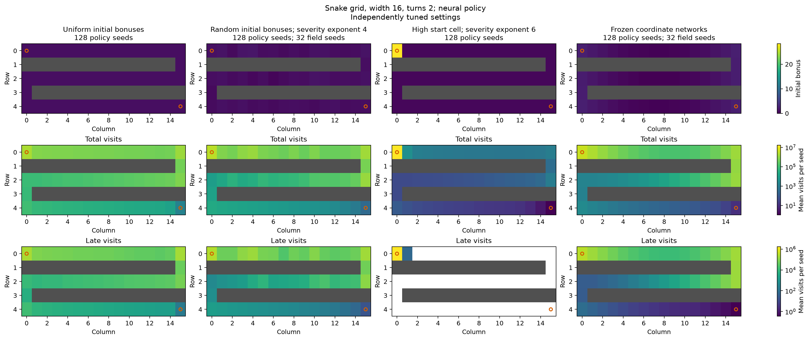

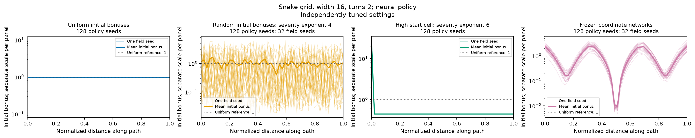

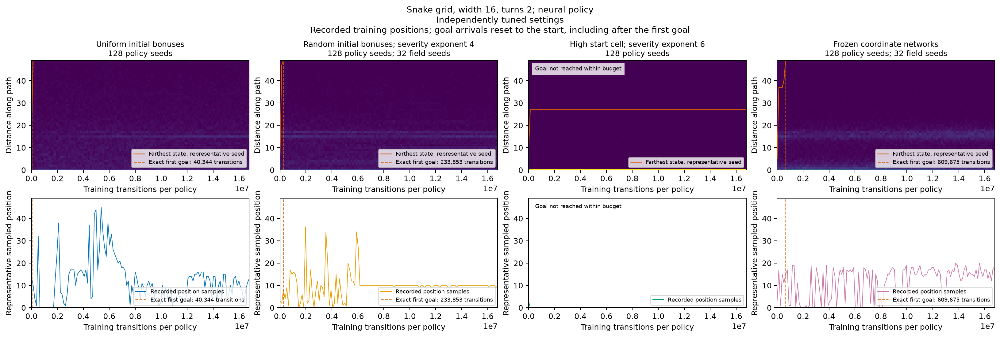

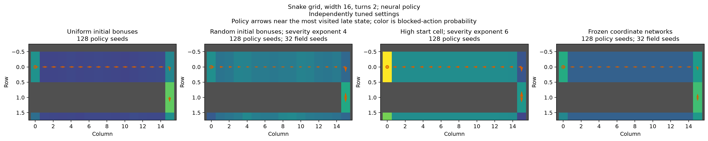

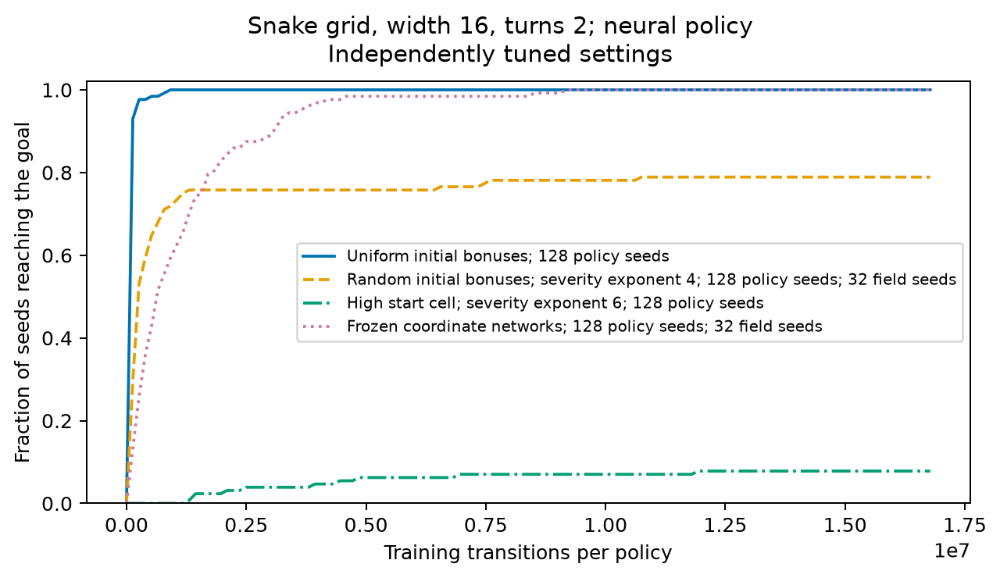

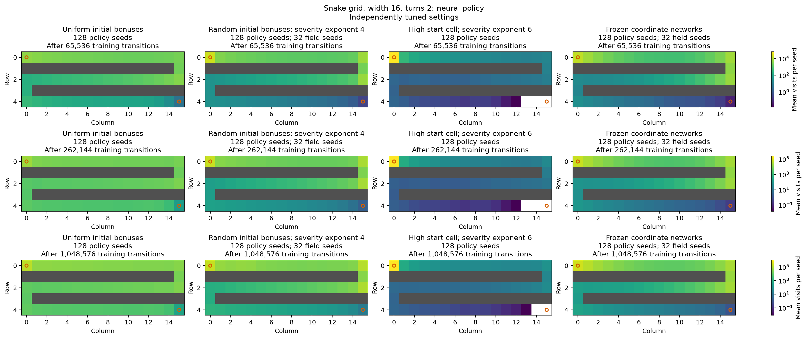

Mean visits per seed after 65,536, 262,144, 1,048,576 training transitions. Every displayed condition and seed uses the same recorded budgets; each row has a shared color scale. White cells have zero visits and dark cells are walls.

Initial-profile panels use separate vertical scales so neural-field variation remains visible. Movement panels share the full zero-to-goal range; exact first-goal markers use saved transition counts. Goal arrivals reset to the start, including after the first goal.

[Play the recorded training-position samples](plots/long-confirmation_comparison-0_sampled_positions.html). Intermediate actions are not shown.

- Uniform initial bonuses: policy seed 10055, field seed 2513.
- Random initial bonuses; severity exponent 4: policy seed 10082, field seed 2520.
- High start cell; severity exponent 6: policy seed 10000, field seed 2500.
- Frozen coordinate networks: policy seed 10022, field seed 2505.

### Snake grid, width 16, turns 2; neural policy; Shared settings

- Uniform initial bonuses; 128 policy seeds.
- Random initial bonuses; severity exponent 4; 128 policy seeds; 32 field seeds.
- High start cell; severity exponent 6; 128 policy seeds.
- Frozen coordinate networks; 128 policy seeds; 32 field seeds.

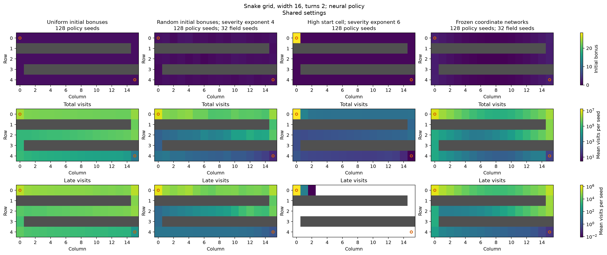

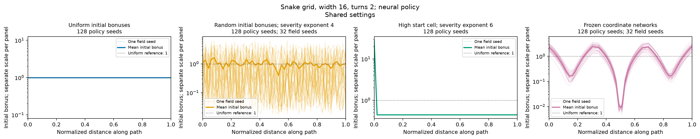

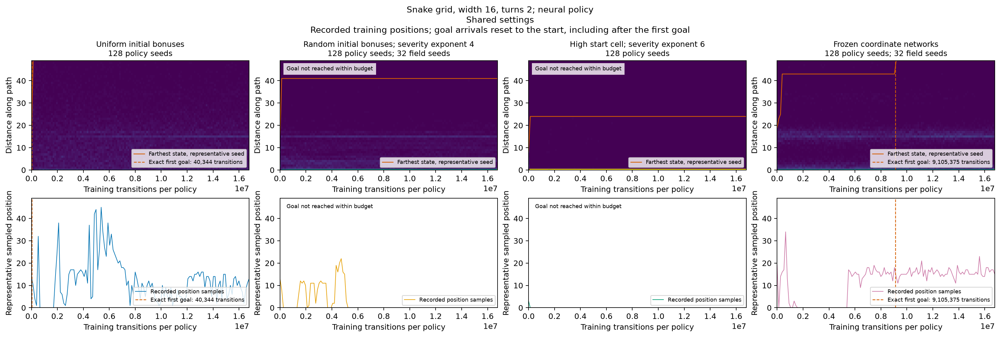

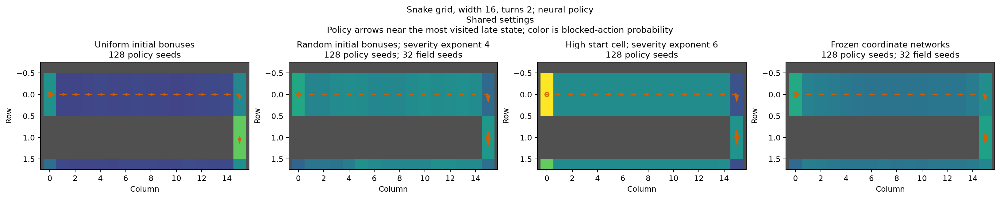

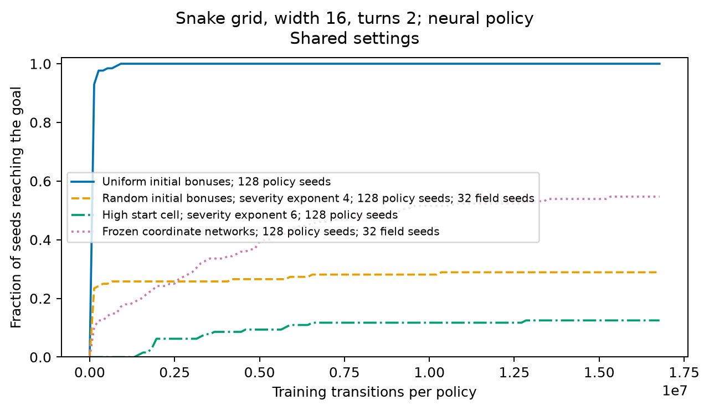

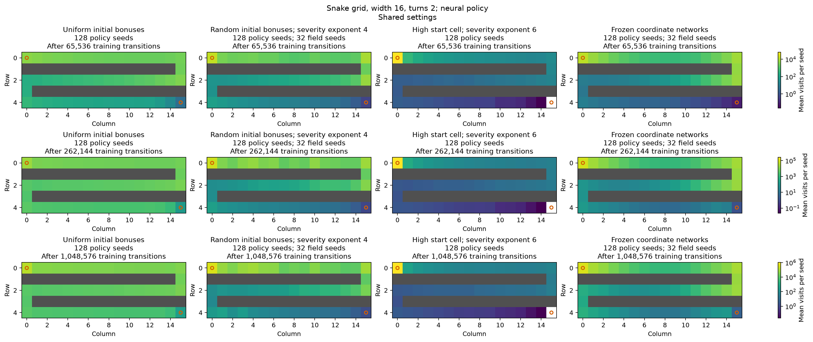

Mean visits per seed after 65,536, 262,144, 1,048,576 training transitions. Every displayed condition and seed uses the same recorded budgets; each row has a shared color scale. White cells have zero visits and dark cells are walls.

Initial-profile panels use separate vertical scales so neural-field variation remains visible. Movement panels share the full zero-to-goal range; exact first-goal markers use saved transition counts. Goal arrivals reset to the start, including after the first goal.

[Play the recorded training-position samples](plots/long-confirmation_comparison-1_sampled_positions.html). Intermediate actions are not shown.

- Uniform initial bonuses: policy seed 10055, field seed 2513.
- Random initial bonuses; severity exponent 4: policy seed 10002, field seed 2500.
- High start cell; severity exponent 6: policy seed 10000, field seed 2500.
- Frozen coordinate networks: policy seed 10076, field seed 2519.

### Snake grid, width 16, turns 2; tabular policy; Independently tuned settings

- Uniform initial bonuses; 128 policy seeds.
- Random initial bonuses; severity exponent 4; 128 policy seeds; 32 field seeds.
- High start region; severity exponent 6; 128 policy seeds.
- Frozen coordinate networks; 128 policy seeds; 32 field seeds.

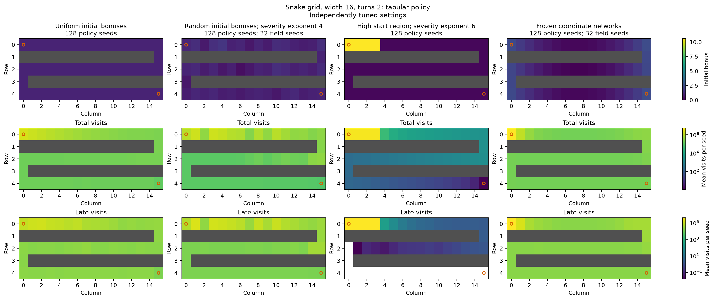

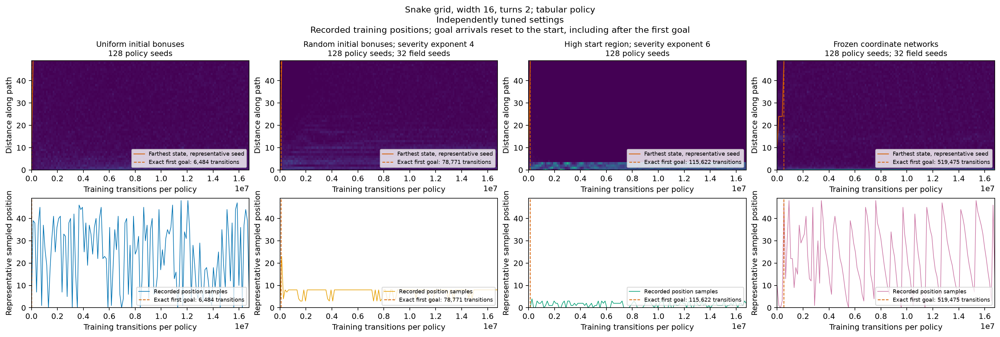

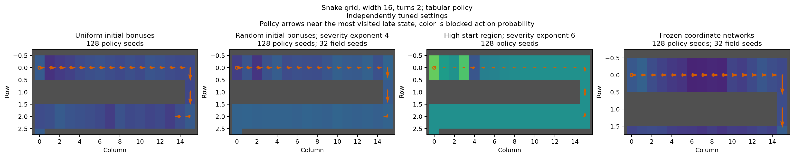

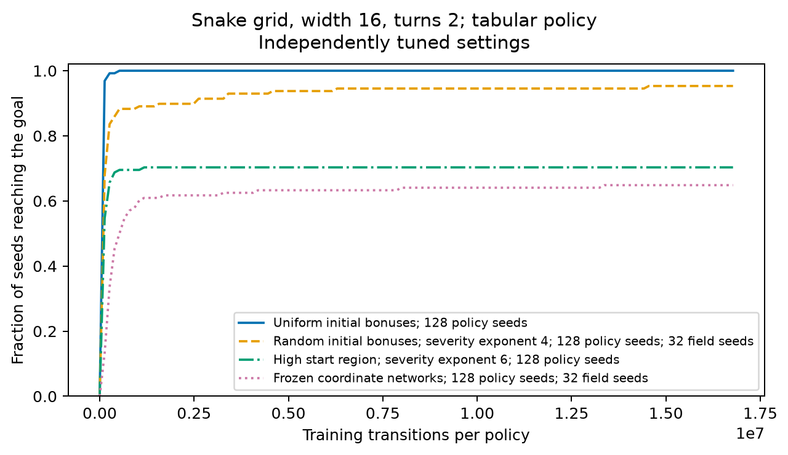

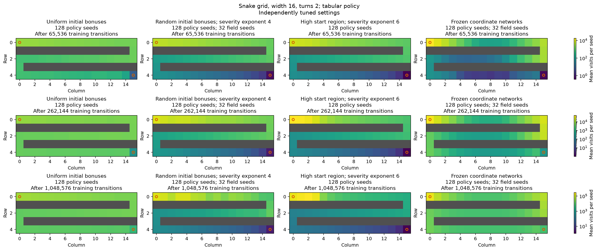

Mean visits per seed after 65,536, 262,144, 1,048,576 training transitions. Every displayed condition and seed uses the same recorded budgets; each row has a shared color scale. White cells have zero visits and dark cells are walls.

Initial-profile panels use separate vertical scales so neural-field variation remains visible. Movement panels share the full zero-to-goal range; exact first-goal markers use saved transition counts. Goal arrivals reset to the start, including after the first goal.

[Play the recorded training-position samples](plots/long-confirmation_comparison-2_sampled_positions.html). Intermediate actions are not shown.

- Uniform initial bonuses: policy seed 10067, field seed 2516.
- Random initial bonuses; severity exponent 4: policy seed 10026, field seed 2506.
- High start region; severity exponent 6: policy seed 10038, field seed 2509.
- Frozen coordinate networks: policy seed 10039, field seed 2509.

### Snake grid, width 16, turns 2; tabular policy; Shared settings

- Uniform initial bonuses; 128 policy seeds.
- Random initial bonuses; severity exponent 4; 128 policy seeds; 32 field seeds.
- High start region; severity exponent 6; 128 policy seeds.
- Frozen coordinate networks; 128 policy seeds; 32 field seeds.

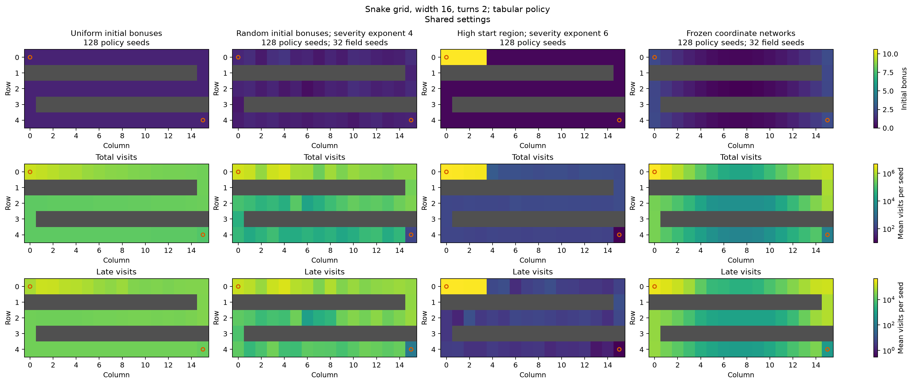

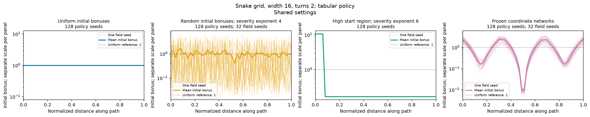

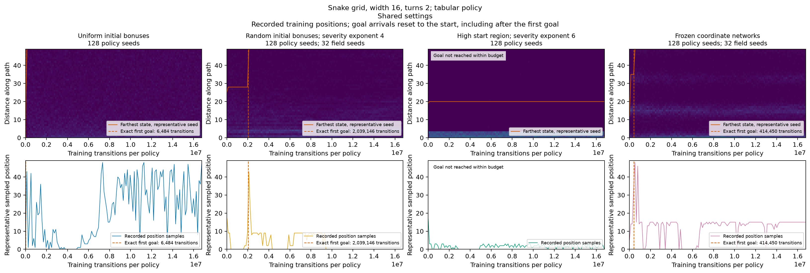

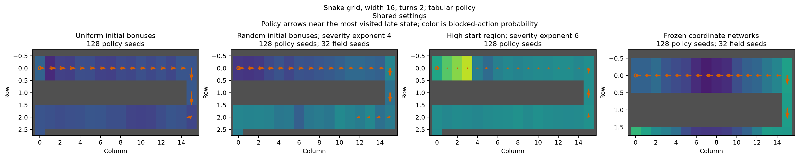

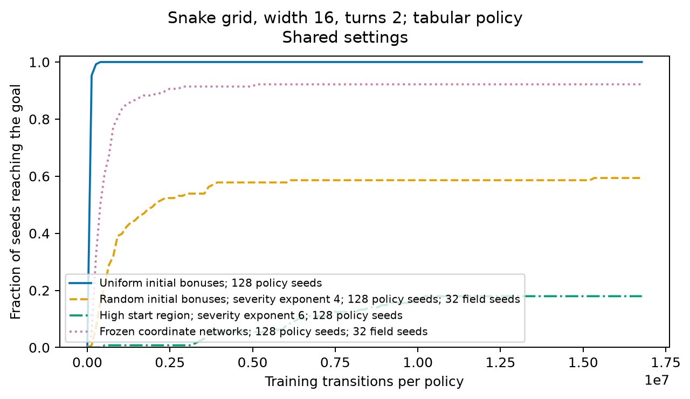

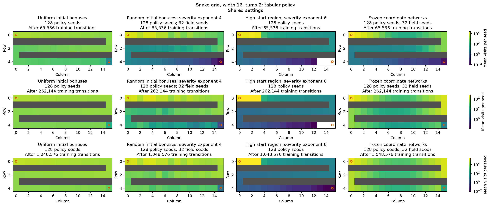

Mean visits per seed after 65,536, 262,144, 1,048,576 training transitions. Every displayed condition and seed uses the same recorded budgets; each row has a shared color scale. White cells have zero visits and dark cells are walls.

Initial-profile panels use separate vertical scales so neural-field variation remains visible. Movement panels share the full zero-to-goal range; exact first-goal markers use saved transition counts. Goal arrivals reset to the start, including after the first goal.

[Play the recorded training-position samples](plots/long-confirmation_comparison-3_sampled_positions.html). Intermediate actions are not shown.

- Uniform initial bonuses: policy seed 10067, field seed 2516.
- Random initial bonuses; severity exponent 4: policy seed 10107, field seed 2526.
- High start region; severity exponent 6: policy seed 10000, field seed 2500.
- Frozen coordinate networks: policy seed 10010, field seed 2502.

### Straight grid, width 32, turns 0; neural policy; Independently tuned settings

- Uniform initial bonuses; 128 policy seeds.
- Random initial bonuses; severity exponent 4; 128 policy seeds; 32 field seeds.
- High start cell; severity exponent 8; 128 policy seeds.
- Frozen coordinate networks; 128 policy seeds; 32 field seeds.

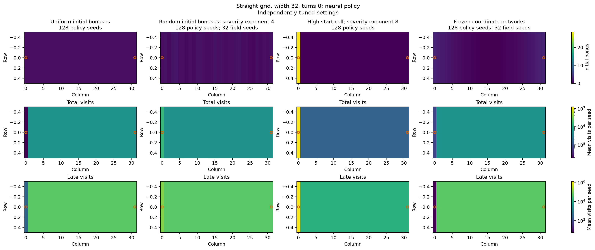

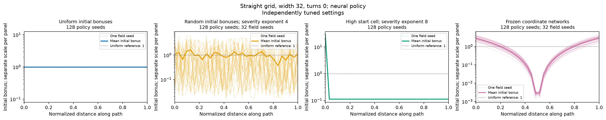

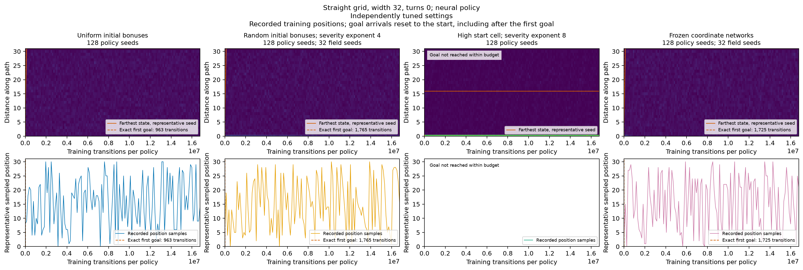

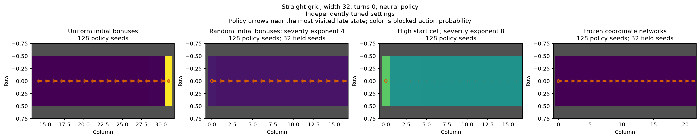

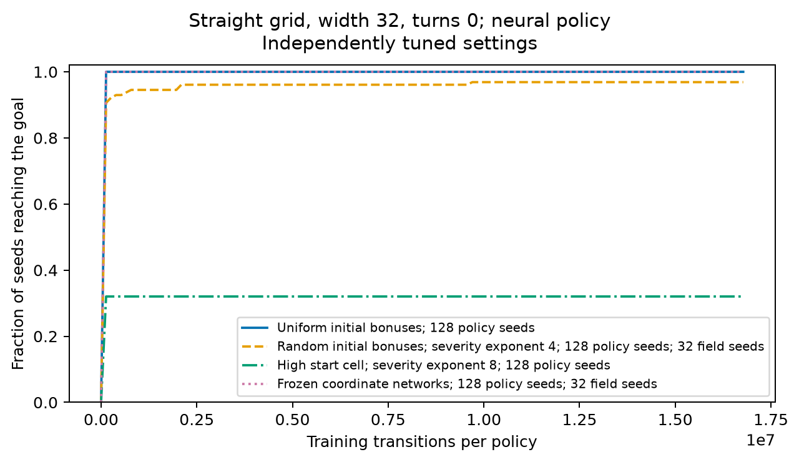

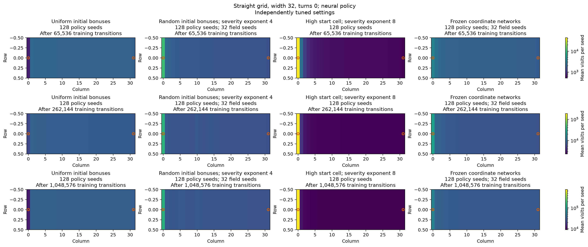

Mean visits per seed after 65,536, 262,144, 1,048,576 training transitions. Every displayed condition and seed uses the same recorded budgets; each row has a shared color scale. White cells have zero visits and dark cells are walls.

Initial-profile panels use separate vertical scales so neural-field variation remains visible. Movement panels share the full zero-to-goal range; exact first-goal markers use saved transition counts. Goal arrivals reset to the start, including after the first goal.

[Play the recorded training-position samples](plots/long-confirmation_comparison-4_sampled_positions.html). Intermediate actions are not shown.

- Uniform initial bonuses: policy seed 10040, field seed 2510.
- Random initial bonuses; severity exponent 4: policy seed 10065, field seed 2516.
- High start cell; severity exponent 8: policy seed 10000, field seed 2500.
- Frozen coordinate networks: policy seed 10020, field seed 2505.

### Straight grid, width 32, turns 0; neural policy; Shared settings

- Uniform initial bonuses; 128 policy seeds.
- Random initial bonuses; severity exponent 4; 128 policy seeds; 32 field seeds.
- High start cell; severity exponent 8; 128 policy seeds.
- Frozen coordinate networks; 128 policy seeds; 32 field seeds.

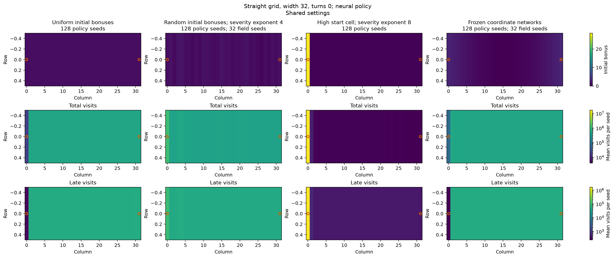

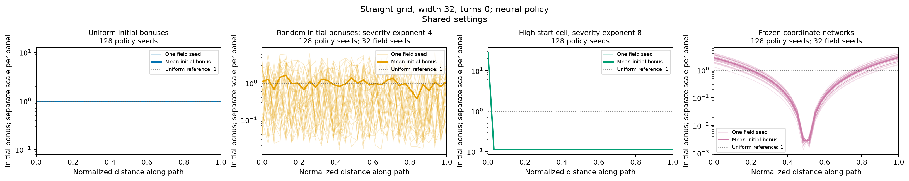

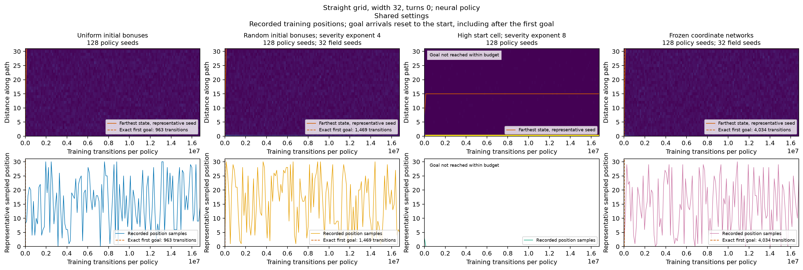

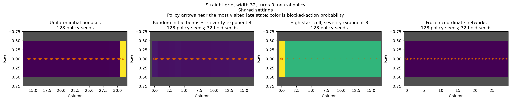

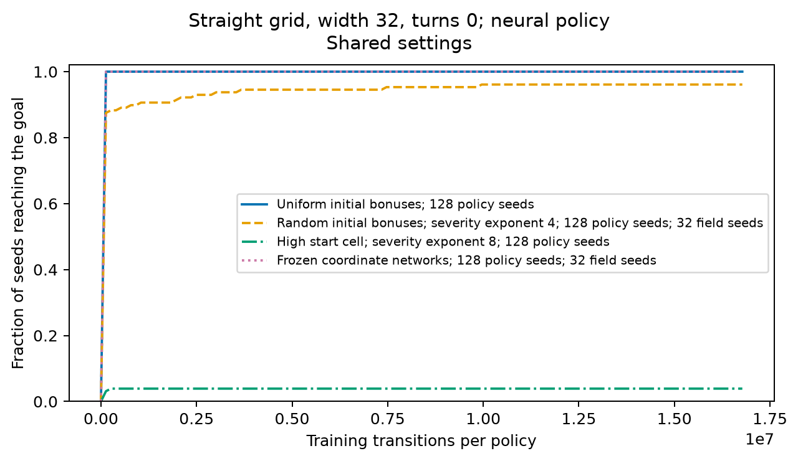

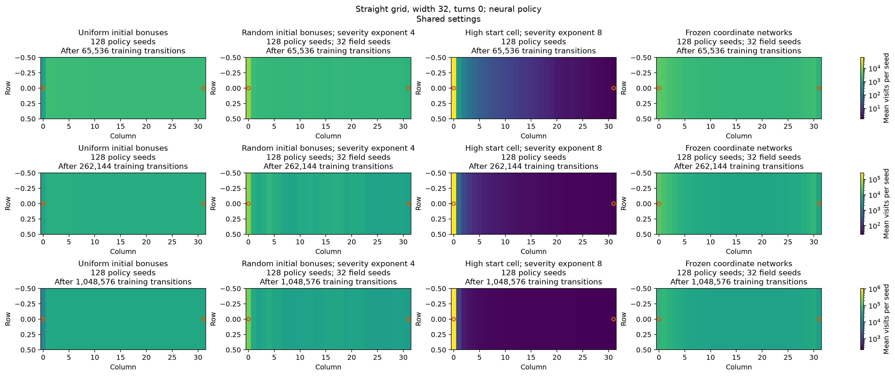

Mean visits per seed after 65,536, 262,144, 1,048,576 training transitions. Every displayed condition and seed uses the same recorded budgets; each row has a shared color scale. White cells have zero visits and dark cells are walls.

Initial-profile panels use separate vertical scales so neural-field variation remains visible. Movement panels share the full zero-to-goal range; exact first-goal markers use saved transition counts. Goal arrivals reset to the start, including after the first goal.

[Play the recorded training-position samples](plots/long-confirmation_comparison-5_sampled_positions.html). Intermediate actions are not shown.

- Uniform initial bonuses: policy seed 10040, field seed 2510.
- Random initial bonuses; severity exponent 4: policy seed 10016, field seed 2504.
- High start cell; severity exponent 8: policy seed 10000, field seed 2500.
- Frozen coordinate networks: policy seed 10022, field seed 2505.

### Straight grid, width 32, turns 0; tabular policy; Independently tuned settings

- Uniform initial bonuses; 128 policy seeds.
- Random initial bonuses; severity exponent 4; 128 policy seeds; 32 field seeds.
- High start region; severity exponent 8; 128 policy seeds.
- Frozen coordinate networks; 128 policy seeds; 32 field seeds.

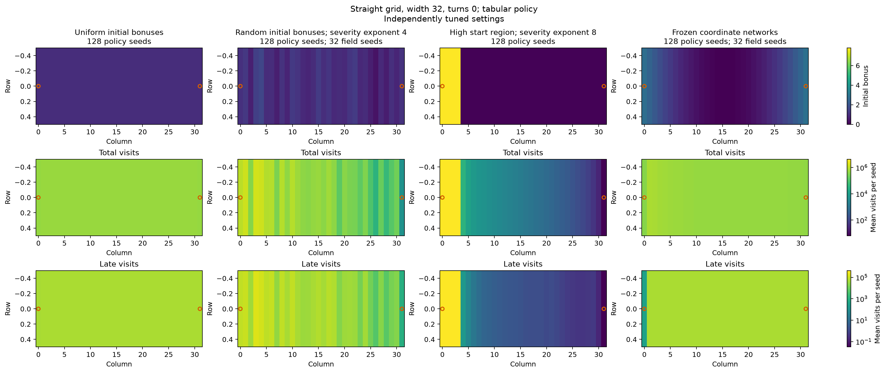

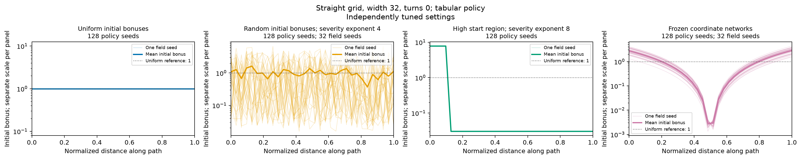

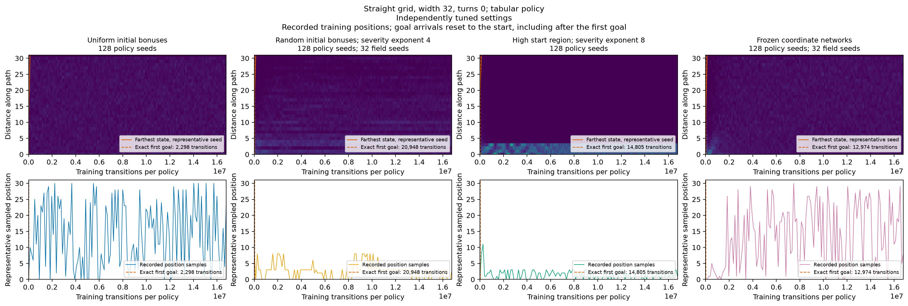

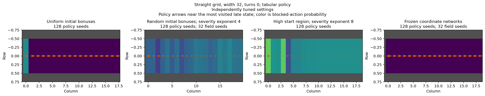

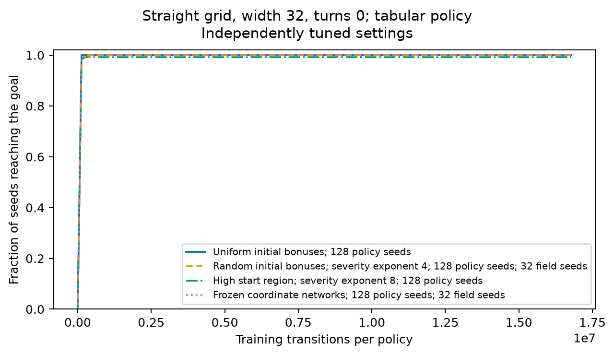

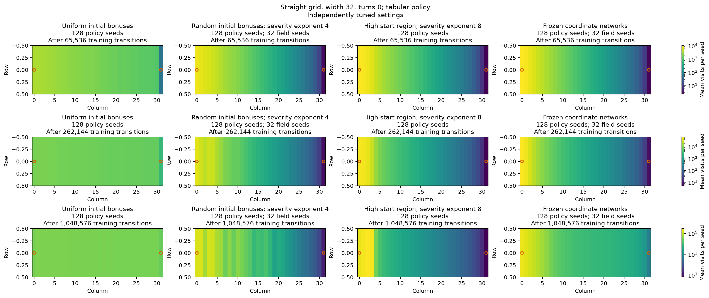

Mean visits per seed after 65,536, 262,144, 1,048,576 training transitions. Every displayed condition and seed uses the same recorded budgets; each row has a shared color scale. White cells have zero visits and dark cells are walls.

Initial-profile panels use separate vertical scales so neural-field variation remains visible. Movement panels share the full zero-to-goal range; exact first-goal markers use saved transition counts. Goal arrivals reset to the start, including after the first goal.

[Play the recorded training-position samples](plots/long-confirmation_comparison-6_sampled_positions.html). Intermediate actions are not shown.

- Uniform initial bonuses: policy seed 10011, field seed 2502.
- Random initial bonuses; severity exponent 4: policy seed 10005, field seed 2501.
- High start region; severity exponent 8: policy seed 10036, field seed 2509.
- Frozen coordinate networks: policy seed 10017, field seed 2504.

### Straight grid, width 32, turns 0; tabular policy; Shared settings

- Uniform initial bonuses; 128 policy seeds.
- Random initial bonuses; severity exponent 4; 128 policy seeds; 32 field seeds.
- High start region; severity exponent 8; 128 policy seeds.
- Frozen coordinate networks; 128 policy seeds; 32 field seeds.

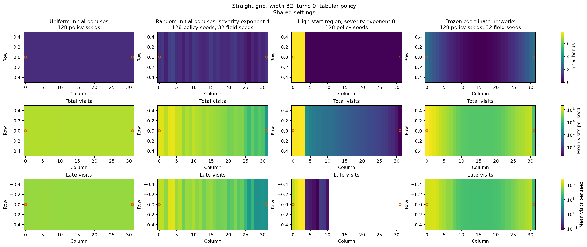

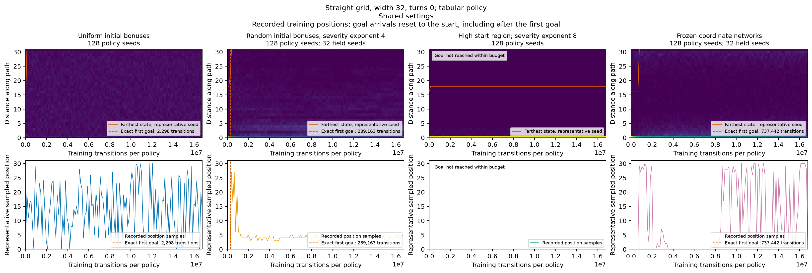

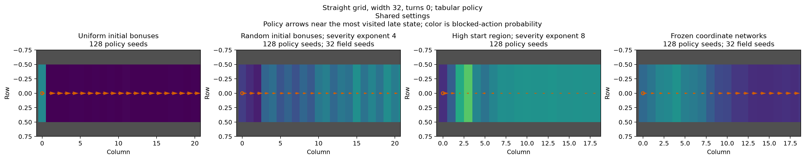

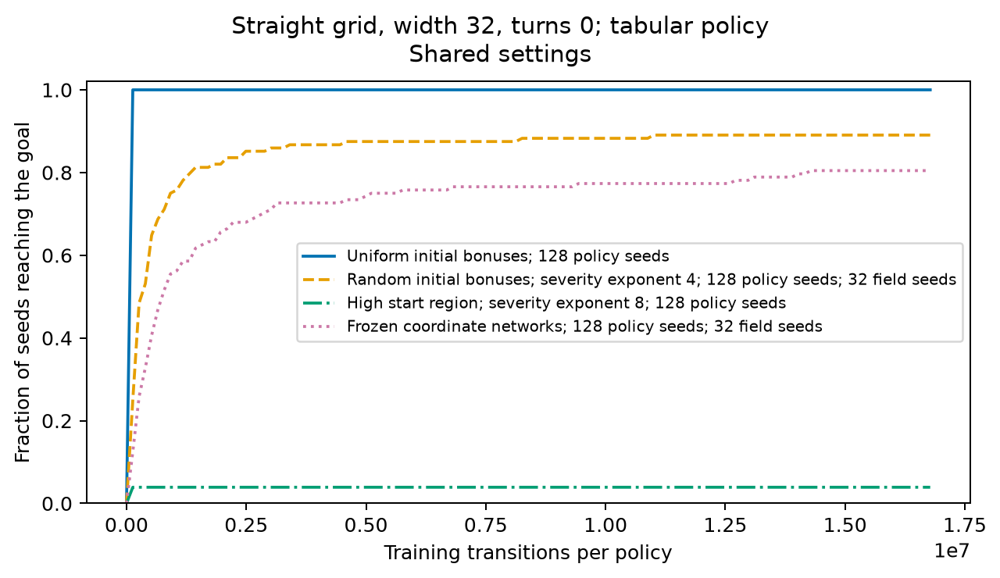

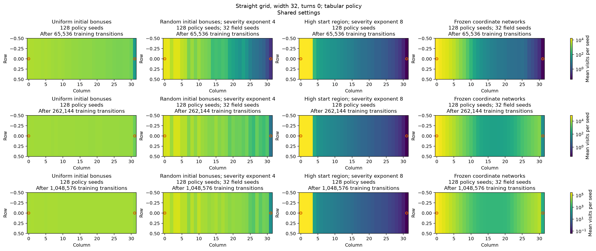

Mean visits per seed after 65,536, 262,144, 1,048,576 training transitions. Every displayed condition and seed uses the same recorded budgets; each row has a shared color scale. White cells have zero visits and dark cells are walls.

Initial-profile panels use separate vertical scales so neural-field variation remains visible. Movement panels share the full zero-to-goal range; exact first-goal markers use saved transition counts. Goal arrivals reset to the start, including after the first goal.

[Play the recorded training-position samples](plots/long-confirmation_comparison-7_sampled_positions.html). Intermediate actions are not shown.

- Uniform initial bonuses: policy seed 10011, field seed 2502.
- Random initial bonuses; severity exponent 4: policy seed 10072, field seed 2518.
- High start region; severity exponent 8: policy seed 10000, field seed 2500.
- Frozen coordinate networks: policy seed 10000, field seed 2500.

## Repeatability of tabular training

Across 2 duplicate-seed tests, initial parameters, action keys, minibatch permutations, and initial rollout actions were identical. No random-key difference was observed.

Maximum absolute differences were 1.19e-07 for a fixed-minibatch gradient and 1.19e-07 for simultaneous additions to repeated state rows. Unique-state-row gradients and ordered state additions matched bit for bit in 20/20 evaluations in every test.

Parameter differences first appeared after update 1; action differences first appeared at transitions 5,777, 88,790. Visit-count differences followed action differences. Recorded-action capture matched production training counts; counts remain exact for the recorded actions. The probe stopped without observing a first-goal-time difference.

The evidence supports repeated floating-point additions as one source of variation. JAX documents that overlapping indexed updates can be applied in a hardware-dependent order. The primary training code remains frozen.

[Completed repeatability probe](../data/repeatability/duplicate_tabular_policy_seeds.json); [JAX documentation on array updates](https://docs.jax.dev/en/latest/_autosummary/jax.numpy.ndarray.at.html).

## Records and visualization sources

[Every seed metric](data/seed_metrics.csv) is retained, including unselected development settings. Every task retains its complete seed arrays in `data/research/<task>/behavior.npz`.

The figure choices follow [visitation maps and action arrows](https://arxiv.org/pdf/2001.00119), [trajectory and coverage comparisons](https://proceedings.neurips.cc/paper_files/paper/2023/file/9c7900fac04a701cbed83256b76dbaa3-Paper-Conference.pdf), and [initial random-network bonus maps](https://proceedings.mlr.press/v235/yang24w.html).
