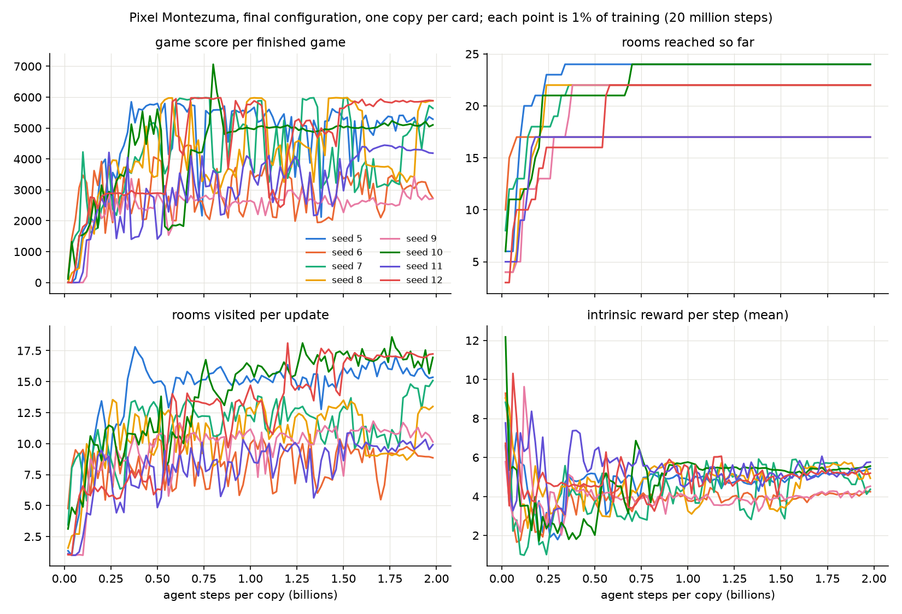

# Pixel Montezuma final training: seeds 5 to 12 (one copy per card)

Times are Pacific, converted from machines running Eastern. Every seed trained 122,070 updates of 16,384 agent steps (128 games x 128 steps), 2,000,015,360 agent steps (8.0 billion frames) per copy, on the corrected game (room geometry from the sprite pack's images, episode limit 27,000 agent steps). Seeds 1 to 4 (four copies on the H100 NVL, serval02 card 1) are still training.

## Completion

| seed | cards, in order | resumed at update | finished |
|---|---|---|---|
| 5 | RTX A4500 (jaguar03, job 6832260) | not resumed | 2026-11-08 01:40 PT |
| 6 | RTX A4500 (jaguar03, job 6832261) | not resumed | 2026-11-08 01:38 PT |
| 7 | RTX A4500 (jaguar03, job 6832262) then RTX 5080 (nekomata01, job 6837934) | 105,521 | 2026-11-08 01:54 PT |
| 8 | RTX A4500 (jaguar03, job 6832263) then RTX 5080 (nekomata01, job 6837935) | 104,406 | 2026-11-08 02:19 PT |
| 9 | RTX A4500 (jaguar03, job 6832264) | not resumed | 2026-11-08 01:19 PT |
| 10 | RTX A4500 (jaguar03, job 6832265) then RTX 5080 (nekomata02, job 6837936) | 104,114 | 2026-11-08 02:28 PT |
| 11 | RTX A4500 (jaguar03, job 6832266) | not resumed | 2026-11-08 01:06 PT |
| 12 | RTX A4500 (jaguar03, job 6832267) then RTX 5080 (nekomata02, job 6837937) | 104,209 | 2026-11-08 02:30 PT |

Each seed's record has exactly 122,070 metric lines, the progress record says completed and the last event is "completed". Seeds 7, 8, 10 and 12 lost the updates after their 19:48 PT checkpoint when they were paused on 2026-11-07 (the trainer cut the metric record back to the checkpoint on resume, so the record has no repeated updates).

## Learning

Game score per finished game in a window $W$ of updates:
$$S(W) = \dfrac{\sum_{u \in W} R_u}{\sum_{u \in W} N_u},$$
where $R_u$ is the sum of the game scores of the games that ended during update $u$ (any of the 128 games of the copy) and $N_u$ the number of those games. Windows are 1,221 updates (1% of training, about 20 million agent steps).

| seed | score per game, last 1% | best 1% window | games ended per update, last 1% | rooms visited per update, last 1% | rooms reached in training |
|---|---|---|---|---|---|
| 5 | 5,246 | 5,849 | 1.4 | 15.4 | 24 |
| 6 | 2,594 | 4,445 | 1.6 | 8.9 | 17 |
| 7 | 5,750 | 5,984 | 2.3 | 15.0 | 22 |
| 8 | 5,828 | 5,986 | 1.8 | 12.7 | 22 |
| 9 | 2,653 | 3,432 | 1.8 | 10.2 | 22 |
| 10 | 5,093 | 7,064 | 1.6 | 15.8 | 24 |
| 11 | 4,098 | 4,447 | 1.2 | 10.1 | 17 |
| 12 | 5,862 | 5,980 | 1.9 | 17.2 | 22 |

Across the 8 seeds the last-1% score per game has median 5,169 (lowest 2,594, highest 5,862).

## Rooms

Rooms are JAXtari's room numbers 0 to 32 (the game starts in room 4). A room counts as visited in an update when any of the copy's 128 games was in it at any step of that update. Each cell is the update at which the seed first visited the room (blank: never).

| room | seed 5 | seed 6 | seed 7 | seed 8 | seed 9 | seed 10 | seed 11 | seed 12 |
|---|---|---|---|---|---|---|---|---|
| 3 | 149 | 4 | 157 | 5 | 3,842 | 257 | 180 | 466 |
| 4 | 1 | 1 | 1 | 1 | 1 | 1 | 1 | 1 |
| 5 | 150 | 142 | 139 | 171 | 162 | 170 | 136 | 1 |
| 10 | 6,882 | 404 | 19,324 | 9,407 | 16,222 | 41,473 | 5,661 | 14,616 |
| 11 | 6,878 | 401 | 16,674 | 9,355 | 16,210 | 12,648 | 5,568 | 11,969 |
| 12 | 373 | 663 | 781 | 4,061 | 6,776 | 473 | 6,035 | 2,961 |
| 13 | 206 | 1,324 | 341 | 1,218 | 233 | 454 | 328 | 2,945 |
| 14 | 207 | 4,296 | 352 | 4,189 | 277 | 454 | 328 | 3,069 |
| 17 | 20,264 | 435 | 20,803 | 11,926 | 22,307 | 42,716 | 8,325 | 33,440 |
| 18 | 7,021 | 405 | 19,446 | 10,064 | 16,223 | 41,656 | 7,400 | 14,651 |
| 19 | 5,579 | 403 | 8,034 | 9,382 | 16,210 | 12,599 | 5,568 | 11,970 |
| 20 | 5,527 | 626 | 4,538 | 12,675 | 12,090 | 8,567 | 8,434 | 33,663 |
| 21 | 4,629 | 2,358 | 1,695 | 6,022 | 7,090 | 6,609 | 8,655 | 3,891 |
| 22 | 4,510 |  | 664 | 5,825 | 6,998 | 1,382 |  | 3,657 |
| 23 | 4,557 |  | 1,743 | 5,874 | 7,239 | 1,867 |  | 9,481 |
| 24 | 14,152 |  |  |  |  | 12,785 |  |  |
| 25 | 14,152 |  |  |  |  | 12,778 |  |  |
| 26 | 10,454 | 2,566 | 9,594 | 14,144 | 22,304 | 12,764 | 10,085 | 34,247 |
| 27 | 5,873 | 1,682 | 8,063 | 13,446 | 21,953 | 11,730 | 8,621 | 33,692 |
| 28 | 5,854 | 1,655 | 8,062 | 13,446 | 21,951 | 10,736 | 8,556 | 33,682 |
| 29 | 5,855 | 1,685 | 8,069 | 14,313 | 22,498 | 10,750 | 9,334 | 33,691 |
| 30 | 4,511 |  | 665 | 5,825 | 6,998 | 1,383 |  | 3,657 |
| 31 | 4,642 |  | 1,625 | 5,882 | 7,157 | 1,383 |  | 3,708 |
| 32 | 4,856 |  | 1,727 | 5,965 | 7,254 | 1,873 |  | 11,072 |

## Speed

Seconds per update are the median gaps between consecutive metric lines of each training segment (the first update after a start or resume is left out); the range runs over the seeds in the row. Hours per million steps per copy are $\dfrac{10^{6}}{3600 \times r}$, where $r$ is the agent steps per second one copy gets. One copy per card, so the total and the per-copy rate are equal.

| card and phase | seeds | copies | seconds per iteration | total steps per second (millions) | steps per second per copy (thousands) | hours per million steps per copy |
|---|---|---|---|---|---|---|
| RTX 5080, nekomata01, 2 cards training | 7, 8 | 1 | 1.23 to 1.24 | 0.0133 to 0.0133 | 13.3 to 13.3 | 0.0209 to 0.0209 |
| RTX 5080, nekomata02, 2 cards training | 10, 12 | 1 | 1.25 to 1.26 | 0.0130 to 0.0131 | 13.0 to 13.1 | 0.0211 to 0.0214 |
| RTX A4500, jaguar03, 4 cards training | 5, 6, 9, 11 | 1 | 1.35 to 1.38 | 0.0119 to 0.0121 | 11.9 to 12.1 | 0.0229 to 0.0234 |
| RTX A4500, jaguar03, all 8 cards training | 5, 6, 7, 8, 9, 10, 11, 12 | 1 | 1.37 to 1.44 | 0.0114 to 0.0120 | 11.4 to 12.0 | 0.0232 to 0.0244 |

The RTX A4500 rows before and after 19:57 PT on 2026-11-07 differ in how many of jaguar03's cards were training at once; the RTX 5080 rows are the last 16,000 to 18,000 updates of seeds 7, 8, 10 and 12.
