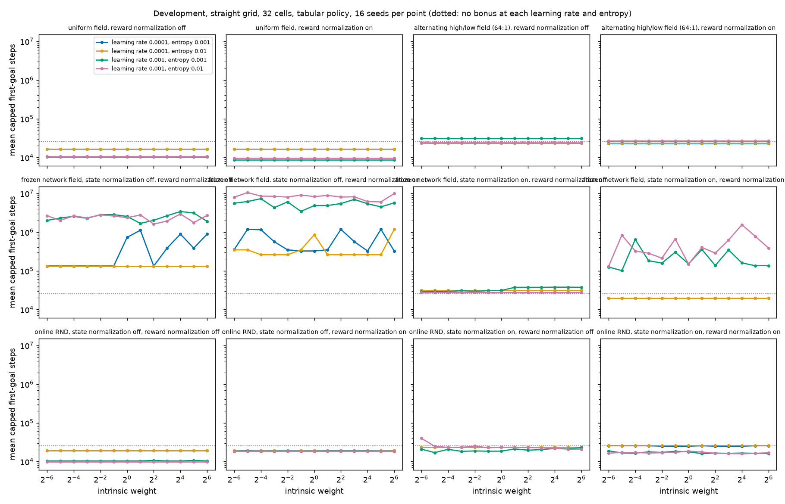
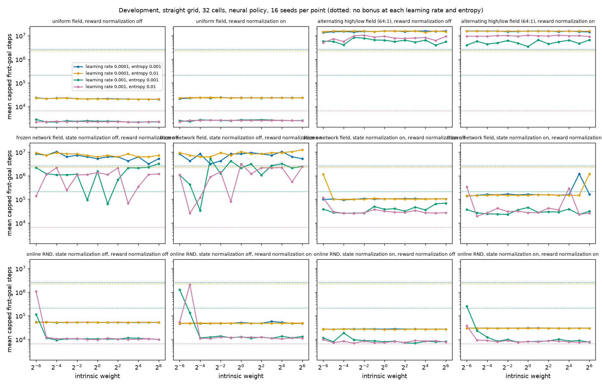
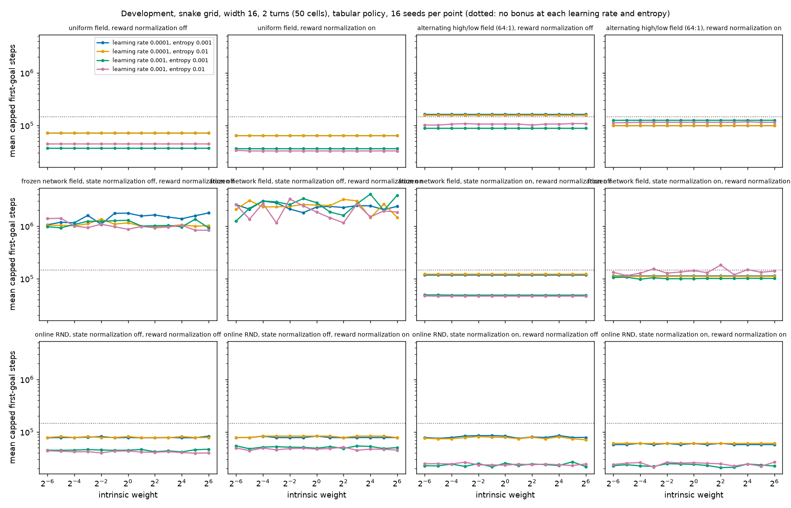
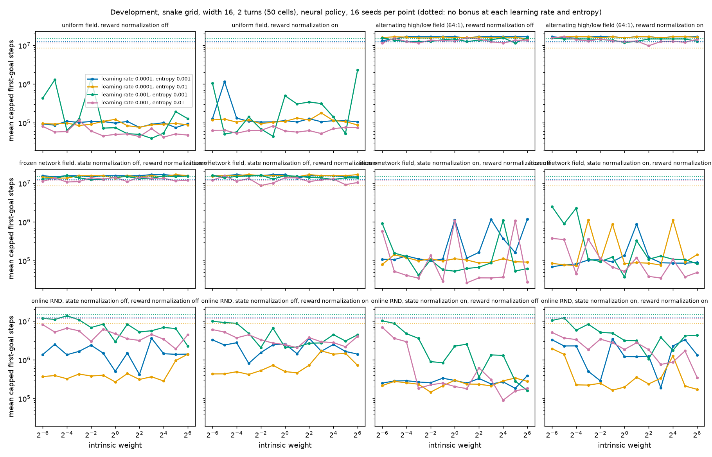
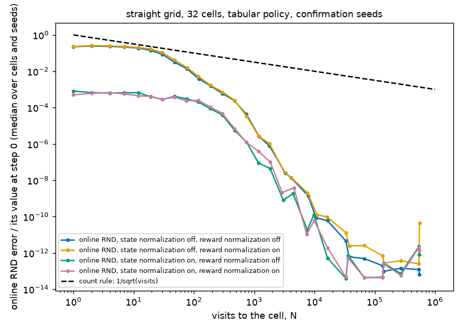
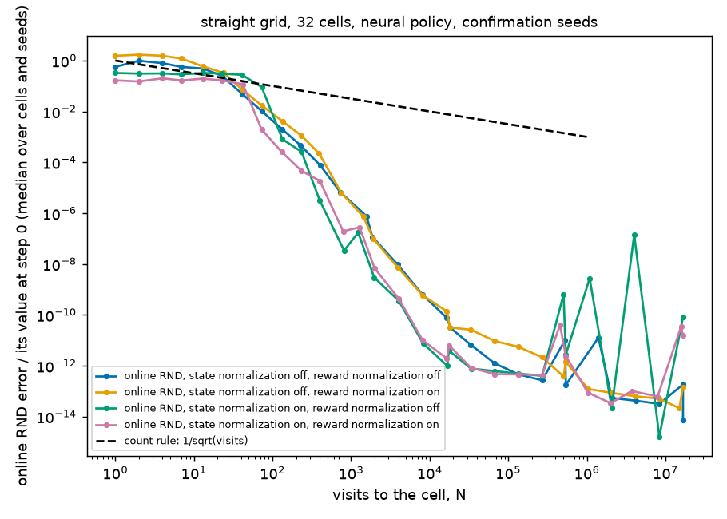
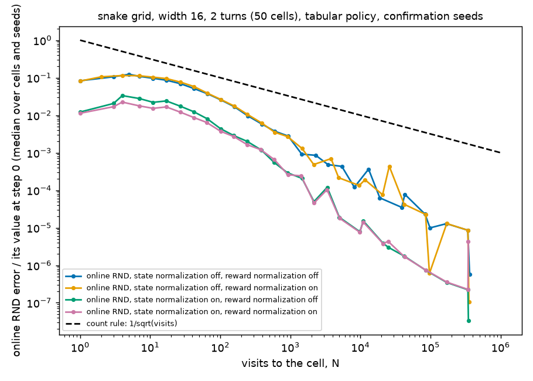
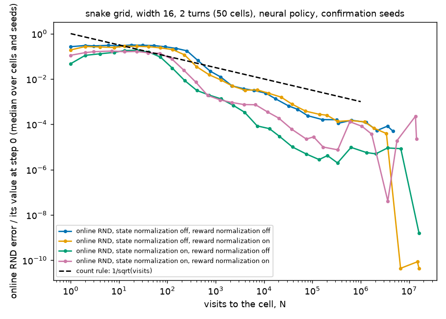

# Fixed CleanRL PPO-RND settings on the straight and snake grids

Generated 2026-11-09 03:03 PT (times are Pacific, converted from machines running Eastern). Phase: complete. Finished settings: 2609.

## Contents

| Section | First written | Last changed | Status |
|---|---|---|---|
| [Metrics](#metrics) | 2026-11-07 21:49 PT | 2026-11-07 21:49 PT | unread |
| [Settings](#settings) | 2026-11-07 21:49 PT | 2026-11-07 21:49 PT | unread |
| [Confirmation, chosen configuration of each condition](#confirmation-chosen-configuration-of-each-condition) | 2026-11-07 21:49 PT | 2026-11-09 03:00 PT | unread |
| [Confirmation, learning rate 1e-4, entropy 0.001, best intrinsic weight](#confirmation-learning-rate-1e-4-entropy-0-001-best-intrinsic-weight) | 2026-11-07 21:49 PT | 2026-11-09 03:00 PT | unread |
| [Development](#development) | 2026-11-07 21:49 PT | 2026-11-09 03:00 PT | unread |
| [Decay: online RND against the count rule](#decay-online-rnd-against-the-count-rule) | 2026-11-07 21:49 PT | 2026-11-09 02:52 PT | unread |
| [Records](#records) | 2026-11-07 21:49 PT | 2026-11-09 03:03 PT | unread |

[Read with section colors](analysis.html). No section marks itself read.

## Metrics

Define $K$ as the number of policies of a configuration, $T_i$ as the training transition at which policy $i$ first arrives at the goal cell, and $B = 16{,}777{,}216$ as the budget. Configurations are chosen by the mean capped first-goal time $M(B) = \dfrac{1}{K} \sum_{i=1}^{K} \min(T_i, B)$, with ties broken by the goal discovery rate $F(B) = \dfrac{1}{K} \sum_{i=1}^{K} \mathbf{1}[T_i \le B]$. Coverage is the fraction of path cells reached in training by $B$. The final-policy goal rate is the fraction of 32 evaluation episodes (actions sampled from the final policy, no learning) that reach the goal; the greedy column uses one episode with the most likely action. Intervals are 95% bootstrap intervals; network conditions resample field seeds (four policies share a field), the others resample policy seeds.

## Settings

All conditions use CleanRL PPO-RND's scalar settings: rollout 128, 4 epochs, 4 minibatches, extrinsic discount 0.999, intrinsic discount 0.99, GAE 0.95, clip 0.1, value coefficient 0.5, maximum gradient norm 0.5, Adam epsilon 1e-5, extrinsic advantage weight 2, linear learning-rate annealing. Swept per condition: learning rate {1e-4, 1e-3} × entropy {0.001, 0.01} × intrinsic weight 2^-6 … 2^6 (13 values). Count-based fields are scaled to average 1 over cells and divided by √visits; online RND uses the raw CleanRL prediction error (half the summed squared error of 512 features). State normalization whitens the RND networks' input coordinates with running statistics, started by 50 random-action rollouts of 128 steps; reward normalization divides the bonus by the running standard deviation of its discounted sum. Development: 16 seeds per configuration; confirmation: 128 fresh seeds (20000-20127).

## Confirmation, chosen configuration of each condition

### straight grid, 32 cells, tabular policy

| condition | mean capped first-goal steps ↓ [95%] | goal found | coverage | final-policy goal rate, sampled | greedy | configuration | seeds |
|---|---|---|---|---|---|---|---|
| uniform field, reward normalization on | **8,110** [7,262, 9,011] | **100.0%** | **100.0%** | **100.0%** | **100.0%** | learning rate 0.001, entropy 0.001, weight 2^-6 | 128 |
| uniform field, reward normalization off | <u>8,585</u> [7,463, 9,912] | **100.0%** | **100.0%** | **100.0%** | **100.0%** | learning rate 0.001, entropy 0.001, weight 2^-6 | 128 |
| online RND, state normalization off, reward normalization off | 11,594 [9,992, 13,192] | **100.0%** | **100.0%** | **100.0%** | **100.0%** | learning rate 0.001, entropy 0.01, weight 2^3 | 128 |
| online RND, state normalization off, reward normalization on | 13,857 [11,938, 15,606] | **100.0%** | **100.0%** | **100.0%** | **100.0%** | learning rate 0.001, entropy 0.01, weight 2^-3 | 128 |
| online RND, state normalization on, reward normalization on | 15,673 [13,739, 17,348] | **100.0%** | **100.0%** | **100.0%** | **100.0%** | learning rate 0.001, entropy 0.01, weight 2^4 | 128 |
| online RND, state normalization on, reward normalization off | 16,157 [13,980, 18,177] | **100.0%** | **100.0%** | **100.0%** | **100.0%** | learning rate 0.001, entropy 0.001, weight 2^-5 | 128 |
| alternating high/low field (64:1), reward normalization on | 16,996 [14,598, 19,509] | **100.0%** | **100.0%** | **100.0%** | **100.0%** | learning rate 0.0001, entropy 0.001, weight 2^-6 | 128 |
| alternating high/low field (64:1), reward normalization off | 17,079 [14,659, 19,534] | **100.0%** | **100.0%** | **100.0%** | **100.0%** | learning rate 0.0001, entropy 0.001, weight 2^-6 | 128 |
| no bonus | 21,468 [18,227, 25,093] | **100.0%** | **100.0%** | **100.0%** | **100.0%** | learning rate 0.0001, entropy 0.001, weight 2^0 | 128 |
| frozen network field, state normalization on, reward normalization on | 34,928 [19,925, 54,154] | **100.0%** | **100.0%** | <u>99.2%</u> | <u>99.2%</u> | learning rate 0.0001, entropy 0.001, weight 2^-6 | 128 |
| frozen network field, state normalization on, reward normalization off | 61,447 [39,514, 87,440] | **100.0%** | **100.0%** | **100.0%** | **100.0%** | learning rate 0.001, entropy 0.01, weight 2^-3 | 128 |
| frozen network field, state normalization off, reward normalization off | 425,874 [184,341, 731,428] | <u>99.2%</u> | <u>100.0%</u> | 93.9% | 93.0% | learning rate 0.0001, entropy 0.001, weight 2^-6 | 128 |
| frozen network field, state normalization off, reward normalization on | 878,398 [307,028, 1,557,814] | 96.9% | 99.9% | 18.0% | 17.2% | learning rate 0.0001, entropy 0.01, weight 2^-4 | 128 |

### straight grid, 32 cells, neural policy

| condition | mean capped first-goal steps ↓ [95%] | goal found | coverage | final-policy goal rate, sampled | greedy | configuration | seeds |
|---|---|---|---|---|---|---|---|
| uniform field, reward normalization off | **2,975** [2,628, 3,331] | **100.0%** | **100.0%** | **100.0%** | **100.0%** | learning rate 0.001, entropy 0.01, weight 2^4 | 128 |
| uniform field, reward normalization on | <u>3,143</u> [2,772, 3,518] | **100.0%** | **100.0%** | **100.0%** | **100.0%** | learning rate 0.001, entropy 0.01, weight 2^-6 | 128 |
| online RND, state normalization on, reward normalization on | 7,817 [7,148, 8,539] | **100.0%** | **100.0%** | 89.1% | 89.1% | learning rate 0.001, entropy 0.01, weight 2^5 | 128 |
| online RND, state normalization on, reward normalization off | 8,010 [7,108, 8,933] | **100.0%** | **100.0%** | <u>99.2%</u> | <u>99.2%</u> | learning rate 0.001, entropy 0.01, weight 2^-3 | 128 |
| online RND, state normalization off, reward normalization on | 10,832 [10,293, 11,473] | **100.0%** | **100.0%** | 94.5% | 94.5% | learning rate 0.001, entropy 0.01, weight 2^4 | 128 |
| online RND, state normalization off, reward normalization off | 161,002 [16,724, 436,690] | <u>99.2%</u> | <u>99.8%</u> | 98.4% | 98.4% | learning rate 0.001, entropy 0.001, weight 2^-4 | 128 |
| frozen network field, state normalization on, reward normalization off | 167,866 [25,945, 439,381] | <u>99.2%</u> | <u>99.8%</u> | 96.9% | 96.9% | learning rate 0.001, entropy 0.01, weight 2^-3 | 128 |
| frozen network field, state normalization on, reward normalization on | 170,585 [29,444, 442,828] | <u>99.2%</u> | 99.7% | 95.3% | 95.3% | learning rate 0.001, entropy 0.01, weight 2^-5 | 128 |
| no bonus | 572,443 [212,291, 1,110,380] | 97.7% | 99.7% | 96.9% | 96.9% | learning rate 0.001, entropy 0.01, weight 2^0 | 128 |
| frozen network field, state normalization off, reward normalization on | 873,766 [291,922, 1,642,664] | 95.3% | 99.1% | 85.2% | 85.2% | learning rate 0.001, entropy 0.01, weight 2^-5 | 128 |
| frozen network field, state normalization off, reward normalization off | 1,767,570 [1,000,405, 2,575,927] | 89.8% | 98.2% | 59.4% | 47.7% | learning rate 0.001, entropy 0.001, weight 2^1 | 128 |
| alternating high/low field (64:1), reward normalization off | 5,774,273 [4,588,128, 6,991,073] | 72.7% | 90.8% | 9.2% | 7.8% | learning rate 0.001, entropy 0.001, weight 2^5 | 128 |
| alternating high/low field (64:1), reward normalization on | 6,995,250 [5,710,347, 8,235,318] | 64.8% | 87.7% | 32.8% | 32.0% | learning rate 0.001, entropy 0.001, weight 2^0 | 128 |

### snake grid, width 16, 2 turns (50 cells), tabular policy

| condition | mean capped first-goal steps ↓ [95%] | goal found | coverage | final-policy goal rate, sampled | greedy | configuration | seeds |
|---|---|---|---|---|---|---|---|
| online RND, state normalization on, reward normalization on | **20,355** [18,085, 22,630] | **100.0%** | **100.0%** | **100.0%** | **100.0%** | learning rate 0.001, entropy 0.001, weight 2^2 | 128 |
| online RND, state normalization on, reward normalization off | <u>21,910</u> [19,098, 24,744] | **100.0%** | **100.0%** | **100.0%** | **100.0%** | learning rate 0.001, entropy 0.001, weight 2^-1 | 128 |
| uniform field, reward normalization on | 31,941 [26,041, 38,184] | **100.0%** | **100.0%** | **100.0%** | **100.0%** | learning rate 0.001, entropy 0.01, weight 2^3 | 128 |
| uniform field, reward normalization off | 33,526 [27,247, 40,028] | **100.0%** | **100.0%** | **100.0%** | **100.0%** | learning rate 0.001, entropy 0.001, weight 2^-6 | 128 |
| online RND, state normalization off, reward normalization on | 36,288 [31,808, 41,029] | **100.0%** | **100.0%** | **100.0%** | **100.0%** | learning rate 0.001, entropy 0.01, weight 2^-5 | 128 |
| online RND, state normalization off, reward normalization off | 37,303 [33,703, 40,952] | **100.0%** | **100.0%** | **100.0%** | **100.0%** | learning rate 0.001, entropy 0.01, weight 2^5 | 128 |
| frozen network field, state normalization on, reward normalization off | 56,724 [48,994, 64,831] | **100.0%** | **100.0%** | **100.0%** | **100.0%** | learning rate 0.001, entropy 0.01, weight 2^-5 | 128 |
| frozen network field, state normalization on, reward normalization on | 91,419 [76,043, 109,183] | **100.0%** | **100.0%** | **100.0%** | **100.0%** | learning rate 0.001, entropy 0.001, weight 2^-4 | 128 |
| no bonus | 119,178 [99,667, 139,252] | **100.0%** | **100.0%** | **100.0%** | **100.0%** | learning rate 0.0001, entropy 0.001, weight 2^0 | 128 |
| alternating high/low field (64:1), reward normalization off | 120,146 [99,259, 141,017] | **100.0%** | **100.0%** | **100.0%** | **100.0%** | learning rate 0.001, entropy 0.001, weight 2^0 | 128 |
| alternating high/low field (64:1), reward normalization on | 146,972 [119,634, 175,542] | **100.0%** | **100.0%** | **100.0%** | **100.0%** | learning rate 0.0001, entropy 0.001, weight 2^-6 | 128 |
| frozen network field, state normalization off, reward normalization off | 1,261,162 [1,103,902, 1,424,773] | **100.0%** | **100.0%** | 81.1% | <u>0.0%</u> | learning rate 0.001, entropy 0.01, weight 2^6 | 128 |
| frozen network field, state normalization off, reward normalization on | 2,315,617 [1,765,752, 2,993,567] | <u>96.9%</u> | <u>99.5%</u> | <u>96.1%</u> | <u>0.0%</u> | learning rate 0.001, entropy 0.01, weight 2^2 | 128 |

### snake grid, width 16, 2 turns (50 cells), neural policy

| condition | mean capped first-goal steps ↓ [95%] | goal found | coverage | final-policy goal rate, sampled | greedy | configuration | seeds |
|---|---|---|---|---|---|---|---|
| frozen network field, state normalization on, reward normalization on | **78,738** [49,463, 117,993] | **100.0%** | **100.0%** | 29.3% | 0.0% | learning rate 0.001, entropy 0.01, weight 2^3 | 128 |
| uniform field, reward normalization on | <u>163,714</u> [70,645, 294,237] | **100.0%** | **100.0%** | 36.7% | 35.9% | learning rate 0.001, entropy 0.001, weight 2^-1 | 128 |
| frozen network field, state normalization on, reward normalization off | 175,984 [34,189, 455,558] | <u>99.2%</u> | 99.9% | 69.4% | 24.2% | learning rate 0.001, entropy 0.01, weight 2^1 | 128 |
| online RND, state normalization on, reward normalization off | 235,870 [142,811, 345,045] | **100.0%** | **100.0%** | 95.3% | 89.1% | learning rate 0.001, entropy 0.01, weight 2^4 | 128 |
| online RND, state normalization on, reward normalization on | 250,563 [194,940, 332,199] | **100.0%** | **100.0%** | <u>98.4%</u> | <u>97.7%</u> | learning rate 0.0001, entropy 0.01, weight 2^-1 | 128 |
| online RND, state normalization off, reward normalization off | 396,019 [357,706, 436,223] | **100.0%** | **100.0%** | **99.2%** | **99.2%** | learning rate 0.0001, entropy 0.01, weight 2^0 | 128 |
| uniform field, reward normalization off | 436,689 [106,857, 860,988] | 98.4% | 99.9% | 27.3% | 22.7% | learning rate 0.001, entropy 0.001, weight 2^3 | 128 |
| online RND, state normalization off, reward normalization on | 643,884 [450,772, 954,705] | <u>99.2%</u> | <u>100.0%</u> | 78.9% | 78.9% | learning rate 0.0001, entropy 0.01, weight 2^-3 | 128 |
| no bonus | 8,805,721 [7,441,392, 10,258,237] | 49.2% | 93.4% | 0.0% | 0.0% | learning rate 0.0001, entropy 0.01, weight 2^0 | 128 |
| frozen network field, state normalization off, reward normalization off | 11,442,450 [10,349,015, 12,481,373] | 45.3% | 86.3% | 13.3% | 10.2% | learning rate 0.001, entropy 0.01, weight 2^-4 | 128 |
| frozen network field, state normalization off, reward normalization on | 13,164,136 [12,020,731, 14,221,747] | 31.2% | 80.2% | 12.5% | 12.5% | learning rate 0.001, entropy 0.01, weight 2^-2 | 128 |
| alternating high/low field (64:1), reward normalization on | 13,657,694 [12,579,694, 14,698,542] | 21.1% | 75.1% | 0.0% | 0.0% | learning rate 0.001, entropy 0.01, weight 2^2 | 128 |
| alternating high/low field (64:1), reward normalization off | 14,202,116 [13,204,112, 15,196,271] | 19.5% | 73.1% | 0.0% | 0.0% | learning rate 0.001, entropy 0.01, weight 2^4 | 128 |

## Confirmation, learning rate 1e-4, entropy 0.001, best intrinsic weight

### straight grid, 32 cells, tabular policy

| condition | mean capped first-goal steps ↓ [95%] | goal found | coverage | final-policy goal rate, sampled | greedy | configuration | seeds |
|---|---|---|---|---|---|---|---|
| uniform field, reward normalization off | **16,943** [14,621, 19,289] | **100.0%** | **100.0%** | **100.0%** | **100.0%** | learning rate 0.0001, entropy 0.001, weight 2^-6 | 128 |
| uniform field, reward normalization on | <u>16,988</u> [14,618, 19,376] | **100.0%** | **100.0%** | **100.0%** | **100.0%** | learning rate 0.0001, entropy 0.001, weight 2^-6 | 128 |
| alternating high/low field (64:1), reward normalization on | 16,996 [14,598, 19,509] | **100.0%** | **100.0%** | **100.0%** | **100.0%** | learning rate 0.0001, entropy 0.001, weight 2^-6 | 128 |
| alternating high/low field (64:1), reward normalization off | 17,079 [14,659, 19,534] | **100.0%** | **100.0%** | **100.0%** | **100.0%** | learning rate 0.0001, entropy 0.001, weight 2^-6 | 128 |
| online RND, state normalization off, reward normalization off | 18,605 [15,751, 21,348] | **100.0%** | **100.0%** | **100.0%** | **100.0%** | learning rate 0.0001, entropy 0.001, weight 2^-6 | 128 |
| online RND, state normalization off, reward normalization on | 18,844 [16,018, 21,623] | **100.0%** | **100.0%** | **100.0%** | **100.0%** | learning rate 0.0001, entropy 0.001, weight 2^-6 | 128 |
| no bonus | 21,468 [18,227, 25,093] | **100.0%** | **100.0%** | **100.0%** | **100.0%** | learning rate 0.0001, entropy 0.001, weight 2^0 | 128 |
| online RND, state normalization on, reward normalization off | 21,866 [17,347, 26,588] | **100.0%** | **100.0%** | **100.0%** | **100.0%** | learning rate 0.0001, entropy 0.001, weight 2^-6 | 128 |
| online RND, state normalization on, reward normalization on | 22,644 [18,421, 27,052] | **100.0%** | **100.0%** | **100.0%** | **100.0%** | learning rate 0.0001, entropy 0.001, weight 2^-2 | 128 |
| frozen network field, state normalization on, reward normalization on | 34,928 [19,925, 54,154] | **100.0%** | **100.0%** | <u>99.2%</u> | <u>99.2%</u> | learning rate 0.0001, entropy 0.001, weight 2^-6 | 128 |
| frozen network field, state normalization on, reward normalization off | 39,901 [24,305, 60,160] | **100.0%** | **100.0%** | **100.0%** | **100.0%** | learning rate 0.0001, entropy 0.001, weight 2^-6 | 128 |
| frozen network field, state normalization off, reward normalization off | 425,874 [184,341, 731,428] | <u>99.2%</u> | <u>100.0%</u> | 93.9% | 93.0% | learning rate 0.0001, entropy 0.001, weight 2^-6 | 128 |
| frozen network field, state normalization off, reward normalization on | 802,953 [328,808, 1,362,276] | 96.1% | 99.8% | 0.0% | 0.0% | learning rate 0.0001, entropy 0.001, weight 2^-1 | 128 |

### straight grid, 32 cells, neural policy

| condition | mean capped first-goal steps ↓ [95%] | goal found | coverage | final-policy goal rate, sampled | greedy | configuration | seeds |
|---|---|---|---|---|---|---|---|
| uniform field, reward normalization off | **21,737** [19,629, 23,777] | **100.0%** | **100.0%** | 66.4% | 66.4% | learning rate 0.0001, entropy 0.001, weight 2^6 | 128 |
| uniform field, reward normalization on | <u>21,875</u> [19,822, 23,835] | **100.0%** | **100.0%** | **100.0%** | **100.0%** | learning rate 0.0001, entropy 0.001, weight 2^-6 | 128 |
| online RND, state normalization on, reward normalization off | 25,066 [23,346, 26,681] | **100.0%** | **100.0%** | **100.0%** | **100.0%** | learning rate 0.0001, entropy 0.001, weight 2^-5 | 128 |
| online RND, state normalization on, reward normalization on | 26,726 [25,013, 28,436] | **100.0%** | **100.0%** | **100.0%** | **100.0%** | learning rate 0.0001, entropy 0.001, weight 2^3 | 128 |
| online RND, state normalization off, reward normalization on | 42,943 [39,624, 46,125] | **100.0%** | **100.0%** | <u>99.2%</u> | <u>99.2%</u> | learning rate 0.0001, entropy 0.001, weight 2^-6 | 128 |
| online RND, state normalization off, reward normalization off | 46,719 [43,540, 49,459] | **100.0%** | **100.0%** | **100.0%** | **100.0%** | learning rate 0.0001, entropy 0.001, weight 2^-4 | 128 |
| frozen network field, state normalization on, reward normalization on | 134,838 [123,154, 145,722] | **100.0%** | **100.0%** | **100.0%** | **100.0%** | learning rate 0.0001, entropy 0.001, weight 2^-6 | 128 |
| frozen network field, state normalization on, reward normalization off | 227,665 [88,688, 494,343] | <u>99.2%</u> | <u>99.7%</u> | <u>99.2%</u> | <u>99.2%</u> | learning rate 0.0001, entropy 0.001, weight 2^-4 | 128 |
| no bonus | 2,426,772 [1,471,965, 3,456,742] | 86.7% | 97.9% | 86.7% | 86.7% | learning rate 0.0001, entropy 0.001, weight 2^0 | 128 |
| frozen network field, state normalization off, reward normalization on | 5,011,251 [3,707,114, 6,187,975] | 70.3% | 96.1% | 25.8% | 25.8% | learning rate 0.0001, entropy 0.001, weight 2^-3 | 128 |
| frozen network field, state normalization off, reward normalization off | 5,536,047 [3,966,056, 7,234,062] | 67.2% | 95.2% | 35.7% | 13.3% | learning rate 0.0001, entropy 0.001, weight 2^5 | 128 |
| alternating high/low field (64:1), reward normalization off | 11,868,633 [10,644,685, 13,096,739] | 35.2% | 84.9% | 32.0% | 32.0% | learning rate 0.0001, entropy 0.001, weight 2^-6 | 128 |
| alternating high/low field (64:1), reward normalization on | 13,216,248 [12,018,766, 14,362,581] | 22.7% | 82.0% | 4.7% | 0.0% | learning rate 0.0001, entropy 0.001, weight 2^6 | 128 |

### snake grid, width 16, 2 turns (50 cells), tabular policy

| condition | mean capped first-goal steps ↓ [95%] | goal found | coverage | final-policy goal rate, sampled | greedy | configuration | seeds |
|---|---|---|---|---|---|---|---|
| online RND, state normalization on, reward normalization on | **55,981** [49,686, 62,018] | **100.0%** | **100.0%** | **100.0%** | **100.0%** | learning rate 0.0001, entropy 0.001, weight 2^-6 | 128 |
| online RND, state normalization on, reward normalization off | <u>66,531</u> [56,730, 76,533] | **100.0%** | **100.0%** | **100.0%** | **100.0%** | learning rate 0.0001, entropy 0.001, weight 2^-5 | 128 |
| online RND, state normalization off, reward normalization on | 67,820 [58,978, 77,071] | **100.0%** | **100.0%** | **100.0%** | **100.0%** | learning rate 0.0001, entropy 0.001, weight 2^-2 | 128 |
| online RND, state normalization off, reward normalization off | 68,364 [58,855, 77,850] | **100.0%** | **100.0%** | **100.0%** | **100.0%** | learning rate 0.0001, entropy 0.001, weight 2^-6 | 128 |
| uniform field, reward normalization on | 82,759 [68,413, 98,353] | **100.0%** | **100.0%** | **100.0%** | **100.0%** | learning rate 0.0001, entropy 0.001, weight 2^-6 | 128 |
| uniform field, reward normalization off | 87,218 [71,170, 104,575] | **100.0%** | **100.0%** | **100.0%** | **100.0%** | learning rate 0.0001, entropy 0.001, weight 2^-6 | 128 |
| no bonus | 119,178 [99,667, 139,252] | **100.0%** | **100.0%** | **100.0%** | **100.0%** | learning rate 0.0001, entropy 0.001, weight 2^0 | 128 |
| alternating high/low field (64:1), reward normalization off | 143,000 [113,831, 174,533] | **100.0%** | **100.0%** | **100.0%** | **100.0%** | learning rate 0.0001, entropy 0.001, weight 2^-6 | 128 |
| frozen network field, state normalization on, reward normalization off | 143,123 [110,812, 181,843] | **100.0%** | **100.0%** | **100.0%** | **100.0%** | learning rate 0.0001, entropy 0.001, weight 2^-6 | 128 |
| alternating high/low field (64:1), reward normalization on | 146,972 [119,634, 175,542] | **100.0%** | **100.0%** | **100.0%** | **100.0%** | learning rate 0.0001, entropy 0.001, weight 2^-6 | 128 |
| frozen network field, state normalization on, reward normalization on | 155,119 [113,635, 208,802] | **100.0%** | **100.0%** | **100.0%** | **100.0%** | learning rate 0.0001, entropy 0.001, weight 2^-6 | 128 |
| frozen network field, state normalization off, reward normalization off | 1,289,583 [1,011,605, 1,608,667] | **100.0%** | **100.0%** | <u>99.2%</u> | <u>99.2%</u> | learning rate 0.0001, entropy 0.001, weight 2^-6 | 128 |
| frozen network field, state normalization off, reward normalization on | 2,142,210 [1,514,816, 2,877,224] | <u>94.5%</u> | <u>99.6%</u> | 13.8% | 10.9% | learning rate 0.0001, entropy 0.001, weight 2^-1 | 128 |

### snake grid, width 16, 2 turns (50 cells), neural policy

| condition | mean capped first-goal steps ↓ [95%] | goal found | coverage | final-policy goal rate, sampled | greedy | configuration | seeds |
|---|---|---|---|---|---|---|---|
| frozen network field, state normalization on, reward normalization on | **106,537** [81,431, 144,652] | **100.0%** | **100.0%** | 49.2% | 49.2% | learning rate 0.0001, entropy 0.001, weight 2^-6 | 128 |
| frozen network field, state normalization on, reward normalization off | <u>107,924</u> [96,008, 120,046] | **100.0%** | **100.0%** | <u>92.2%</u> | <u>92.2%</u> | learning rate 0.0001, entropy 0.001, weight 2^-2 | 128 |
| uniform field, reward normalization off | 236,864 [92,030, 509,356] | <u>99.2%</u> | <u>100.0%</u> | 40.6% | 39.8% | learning rate 0.0001, entropy 0.001, weight 2^5 | 128 |
| online RND, state normalization on, reward normalization off | 497,912 [322,492, 791,242] | <u>99.2%</u> | 99.9% | 85.9% | 72.7% | learning rate 0.0001, entropy 0.001, weight 2^5 | 128 |
| online RND, state normalization on, reward normalization on | 673,098 [294,844, 1,150,624] | 97.7% | 99.8% | 91.4% | 88.3% | learning rate 0.0001, entropy 0.001, weight 2^3 | 128 |
| uniform field, reward normalization on | 764,709 [242,575, 1,403,562] | 96.1% | 99.7% | **93.0%** | **93.0%** | learning rate 0.0001, entropy 0.001, weight 2^-2 | 128 |
| online RND, state normalization off, reward normalization off | 1,470,090 [880,825, 2,115,771] | 94.5% | 99.1% | 87.5% | 87.5% | learning rate 0.0001, entropy 0.001, weight 2^2 | 128 |
| online RND, state normalization off, reward normalization on | 1,947,282 [1,211,049, 2,790,610] | 91.4% | 97.9% | 44.5% | 44.5% | learning rate 0.0001, entropy 0.001, weight 2^-3 | 128 |
| no bonus | 10,200,082 [8,757,062, 11,685,378] | 39.8% | 89.9% | 0.0% | 0.0% | learning rate 0.0001, entropy 0.001, weight 2^0 | 128 |
| alternating high/low field (64:1), reward normalization off | 14,408,251 [13,459,872, 15,296,689] | 16.4% | 76.9% | 4.7% | 4.7% | learning rate 0.0001, entropy 0.001, weight 2^-6 | 128 |
| frozen network field, state normalization off, reward normalization on | 15,080,450 [14,170,683, 15,861,902] | 10.2% | 73.2% | 0.0% | 0.0% | learning rate 0.0001, entropy 0.001, weight 2^1 | 128 |
| alternating high/low field (64:1), reward normalization on | 15,237,373 [14,352,623, 16,022,347] | 9.4% | 70.7% | 0.0% | 0.0% | learning rate 0.0001, entropy 0.001, weight 2^0 | 128 |
| frozen network field, state normalization off, reward normalization off | 15,338,368 [14,553,505, 16,122,795] | 8.6% | 73.2% | 0.0% | 0.0% | learning rate 0.0001, entropy 0.001, weight 2^-2 | 128 |

## Development

### straight grid, 32 cells, tabular policy

Best configuration of each condition (628 of 628 settings finished):

| condition | mean capped first-goal steps ↓ [95%] | goal found | coverage | final-policy goal rate, sampled | greedy | configuration | seeds |
|---|---|---|---|---|---|---|---|
| uniform field, reward normalization on | **8,679** [6,420, 11,255] | **100.0%** | **100.0%** | **100.0%** | **100.0%** | learning rate 0.001, entropy 0.001, weight 2^-6 | 16 |
| online RND, state normalization off, reward normalization off | <u>9,958</u> [7,152, 14,492] | **100.0%** | **100.0%** | **100.0%** | **100.0%** | learning rate 0.001, entropy 0.01, weight 2^-6 | 16 |
| uniform field, reward normalization off | 10,392 [7,637, 13,107] | **100.0%** | **100.0%** | **100.0%** | **100.0%** | learning rate 0.001, entropy 0.001, weight 2^-6 | 16 |
| online RND, state normalization on, reward normalization on | 15,860 [10,464, 21,257] | **100.0%** | **100.0%** | **100.0%** | **100.0%** | learning rate 0.001, entropy 0.01, weight 2^4 | 16 |
| online RND, state normalization on, reward normalization off | 17,006 [12,780, 21,016] | **100.0%** | **100.0%** | **100.0%** | **100.0%** | learning rate 0.001, entropy 0.001, weight 2^-5 | 16 |
| online RND, state normalization off, reward normalization on | 18,110 [14,230, 23,599] | **100.0%** | **100.0%** | **100.0%** | **100.0%** | learning rate 0.001, entropy 0.01, weight 2^-3 | 16 |
| frozen network field, state normalization on, reward normalization on | 19,644 [14,327, 25,261] | **100.0%** | **100.0%** | **100.0%** | **100.0%** | learning rate 0.0001, entropy 0.001, weight 2^-6 | 16 |
| alternating high/low field (64:1), reward normalization on | 22,952 [13,813, 35,029] | **100.0%** | **100.0%** | **100.0%** | **100.0%** | learning rate 0.0001, entropy 0.001, weight 2^-6 | 16 |
| alternating high/low field (64:1), reward normalization off | 23,724 [14,334, 36,157] | **100.0%** | **100.0%** | **100.0%** | **100.0%** | learning rate 0.0001, entropy 0.001, weight 2^-6 | 16 |
| no bonus | 25,720 [15,654, 39,196] | **100.0%** | **100.0%** | **100.0%** | **100.0%** | learning rate 0.0001, entropy 0.001, weight 2^0 | 16 |
| frozen network field, state normalization on, reward normalization off | 27,200 [15,708, 42,961] | **100.0%** | **100.0%** | **100.0%** | **100.0%** | learning rate 0.001, entropy 0.01, weight 2^-3 | 16 |
| frozen network field, state normalization off, reward normalization off | 132,641 [22,417, 242,866] | **100.0%** | **100.0%** | <u>93.8%</u> | <u>93.8%</u> | learning rate 0.0001, entropy 0.001, weight 2^-6 | 16 |
| frozen network field, state normalization off, reward normalization on | 259,448 [22,417, 546,704] | **100.0%** | **100.0%** | 12.5% | 12.5% | learning rate 0.0001, entropy 0.01, weight 2^-4 | 16 |

### straight grid, 32 cells, neural policy

Best configuration of each condition (628 of 628 settings finished):

| condition | mean capped first-goal steps ↓ [95%] | goal found | coverage | final-policy goal rate, sampled | greedy | configuration | seeds |
|---|---|---|---|---|---|---|---|
| uniform field, reward normalization off | **2,122** [1,400, 2,927] | **100.0%** | **100.0%** | **100.0%** | <u>87.5%</u> | learning rate 0.001, entropy 0.01, weight 2^4 | 16 |
| uniform field, reward normalization on | <u>2,240</u> [1,433, 3,312] | **100.0%** | **100.0%** | **100.0%** | **100.0%** | learning rate 0.001, entropy 0.01, weight 2^-6 | 16 |
| no bonus | 6,505 [2,513, 12,913] | **100.0%** | **100.0%** | **100.0%** | **100.0%** | learning rate 0.001, entropy 0.01, weight 2^0 | 16 |
| online RND, state normalization on, reward normalization off | 6,870 [5,596, 8,298] | **100.0%** | **100.0%** | <u>87.5%</u> | <u>87.5%</u> | learning rate 0.001, entropy 0.01, weight 2^-3 | 16 |
| online RND, state normalization on, reward normalization on | 7,520 [6,274, 8,765] | **100.0%** | **100.0%** | 81.2% | 81.2% | learning rate 0.001, entropy 0.01, weight 2^5 | 16 |
| online RND, state normalization off, reward normalization off | 9,357 [8,968, 9,877] | **100.0%** | **100.0%** | **100.0%** | **100.0%** | learning rate 0.001, entropy 0.001, weight 2^-4 | 16 |
| online RND, state normalization off, reward normalization on | 10,512 [8,796, 12,278] | **100.0%** | **100.0%** | **100.0%** | **100.0%** | learning rate 0.001, entropy 0.01, weight 2^4 | 16 |
| frozen network field, state normalization on, reward normalization on | 19,230 [15,322, 23,237] | **100.0%** | **100.0%** | **100.0%** | **100.0%** | learning rate 0.001, entropy 0.01, weight 2^-5 | 16 |
| frozen network field, state normalization on, reward normalization off | 25,327 [22,170, 29,948] | **100.0%** | **100.0%** | **100.0%** | **100.0%** | learning rate 0.001, entropy 0.01, weight 2^-3 | 16 |
| frozen network field, state normalization off, reward normalization on | 25,862 [8,221, 59,222] | **100.0%** | **100.0%** | **100.0%** | **100.0%** | learning rate 0.001, entropy 0.01, weight 2^-5 | 16 |
| frozen network field, state normalization off, reward normalization off | 63,847 [25,590, 102,104] | **100.0%** | **100.0%** | 50.0% | 50.0% | learning rate 0.001, entropy 0.001, weight 2^1 | 16 |
| alternating high/low field (64:1), reward normalization on | 3,461,246 [1,687,387, 5,720,811] | <u>93.8%</u> | <u>97.7%</u> | 43.8% | 37.5% | learning rate 0.001, entropy 0.001, weight 2^0 | 16 |
| alternating high/low field (64:1), reward normalization off | 3,966,218 [1,171,450, 7,224,026] | 81.2% | 91.2% | 6.2% | 6.2% | learning rate 0.001, entropy 0.001, weight 2^5 | 16 |

### snake grid, width 16, 2 turns (50 cells), tabular policy

Best configuration of each condition (628 of 628 settings finished):

| condition | mean capped first-goal steps ↓ [95%] | goal found | coverage | final-policy goal rate, sampled | greedy | configuration | seeds |
|---|---|---|---|---|---|---|---|
| online RND, state normalization on, reward normalization on | **20,977** [19,843, 22,113] | **100.0%** | **100.0%** | **100.0%** | **100.0%** | learning rate 0.001, entropy 0.001, weight 2^2 | 16 |
| online RND, state normalization on, reward normalization off | <u>21,774</u> [16,205, 27,948] | **100.0%** | **100.0%** | **100.0%** | **100.0%** | learning rate 0.001, entropy 0.001, weight 2^-1 | 16 |
| uniform field, reward normalization on | 32,670 [20,376, 47,455] | **100.0%** | **100.0%** | **100.0%** | **100.0%** | learning rate 0.001, entropy 0.01, weight 2^-5 | 16 |
| uniform field, reward normalization off | 36,862 [21,672, 56,026] | **100.0%** | **100.0%** | **100.0%** | **100.0%** | learning rate 0.001, entropy 0.001, weight 2^-6 | 16 |
| online RND, state normalization off, reward normalization off | 39,394 [29,166, 49,622] | **100.0%** | **100.0%** | **100.0%** | **100.0%** | learning rate 0.001, entropy 0.01, weight 2^5 | 16 |
| online RND, state normalization off, reward normalization on | 44,136 [31,258, 58,140] | **100.0%** | **100.0%** | **100.0%** | **100.0%** | learning rate 0.001, entropy 0.01, weight 2^-5 | 16 |
| frozen network field, state normalization on, reward normalization off | 46,294 [35,004, 56,037] | **100.0%** | **100.0%** | **100.0%** | **100.0%** | learning rate 0.001, entropy 0.01, weight 2^-5 | 16 |
| alternating high/low field (64:1), reward normalization off | 88,258 [41,013, 146,202] | **100.0%** | **100.0%** | **100.0%** | **100.0%** | learning rate 0.001, entropy 0.001, weight 2^-6 | 16 |
| frozen network field, state normalization on, reward normalization on | 97,536 [50,807, 141,886] | **100.0%** | **100.0%** | **100.0%** | **100.0%** | learning rate 0.001, entropy 0.001, weight 2^-4 | 16 |
| alternating high/low field (64:1), reward normalization on | 100,166 [61,453, 154,713] | **100.0%** | **100.0%** | **100.0%** | **100.0%** | learning rate 0.0001, entropy 0.001, weight 2^-6 | 16 |
| no bonus | 145,071 [94,686, 198,643] | **100.0%** | **100.0%** | **100.0%** | **100.0%** | learning rate 0.0001, entropy 0.001, weight 2^0 | 16 |
| frozen network field, state normalization off, reward normalization off | 832,140 [706,292, 928,959] | **100.0%** | **100.0%** | <u>85.5%</u> | <u>0.0%</u> | learning rate 0.001, entropy 0.01, weight 2^6 | 16 |
| frozen network field, state normalization off, reward normalization on | 1,149,910 [823,061, 1,616,713] | **100.0%** | **100.0%** | **100.0%** | <u>0.0%</u> | learning rate 0.001, entropy 0.01, weight 2^2 | 16 |

### snake grid, width 16, 2 turns (50 cells), neural policy

Best configuration of each condition (628 of 628 settings finished):

| condition | mean capped first-goal steps ↓ [95%] | goal found | coverage | final-policy goal rate, sampled | greedy | configuration | seeds |
|---|---|---|---|---|---|---|---|
| frozen network field, state normalization on, reward normalization off | **26,804** [22,013, 30,650] | **100.0%** | **100.0%** | 50.0% | 31.2% | learning rate 0.001, entropy 0.01, weight 2^1 | 16 |
| frozen network field, state normalization on, reward normalization on | <u>35,519</u> [27,621, 43,417] | **100.0%** | **100.0%** | 21.1% | 0.0% | learning rate 0.001, entropy 0.01, weight 2^3 | 16 |
| uniform field, reward normalization off | 39,631 [30,926, 47,744] | **100.0%** | **100.0%** | 25.0% | 25.0% | learning rate 0.001, entropy 0.001, weight 2^3 | 16 |
| uniform field, reward normalization on | 44,967 [32,972, 57,954] | **100.0%** | **100.0%** | 25.0% | 25.0% | learning rate 0.001, entropy 0.001, weight 2^-1 | 16 |
| online RND, state normalization on, reward normalization off | 90,602 [68,322, 131,949] | **100.0%** | **100.0%** | <u>93.8%</u> | 87.5% | learning rate 0.001, entropy 0.01, weight 2^4 | 16 |
| online RND, state normalization on, reward normalization on | 164,217 [141,865, 186,570] | **100.0%** | **100.0%** | **100.0%** | <u>93.8%</u> | learning rate 0.0001, entropy 0.01, weight 2^-1 | 16 |
| online RND, state normalization off, reward normalization off | 268,831 [215,842, 321,819] | **100.0%** | **100.0%** | **100.0%** | **100.0%** | learning rate 0.0001, entropy 0.01, weight 2^0 | 16 |
| online RND, state normalization off, reward normalization on | 419,979 [342,597, 532,436] | **100.0%** | **100.0%** | 62.5% | 62.5% | learning rate 0.0001, entropy 0.01, weight 2^-3 | 16 |
| no bonus | 8,466,339 [4,321,512, 12,619,207] | 50.0% | <u>90.2%</u> | 0.0% | 0.0% | learning rate 0.0001, entropy 0.01, weight 2^0 | 16 |
| frozen network field, state normalization off, reward normalization on | 8,756,399 [6,898,944, 10,282,774] | <u>56.2%</u> | 86.9% | 12.5% | 12.5% | learning rate 0.001, entropy 0.01, weight 2^-2 | 16 |
| alternating high/low field (64:1), reward normalization on | 9,809,341 [5,982,398, 13,635,438] | 43.8% | 81.4% | 0.0% | 0.0% | learning rate 0.001, entropy 0.01, weight 2^2 | 16 |
| frozen network field, state normalization off, reward normalization off | 10,792,517 [8,186,874, 14,829,905] | 43.8% | 84.5% | 18.8% | 18.8% | learning rate 0.001, entropy 0.01, weight 2^-4 | 16 |
| alternating high/low field (64:1), reward normalization off | 11,540,572 [7,355,265, 14,685,045] | 31.2% | 72.8% | 0.0% | 0.0% | learning rate 0.001, entropy 0.01, weight 2^4 | 16 |

## Decay: online RND against the count rule

Define $e_t(s)$ as the online RND error of cell $s$ after $t$ updates and $N_t(s)$ as its visits. The figures plot $e_t(s)/e_0(s)$ against $N_t(s)$ for the chosen confirmation configurations, beside $N^{-1/2}$, the count rule's decay. Slopes are least-squares fits of $\log(e_t/e_0)$ on $\log N_t$ per cell and seed (cells with at least three checkpoints of 2 or more visits); the count rule's slope is -0.5.

### straight grid, 32 cells, tabular policy

| condition | median slope | middle half of slopes | fitted cells |
|---|---|---|---|
| online RND, state normalization off, reward normalization off | -2.97 | -3.27 to -2.55 | 4096 |
| online RND, state normalization off, reward normalization on | -2.86 | -3.22 to -2.41 | 4096 |
| online RND, state normalization on, reward normalization off | -2.64 | -3.01 to -2.31 | 4096 |
| online RND, state normalization on, reward normalization on | -2.64 | -3.01 to -2.30 | 4096 |

### straight grid, 32 cells, neural policy

| condition | median slope | middle half of slopes | fitted cells |
|---|---|---|---|
| online RND, state normalization off, reward normalization off | -2.84 | -3.17 to -2.43 | 4080 |
| online RND, state normalization off, reward normalization on | -2.75 | -3.12 to -2.24 | 4082 |
| online RND, state normalization on, reward normalization off | -2.60 | -3.03 to -2.11 | 4096 |
| online RND, state normalization on, reward normalization on | -2.53 | -2.95 to -2.02 | 4069 |

### snake grid, width 16, 2 turns (50 cells), tabular policy

| condition | median slope | middle half of slopes | fitted cells |
|---|---|---|---|
| online RND, state normalization off, reward normalization off | -1.00 | -1.19 to -0.88 | 6400 |
| online RND, state normalization off, reward normalization on | -1.01 | -1.19 to -0.88 | 6400 |
| online RND, state normalization on, reward normalization off | -1.14 | -1.30 to -1.02 | 6400 |
| online RND, state normalization on, reward normalization on | -1.12 | -1.28 to -1.00 | 6400 |

### snake grid, width 16, 2 turns (50 cells), neural policy

| condition | median slope | middle half of slopes | fitted cells |
|---|---|---|---|
| online RND, state normalization off, reward normalization off | -0.82 | -0.97 to -0.69 | 6392 |
| online RND, state normalization off, reward normalization on | -0.76 | -0.90 to -0.63 | 6374 |
| online RND, state normalization on, reward normalization off | -1.05 | -1.18 to -0.90 | 6397 |
| online RND, state normalization on, reward normalization on | -0.87 | -1.03 to -0.73 | 6393 |

## Records

Unit records: `data/research/fixed-*/summary.json` and `behavior.npz`. Frozen confirmation choices: `confirmation_frozen.json`. Report generated 2026-11-09 03:03 PT.
