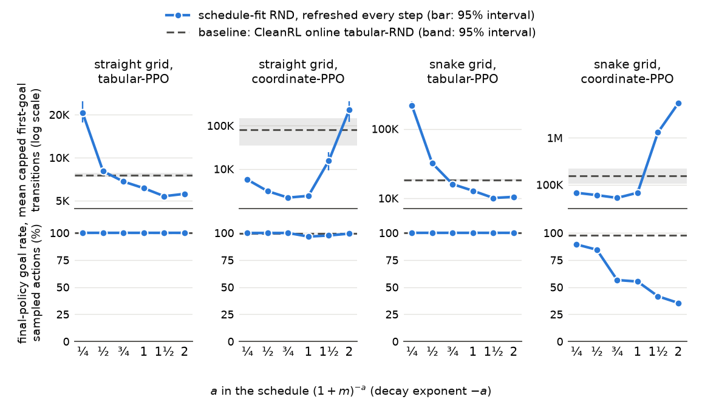

# Online tabular-RND auto research

Generated 2026-11-11 10:54 PT (times are Pacific, converted from machines running Eastern). Finished settings: 8856. Protocol: `program.md`; log: `STATE.md`.

## Contents

| Section | First written | Last changed | Status |
|---|---|---|---|
| [Measures](#measures) | 2026-11-09 21:43 PT | 2026-11-09 22:42 PT | unread |
| [development 06: results](#development-06-results) | 2026-11-10 04:43 PT | 2026-11-10 21:25 PT | unread |
| [development 07: results](#development-07-results) | 2026-11-10 13:44 PT | 2026-11-10 19:23 PT | unread |
| [screen 01: results](#screen-01-results) | 2026-11-09 21:43 PT | 2026-11-10 11:24 PT | unread |
| [screen 02: results](#screen-02-results) | 2026-11-09 23:44 PT | 2026-11-10 03:23 PT | unread |
| [screen 03: results](#screen-03-results) | 2026-11-10 02:03 PT | 2026-11-10 03:43 PT | unread |
| [screen 04: results](#screen-04-results) | 2026-11-10 03:05 PT | 2026-11-10 12:24 PT | unread |
| [screen 05: results](#screen-05-results) | 2026-11-10 04:04 PT | 2026-11-10 07:24 PT | unread |
| [confirmation: chosen configurations on the confirmation seeds](#confirmation-chosen-configurations-on-the-confirmation-seeds) | 2026-11-10 18:24 PT | 2026-11-11 10:54 PT | unread |

[Read with section colors](analysis.html). No section marks itself read.

## Measures

Define $b_t(s)$ as the bonus of cell $s$ after $t$ updates (before reward normalization) and $N_t(s)$ as the visits of cell $s$. Start max/min is $\max_s b_0(s) / \min_s b_0(s)$ (median over seeds; target at most 1.5). The decay slope is the least-squares slope of $\log(b_t(s)/b_0(s))$ on $\log N_t(s)$ per cell and seed, over checkpoints with $N_t(s) \ge 2$ (target [-0.6, -0.4]). Late count consistency is the spread over cells of $\log(b_T(s) \sqrt{N_T(s)})$ at the last checkpoint $T$ (zero when every cell follows the same $c/\sqrt{N}$). The screen score is the mean capped first-goal time $M(B)$ at the screen's budget, the best of each idea's settings (policy learning rate 1e-3, and 1e-4 for the control and the main ideas; entropy 0.001 or 0.01; weight 2^-6 to 2^6 in steps of 4×) on seeds 0-31; the standard error and interval resample field seeds (four policies each). Every idea keeps CleanRL's reward normalization on unless its name says it replaces it. The last column counts, over all of an idea's settings in the case, the copies whose bonus became not-a-number or infinite: such an idea is unstable, and its score is not evidence about the two properties.

## development 06: results

Budget per policy: 16,777,216 transitions, on the full 16,777,216-transition learning-rate schedule.

### straight grid, 32 cells, tabular-PPO

| idea | mean capped first-goal steps ↓ ± standard error [95%] | goal found | start max/min | decay slope, median [middle half] | late count consistency | properties met | best setting | seeds | copies with a non-finite bonus, all settings |
|---|---|---|---|---|---|---|---|---|---|
| schedule-fit RND, decay exponent −1, refreshed every step (even start, scheduled decay) | **6.82K** ± 0.39K [6.06K, 7.58K] | 100.0% | 1.00 | -0.68 [-0.71, -0.64] | 1.74 | even start | learning rate 0.001, entropy 0.001, weight 2^-6 | 16 | 0 of 832 |
| baseline: CleanRL online tabular-RND (uneven start, decay left to training) | <u>7.17K</u> ± 0.36K [6.60K, 8.01K] | 100.0% | 3.55 | -3.31 [-3.61, -3.06] | 4.79 | neither | learning rate 0.001, entropy 0.001, weight 2^-4 | 16 | 0 of 832 |
| count rule on the frozen tabular-RND field, decay exponent −1, refreshed every step (uneven start, scheduled decay) | 7.69K ± 0.92K [5.87K, 9.51K] | 100.0% | 3.55 | n/a | n/a | neither | learning rate 0.001, entropy 0.01, weight 2^-6 | 16 | 0 of 832 |
| schedule-fit RND, decay exponent −0.5, refreshed every step (even start, scheduled decay) | 8.18K ± 0.69K [6.82K, 9.47K] | 100.0% | 1.00 | -0.47 [-0.47, -0.47] | 1.15 | both | learning rate 0.001, entropy 0.001, weight 2^-6 | 16 | 0 of 832 |
| unit start alone (even start, decay left to training) | 8.70K ± 1.01K [6.75K, 10.75K] | 100.0% | 1.00 | -3.50 [-3.76, -3.11] | 5.62 | even start | learning rate 0.001, entropy 0.01, weight 2^-6 | 16 | 0 of 832 |

### straight grid, 32 cells, coordinate-PPO

| idea | mean capped first-goal steps ↓ ± standard error [95%] | goal found | start max/min | decay slope, median [middle half] | late count consistency | properties met | best setting | seeds | copies with a non-finite bonus, all settings |
|---|---|---|---|---|---|---|---|---|---|
| schedule-fit RND, decay exponent −1, refreshed every step (even start, scheduled decay) | **1.32K** ± 0.25K [0.89K, 1.79K] | 100.0% | 1.00 | -0.67 [-0.69, -0.65] | 1.77 | even start | learning rate 0.001, entropy 0.01, weight 2^-5 | 16 | 0 of 832 |
| count rule on the frozen tabular-RND field, decay exponent −1, refreshed every step (uneven start, scheduled decay) | <u>1.48K</u> ± 0.23K [0.97K, 1.81K] | 100.0% | 3.55 | n/a | n/a | neither | learning rate 0.001, entropy 0.001, weight 2^-1 | 16 | 0 of 832 |
| schedule-fit RND, decay exponent −0.5, refreshed every step (even start, scheduled decay) | 2.29K ± 0.35K [1.52K, 2.84K] | 100.0% | 1.00 | -0.47 [-0.47, -0.47] | 1.22 | both | learning rate 0.001, entropy 0.001, weight 2^0 | 16 | 0 of 832 |
| baseline: CleanRL online tabular-RND (uneven start, decay left to training) | 3.59K ± 0.17K [3.28K, 3.97K] | 100.0% | 3.55 | -3.49 [-3.67, -3.27] | 4.84 | neither | learning rate 0.001, entropy 0.001, weight 2^-6 | 16 | 0 of 832 |
| unit start alone (even start, decay left to training) | 4.14K ± 0.22K [3.73K, 4.65K] | 100.0% | 1.00 | -3.23 [-3.50, -2.63] | 5.59 | even start | learning rate 0.001, entropy 0.01, weight 2^0 | 16 | 0 of 832 |

### snake grid, width 16, 2 turns (50 cells), tabular-PPO

| idea | mean capped first-goal steps ↓ ± standard error [95%] | goal found | start max/min | decay slope, median [middle half] | late count consistency | properties met | best setting | seeds | copies with a non-finite bonus, all settings |
|---|---|---|---|---|---|---|---|---|---|
| schedule-fit RND, decay exponent −1, refreshed every step (even start, scheduled decay) | **14.51K** ± 0.68K [13.25K, 15.77K] | 100.0% | 1.00 | -0.68 [-0.71, -0.66] | 1.38 | even start | learning rate 0.001, entropy 0.01, weight 2^-6 | 16 | 0 of 832 |
| count rule on the frozen tabular-RND field, decay exponent −1, refreshed every step (uneven start, scheduled decay) | <u>16.78K</u> ± 1.32K [14.58K, 19.78K] | 100.0% | 4.52 | n/a | n/a | neither | learning rate 0.001, entropy 0.01, weight 2^-6 | 16 | 0 of 832 |
| baseline: CleanRL online tabular-RND (uneven start, decay left to training) | 20.09K ± 2.88K [14.73K, 25.46K] | 100.0% | 4.52 | -2.78 [-3.03, -2.50] | 3.47 | neither | learning rate 0.001, entropy 0.001, weight 2^5 | 16 | 0 of 832 |
| unit start alone (even start, decay left to training) | 22.06K ± 1.27K [19.71K, 24.42K] | 100.0% | 1.00 | -3.71 [-4.12, -3.27] | 4.48 | even start | learning rate 0.001, entropy 0.001, weight 2^-4 | 16 | 0 of 832 |
| schedule-fit RND, decay exponent −0.5, refreshed every step (even start, scheduled decay) | 34.73K ± 5.15K [25.06K, 44.00K] | 100.0% | 1.00 | -0.48 [-0.48, -0.48] | 0.90 | both | learning rate 0.001, entropy 0.001, weight 2^-6 | 16 | 0 of 832 |

### snake grid, width 16, 2 turns (50 cells), coordinate-PPO

| idea | mean capped first-goal steps ↓ ± standard error [95%] | goal found | start max/min | decay slope, median [middle half] | late count consistency | properties met | best setting | seeds | copies with a non-finite bonus, all settings |
|---|---|---|---|---|---|---|---|---|---|
| schedule-fit RND, decay exponent −1, refreshed every step (even start, scheduled decay) | **33.63K** ± 3.06K [27.99K, 39.28K] | 100.0% | 1.00 | -0.77 [-0.80, -0.73] | 1.38 | even start | learning rate 0.001, entropy 0.01, weight 2^6 | 16 | 0 of 832 |
| schedule-fit RND, decay exponent −0.5, refreshed every step (even start, scheduled decay) | <u>44.96K</u> ± 8.33K [28.43K, 61.48K] | 100.0% | 1.00 | -0.48 [-0.49, -0.48] | 0.83 | both | learning rate 0.001, entropy 0.01, weight 2^3 | 16 | 0 of 832 |
| count rule on the frozen tabular-RND field, decay exponent −1, refreshed every step (uneven start, scheduled decay) | 55.18K ± 6.07K [43.09K, 67.26K] | 100.0% | 4.52 | n/a | n/a | neither | learning rate 0.001, entropy 0.01, weight 2^-2 | 16 | 0 of 832 |
| baseline: CleanRL online tabular-RND (uneven start, decay left to training) | 74.78K ± 6.22K [62.40K, 87.16K] | 100.0% | 4.52 | -1.32 [-1.55, -1.14] | 2.17 | neither | learning rate 0.0001, entropy 0.01, weight 2^5 | 16 | 0 of 832 |
| unit start alone (even start, decay left to training) | 7,653.13K ± 2,320.03K [2,276.61K, 12,209.23K] | 56.2% | 1.00 | -1.33 [-2.52, -0.89] | 6.04 | even start | learning rate 0.0001, entropy 0.01, weight 2^-6 | 16 | 0 of 832 |

## development 07: results

Budget per policy: 16,777,216 transitions, on the full 16,777,216-transition learning-rate schedule.

### straight grid, 32 cells, tabular-PPO

| idea | mean capped first-goal steps ↓ ± standard error [95%] | goal found | start max/min | decay slope, median [middle half] | late count consistency | properties met | best setting | seeds | copies with a non-finite bonus, all settings |
|---|---|---|---|---|---|---|---|---|---|
| schedule-fit RND, decay exponent −1.5, refreshed every step | **5.75K** ± 0.27K [5.17K, 6.29K] | 100.0% | 1.00 | -0.67 [-0.76, -0.59] | 2.13 | even start | learning rate 0.001, entropy 0.001, weight 2^-6 | 16 | 0 of 832 |
| schedule-fit RND, decay exponent −2, refreshed every step | <u>6.02K</u> ± 0.31K [5.45K, 6.69K] | 100.0% | 1.00 | -0.63 [-0.76, -0.48] | 2.44 | even start | learning rate 0.001, entropy 0.001, weight 2^-6 | 16 | 0 of 832 |
| schedule-fit RND, decay exponent −0.75, refreshed every step | 7.25K ± 0.49K [6.32K, 8.26K] | 100.0% | 1.00 | -0.61 [-0.63, -0.60] | 1.48 | even start | learning rate 0.001, entropy 0.001, weight 2^-6 | 16 | 0 of 832 |
| schedule-fit RND, decay exponent −1, refreshed once per rollout | 8.18K ± 0.20K [7.81K, 8.56K] | 100.0% | 1.00 | -0.67 [-0.71, -0.63] | 1.74 | even start | learning rate 0.001, entropy 0.01, weight 2^-6 | 16 | 0 of 832 |
| schedule-fit RND, decay exponent −0.25, refreshed every step | 22.52K ± 2.84K [16.60K, 28.34K] | 100.0% | 1.00 | -0.25 [-0.25, -0.25] | 0.62 | even start | learning rate 0.0001, entropy 0.01, weight 2^-6 | 16 | 0 of 832 |

### straight grid, 32 cells, coordinate-PPO

| idea | mean capped first-goal steps ↓ ± standard error [95%] | goal found | start max/min | decay slope, median [middle half] | late count consistency | properties met | best setting | seeds | copies with a non-finite bonus, all settings |
|---|---|---|---|---|---|---|---|---|---|
| schedule-fit RND, decay exponent −0.75, refreshed every step | **1.72K** ± 0.34K [1.03K, 2.33K] | 100.0% | 1.00 | -0.61 [-0.62, -0.60] | 1.58 | even start | learning rate 0.001, entropy 0.001, weight 2^-6 | 16 | 0 of 832 |
| schedule-fit RND, decay exponent −1.5, refreshed every step | <u>1.80K</u> ± 0.34K [1.06K, 2.35K] | 100.0% | 1.00 | -0.65 [-0.71, -0.61] | 2.15 | even start | learning rate 0.001, entropy 0.01, weight 2^-6 | 16 | 0 of 832 |
| schedule-fit RND, decay exponent −1, refreshed once per rollout | 2.15K ± 0.24K [1.67K, 2.64K] | 100.0% | 1.00 | -0.67 [-0.69, -0.65] | 1.82 | even start | learning rate 0.001, entropy 0.001, weight 2^-6 | 16 | 0 of 832 |
| schedule-fit RND, decay exponent −2, refreshed every step | 2.30K ± 0.58K [1.39K, 3.64K] | 100.0% | 1.00 | -0.56 [-0.65, -0.48] | 2.48 | both | learning rate 0.001, entropy 0.001, weight 2^-6 | 16 | 0 of 832 |
| schedule-fit RND, decay exponent −0.25, refreshed every step | 4.29K ± 0.48K [3.35K, 5.12K] | 100.0% | 1.00 | -0.25 [-0.25, -0.25] | 0.81 | even start | learning rate 0.001, entropy 0.001, weight 2^-6 | 16 | 0 of 832 |

### snake grid, width 16, 2 turns (50 cells), tabular-PPO

| idea | mean capped first-goal steps ↓ ± standard error [95%] | goal found | start max/min | decay slope, median [middle half] | late count consistency | properties met | best setting | seeds | copies with a non-finite bonus, all settings |
|---|---|---|---|---|---|---|---|---|---|
| schedule-fit RND, decay exponent −1.5, refreshed every step | **10.51K** ± 0.53K [9.40K, 11.66K] | 100.0% | 1.00 | -0.68 [-0.76, -0.62] | 1.69 | even start | learning rate 0.001, entropy 0.01, weight 2^-6 | 16 | 0 of 832 |
| schedule-fit RND, decay exponent −2, refreshed every step | <u>13.08K</u> ± 1.31K [10.04K, 14.97K] | 100.0% | 1.00 | -0.61 [-0.73, -0.50] | 1.93 | even start | learning rate 0.001, entropy 0.01, weight 2^-6 | 16 | 0 of 832 |
| schedule-fit RND, decay exponent −1, refreshed once per rollout | 16.44K ± 1.18K [14.22K, 18.65K] | 100.0% | 1.00 | -0.69 [-0.71, -0.66] | 1.38 | even start | learning rate 0.001, entropy 0.01, weight 2^-6 | 16 | 0 of 832 |
| schedule-fit RND, decay exponent −0.75, refreshed every step | 17.68K ± 2.02K [14.29K, 21.96K] | 100.0% | 1.00 | -0.62 [-0.63, -0.61] | 1.16 | even start | learning rate 0.001, entropy 0.01, weight 2^-6 | 16 | 0 of 832 |
| schedule-fit RND, decay exponent −0.25, refreshed every step | 79.87K ± 7.93K [67.46K, 97.30K] | 100.0% | 1.00 | -0.25 [-0.25, -0.25] | 0.45 | even start | learning rate 0.0001, entropy 0.001, weight 2^-6 | 16 | 0 of 832 |

### snake grid, width 16, 2 turns (50 cells), coordinate-PPO

| idea | mean capped first-goal steps ↓ ± standard error [95%] | goal found | start max/min | decay slope, median [middle half] | late count consistency | properties met | best setting | seeds | copies with a non-finite bonus, all settings |
|---|---|---|---|---|---|---|---|---|---|
| schedule-fit RND, decay exponent −0.75, refreshed every step | **38.00K** ± 2.44K [33.43K, 42.57K] | 100.0% | 1.00 | -0.68 [-0.70, -0.65] | 1.13 | even start | learning rate 0.001, entropy 0.01, weight 2^-2 | 16 | 0 of 832 |
| schedule-fit RND, decay exponent −1, refreshed once per rollout | <u>46.97K</u> ± 6.80K [34.48K, 59.46K] | 100.0% | 1.00 | -0.77 [-0.82, -0.72] | 1.37 | even start | learning rate 0.001, entropy 0.01, weight 2^0 | 16 | 0 of 832 |
| schedule-fit RND, decay exponent −0.25, refreshed every step | 53.12K ± 11.70K [30.53K, 75.72K] | 100.0% | 1.00 | -0.25 [-0.25, -0.25] | 0.46 | even start | learning rate 0.001, entropy 0.01, weight 2^0 | 16 | 0 of 832 |
| schedule-fit RND, decay exponent −1.5, refreshed every step | 640.48K ± 186.82K [254.86K, 954.45K] | 100.0% | 1.00 | -0.86 [-0.95, -0.75] | 1.71 | even start | learning rate 0.001, entropy 0.01, weight 2^5 | 16 | 0 of 832 |
| schedule-fit RND, decay exponent −2, refreshed every step | 3,708.89K ± 1,001.63K [1,756.61K, 5,661.16K] | 87.5% | 1.00 | -0.85 [-1.15, -0.63] | 1.74 | even start | learning rate 0.001, entropy 0.01, weight 2^2 | 16 | 0 of 832 |

## screen 01: results

Budget per policy: 4,194,304 transitions, on the full 16,777,216-transition learning-rate schedule.

### straight grid, 32 cells, tabular-PPO

| idea | mean capped first-goal steps ↓ ± standard error [95%] | goal found | start max/min | decay slope, median [middle half] | late count consistency | properties met | best setting | seeds | copies with a non-finite bonus, all settings |
|---|---|---|---|---|---|---|---|---|---|
| baseline: CleanRL online tabular-RND (uneven start, decay left to training) | **7.22K** ± 0.28K [6.73K, 7.81K] | 100.0% | 3.65 | -3.78 [-4.18, -3.42] | 4.83 | neither | learning rate 0.001, entropy 0.001, weight 2^-4 | 32 | 0 of 896 |
| wide-input-layer-64 | <u>7.41K</u> ± 0.50K [6.57K, 8.44K] | 100.0% | 2.63 | -3.84 [-4.24, -3.50] | 4.87 | neither | learning rate 0.001, entropy 0.001, weight 2^-4 | 32 | 0 of 448 |
| initial-ratio-readout | 7.95K ± 0.44K [7.14K, 8.84K] | 100.0% | 1.00 | -3.75 [-4.16, -3.41] | 4.83 | even start | learning rate 0.001, entropy 0.01, weight 2^-4 | 32 | 0 of 448 |
| unit start alone (even start, decay left to training) | 8.57K ± 0.64K [7.33K, 9.86K] | 100.0% | 1.00 | -4.16 [-4.60, -3.66] | 5.52 | even start | learning rate 0.001, entropy 0.01, weight 2^6 | 32 | 0 of 896 |
| length-readout | 9.79K ± 0.80K [8.24K, 11.40K] | 100.0% | 1.91 | -1.87 [-2.09, -1.69] | 2.43 | neither | learning rate 0.001, entropy 0.01, weight 2^6 | 32 | 0 of 896 |
| unit-start-shrink-target-sgd-2-length-readout | 10.47K ± 0.81K [8.91K, 12.09K] | 100.0% | 1.00 | -0.51 [-0.55, -0.48] | 0.93 | both | learning rate 0.001, entropy 0.01, weight 2^-6 | 32 | 0 of 896 |
| separate-adam-constant-learning-rate-1e-4 | 11.37K ± 1.33K [8.79K, 13.92K] | 100.0% | 3.65 | -2.54 [-2.90, -2.20] | 3.93 | neither | learning rate 0.001, entropy 0.01, weight 2^-6 | 32 | 0 of 896 |
| bias-start-0.5 | 11.40K ± 1.08K [9.37K, 13.55K] | 100.0% | 1.04 | -1.93 [-2.31, -1.63] | 4.16 | even start | learning rate 0.001, entropy 0.01, weight 2^-2 | 32 | 0 of 448 |
| unit-start-shrink-target-sgd-3-length-readout | 14.89K ± 2.50K [10.55K, 20.32K] | 100.0% | 1.00 | -0.53 [-0.58, -0.49] | 0.94 | both | learning rate 0.001, entropy 0.001, weight 2^-6 | 32 | 14 of 896 |
| unit-start-power-4-sgd-0.3-length-readout | 17.15K ± 3.35K [11.61K, 24.30K] | 100.0% | 1.00 | -0.50 [-0.53, -0.47] | 0.89 | both | learning rate 0.001, entropy 0.001, weight 2^-6 | 32 | 25 of 896 |
| unit-start-adagrad-0.1 | 19.95K ± 3.63K [13.10K, 27.15K] | 100.0% | 1.00 | -0.57 [-1.43, -0.34] | 1.70 | both | learning rate 0.001, entropy 0.01, weight 2^-6 | 32 | 0 of 448 |
| shrink-target-sgd-1-length-readout | 22.31K ± 3.30K [15.93K, 28.65K] | 100.0% | 1.91 | -0.37 [-0.41, -0.34] | 0.60 | neither | learning rate 0.0001, entropy 0.001, weight 2^-6 | 32 | 0 of 896 |
| power-4-sgd-0.1-length-readout | 545.94K ± 367.86K [19.53K, 1,331.62K] | 87.5% | 1.91 | -0.33 [-0.37, -0.29] | 0.53 | neither | learning rate 0.0001, entropy 0.001, weight 2^-6 | 32 | 140 of 896 |

### straight grid, 32 cells, coordinate-PPO

| idea | mean capped first-goal steps ↓ ± standard error [95%] | goal found | start max/min | decay slope, median [middle half] | late count consistency | properties met | best setting | seeds | copies with a non-finite bonus, all settings |
|---|---|---|---|---|---|---|---|---|---|
| separate-adam-constant-learning-rate-1e-4 | **3.78K** ± 0.29K [3.22K, 4.35K] | 100.0% | 3.65 | -2.68 [-3.14, -2.30] | 3.96 | neither | learning rate 0.001, entropy 0.001, weight 2^-6 | 32 | 0 of 896 |
| baseline: CleanRL online tabular-RND (uneven start, decay left to training) | <u>3.90K</u> ± 0.20K [3.51K, 4.29K] | 100.0% | 3.65 | -4.02 [-4.39, -3.60] | 4.87 | neither | learning rate 0.001, entropy 0.001, weight 2^4 | 32 | 0 of 896 |
| wide-input-layer-64 | 4.06K ± 0.11K [3.84K, 4.28K] | 100.0% | 2.63 | -4.13 [-4.47, -3.71] | 4.90 | neither | learning rate 0.001, entropy 0.01, weight 2^6 | 32 | 0 of 448 |
| initial-ratio-readout | 4.27K ± 0.19K [3.86K, 4.61K] | 100.0% | 1.00 | -4.02 [-4.38, -3.59] | 4.87 | even start | learning rate 0.001, entropy 0.001, weight 2^-2 | 32 | 0 of 448 |
| unit start alone (even start, decay left to training) | 4.66K ± 0.22K [4.26K, 5.10K] | 100.0% | 1.00 | -3.97 [-4.54, -3.29] | 5.54 | even start | learning rate 0.001, entropy 0.001, weight 2^0 | 32 | 0 of 896 |
| unit-start-adagrad-0.1 | 4.76K ± 0.26K [4.25K, 5.26K] | 100.0% | 1.00 | -0.63 [-1.25, -0.33] | 1.87 | even start | learning rate 0.001, entropy 0.01, weight 2^6 | 32 | 0 of 448 |
| length-readout | 4.80K ± 0.17K [4.44K, 5.11K] | 100.0% | 1.91 | -2.05 [-2.22, -1.81] | 2.46 | neither | learning rate 0.001, entropy 0.001, weight 2^0 | 32 | 0 of 896 |
| unit-start-power-4-sgd-0.3-length-readout | 5.03K ± 0.52K [4.06K, 6.08K] | 100.0% | 1.00 | -0.50 [-0.52, -0.47] | 0.92 | both | learning rate 0.001, entropy 0.01, weight 2^-6 | 32 | 7 of 896 |
| unit-start-shrink-target-sgd-2-length-readout | 5.07K ± 0.33K [4.36K, 5.66K] | 100.0% | 1.00 | -0.50 [-0.53, -0.48] | 0.95 | both | learning rate 0.001, entropy 0.01, weight 2^6 | 32 | 0 of 896 |
| shrink-target-sgd-1-length-readout | 6.20K ± 0.26K [5.67K, 6.69K] | 100.0% | 1.91 | -0.39 [-0.43, -0.35] | 0.72 | neither | learning rate 0.001, entropy 0.001, weight 2^2 | 32 | 2 of 896 |
| unit-start-shrink-target-sgd-3-length-readout | 6.25K ± 0.29K [5.65K, 6.77K] | 100.0% | 1.00 | -0.51 [-0.55, -0.49] | 0.95 | both | learning rate 0.001, entropy 0.001, weight 2^6 | 32 | 14 of 896 |
| bias-start-0.5 | 7.05K ± 0.66K [5.78K, 8.34K] | 100.0% | 1.04 | -2.08 [-2.52, -1.69] | 4.19 | even start | learning rate 0.001, entropy 0.01, weight 2^6 | 32 | 0 of 448 |
| power-4-sgd-0.1-length-readout | 530.24K ± 368.18K [6.35K, 1,315.44K] | 87.5% | 1.91 | -0.34 [-0.38, -0.29] | 0.62 | neither | learning rate 0.001, entropy 0.01, weight 2^-6 | 32 | 118 of 896 |

### snake grid, width 16, 2 turns (50 cells), tabular-PPO

| idea | mean capped first-goal steps ↓ ± standard error [95%] | goal found | start max/min | decay slope, median [middle half] | late count consistency | properties met | best setting | seeds | copies with a non-finite bonus, all settings |
|---|---|---|---|---|---|---|---|---|---|
| wide-input-layer-64 | **16.37K** ± 0.59K [15.26K, 17.56K] | 100.0% | 3.04 | -3.45 [-3.83, -3.10] | 3.73 | neither | learning rate 0.001, entropy 0.01, weight 2^0 | 32 | 0 of 448 |
| baseline: CleanRL online tabular-RND (uneven start, decay left to training) | <u>18.74K</u> ± 0.96K [16.96K, 20.71K] | 100.0% | 4.23 | -2.72 [-3.08, -2.38] | 3.48 | neither | learning rate 0.001, entropy 0.01, weight 2^0 | 32 | 0 of 896 |
| unit start alone (even start, decay left to training) | 21.74K ± 1.24K [19.22K, 24.05K] | 100.0% | 1.00 | -4.46 [-4.97, -4.01] | 4.44 | even start | learning rate 0.001, entropy 0.001, weight 2^2 | 32 | 0 of 896 |
| initial-ratio-readout | 24.42K ± 1.69K [21.11K, 27.70K] | 100.0% | 1.00 | -2.66 [-3.00, -2.35] | 3.54 | even start | learning rate 0.001, entropy 0.01, weight 2^-4 | 32 | 0 of 448 |
| length-readout | 26.31K ± 3.48K [20.56K, 33.76K] | 100.0% | 2.06 | -1.30 [-1.48, -1.14] | 1.75 | neither | learning rate 0.001, entropy 0.01, weight 2^0 | 32 | 0 of 896 |
| bias-start-0.5 | 28.09K ± 1.10K [25.89K, 30.13K] | 100.0% | 1.04 | -1.48 [-1.65, -1.31] | 1.89 | even start | learning rate 0.001, entropy 0.001, weight 2^0 | 32 | 0 of 448 |
| separate-adam-constant-learning-rate-1e-4 | 50.08K ± 4.21K [41.92K, 58.36K] | 100.0% | 4.23 | -1.41 [-1.65, -1.22] | 2.17 | neither | learning rate 0.001, entropy 0.001, weight 2^-6 | 32 | 0 of 896 |
| unit-start-shrink-target-sgd-2-length-readout | 61.28K ± 8.14K [47.03K, 78.72K] | 100.0% | 1.00 | -0.50 [-0.54, -0.48] | 0.69 | both | learning rate 0.001, entropy 0.01, weight 2^-6 | 32 | 14 of 896 |
| shrink-target-sgd-1-length-readout | 141.51K ± 20.69K [100.89K, 180.49K] | 100.0% | 2.06 | -0.30 [-0.33, -0.27] | 0.39 | neither | learning rate 0.0001, entropy 0.01, weight 2^-4 | 32 | 1 of 896 |
| unit-start-adagrad-0.1 | 231.51K ± 114.37K [69.08K, 483.51K] | 96.9% | 1.00 | -0.37 [-0.51, -0.25] | 0.94 | even start | learning rate 0.001, entropy 0.01, weight 2^-2 | 32 | 0 of 448 |
| unit-start-shrink-target-sgd-3-length-readout | 440.93K ± 173.79K [69.87K, 827.72K] | 90.6% | 1.00 | -0.52 [-0.56, -0.48] | 0.71 | both | learning rate 0.001, entropy 0.01, weight 2^-6 | 32 | 161 of 896 |

### snake grid, width 16, 2 turns (50 cells), coordinate-PPO

| idea | mean capped first-goal steps ↓ ± standard error [95%] | goal found | start max/min | decay slope, median [middle half] | late count consistency | properties met | best setting | seeds | copies with a non-finite bonus, all settings |
|---|---|---|---|---|---|---|---|---|---|
| length-readout | **46.52K** ± 2.54K [41.43K, 51.14K] | 100.0% | 2.06 | -1.12 [-1.35, -0.91] | 1.76 | neither | learning rate 0.001, entropy 0.01, weight 2^0 | 32 | 0 of 896 |
| separate-adam-constant-learning-rate-1e-4 | <u>48.86K</u> ± 1.68K [45.80K, 52.26K] | 100.0% | 4.23 | -1.33 [-1.62, -1.11] | 2.20 | neither | learning rate 0.001, entropy 0.01, weight 2^6 | 32 | 0 of 896 |
| shrink-target-sgd-1-length-readout | 55.16K ± 8.30K [41.23K, 73.36K] | 100.0% | 2.06 | -0.30 [-0.34, -0.26] | 0.39 | neither | learning rate 0.001, entropy 0.001, weight 2^6 | 32 | 0 of 896 |
| unit-start-shrink-target-sgd-2-length-readout | 56.99K ± 5.87K [44.61K, 67.49K] | 100.0% | 1.00 | -0.50 [-0.53, -0.47] | 0.65 | both | learning rate 0.001, entropy 0.01, weight 2^4 | 32 | 6 of 896 |
| unit-start-adagrad-0.1 | 58.40K ± 4.54K [49.64K, 67.01K] | 100.0% | 1.00 | -0.34 [-0.47, -0.23] | 1.00 | even start | learning rate 0.001, entropy 0.01, weight 2^2 | 32 | 0 of 448 |
| power-4-sgd-0.1-length-readout | 60.47K ± 7.22K [46.21K, 74.80K] | 100.0% | 2.06 | -0.26 [-0.30, -0.23] | 0.35 | neither | learning rate 0.001, entropy 0.01, weight 2^-6 | 32 | 3 of 896 |
| baseline: CleanRL online tabular-RND (uneven start, decay left to training) | 82.11K ± 12.00K [59.55K, 105.87K] | 100.0% | 4.23 | -0.93 [-1.17, -0.67] | 1.75 | neither | learning rate 0.0001, entropy 0.001, weight 2^-2 | 32 | 0 of 896 |
| unit-start-shrink-target-sgd-3-length-readout | 446.86K ± 249.72K [50.91K, 968.53K] | 90.6% | 1.00 | -0.52 [-0.56, -0.49] | 0.66 | both | learning rate 0.001, entropy 0.01, weight 2^6 | 32 | 179 of 896 |
| unit-start-power-4-sgd-0.3-length-readout | 482.36K ± 167.17K [214.41K, 846.20K] | 90.6% | 1.00 | -0.47 [-0.50, -0.44] | 0.64 | both | learning rate 0.0001, entropy 0.001, weight 2^6 | 32 | 200 of 896 |
| bias-start-0.5 | 1,085.52K ± 248.59K [639.55K, 1,598.99K] | 84.4% | 1.04 | -1.09 [-1.38, -0.78] | 3.04 | even start | learning rate 0.001, entropy 0.01, weight 2^6 | 32 | 0 of 448 |
| initial-ratio-readout | 1,104.67K ± 362.54K [457.12K, 1,874.40K] | 75.0% | 1.00 | -1.70 [-2.46, -1.14] | 4.36 | even start | learning rate 0.001, entropy 0.01, weight 2^0 | 32 | 0 of 448 |
| wide-input-layer-64 | 1,130.86K ± 273.55K [588.73K, 1,676.47K] | 75.0% | 3.04 | -2.10 [-3.10, -1.25] | 4.42 | neither | learning rate 0.001, entropy 0.001, weight 2^4 | 32 | 0 of 448 |
| unit start alone (even start, decay left to training) | 1,905.10K ± 292.49K [1,392.73K, 2,515.92K] | 56.2% | 1.00 | -1.38 [-2.88, -0.81] | 6.54 | even start | learning rate 0.0001, entropy 0.01, weight 2^-6 | 32 | 0 of 896 |

## screen 02: results

Budget per policy: 4,194,304 transitions, on the full 16,777,216-transition learning-rate schedule.

### straight grid, 32 cells, tabular-PPO

| idea | mean capped first-goal steps ↓ ± standard error [95%] | goal found | start max/min | decay slope, median [middle half] | late count consistency | properties met | best setting | seeds | copies with a non-finite bonus, all settings |
|---|---|---|---|---|---|---|---|---|---|
| count-per-rollout-exponent-minus-2 | **7.56K** ± 0.61K [6.35K, 8.71K] | 100.0% | 1.00 | n/a | n/a | even start | learning rate 0.001, entropy 0.001, weight 2^-6 | 32 | 0 of 896 |
| count-per-rollout-exponent-minus-1 | <u>7.73K</u> ± 0.47K [6.88K, 8.68K] | 100.0% | 1.00 | n/a | n/a | even start | learning rate 0.001, entropy 0.01, weight 2^-6 | 32 | 0 of 896 |
| count-per-step-rate-0.5 | 8.08K ± 0.47K [7.15K, 8.96K] | 100.0% | 1.00 | n/a | n/a | even start | learning rate 0.001, entropy 0.01, weight 2^-6 | 32 | 0 of 896 |
| count-rule-per-step-rate-1 | 8.42K ± 0.39K [7.65K, 9.16K] | 100.0% | 1.00 | n/a | n/a | even start | learning rate 0.001, entropy 0.001, weight 2^-6 | 32 | 0 of 896 |
| count-per-step-rate-0.25 | 8.59K ± 0.60K [7.43K, 9.80K] | 100.0% | 1.00 | n/a | n/a | even start | learning rate 0.001, entropy 0.01, weight 2^-6 | 32 | 0 of 896 |
| count-per-rollout-rate-0.5 | 9.00K ± 0.59K [7.91K, 10.16K] | 100.0% | 1.00 | n/a | n/a | even start | learning rate 0.001, entropy 0.01, weight 2^-6 | 32 | 0 of 896 |
| count-per-rollout-rate-0.25 | 9.14K ± 0.82K [7.61K, 10.84K] | 100.0% | 1.00 | n/a | n/a | even start | learning rate 0.001, entropy 0.001, weight 2^-6 | 32 | 0 of 896 |
| unit-start-shrink-exponent-minus-1-sgd-1-length-readout | 9.45K ± 0.69K [8.14K, 10.84K] | 100.0% | 1.00 | -0.94 [-1.01, -0.88] | 1.48 | even start | learning rate 0.001, entropy 0.001, weight 2^-6 | 32 | 0 of 896 |
| count-per-rollout-rate-1 | 9.70K ± 0.72K [8.28K, 11.10K] | 100.0% | 1.00 | n/a | n/a | even start | learning rate 0.001, entropy 0.001, weight 2^-6 | 32 | 0 of 896 |
| count-per-rollout-rate-4 | 11.24K ± 1.42K [8.82K, 14.29K] | 100.0% | 1.00 | n/a | n/a | even start | learning rate 0.001, entropy 0.01, weight 2^-6 | 32 | 0 of 896 |
| unit-start-shrink-target-sgd-1-length-readout | 12.02K ± 1.18K [9.85K, 14.38K] | 100.0% | 1.00 | -0.50 [-0.54, -0.47] | 0.88 | both | learning rate 0.001, entropy 0.001, weight 2^-6 | 32 | 0 of 896 |
| unit-start-exact-step-shrink-target | 15.02K ± 2.92K [10.09K, 21.06K] | 100.0% | 1.00 | -0.39 [-0.41, -0.36] | 0.71 | even start | learning rate 0.001, entropy 0.001, weight 2^-6 | 32 | 0 of 896 |
| count-per-rollout-exponent-minus-0.25 | 22.21K ± 3.16K [16.14K, 28.26K] | 100.0% | 1.00 | n/a | n/a | even start | learning rate 0.0001, entropy 0.001, weight 2^-6 | 32 | 0 of 896 |
| unit-start-shrink-exponent-minus-0.25-sgd-4-length-readout | 22.53K ± 3.13K [16.39K, 28.41K] | 100.0% | 1.00 | -0.26 [-0.27, -0.25] | 0.45 | even start | learning rate 0.0001, entropy 0.01, weight 2^-6 | 32 | 3 of 896 |

### straight grid, 32 cells, coordinate-PPO

| idea | mean capped first-goal steps ↓ ± standard error [95%] | goal found | start max/min | decay slope, median [middle half] | late count consistency | properties met | best setting | seeds | copies with a non-finite bonus, all settings |
|---|---|---|---|---|---|---|---|---|---|
| count-rule-per-step-rate-1 | **2.38K** ± 0.22K [1.97K, 2.80K] | 100.0% | 1.00 | n/a | n/a | even start | learning rate 0.001, entropy 0.01, weight 2^-6 | 32 | 0 of 896 |
| count-per-step-rate-0.5 | <u>2.64K</u> ± 0.25K [2.11K, 3.10K] | 100.0% | 1.00 | n/a | n/a | even start | learning rate 0.001, entropy 0.01, weight 2^-6 | 32 | 0 of 896 |
| count-per-rollout-exponent-minus-1 | 3.09K ± 0.42K [2.30K, 3.96K] | 100.0% | 1.00 | n/a | n/a | even start | learning rate 0.001, entropy 0.01, weight 2^-6 | 32 | 0 of 896 |
| count-per-step-rate-0.25 | 3.23K ± 0.24K [2.77K, 3.69K] | 100.0% | 1.00 | n/a | n/a | even start | learning rate 0.001, entropy 0.01, weight 2^6 | 32 | 0 of 896 |
| count-per-rollout-rate-1 | 3.52K ± 0.32K [2.96K, 4.16K] | 100.0% | 1.00 | n/a | n/a | even start | learning rate 0.001, entropy 0.001, weight 2^-6 | 32 | 0 of 896 |
| count-per-rollout-rate-0.5 | 3.54K ± 0.23K [3.07K, 3.98K] | 100.0% | 1.00 | n/a | n/a | even start | learning rate 0.001, entropy 0.001, weight 2^-6 | 32 | 0 of 896 |
| count-per-rollout-rate-0.25 | 3.72K ± 0.23K [3.26K, 4.15K] | 100.0% | 1.00 | n/a | n/a | even start | learning rate 0.001, entropy 0.01, weight 2^-4 | 32 | 0 of 896 |
| count-per-rollout-rate-4 | 3.78K ± 0.43K [2.98K, 4.64K] | 100.0% | 1.00 | n/a | n/a | even start | learning rate 0.001, entropy 0.001, weight 2^-6 | 32 | 0 of 896 |
| unit-start-shrink-exponent-minus-1-sgd-1-length-readout | 4.27K ± 0.40K [3.49K, 5.03K] | 100.0% | 1.00 | -0.91 [-0.96, -0.86] | 1.51 | even start | learning rate 0.001, entropy 0.01, weight 2^-6 | 32 | 0 of 896 |
| count-per-rollout-exponent-minus-0.25 | 4.57K ± 0.43K [3.73K, 5.46K] | 100.0% | 1.00 | n/a | n/a | even start | learning rate 0.001, entropy 0.001, weight 2^-6 | 32 | 0 of 896 |
| unit-start-exact-step-shrink-target | 5.35K ± 0.39K [4.58K, 6.11K] | 100.0% | 1.00 | -0.40 [-0.42, -0.37] | 0.73 | even start | learning rate 0.001, entropy 0.01, weight 2^-4 | 32 | 0 of 896 |
| unit-start-shrink-target-sgd-1-length-readout | 5.53K ± 0.41K [4.77K, 6.38K] | 100.0% | 1.00 | -0.50 [-0.52, -0.47] | 0.91 | both | learning rate 0.001, entropy 0.001, weight 2^-4 | 32 | 0 of 896 |
| count-per-rollout-exponent-minus-2 | 5.77K ± 0.29K [5.21K, 6.34K] | 100.0% | 1.00 | n/a | n/a | even start | learning rate 0.001, entropy 0.01, weight 2^0 | 32 | 0 of 896 |
| unit-start-shrink-exponent-minus-0.25-sgd-4-length-readout | 6.68K ± 0.66K [5.48K, 8.03K] | 100.0% | 1.00 | -0.26 [-0.28, -0.25] | 0.59 | even start | learning rate 0.001, entropy 0.001, weight 2^-6 | 32 | 0 of 896 |

### snake grid, width 16, 2 turns (50 cells), tabular-PPO

| idea | mean capped first-goal steps ↓ ± standard error [95%] | goal found | start max/min | decay slope, median [middle half] | late count consistency | properties met | best setting | seeds | copies with a non-finite bonus, all settings |
|---|---|---|---|---|---|---|---|---|---|
| count-per-rollout-exponent-minus-2 | **14.14K** ± 1.62K [11.06K, 17.44K] | 100.0% | 1.00 | n/a | n/a | even start | learning rate 0.001, entropy 0.001, weight 2^-6 | 32 | 0 of 896 |
| count-per-rollout-exponent-minus-1 | <u>16.25K</u> ± 0.88K [14.61K, 18.01K] | 100.0% | 1.00 | n/a | n/a | even start | learning rate 0.001, entropy 0.001, weight 2^-6 | 32 | 0 of 896 |
| unit-start-shrink-exponent-minus-1-sgd-1-length-readout | 25.42K ± 1.91K [21.78K, 29.42K] | 100.0% | 1.00 | -0.97 [-1.04, -0.90] | 1.17 | even start | learning rate 0.001, entropy 0.001, weight 2^-6 | 32 | 0 of 896 |
| count-per-step-rate-0.25 | 29.11K ± 4.70K [20.40K, 38.56K] | 100.0% | 1.00 | n/a | n/a | even start | learning rate 0.001, entropy 0.001, weight 2^-4 | 32 | 0 of 896 |
| count-per-step-rate-0.5 | 29.85K ± 5.26K [21.08K, 40.98K] | 100.0% | 1.00 | n/a | n/a | even start | learning rate 0.001, entropy 0.01, weight 2^-6 | 32 | 0 of 896 |
| count-rule-per-step-rate-1 | 32.25K ± 4.52K [24.17K, 41.73K] | 100.0% | 1.00 | n/a | n/a | even start | learning rate 0.001, entropy 0.01, weight 2^-4 | 32 | 0 of 896 |
| count-per-rollout-rate-0.5 | 37.68K ± 5.16K [27.18K, 47.66K] | 100.0% | 1.00 | n/a | n/a | even start | learning rate 0.001, entropy 0.001, weight 2^-6 | 32 | 0 of 896 |
| count-per-rollout-rate-0.25 | 40.25K ± 5.54K [29.75K, 51.48K] | 100.0% | 1.00 | n/a | n/a | even start | learning rate 0.001, entropy 0.001, weight 2^0 | 32 | 0 of 896 |
| count-per-rollout-rate-4 | 42.46K ± 7.34K [29.15K, 57.23K] | 100.0% | 1.00 | n/a | n/a | even start | learning rate 0.001, entropy 0.01, weight 2^-4 | 32 | 0 of 896 |
| count-per-rollout-rate-1 | 42.76K ± 6.32K [30.66K, 55.70K] | 100.0% | 1.00 | n/a | n/a | even start | learning rate 0.001, entropy 0.001, weight 2^-6 | 32 | 0 of 896 |
| unit-start-exact-step-shrink-target | 56.20K ± 7.09K [43.35K, 70.57K] | 100.0% | 1.00 | -0.34 [-0.36, -0.31] | 0.44 | even start | learning rate 0.0001, entropy 0.01, weight 2^-6 | 32 | 0 of 896 |
| unit-start-shrink-target-sgd-1-length-readout | 72.89K ± 6.63K [60.22K, 85.75K] | 100.0% | 1.00 | -0.48 [-0.50, -0.45] | 0.64 | both | learning rate 0.001, entropy 0.01, weight 2^6 | 32 | 0 of 896 |
| count-per-rollout-exponent-minus-0.25 | 227.16K ± 54.60K [123.95K, 337.95K] | 100.0% | 1.00 | n/a | n/a | even start | learning rate 0.0001, entropy 0.001, weight 2^-6 | 32 | 0 of 896 |
| unit-start-shrink-exponent-minus-0.25-sgd-4-length-readout | 945.33K ± 232.19K [491.34K, 1,404.42K] | 81.2% | 1.00 | -0.24 [-0.25, -0.22] | 0.57 | even start | learning rate 0.0001, entropy 0.01, weight 2^-6 | 32 | 234 of 896 |

### snake grid, width 16, 2 turns (50 cells), coordinate-PPO

| idea | mean capped first-goal steps ↓ ± standard error [95%] | goal found | start max/min | decay slope, median [middle half] | late count consistency | properties met | best setting | seeds | copies with a non-finite bonus, all settings |
|---|---|---|---|---|---|---|---|---|---|
| count-per-step-rate-0.25 | **47.08K** ± 4.07K [39.71K, 55.52K] | 100.0% | 1.00 | n/a | n/a | even start | learning rate 0.001, entropy 0.01, weight 2^6 | 32 | 0 of 896 |
| count-per-rollout-rate-0.5 | <u>51.24K</u> ± 6.55K [40.27K, 65.68K] | 100.0% | 1.00 | n/a | n/a | even start | learning rate 0.001, entropy 0.01, weight 2^6 | 32 | 0 of 896 |
| count-rule-per-step-rate-1 | 52.66K ± 7.83K [37.53K, 67.77K] | 100.0% | 1.00 | n/a | n/a | even start | learning rate 0.001, entropy 0.01, weight 2^2 | 32 | 0 of 896 |
| unit-start-shrink-target-sgd-1-length-readout | 53.52K ± 6.04K [42.43K, 65.94K] | 100.0% | 1.00 | -0.48 [-0.51, -0.45] | 0.61 | both | learning rate 0.001, entropy 0.01, weight 2^4 | 32 | 0 of 896 |
| count-per-rollout-rate-4 | 53.58K ± 3.35K [47.26K, 60.29K] | 100.0% | 1.00 | n/a | n/a | even start | learning rate 0.001, entropy 0.01, weight 2^0 | 32 | 0 of 896 |
| count-per-step-rate-0.5 | 54.58K ± 8.40K [41.25K, 72.99K] | 100.0% | 1.00 | n/a | n/a | even start | learning rate 0.001, entropy 0.01, weight 2^4 | 32 | 0 of 896 |
| count-per-rollout-rate-0.25 | 55.24K ± 3.96K [47.22K, 62.65K] | 100.0% | 1.00 | n/a | n/a | even start | learning rate 0.001, entropy 0.01, weight 2^-2 | 32 | 0 of 896 |
| count-per-rollout-rate-1 | 56.98K ± 4.40K [47.98K, 65.61K] | 100.0% | 1.00 | n/a | n/a | even start | learning rate 0.001, entropy 0.01, weight 2^6 | 32 | 0 of 896 |
| unit-start-exact-step-shrink-target | 57.07K ± 7.02K [44.33K, 72.16K] | 100.0% | 1.00 | -0.34 [-0.37, -0.30] | 0.51 | even start | learning rate 0.001, entropy 0.001, weight 2^6 | 32 | 0 of 896 |
| unit-start-shrink-exponent-minus-1-sgd-1-length-readout | 59.14K ± 6.03K [46.85K, 70.38K] | 100.0% | 1.00 | -0.94 [-1.01, -0.87] | 1.12 | even start | learning rate 0.001, entropy 0.01, weight 2^-2 | 32 | 0 of 896 |
| count-per-rollout-exponent-minus-0.25 | 65.77K ± 8.00K [50.87K, 81.78K] | 100.0% | 1.00 | n/a | n/a | even start | learning rate 0.001, entropy 0.01, weight 2^0 | 32 | 0 of 896 |
| count-per-rollout-exponent-minus-1 | 116.86K ± 41.64K [57.87K, 208.98K] | 100.0% | 1.00 | n/a | n/a | even start | learning rate 0.001, entropy 0.01, weight 2^0 | 32 | 0 of 896 |
| unit-start-shrink-exponent-minus-0.25-sgd-4-length-readout | 490.33K ± 168.02K [204.30K, 851.33K] | 90.6% | 1.00 | -0.24 [-0.26, -0.21] | 0.43 | even start | learning rate 0.001, entropy 0.001, weight 2^-6 | 32 | 190 of 896 |
| count-per-rollout-exponent-minus-2 | 3,288.33K ± 281.54K [2,763.18K, 3,809.12K] | 25.0% | 1.00 | n/a | n/a | even start | learning rate 0.001, entropy 0.01, weight 2^-4 | 32 | 0 of 896 |

## screen 03: results

Budget per policy: 4,194,304 transitions, on the full 16,777,216-transition learning-rate schedule.

### straight grid, 32 cells, tabular-PPO

| idea | mean capped first-goal steps ↓ ± standard error [95%] | goal found | start max/min | decay slope, median [middle half] | late count consistency | properties met | best setting | seeds | copies with a non-finite bonus, all settings |
|---|---|---|---|---|---|---|---|---|---|
| count-per-step-exponent-minus-2 | **5.76K** ± 0.30K [5.15K, 6.31K] | 100.0% | 1.00 | n/a | n/a | even start | learning rate 0.001, entropy 0.01, weight 2^-6 | 32 | 0 of 896 |
| count-per-step-exponent-minus-1 | <u>6.47K</u> ± 0.26K [5.97K, 7.00K] | 100.0% | 1.00 | n/a | n/a | even start | learning rate 0.001, entropy 0.001, weight 2^-6 | 32 | 0 of 896 |
| count-per-rollout-exponent-minus-2-rate-0.25 | 6.79K ± 0.49K [5.85K, 7.72K] | 100.0% | 1.00 | n/a | n/a | even start | learning rate 0.001, entropy 0.001, weight 2^-6 | 32 | 0 of 896 |
| count-per-rollout-exponent-minus-1-rate-0.25 | 7.08K ± 0.37K [6.43K, 7.81K] | 100.0% | 1.00 | n/a | n/a | even start | learning rate 0.001, entropy 0.001, weight 2^-6 | 32 | 0 of 896 |
| count-per-rollout-exponent-minus-1-rate-4 | 7.18K ± 0.42K [6.42K, 8.01K] | 100.0% | 1.00 | n/a | n/a | even start | learning rate 0.001, entropy 0.01, weight 2^-6 | 32 | 0 of 896 |
| count-per-rollout-exponent-minus-1.5 | 7.21K ± 0.44K [6.38K, 8.07K] | 100.0% | 1.00 | n/a | n/a | even start | learning rate 0.001, entropy 0.001, weight 2^-6 | 32 | 0 of 896 |
| count-per-rollout-exponent-minus-3 | 8.03K ± 1.05K [6.18K, 10.25K] | 100.0% | 1.00 | n/a | n/a | even start | learning rate 0.001, entropy 0.01, weight 2^-6 | 32 | 0 of 896 |
| count-per-rollout-exponent-minus-2-rate-4 | 8.06K ± 0.97K [6.34K, 10.09K] | 100.0% | 1.00 | n/a | n/a | even start | learning rate 0.001, entropy 0.01, weight 2^-6 | 32 | 0 of 896 |
| count-per-rollout-exponent-minus-0.75 | 8.67K ± 0.70K [7.33K, 10.04K] | 100.0% | 1.00 | n/a | n/a | even start | learning rate 0.001, entropy 0.01, weight 2^-6 | 32 | 0 of 896 |
| count-per-rollout-exponent-minus-1-plus-0.1-of-exponent-minus-0.5 | 8.84K ± 0.66K [7.61K, 10.16K] | 100.0% | 1.00 | n/a | n/a | even start | learning rate 0.001, entropy 0.001, weight 2^-6 | 32 | 0 of 896 |
| count-per-rollout-exponent-minus-2-plus-0.03-of-exponent-minus-0.5 | 9.28K ± 0.79K [7.84K, 10.91K] | 100.0% | 1.00 | n/a | n/a | even start | learning rate 0.001, entropy 0.01, weight 2^-6 | 32 | 0 of 896 |
| count-per-rollout-exponent-minus-1-plus-0.3-of-exponent-minus-0.5 | 9.76K ± 1.17K [7.64K, 12.24K] | 100.0% | 1.00 | n/a | n/a | even start | learning rate 0.001, entropy 0.01, weight 2^-6 | 32 | 0 of 896 |
| count-per-rollout-exponent-minus-2-plus-0.1-of-exponent-minus-0.5 | 10.55K ± 1.52K [7.87K, 13.82K] | 100.0% | 1.00 | n/a | n/a | even start | learning rate 0.001, entropy 0.01, weight 2^-6 | 32 | 0 of 896 |
| count-per-rollout-exponent-minus-2-plus-0.3-of-exponent-minus-0.5 | 10.90K ± 1.56K [8.04K, 14.04K] | 100.0% | 1.00 | n/a | n/a | even start | learning rate 0.001, entropy 0.001, weight 2^-6 | 32 | 0 of 896 |

### straight grid, 32 cells, coordinate-PPO

| idea | mean capped first-goal steps ↓ ± standard error [95%] | goal found | start max/min | decay slope, median [middle half] | late count consistency | properties met | best setting | seeds | copies with a non-finite bonus, all settings |
|---|---|---|---|---|---|---|---|---|---|
| count-per-step-exponent-minus-1 | **1.70K** ± 0.26K [1.26K, 2.26K] | 100.0% | 1.00 | n/a | n/a | even start | learning rate 0.001, entropy 0.001, weight 2^-6 | 32 | 0 of 896 |
| count-per-rollout-exponent-minus-1-rate-0.25 | <u>3.20K</u> ± 0.22K [2.80K, 3.67K] | 100.0% | 1.00 | n/a | n/a | even start | learning rate 0.001, entropy 0.001, weight 2^-2 | 32 | 0 of 896 |
| count-per-rollout-exponent-minus-0.75 | 3.21K ± 0.38K [2.55K, 4.00K] | 100.0% | 1.00 | n/a | n/a | even start | learning rate 0.001, entropy 0.001, weight 2^-6 | 32 | 0 of 896 |
| count-per-rollout-exponent-minus-1-plus-0.1-of-exponent-minus-0.5 | 3.62K ± 0.42K [2.82K, 4.46K] | 100.0% | 1.00 | n/a | n/a | even start | learning rate 0.001, entropy 0.001, weight 2^-6 | 32 | 0 of 896 |
| count-per-rollout-exponent-minus-1-plus-0.3-of-exponent-minus-0.5 | 3.65K ± 0.40K [2.87K, 4.41K] | 100.0% | 1.00 | n/a | n/a | even start | learning rate 0.001, entropy 0.01, weight 2^2 | 32 | 0 of 896 |
| count-per-rollout-exponent-minus-2-rate-0.25 | 3.89K ± 0.48K [2.97K, 4.88K] | 100.0% | 1.00 | n/a | n/a | even start | learning rate 0.001, entropy 0.01, weight 2^6 | 32 | 0 of 896 |
| count-per-step-exponent-minus-2 | 3.96K ± 0.45K [3.13K, 4.90K] | 100.0% | 1.00 | n/a | n/a | even start | learning rate 0.001, entropy 0.01, weight 2^2 | 32 | 0 of 896 |
| count-per-rollout-exponent-minus-1-rate-4 | 3.97K ± 0.17K [3.65K, 4.28K] | 100.0% | 1.00 | n/a | n/a | even start | learning rate 0.001, entropy 0.01, weight 2^-4 | 32 | 0 of 896 |
| count-per-rollout-exponent-minus-2-plus-0.3-of-exponent-minus-0.5 | 4.14K ± 0.32K [3.51K, 4.73K] | 100.0% | 1.00 | n/a | n/a | even start | learning rate 0.001, entropy 0.001, weight 2^0 | 32 | 0 of 896 |
| count-per-rollout-exponent-minus-2-plus-0.1-of-exponent-minus-0.5 | 4.27K ± 0.33K [3.69K, 4.96K] | 100.0% | 1.00 | n/a | n/a | even start | learning rate 0.001, entropy 0.001, weight 2^-6 | 32 | 0 of 896 |
| count-per-rollout-exponent-minus-1.5 | 4.35K ± 0.29K [3.82K, 4.94K] | 100.0% | 1.00 | n/a | n/a | even start | learning rate 0.001, entropy 0.01, weight 2^-2 | 32 | 0 of 896 |
| count-per-rollout-exponent-minus-2-plus-0.03-of-exponent-minus-0.5 | 5.13K ± 0.26K [4.65K, 5.66K] | 100.0% | 1.00 | n/a | n/a | even start | learning rate 0.001, entropy 0.01, weight 2^-6 | 32 | 0 of 896 |
| count-per-rollout-exponent-minus-3 | 10.31K ± 2.95K [6.53K, 16.73K] | 100.0% | 1.00 | n/a | n/a | even start | learning rate 0.001, entropy 0.01, weight 2^2 | 32 | 0 of 896 |
| count-per-rollout-exponent-minus-2-rate-4 | 13.07K ± 5.43K [6.79K, 24.72K] | 100.0% | 1.00 | n/a | n/a | even start | learning rate 0.001, entropy 0.001, weight 2^0 | 32 | 0 of 896 |

### snake grid, width 16, 2 turns (50 cells), tabular-PPO

| idea | mean capped first-goal steps ↓ ± standard error [95%] | goal found | start max/min | decay slope, median [middle half] | late count consistency | properties met | best setting | seeds | copies with a non-finite bonus, all settings |
|---|---|---|---|---|---|---|---|---|---|
| count-per-step-exponent-minus-2 | **11.15K** ± 1.19K [8.93K, 13.58K] | 100.0% | 1.00 | n/a | n/a | even start | learning rate 0.001, entropy 0.001, weight 2^-6 | 32 | 0 of 896 |
| count-per-rollout-exponent-minus-2-rate-0.25 | <u>12.75K</u> ± 0.77K [11.37K, 14.35K] | 100.0% | 1.00 | n/a | n/a | even start | learning rate 0.001, entropy 0.01, weight 2^-6 | 32 | 0 of 896 |
| count-per-rollout-exponent-minus-1.5 | 12.94K ± 1.13K [10.96K, 15.38K] | 100.0% | 1.00 | n/a | n/a | even start | learning rate 0.001, entropy 0.001, weight 2^-6 | 32 | 0 of 896 |
| count-per-step-exponent-minus-1 | 13.31K ± 0.74K [11.85K, 14.69K] | 100.0% | 1.00 | n/a | n/a | even start | learning rate 0.001, entropy 0.001, weight 2^-6 | 32 | 0 of 896 |
| count-per-rollout-exponent-minus-1-rate-4 | 15.21K ± 0.67K [13.94K, 16.55K] | 100.0% | 1.00 | n/a | n/a | even start | learning rate 0.001, entropy 0.001, weight 2^-6 | 32 | 0 of 896 |
| count-per-rollout-exponent-minus-1-rate-0.25 | 15.92K ± 0.79K [14.44K, 17.42K] | 100.0% | 1.00 | n/a | n/a | even start | learning rate 0.001, entropy 0.001, weight 2^-6 | 32 | 0 of 896 |
| count-per-rollout-exponent-minus-3 | 16.12K ± 1.38K [13.56K, 18.85K] | 100.0% | 1.00 | n/a | n/a | even start | learning rate 0.001, entropy 0.001, weight 2^-6 | 32 | 0 of 896 |
| count-per-rollout-exponent-minus-2-rate-4 | 16.62K ± 1.77K [13.36K, 20.27K] | 100.0% | 1.00 | n/a | n/a | even start | learning rate 0.001, entropy 0.01, weight 2^-2 | 32 | 0 of 896 |
| count-per-rollout-exponent-minus-0.75 | 18.46K ± 1.68K [15.29K, 21.73K] | 100.0% | 1.00 | n/a | n/a | even start | learning rate 0.001, entropy 0.01, weight 2^-6 | 32 | 0 of 896 |
| count-per-rollout-exponent-minus-2-plus-0.03-of-exponent-minus-0.5 | 19.24K ± 1.72K [15.78K, 22.46K] | 100.0% | 1.00 | n/a | n/a | even start | learning rate 0.001, entropy 0.001, weight 2^-6 | 32 | 0 of 896 |
| count-per-rollout-exponent-minus-1-plus-0.1-of-exponent-minus-0.5 | 22.38K ± 1.42K [19.57K, 25.00K] | 100.0% | 1.00 | n/a | n/a | even start | learning rate 0.001, entropy 0.01, weight 2^-6 | 32 | 0 of 896 |
| count-per-rollout-exponent-minus-1-plus-0.3-of-exponent-minus-0.5 | 26.15K ± 2.15K [22.11K, 30.40K] | 100.0% | 1.00 | n/a | n/a | even start | learning rate 0.001, entropy 0.01, weight 2^-6 | 32 | 0 of 896 |
| count-per-rollout-exponent-minus-2-plus-0.1-of-exponent-minus-0.5 | 27.87K ± 2.26K [23.36K, 32.27K] | 100.0% | 1.00 | n/a | n/a | even start | learning rate 0.001, entropy 0.001, weight 2^-2 | 32 | 0 of 896 |
| count-per-rollout-exponent-minus-2-plus-0.3-of-exponent-minus-0.5 | 37.27K ± 4.14K [29.17K, 45.33K] | 100.0% | 1.00 | n/a | n/a | even start | learning rate 0.001, entropy 0.001, weight 2^-4 | 32 | 0 of 896 |

### snake grid, width 16, 2 turns (50 cells), coordinate-PPO

| idea | mean capped first-goal steps ↓ ± standard error [95%] | goal found | start max/min | decay slope, median [middle half] | late count consistency | properties met | best setting | seeds | copies with a non-finite bonus, all settings |
|---|---|---|---|---|---|---|---|---|---|
| count-per-step-exponent-minus-1 | **41.28K** ± 2.75K [35.65K, 46.63K] | 100.0% | 1.00 | n/a | n/a | even start | learning rate 0.001, entropy 0.01, weight 2^6 | 32 | 0 of 896 |
| count-per-rollout-exponent-minus-1-plus-0.3-of-exponent-minus-0.5 | <u>56.78K</u> ± 3.81K [49.47K, 64.38K] | 100.0% | 1.00 | n/a | n/a | even start | learning rate 0.001, entropy 0.01, weight 2^4 | 32 | 0 of 896 |
| count-per-rollout-exponent-minus-0.75 | 59.58K ± 7.18K [45.73K, 73.65K] | 100.0% | 1.00 | n/a | n/a | even start | learning rate 0.001, entropy 0.01, weight 2^4 | 32 | 0 of 896 |
| count-per-rollout-exponent-minus-1-plus-0.1-of-exponent-minus-0.5 | 59.72K ± 6.96K [47.97K, 74.19K] | 100.0% | 1.00 | n/a | n/a | even start | learning rate 0.001, entropy 0.01, weight 2^0 | 32 | 0 of 896 |
| count-per-rollout-exponent-minus-2-plus-0.3-of-exponent-minus-0.5 | 61.95K ± 6.00K [50.60K, 74.50K] | 100.0% | 1.00 | n/a | n/a | even start | learning rate 0.001, entropy 0.01, weight 2^0 | 32 | 0 of 896 |
| count-per-rollout-exponent-minus-1-rate-0.25 | 63.82K ± 9.67K [46.22K, 83.66K] | 100.0% | 1.00 | n/a | n/a | even start | learning rate 0.001, entropy 0.01, weight 2^4 | 32 | 0 of 896 |
| count-per-rollout-exponent-minus-2-plus-0.1-of-exponent-minus-0.5 | 73.25K ± 8.06K [59.40K, 90.55K] | 100.0% | 1.00 | n/a | n/a | even start | learning rate 0.001, entropy 0.01, weight 2^4 | 32 | 0 of 896 |
| count-per-rollout-exponent-minus-2-plus-0.03-of-exponent-minus-0.5 | 109.01K ± 15.10K [78.31K, 137.86K] | 100.0% | 1.00 | n/a | n/a | even start | learning rate 0.001, entropy 0.01, weight 2^6 | 32 | 0 of 896 |
| count-per-rollout-exponent-minus-1-rate-4 | 319.64K ± 51.62K [218.40K, 421.69K] | 100.0% | 1.00 | n/a | n/a | even start | learning rate 0.001, entropy 0.01, weight 2^2 | 32 | 0 of 896 |
| count-per-rollout-exponent-minus-1.5 | 2,428.62K ± 324.54K [1,781.67K, 3,035.42K] | 56.2% | 1.00 | n/a | n/a | even start | learning rate 0.001, entropy 0.01, weight 2^0 | 32 | 0 of 896 |
| count-per-rollout-exponent-minus-2-rate-0.25 | 2,612.95K ± 249.39K [2,092.67K, 3,029.46K] | 46.9% | 1.00 | n/a | n/a | even start | learning rate 0.001, entropy 0.01, weight 2^0 | 32 | 0 of 896 |
| count-per-step-exponent-minus-2 | 2,839.29K ± 438.92K [1,988.88K, 3,676.73K] | 34.4% | 1.00 | n/a | n/a | even start | learning rate 0.0001, entropy 0.01, weight 2^-2 | 32 | 0 of 896 |
| count-per-rollout-exponent-minus-2-rate-4 | 3,212.16K ± 310.88K [2,576.87K, 3,815.48K] | 25.0% | 1.00 | n/a | n/a | even start | learning rate 0.0001, entropy 0.001, weight 2^-6 | 32 | 0 of 896 |
| count-per-rollout-exponent-minus-3 | 3,283.33K ± 248.84K [2,786.68K, 3,762.75K] | 28.1% | 1.00 | n/a | n/a | even start | learning rate 0.001, entropy 0.01, weight 2^-2 | 32 | 0 of 896 |

## screen 04: results

Budget per policy: 4,194,304 transitions, on the full 16,777,216-transition learning-rate schedule.

### straight grid, 32 cells, tabular-PPO

| idea | mean capped first-goal steps ↓ ± standard error [95%] | goal found | start max/min | decay slope, median [middle half] | late count consistency | properties met | best setting | seeds | copies with a non-finite bonus, all settings |
|---|---|---|---|---|---|---|---|---|---|
| count-per-step-exponent-minus-1.5-rate-0.25 | **6.23K** ± 0.32K [5.65K, 6.89K] | 100.0% | 1.00 | n/a | n/a | even start | learning rate 0.001, entropy 0.001, weight 2^-6 | 32 | 0 of 896 |
| count-per-step-exponent-minus-1.5-rate-0.0625 | <u>6.26K</u> ± 0.34K [5.63K, 6.95K] | 100.0% | 1.00 | n/a | n/a | even start | learning rate 0.001, entropy 0.001, weight 2^-6 | 32 | 0 of 896 |
| schedule-fit RND, decay exponent −1, refreshed every step (even start, scheduled decay) | 6.33K ± 0.29K [5.79K, 6.91K] | 100.0% | 1.00 | -0.79 [-0.82, -0.76] | 1.70 | even start | learning rate 0.001, entropy 0.01, weight 2^-6 | 32 | 0 of 896 |
| count-per-step-exponent-minus-1-rate-0.5 | 6.35K ± 0.37K [5.68K, 7.10K] | 100.0% | 1.00 | n/a | n/a | even start | learning rate 0.001, entropy 0.001, weight 2^-6 | 32 | 0 of 896 |
| schedule-fit-rnd-exponent-minus-1-rate-0.25-refresh-per-step | 6.75K ± 0.37K [6.09K, 7.48K] | 100.0% | 1.00 | -0.86 [-0.87, -0.85] | 1.57 | even start | learning rate 0.001, entropy 0.001, weight 2^-6 | 32 | 0 of 896 |
| count-per-step-exponent-minus-1-rate-0.0625 | 6.75K ± 0.29K [6.22K, 7.32K] | 100.0% | 1.00 | n/a | n/a | even start | learning rate 0.001, entropy 0.001, weight 2^-6 | 32 | 0 of 896 |
| count-per-step-exponent-minus-1-rate-0.125 | 6.90K ± 0.52K [5.94K, 8.00K] | 100.0% | 1.00 | n/a | n/a | even start | learning rate 0.001, entropy 0.01, weight 2^-6 | 32 | 0 of 896 |
| schedule-fit-rnd-exponent-minus-1-rate-0.25-refresh-per-rollout | 6.97K ± 0.41K [6.23K, 7.80K] | 100.0% | 1.00 | -0.86 [-0.87, -0.85] | 1.57 | even start | learning rate 0.001, entropy 0.01, weight 2^-6 | 32 | 0 of 896 |
| count-per-step-exponent-minus-1-rate-0.25 | 7.03K ± 0.41K [6.29K, 7.86K] | 100.0% | 1.00 | n/a | n/a | even start | learning rate 0.001, entropy 0.001, weight 2^-6 | 32 | 0 of 896 |
| schedule-fit RND, decay exponent −0.75, refreshed every step | 7.31K ± 0.35K [6.65K, 8.04K] | 100.0% | 1.00 | -0.69 [-0.70, -0.68] | 1.43 | even start | learning rate 0.001, entropy 0.001, weight 2^-6 | 32 | 0 of 896 |
| count-per-rollout-exponent-minus-1-rate-0.125 | 7.41K ± 0.56K [6.41K, 8.58K] | 100.0% | 1.00 | n/a | n/a | even start | learning rate 0.001, entropy 0.01, weight 2^-6 | 32 | 0 of 896 |
| count-per-step-exponent-minus-0.75 | 7.53K ± 0.46K [6.64K, 8.45K] | 100.0% | 1.00 | n/a | n/a | even start | learning rate 0.001, entropy 0.01, weight 2^-6 | 32 | 0 of 896 |
| count-per-rollout-exponent-minus-1-rate-0.5 | 7.55K ± 0.44K [6.72K, 8.41K] | 100.0% | 1.00 | n/a | n/a | even start | learning rate 0.001, entropy 0.01, weight 2^-6 | 32 | 0 of 896 |
| count-per-rollout-exponent-minus-1-rate-0.0625 | 7.74K ± 0.45K [6.92K, 8.64K] | 100.0% | 1.00 | n/a | n/a | even start | learning rate 0.001, entropy 0.001, weight 2^-6 | 32 | 0 of 896 |
| schedule-fit RND, decay exponent −0.5, refreshed every step (even start, scheduled decay) | 8.63K ± 0.65K [7.42K, 9.93K] | 100.0% | 1.00 | -0.50 [-0.50, -0.50] | 1.09 | both | learning rate 0.001, entropy 0.001, weight 2^-6 | 32 | 0 of 896 |
| schedule-fit-rnd-exponent-minus-0.5-refresh-per-rollout | 8.77K ± 0.84K [7.29K, 10.50K] | 100.0% | 1.00 | -0.50 [-0.50, -0.50] | 1.09 | both | learning rate 0.001, entropy 0.001, weight 2^-6 | 32 | 0 of 896 |
| schedule-fit-rnd-all-layers-exponent-minus-1-rate-0.25 | 9.64K ± 1.08K [7.69K, 11.91K] | 100.0% | 1.00 | -1.03 [-1.08, -0.98] | 1.59 | even start | learning rate 0.001, entropy 0.001, weight 2^-6 | 32 | 0 of 896 |
| schedule-fit-rnd-all-layers-exponent-minus-0.5 | 11.86K ± 1.20K [9.65K, 14.28K] | 100.0% | 1.00 | -0.57 [-0.59, -0.54] | 1.04 | both | learning rate 0.001, entropy 0.01, weight 2^-6 | 32 | 0 of 896 |

### straight grid, 32 cells, coordinate-PPO

| idea | mean capped first-goal steps ↓ ± standard error [95%] | goal found | start max/min | decay slope, median [middle half] | late count consistency | properties met | best setting | seeds | copies with a non-finite bonus, all settings |
|---|---|---|---|---|---|---|---|---|---|
| count-per-step-exponent-minus-1.5-rate-0.25 | **1.83K** ± 0.27K [1.33K, 2.42K] | 100.0% | 1.00 | n/a | n/a | even start | learning rate 0.001, entropy 0.01, weight 2^-4 | 32 | 0 of 896 |
| schedule-fit RND, decay exponent −1, refreshed every step (even start, scheduled decay) | <u>1.96K</u> ± 0.29K [1.42K, 2.54K] | 100.0% | 1.00 | -0.79 [-0.80, -0.77] | 1.76 | even start | learning rate 0.001, entropy 0.001, weight 2^6 | 32 | 0 of 896 |
| count-per-step-exponent-minus-1-rate-0.5 | 2.05K ± 0.26K [1.55K, 2.56K] | 100.0% | 1.00 | n/a | n/a | even start | learning rate 0.001, entropy 0.01, weight 2^4 | 32 | 0 of 896 |
| schedule-fit-rnd-exponent-minus-1-rate-0.25-refresh-per-step | 2.13K ± 0.19K [1.73K, 2.44K] | 100.0% | 1.00 | -0.86 [-0.87, -0.85] | 1.63 | even start | learning rate 0.001, entropy 0.001, weight 2^6 | 32 | 0 of 896 |
| schedule-fit RND, decay exponent −0.75, refreshed every step | 2.22K ± 0.25K [1.73K, 2.70K] | 100.0% | 1.00 | -0.69 [-0.69, -0.69] | 1.49 | even start | learning rate 0.001, entropy 0.001, weight 2^6 | 32 | 0 of 896 |
| count-per-step-exponent-minus-1-rate-0.25 | 2.27K ± 0.20K [1.82K, 2.59K] | 100.0% | 1.00 | n/a | n/a | even start | learning rate 0.001, entropy 0.01, weight 2^-2 | 32 | 0 of 896 |
| schedule-fit RND, decay exponent −0.5, refreshed every step (even start, scheduled decay) | 2.29K ± 0.23K [1.85K, 2.74K] | 100.0% | 1.00 | -0.50 [-0.50, -0.50] | 1.13 | both | learning rate 0.001, entropy 0.01, weight 2^-6 | 32 | 0 of 896 |
| count-per-step-exponent-minus-0.75 | 2.30K ± 0.28K [1.80K, 2.89K] | 100.0% | 1.00 | n/a | n/a | even start | learning rate 0.001, entropy 0.01, weight 2^-6 | 32 | 0 of 896 |
| count-per-step-exponent-minus-1.5-rate-0.0625 | 2.31K ± 0.23K [1.85K, 2.74K] | 100.0% | 1.00 | n/a | n/a | even start | learning rate 0.001, entropy 0.01, weight 2^0 | 32 | 0 of 896 |
| count-per-step-exponent-minus-1-rate-0.125 | 2.36K ± 0.25K [1.91K, 2.88K] | 100.0% | 1.00 | n/a | n/a | even start | learning rate 0.001, entropy 0.001, weight 2^0 | 32 | 0 of 896 |
| count-per-step-exponent-minus-1-rate-0.0625 | 2.72K ± 0.20K [2.31K, 3.14K] | 100.0% | 1.00 | n/a | n/a | even start | learning rate 0.001, entropy 0.001, weight 2^2 | 32 | 0 of 896 |
| count-per-rollout-exponent-minus-1-rate-0.5 | 3.01K ± 0.27K [2.49K, 3.55K] | 100.0% | 1.00 | n/a | n/a | even start | learning rate 0.001, entropy 0.01, weight 2^-6 | 32 | 0 of 896 |
| count-per-rollout-exponent-minus-1-rate-0.0625 | 3.08K ± 0.22K [2.65K, 3.51K] | 100.0% | 1.00 | n/a | n/a | even start | learning rate 0.001, entropy 0.001, weight 2^-6 | 32 | 0 of 896 |
| count-per-rollout-exponent-minus-1-rate-0.125 | 3.09K ± 0.22K [2.68K, 3.54K] | 100.0% | 1.00 | n/a | n/a | even start | learning rate 0.001, entropy 0.001, weight 2^-2 | 32 | 0 of 896 |
| schedule-fit-rnd-exponent-minus-1-rate-0.25-refresh-per-rollout | 3.11K ± 0.24K [2.70K, 3.61K] | 100.0% | 1.00 | -0.86 [-0.87, -0.84] | 1.61 | even start | learning rate 0.001, entropy 0.001, weight 2^0 | 32 | 0 of 896 |
| schedule-fit-rnd-exponent-minus-0.5-refresh-per-rollout | 3.43K ± 0.31K [2.89K, 4.08K] | 100.0% | 1.00 | -0.50 [-0.50, -0.50] | 1.12 | both | learning rate 0.001, entropy 0.01, weight 2^-4 | 32 | 0 of 896 |
| schedule-fit-rnd-all-layers-exponent-minus-1-rate-0.25 | 3.54K ± 0.16K [3.22K, 3.84K] | 100.0% | 1.00 | -0.99 [-1.04, -0.94] | 1.61 | even start | learning rate 0.001, entropy 0.001, weight 2^4 | 32 | 0 of 896 |
| schedule-fit-rnd-all-layers-exponent-minus-0.5 | 4.15K ± 0.39K [3.40K, 4.94K] | 100.0% | 1.00 | -0.55 [-0.58, -0.53] | 1.07 | both | learning rate 0.001, entropy 0.01, weight 2^-2 | 32 | 0 of 896 |

### snake grid, width 16, 2 turns (50 cells), tabular-PPO

| idea | mean capped first-goal steps ↓ ± standard error [95%] | goal found | start max/min | decay slope, median [middle half] | late count consistency | properties met | best setting | seeds | copies with a non-finite bonus, all settings |
|---|---|---|---|---|---|---|---|---|---|
| count-per-step-exponent-minus-1.5-rate-0.25 | **10.38K** ± 0.58K [9.26K, 11.49K] | 100.0% | 1.00 | n/a | n/a | even start | learning rate 0.001, entropy 0.01, weight 2^-6 | 32 | 0 of 896 |
| count-per-step-exponent-minus-1-rate-0.5 | <u>12.01K</u> ± 0.78K [10.53K, 13.51K] | 100.0% | 1.00 | n/a | n/a | even start | learning rate 0.001, entropy 0.01, weight 2^-6 | 32 | 0 of 896 |
| count-per-step-exponent-minus-1.5-rate-0.0625 | 12.38K ± 0.64K [11.12K, 13.61K] | 100.0% | 1.00 | n/a | n/a | even start | learning rate 0.001, entropy 0.001, weight 2^-6 | 32 | 0 of 896 |
| count-per-step-exponent-minus-1-rate-0.125 | 13.11K ± 1.20K [11.20K, 15.74K] | 100.0% | 1.00 | n/a | n/a | even start | learning rate 0.001, entropy 0.01, weight 2^-6 | 32 | 0 of 896 |
| count-per-step-exponent-minus-1-rate-0.25 | 13.42K ± 1.07K [11.39K, 15.55K] | 100.0% | 1.00 | n/a | n/a | even start | learning rate 0.001, entropy 0.01, weight 2^-6 | 32 | 0 of 896 |
| schedule-fit RND, decay exponent −1, refreshed every step (even start, scheduled decay) | 13.51K ± 0.72K [12.03K, 14.77K] | 100.0% | 1.00 | -0.81 [-0.83, -0.79] | 1.34 | even start | learning rate 0.001, entropy 0.001, weight 2^-6 | 32 | 0 of 896 |
| schedule-fit-rnd-exponent-minus-1-rate-0.25-refresh-per-step | 13.69K ± 1.05K [11.84K, 15.92K] | 100.0% | 1.00 | -0.88 [-0.88, -0.87] | 1.24 | even start | learning rate 0.001, entropy 0.01, weight 2^-6 | 32 | 0 of 896 |
| count-per-step-exponent-minus-1-rate-0.0625 | 15.09K ± 1.23K [12.90K, 17.72K] | 100.0% | 1.00 | n/a | n/a | even start | learning rate 0.001, entropy 0.001, weight 2^-6 | 32 | 0 of 896 |
| count-per-rollout-exponent-minus-1-rate-0.125 | 16.42K ± 1.13K [14.25K, 18.66K] | 100.0% | 1.00 | n/a | n/a | even start | learning rate 0.001, entropy 0.01, weight 2^-6 | 32 | 0 of 896 |
| schedule-fit-rnd-exponent-minus-1-rate-0.25-refresh-per-rollout | 16.60K ± 0.87K [14.97K, 18.34K] | 100.0% | 1.00 | -0.88 [-0.88, -0.87] | 1.24 | even start | learning rate 0.001, entropy 0.001, weight 2^-6 | 32 | 0 of 896 |
| count-per-step-exponent-minus-0.75 | 16.62K ± 1.52K [13.65K, 19.51K] | 100.0% | 1.00 | n/a | n/a | even start | learning rate 0.001, entropy 0.001, weight 2^-6 | 32 | 0 of 896 |
| count-per-rollout-exponent-minus-1-rate-0.5 | 17.08K ± 0.86K [15.35K, 18.72K] | 100.0% | 1.00 | n/a | n/a | even start | learning rate 0.001, entropy 0.001, weight 2^-6 | 32 | 0 of 896 |
| count-per-rollout-exponent-minus-1-rate-0.0625 | 17.09K ± 1.41K [14.39K, 19.88K] | 100.0% | 1.00 | n/a | n/a | even start | learning rate 0.001, entropy 0.001, weight 2^-6 | 32 | 0 of 896 |
| schedule-fit RND, decay exponent −0.75, refreshed every step | 17.84K ± 2.03K [14.07K, 21.90K] | 100.0% | 1.00 | -0.70 [-0.71, -0.70] | 1.13 | even start | learning rate 0.001, entropy 0.01, weight 2^-6 | 32 | 0 of 896 |
| schedule-fit-rnd-all-layers-exponent-minus-1-rate-0.25 | 27.83K ± 2.71K [22.46K, 32.89K] | 100.0% | 1.00 | -1.00 [-1.06, -0.93] | 1.17 | even start | learning rate 0.001, entropy 0.001, weight 2^-6 | 32 | 0 of 896 |
| schedule-fit RND, decay exponent −0.5, refreshed every step (even start, scheduled decay) | 32.19K ± 4.39K [23.58K, 40.70K] | 100.0% | 1.00 | -0.50 [-0.50, -0.50] | 0.83 | both | learning rate 0.001, entropy 0.01, weight 2^-6 | 32 | 0 of 896 |
| schedule-fit-rnd-exponent-minus-0.5-refresh-per-rollout | 39.35K ± 6.45K [28.24K, 53.03K] | 100.0% | 1.00 | -0.50 [-0.50, -0.50] | 0.83 | both | learning rate 0.001, entropy 0.001, weight 2^-6 | 32 | 0 of 896 |
| schedule-fit-rnd-all-layers-exponent-minus-0.5 | 44.96K ± 9.44K [27.99K, 64.42K] | 100.0% | 1.00 | -0.55 [-0.58, -0.51] | 0.75 | both | learning rate 0.001, entropy 0.001, weight 2^-4 | 32 | 0 of 896 |

### snake grid, width 16, 2 turns (50 cells), coordinate-PPO

| idea | mean capped first-goal steps ↓ ± standard error [95%] | goal found | start max/min | decay slope, median [middle half] | late count consistency | properties met | best setting | seeds | copies with a non-finite bonus, all settings |
|---|---|---|---|---|---|---|---|---|---|
| count-per-step-exponent-minus-1-rate-0.5 | **39.51K** ± 2.41K [35.34K, 44.63K] | 100.0% | 1.00 | n/a | n/a | even start | learning rate 0.001, entropy 0.01, weight 2^4 | 32 | 0 of 896 |
| count-per-step-exponent-minus-1-rate-0.25 | <u>39.52K</u> ± 2.99K [33.49K, 45.06K] | 100.0% | 1.00 | n/a | n/a | even start | learning rate 0.001, entropy 0.01, weight 2^2 | 32 | 0 of 896 |
| count-per-step-exponent-minus-0.75 | 39.70K ± 3.12K [33.98K, 45.72K] | 100.0% | 1.00 | n/a | n/a | even start | learning rate 0.001, entropy 0.01, weight 2^0 | 32 | 0 of 896 |
| count-per-rollout-exponent-minus-1-rate-0.125 | 39.96K ± 3.55K [33.72K, 47.20K] | 100.0% | 1.00 | n/a | n/a | even start | learning rate 0.001, entropy 0.01, weight 2^6 | 32 | 0 of 896 |
| schedule-fit RND, decay exponent −1, refreshed every step (even start, scheduled decay) | 42.07K ± 2.84K [36.97K, 47.87K] | 100.0% | 1.00 | -0.88 [-0.91, -0.83] | 1.36 | even start | learning rate 0.001, entropy 0.01, weight 2^2 | 32 | 0 of 896 |
| schedule-fit-rnd-exponent-minus-1-rate-0.25-refresh-per-step | 43.21K ± 3.03K [37.94K, 49.48K] | 100.0% | 1.00 | -0.91 [-0.94, -0.89] | 1.24 | even start | learning rate 0.001, entropy 0.01, weight 2^0 | 32 | 0 of 896 |
| schedule-fit-rnd-exponent-minus-1-rate-0.25-refresh-per-rollout | 43.75K ± 5.55K [33.64K, 55.38K] | 100.0% | 1.00 | -0.94 [-0.96, -0.90] | 1.23 | even start | learning rate 0.001, entropy 0.01, weight 2^0 | 32 | 0 of 896 |
| count-per-step-exponent-minus-1-rate-0.125 | 43.77K ± 4.98K [34.59K, 53.57K] | 100.0% | 1.00 | n/a | n/a | even start | learning rate 0.001, entropy 0.01, weight 2^4 | 32 | 0 of 896 |
| count-per-step-exponent-minus-1-rate-0.0625 | 44.84K ± 3.95K [37.69K, 52.90K] | 100.0% | 1.00 | n/a | n/a | even start | learning rate 0.001, entropy 0.01, weight 2^2 | 32 | 0 of 896 |
| schedule-fit RND, decay exponent −0.75, refreshed every step | 47.94K ± 4.44K [39.63K, 57.22K] | 100.0% | 1.00 | -0.72 [-0.73, -0.71] | 1.11 | even start | learning rate 0.001, entropy 0.01, weight 2^4 | 32 | 0 of 896 |
| schedule-fit RND, decay exponent −0.5, refreshed every step (even start, scheduled decay) | 48.98K ± 5.06K [39.54K, 59.22K] | 100.0% | 1.00 | -0.50 [-0.50, -0.50] | 0.77 | both | learning rate 0.001, entropy 0.01, weight 2^2 | 32 | 0 of 896 |
| count-per-step-exponent-minus-1.5-rate-0.0625 | 52.94K ± 8.20K [40.18K, 71.75K] | 100.0% | 1.00 | n/a | n/a | even start | learning rate 0.001, entropy 0.01, weight 2^6 | 32 | 0 of 896 |
| count-per-rollout-exponent-minus-1-rate-0.0625 | 54.17K ± 5.22K [44.99K, 65.03K] | 100.0% | 1.00 | n/a | n/a | even start | learning rate 0.001, entropy 0.01, weight 2^6 | 32 | 0 of 896 |
| schedule-fit-rnd-exponent-minus-0.5-refresh-per-rollout | 57.66K ± 3.08K [51.76K, 63.84K] | 100.0% | 1.00 | -0.50 [-0.50, -0.50] | 0.78 | both | learning rate 0.001, entropy 0.01, weight 2^6 | 32 | 0 of 896 |
| schedule-fit-rnd-all-layers-exponent-minus-0.5 | 64.19K ± 4.42K [55.42K, 72.47K] | 100.0% | 1.00 | -0.52 [-0.56, -0.48] | 0.69 | both | learning rate 0.001, entropy 0.01, weight 2^0 | 32 | 0 of 896 |
| schedule-fit-rnd-all-layers-exponent-minus-1-rate-0.25 | 65.08K ± 8.11K [49.74K, 80.44K] | 100.0% | 1.00 | -0.95 [-1.02, -0.88] | 1.11 | even start | learning rate 0.001, entropy 0.01, weight 2^6 | 32 | 0 of 896 |
| count-per-rollout-exponent-minus-1-rate-0.5 | 67.51K ± 11.35K [46.46K, 91.44K] | 100.0% | 1.00 | n/a | n/a | even start | learning rate 0.001, entropy 0.01, weight 2^6 | 32 | 0 of 896 |
| count-per-step-exponent-minus-1.5-rate-0.25 | 268.06K ± 134.07K [93.13K, 561.73K] | 96.9% | 1.00 | n/a | n/a | even start | learning rate 0.001, entropy 0.01, weight 2^6 | 32 | 0 of 896 |

## screen 05: results

Budget per policy: 4,194,304 transitions, on the full 16,777,216-transition learning-rate schedule.

### straight grid, 32 cells, tabular-PPO

| idea | mean capped first-goal steps ↓ ± standard error [95%] | goal found | start max/min | decay slope, median [middle half] | late count consistency | properties met | best setting | seeds | copies with a non-finite bonus, all settings |
|---|---|---|---|---|---|---|---|---|---|
| count rule on the frozen tabular-RND field, decay exponent −1, refreshed every step (uneven start, scheduled decay) | **6.91K** ± 0.60K [5.85K, 8.16K] | 100.0% | 3.65 | n/a | n/a | neither | learning rate 0.001, entropy 0.001, weight 2^-6 | 32 | 0 of 896 |
| frozen-tabular-rnd-field-count-per-step-exponent-minus-1-rate-0.25 | <u>7.58K</u> ± 0.60K [6.50K, 8.78K] | 100.0% | 3.65 | n/a | n/a | neither | learning rate 0.001, entropy 0.001, weight 2^-6 | 32 | 0 of 896 |
| frozen-tabular-rnd-field-count-per-rollout-exponent-minus-1-rate-0.25 | 7.89K ± 0.64K [6.71K, 9.15K] | 100.0% | 3.65 | n/a | n/a | neither | learning rate 0.001, entropy 0.001, weight 2^-6 | 32 | 0 of 896 |
| frozen-tabular-rnd-field-count-per-step-exponent-minus-0.5 | 14.23K ± 3.80K [7.62K, 21.55K] | 100.0% | 3.65 | n/a | n/a | neither | learning rate 0.001, entropy 0.001, weight 2^-6 | 32 | 0 of 896 |

### straight grid, 32 cells, coordinate-PPO

| idea | mean capped first-goal steps ↓ ± standard error [95%] | goal found | start max/min | decay slope, median [middle half] | late count consistency | properties met | best setting | seeds | copies with a non-finite bonus, all settings |
|---|---|---|---|---|---|---|---|---|---|
| count rule on the frozen tabular-RND field, decay exponent −1, refreshed every step (uneven start, scheduled decay) | **1.94K** ± 0.25K [1.48K, 2.45K] | 100.0% | 3.65 | n/a | n/a | neither | learning rate 0.001, entropy 0.01, weight 2^-6 | 32 | 0 of 896 |
| frozen-tabular-rnd-field-count-per-step-exponent-minus-1-rate-0.25 | <u>2.12K</u> ± 0.25K [1.66K, 2.63K] | 100.0% | 3.65 | n/a | n/a | neither | learning rate 0.001, entropy 0.001, weight 2^-6 | 32 | 0 of 896 |
| frozen-tabular-rnd-field-count-per-step-exponent-minus-0.5 | 2.56K ± 0.28K [2.00K, 3.08K] | 100.0% | 3.65 | n/a | n/a | neither | learning rate 0.001, entropy 0.01, weight 2^2 | 32 | 0 of 896 |
| frozen-tabular-rnd-field-count-per-rollout-exponent-minus-1-rate-0.25 | 3.13K ± 0.27K [2.64K, 3.66K] | 100.0% | 3.65 | n/a | n/a | neither | learning rate 0.001, entropy 0.001, weight 2^0 | 32 | 0 of 896 |

### snake grid, width 16, 2 turns (50 cells), tabular-PPO

| idea | mean capped first-goal steps ↓ ± standard error [95%] | goal found | start max/min | decay slope, median [middle half] | late count consistency | properties met | best setting | seeds | copies with a non-finite bonus, all settings |
|---|---|---|---|---|---|---|---|---|---|
| count rule on the frozen tabular-RND field, decay exponent −1, refreshed every step (uneven start, scheduled decay) | **15.06K** ± 1.44K [12.35K, 18.02K] | 100.0% | 4.23 | n/a | n/a | neither | learning rate 0.001, entropy 0.01, weight 2^-6 | 32 | 0 of 896 |
| frozen-tabular-rnd-field-count-per-step-exponent-minus-1-rate-0.25 | <u>15.60K</u> ± 1.02K [13.73K, 17.69K] | 100.0% | 4.23 | n/a | n/a | neither | learning rate 0.001, entropy 0.01, weight 2^-6 | 32 | 0 of 896 |
| frozen-tabular-rnd-field-count-per-rollout-exponent-minus-1-rate-0.25 | 18.76K ± 1.80K [15.49K, 22.41K] | 100.0% | 4.23 | n/a | n/a | neither | learning rate 0.001, entropy 0.01, weight 2^-6 | 32 | 0 of 896 |
| frozen-tabular-rnd-field-count-per-step-exponent-minus-0.5 | 67.66K ± 12.73K [45.78K, 94.69K] | 100.0% | 4.23 | n/a | n/a | neither | learning rate 0.0001, entropy 0.01, weight 2^-6 | 32 | 0 of 896 |

### snake grid, width 16, 2 turns (50 cells), coordinate-PPO

| idea | mean capped first-goal steps ↓ ± standard error [95%] | goal found | start max/min | decay slope, median [middle half] | late count consistency | properties met | best setting | seeds | copies with a non-finite bonus, all settings |
|---|---|---|---|---|---|---|---|---|---|
| count rule on the frozen tabular-RND field, decay exponent −1, refreshed every step (uneven start, scheduled decay) | **51.45K** ± 7.08K [39.77K, 66.60K] | 100.0% | 4.23 | n/a | n/a | neither | learning rate 0.001, entropy 0.01, weight 2^4 | 32 | 0 of 896 |
| frozen-tabular-rnd-field-count-per-step-exponent-minus-1-rate-0.25 | <u>103.94K</u> ± 38.15K [38.07K, 180.13K] | 100.0% | 4.23 | n/a | n/a | neither | learning rate 0.001, entropy 0.01, weight 2^-2 | 32 | 0 of 896 |
| frozen-tabular-rnd-field-count-per-rollout-exponent-minus-1-rate-0.25 | 129.21K ± 31.87K [71.61K, 193.00K] | 100.0% | 4.23 | n/a | n/a | neither | learning rate 0.001, entropy 0.01, weight 2^2 | 32 | 0 of 896 |
| frozen-tabular-rnd-field-count-per-step-exponent-minus-0.5 | 557.95K ± 207.57K [203.88K, 996.57K] | 96.9% | 4.23 | n/a | n/a | neither | learning rate 0.001, entropy 0.01, weight 2^-4 | 32 | 0 of 896 |

## confirmation: chosen configurations on the confirmation seeds

Define $K$ as the number of policy seeds, $B$ as the budget, and $T_i$ as the transition at which policy $i$ first reaches the goal ($T_i = \infty$ if never). The score is $M(B) = \dfrac{1}{K} \sum_{i=1}^{K} \min(T_i, B)$ at $B$ = 16,777,216. Each row is one idea's configuration chosen on the development seeds, trained on the confirmation seeds from 20000 on; every finished seed of a row is pooled. Define $T_i^{a}$ and $T_i^{b}$ as policy $i$'s first-goal transitions under the row's idea and under the baseline (`control`, CleanRL online tabular-RND with reward normalization on). The difference column is $\dfrac{1}{K} \sum_{i=1}^{K} \left(\min(T_i^{a}, B) - \min(T_i^{b}, B)\right)$ over the $K$ seeds both rows have (negative means faster than the baseline), followed by the same difference as a percentage of the baseline's mean. Standard errors and 95% intervals resample field seeds (four policy seeds each).

### All four cases

Each cell gives the confirmed score, then the difference to the baseline on the seeds both have as a percentage of the baseline's mean, and a verdict: ahead when the whole 95% interval of the difference is below zero, behind when it is above zero, level when it contains zero. Rows are sorted by the mean of those percentages.

| idea | straight grid, 32 cells, tabular-PPO | straight grid, 32 cells, coordinate-PPO | snake grid, width 16, 2 turns (50 cells), tabular-PPO | snake grid, width 16, 2 turns (50 cells), coordinate-PPO | cases ahead of the baseline |
|---|---|---|---|---|---|
| baseline: CleanRL online tabular-RND (uneven start, decay left to training) | 7.56K (1024 seeds) | 81.69K (1024 seeds) | 18.47K (1024 seeds) | 157.01K (1024 seeds) | baseline |
| schedule-fit RND, decay exponent −1, refreshed every step (even start, scheduled decay) | 6.12K (1024 seeds); -19%, ahead (1024 seeds in common) | 2.41K (1024 seeds); -97%, ahead (1024 seeds in common) | 12.84K (1024 seeds); -31%, ahead (1024 seeds in common) | 67.57K (1024 seeds); -57%, ahead (1024 seeds in common) | 4 of 4 compared |
| schedule-fit RND, decay exponent −0.75, refreshed every step | 6.81K (512 seeds); -10%, ahead (512 seeds in common) | 2.19K (512 seeds); -98%, ahead (512 seeds in common) | 15.99K (512 seeds); -11%, ahead (512 seeds in common) | 52.42K (512 seeds); -63%, ahead (512 seeds in common) | 4 of 4 compared |
| count rule on the frozen tabular-RND field, decay exponent −1, refreshed every step (uneven start, scheduled decay) | 6.48K (512 seeds); -14%, ahead (512 seeds in common) | 2.39K (512 seeds); -98%, ahead (512 seeds in common) | 14.07K (512 seeds); -22%, ahead (512 seeds in common) | 128.05K (512 seeds); -9%, level (512 seeds in common) | 3 of 4 compared |
| schedule-fit RND, decay exponent −1, refreshed once per rollout | 7.13K (512 seeds); -5%, ahead (512 seeds in common) | 4.55K (512 seeds); -95%, ahead (512 seeds in common) | 14.78K (512 seeds); -18%, ahead (512 seeds in common) | 120.79K (512 seeds); -14%, level (512 seeds in common) | 3 of 4 compared |
| schedule-fit RND, decay exponent −0.5, refreshed every step (even start, scheduled decay) | 8.04K (1024 seeds); +6%, behind (1024 seeds in common) | 3.09K (1024 seeds); -96%, ahead (1024 seeds in common) | 32.01K (1024 seeds); +73%, behind (1024 seeds in common) | 60.05K (1024 seeds); -62%, ahead (1024 seeds in common) | 2 of 4 compared |
| schedule-fit RND, decay exponent −1.5, refreshed every step | 5.38K (512 seeds); -29%, ahead (512 seeds in common) | 15.64K (512 seeds); -84%, ahead (512 seeds in common) | 10.10K (512 seeds); -44%, ahead (512 seeds in common) | 1.32M (512 seeds); +834%, behind (512 seeds in common) | 3 of 4 compared |
| schedule-fit RND, decay exponent −0.25, refreshed every step | 20.54K (512 seeds); +173%, behind (512 seeds in common) | 5.72K (512 seeds); -94%, ahead (512 seeds in common) | 218.14K (512 seeds); +1112%, behind (512 seeds in common) | 67.35K (512 seeds); -52%, ahead (512 seeds in common) | 2 of 4 compared |
| schedule-fit RND, decay exponent −2, refreshed every step | 5.59K (512 seeds); -26%, ahead (512 seeds in common) | 230.23K (512 seeds); +135%, level (512 seeds in common) | 10.49K (512 seeds); -42%, ahead (512 seeds in common) | 5.53M (512 seeds); +3827%, behind (512 seeds in common) | 2 of 4 compared |
| unit start alone (even start, decay left to training) | 8.67K (512 seeds); +15%, behind (512 seeds in common) | 5.23K (512 seeds); -95%, ahead (512 seeds in common) | 20.35K (512 seeds); +13%, behind (512 seeds in common) | 8.37M (512 seeds); +5846%, behind (512 seeds in common) | 1 of 4 compared |

### One row against another

Each cell gives the first-named row's score minus the second-named row's over the seeds both have (negative means the first is faster), its 95% interval, the same difference as a percentage of the second row's mean, and a verdict about the first-named row: ahead when the whole interval is below zero, behind when it is above zero, level when it contains zero.

| first row against second row | straight grid, 32 cells, tabular-PPO | straight grid, 32 cells, coordinate-PPO | snake grid, width 16, 2 turns (50 cells), tabular-PPO | snake grid, width 16, 2 turns (50 cells), coordinate-PPO |
|---|---|---|---|---|
| even start against uneven start, both with the scheduled decay (decay exponent −1, refreshed every step) | -0.34K [-0.55K, -0.14K], -5%, ahead (512 seeds) | -0.05K [-0.18K, +0.07K], -2%, level (512 seeds) | -1.20K [-1.71K, -0.73K], -9%, ahead (512 seeds) | -55.50K [-96.47K, -13.17K], -43%, ahead (512 seeds) |
| scheduled decay (decay exponent −1, refreshed every step) against decay left to training, both with the even start | -2.53K [-2.93K, -2.15K], -29%, ahead (512 seeds) | -2.89K [-3.16K, -2.63K], -55%, ahead (512 seeds) | -7.47K [-8.33K, -6.61K], -37%, ahead (512 seeds) | -8.30M [-8.98M, -7.61M], -99%, ahead (512 seeds) |
| refreshed every step against refreshed once per rollout, both schedule-fit RND with decay exponent −1 | -0.99K [-1.22K, -0.77K], -14%, ahead (512 seeds) | -2.21K [-3.93K, -1.32K], -49%, ahead (512 seeds) | -1.90K [-2.34K, -1.46K], -13%, ahead (512 seeds) | -48.25K [-76.99K, -14.32K], -40%, ahead (512 seeds) |
| decay exponent −0.75 against decay exponent −1, both schedule-fit RND refreshed every step | +0.67K [+0.43K, +0.93K], +11%, behind (512 seeds) | -0.15K [-0.30K, +0.01K], -6%, level (512 seeds) | +3.11K [+2.49K, +3.77K], +24%, behind (512 seeds) | -20.13K [-50.48K, -0.92K], -28%, ahead (512 seeds) |
| decay exponent −0.5 against decay exponent −1, both schedule-fit RND refreshed every step | +1.92K [+1.62K, +2.30K], +31%, behind (1024 seeds) | +0.68K [+0.56K, +0.80K], +28%, behind (1024 seeds) | +19.17K [+17.28K, +21.18K], +149%, behind (1024 seeds) | -7.52K [-23.01K, +3.86K], -11%, level (1024 seeds) |

### Against the decay exponent

The schedule-fit RND rows refreshed every step in the four cases of the table above (same order), against $a$ of their schedule $(1+m)^{-a}$, where $m$ is the number of times the cell has been a training state (decay exponent $-a$). Top: the score with its 95% interval, on a logarithmic axis. Bottom: the final policy's goal rate $P(B)$ with sampled actions, the share of evaluation episodes that reach the goal. The dashed line is the baseline.

### straight grid, 32 cells, tabular-PPO

| idea | mean capped first-goal steps ↓ ± standard error [95%] | difference to the baseline on the same seeds [95%] | trimmed mean (lowest and highest seeds removed) | goal found | coverage | final-policy goal rate, sampled | greedy | configuration | seeds |
|---|---|---|---|---|---|---|---|---|---|
| schedule-fit RND, decay exponent −1.5, refreshed every step | **5.38K** ± 0.12K [5.14K, 5.62K] | -2.15K [-2.42K, -1.89K], -29% (512 seeds) | **5.34K** (40 per end) | **100.0%** | **100.0%** | **100.0%** | **100.0%** | learning rate 0.001, entropy 0.001, weight 2^-6 | 512 |
| schedule-fit RND, decay exponent −2, refreshed every step | <u>5.59K</u> ± 0.13K [5.33K, 5.85K] | -1.94K [-2.21K, -1.68K], -26% (512 seeds) | <u>5.49K</u> (40 per end) | **100.0%** | **100.0%** | **100.0%** | **100.0%** | learning rate 0.001, entropy 0.001, weight 2^-6 | 512 |
| schedule-fit RND, decay exponent −1, refreshed every step (even start, scheduled decay) | 6.12K ± 0.10K [5.92K, 6.31K] | -1.44K [-1.62K, -1.26K], -19% (1024 seeds) | 6.00K (80 per end) | **100.0%** | **100.0%** | **100.0%** | **100.0%** | learning rate 0.001, entropy 0.001, weight 2^-6 | 1024 |
| count rule on the frozen tabular-RND field, decay exponent −1, refreshed every step (uneven start, scheduled decay) | 6.48K ± 0.17K [6.16K, 6.81K] | -1.04K [-1.34K, -0.75K], -14% (512 seeds) | 6.28K (40 per end) | **100.0%** | **100.0%** | **100.0%** | **100.0%** | learning rate 0.001, entropy 0.01, weight 2^-6 | 512 |
| schedule-fit RND, decay exponent −0.75, refreshed every step | 6.81K ± 0.18K [6.46K, 7.15K] | -0.72K [-1.04K, -0.41K], -10% (512 seeds) | 6.57K (40 per end) | **100.0%** | **100.0%** | **100.0%** | **100.0%** | learning rate 0.001, entropy 0.001, weight 2^-6 | 512 |
| schedule-fit RND, decay exponent −1, refreshed once per rollout | 7.13K ± 0.16K [6.81K, 7.46K] | -0.39K [-0.69K, -0.10K], -5% (512 seeds) | 6.98K (40 per end) | **100.0%** | **100.0%** | **100.0%** | **100.0%** | learning rate 0.001, entropy 0.01, weight 2^-6 | 512 |
| baseline: CleanRL online tabular-RND (uneven start, decay left to training) | 7.56K ± 0.13K [7.31K, 7.80K] | baseline | 7.46K (80 per end) | **100.0%** | **100.0%** | **100.0%** | **100.0%** | learning rate 0.001, entropy 0.001, weight 2^-4 | 1024 |
| schedule-fit RND, decay exponent −0.5, refreshed every step (even start, scheduled decay) | 8.04K ± 0.21K [7.66K, 8.48K] | +0.49K [+0.16K, +0.86K], +6% (1024 seeds) | 7.38K (80 per end) | **100.0%** | **100.0%** | **100.0%** | **100.0%** | learning rate 0.001, entropy 0.001, weight 2^-6 | 1024 |
| unit start alone (even start, decay left to training) | 8.67K ± 0.27K [8.16K, 9.21K] | +1.14K [+0.75K, +1.56K], +15% (512 seeds) | 8.12K (40 per end) | **100.0%** | **100.0%** | **100.0%** | **100.0%** | learning rate 0.001, entropy 0.01, weight 2^-6 | 512 |
| schedule-fit RND, decay exponent −0.25, refreshed every step | 20.54K ± 1.84K [17.69K, 24.78K] | +13.01K [+10.23K, +17.15K], +173% (512 seeds) | 16.96K (40 per end) | **100.0%** | **100.0%** | **100.0%** | **100.0%** | learning rate 0.0001, entropy 0.01, weight 2^-6 | 512 |

### straight grid, 32 cells, coordinate-PPO

| idea | mean capped first-goal steps ↓ ± standard error [95%] | difference to the baseline on the same seeds [95%] | trimmed mean (lowest and highest seeds removed) | goal found | coverage | final-policy goal rate, sampled | greedy | configuration | seeds |
|---|---|---|---|---|---|---|---|---|---|
| schedule-fit RND, decay exponent −0.75, refreshed every step | **2.19K** ± 0.08K [2.03K, 2.35K] | -95.65K [-202.03K, -20.66K], -98% (512 seeds) | **1.96K** (40 per end) | **100.0%** | **100.0%** | **100.0%** | **100.0%** | learning rate 0.001, entropy 0.001, weight 2^-6 | 512 |
| count rule on the frozen tabular-RND field, decay exponent −1, refreshed every step (uneven start, scheduled decay) | <u>2.39K</u> ± 0.09K [2.23K, 2.57K] | -95.45K [-201.92K, -20.50K], -98% (512 seeds) | <u>2.20K</u> (40 per end) | **100.0%** | **100.0%** | <u>99.8%</u> | <u>99.8%</u> | learning rate 0.001, entropy 0.001, weight 2^-1 | 512 |
| schedule-fit RND, decay exponent −1, refreshed every step (even start, scheduled decay) | 2.41K ± 0.06K [2.28K, 2.54K] | -79.28K [-147.16K, -32.64K], -97% (1024 seeds) | 2.20K (80 per end) | **100.0%** | **100.0%** | 96.7% | 96.7% | learning rate 0.001, entropy 0.01, weight 2^-5 | 1024 |
| schedule-fit RND, decay exponent −0.5, refreshed every step (even start, scheduled decay) | 3.09K ± 0.06K [2.97K, 3.21K] | -78.59K [-146.51K, -31.90K], -96% (1024 seeds) | 2.91K (80 per end) | **100.0%** | **100.0%** | **100.0%** | **100.0%** | learning rate 0.001, entropy 0.001, weight 2^0 | 1024 |
| schedule-fit RND, decay exponent −1, refreshed once per rollout | 4.55K ± 0.71K [3.66K, 6.23K] | -93.29K [-199.63K, -18.30K], -95% (512 seeds) | 3.56K (40 per end) | **100.0%** | **100.0%** | **100.0%** | **100.0%** | learning rate 0.001, entropy 0.001, weight 2^-6 | 512 |
| unit start alone (even start, decay left to training) | 5.23K ± 0.12K [5.00K, 5.46K] | -92.62K [-199.12K, -17.80K], -95% (512 seeds) | 4.88K (40 per end) | **100.0%** | **100.0%** | 97.3% | 97.3% | learning rate 0.001, entropy 0.01, weight 2^0 | 512 |
| schedule-fit RND, decay exponent −0.25, refreshed every step | 5.72K ± 0.13K [5.47K, 5.99K] | -92.12K [-198.51K, -17.16K], -94% (512 seeds) | 5.60K (40 per end) | **100.0%** | **100.0%** | **100.0%** | **100.0%** | learning rate 0.001, entropy 0.001, weight 2^-6 | 512 |
| schedule-fit RND, decay exponent −1.5, refreshed every step | 15.64K ± 4.01K [9.19K, 24.31K] | -82.20K [-182.98K, -9.94K], -84% (512 seeds) | 2.58K (40 per end) | **100.0%** | **100.0%** | 97.7% | 97.7% | learning rate 0.001, entropy 0.01, weight 2^-6 | 512 |
| baseline: CleanRL online tabular-RND (uneven start, decay left to training) | 81.69K ± 29.36K [35.05K, 149.63K] | baseline | 4.74K (80 per end) | <u>99.7%</u> | <u>99.9%</u> | 99.3% | 99.3% | learning rate 0.001, entropy 0.001, weight 2^-6 | 1024 |
| schedule-fit RND, decay exponent −2, refreshed every step | 230.23K ± 62.60K [123.14K, 363.47K] | +132.39K [-19.22K, +289.84K], +135% (512 seeds) | 3.80K (40 per end) | 99.4% | 99.8% | 99.4% | 99.4% | learning rate 0.001, entropy 0.001, weight 2^-6 | 512 |

### snake grid, width 16, 2 turns (50 cells), tabular-PPO

| idea | mean capped first-goal steps ↓ ± standard error [95%] | difference to the baseline on the same seeds [95%] | trimmed mean (lowest and highest seeds removed) | goal found | coverage | final-policy goal rate, sampled | greedy | configuration | seeds |
|---|---|---|---|---|---|---|---|---|---|
| schedule-fit RND, decay exponent −1.5, refreshed every step | **10.10K** ± 0.18K [9.75K, 10.44K] | -7.89K [-8.76K, -7.11K], -44% (512 seeds) | **9.99K** (40 per end) | **100.0%** | **100.0%** | **100.0%** | **100.0%** | learning rate 0.001, entropy 0.01, weight 2^-6 | 512 |
| schedule-fit RND, decay exponent −2, refreshed every step | <u>10.49K</u> ± 0.20K [10.10K, 10.87K] | -7.51K [-8.41K, -6.69K], -42% (512 seeds) | <u>10.28K</u> (40 per end) | **100.0%** | **100.0%** | **100.0%** | **100.0%** | learning rate 0.001, entropy 0.01, weight 2^-6 | 512 |
| schedule-fit RND, decay exponent −1, refreshed every step (even start, scheduled decay) | 12.84K ± 0.18K [12.50K, 13.20K] | -5.63K [-6.14K, -5.13K], -31% (1024 seeds) | 12.59K (80 per end) | **100.0%** | **100.0%** | **100.0%** | **100.0%** | learning rate 0.001, entropy 0.01, weight 2^-6 | 1024 |
| count rule on the frozen tabular-RND field, decay exponent −1, refreshed every step (uneven start, scheduled decay) | 14.07K ± 0.34K [13.43K, 14.78K] | -3.92K [-4.77K, -3.05K], -22% (512 seeds) | 13.48K (40 per end) | **100.0%** | **100.0%** | **100.0%** | **100.0%** | learning rate 0.001, entropy 0.01, weight 2^-6 | 512 |
| schedule-fit RND, decay exponent −1, refreshed once per rollout | 14.78K ± 0.28K [14.25K, 15.36K] | -3.22K [-3.99K, -2.46K], -18% (512 seeds) | 14.62K (40 per end) | **100.0%** | **100.0%** | **100.0%** | **100.0%** | learning rate 0.001, entropy 0.01, weight 2^-6 | 512 |
| schedule-fit RND, decay exponent −0.75, refreshed every step | 15.99K ± 0.43K [15.17K, 16.84K] | -2.01K [-3.00K, -1.06K], -11% (512 seeds) | 15.01K (40 per end) | **100.0%** | **100.0%** | **100.0%** | **100.0%** | learning rate 0.001, entropy 0.01, weight 2^-6 | 512 |
| baseline: CleanRL online tabular-RND (uneven start, decay left to training) | 18.47K ± 0.27K [17.95K, 19.03K] | baseline | 18.14K (80 per end) | **100.0%** | **100.0%** | **100.0%** | **100.0%** | learning rate 0.001, entropy 0.001, weight 2^5 | 1024 |
| unit start alone (even start, decay left to training) | 20.35K ± 0.48K [19.43K, 21.24K] | +2.35K [+1.44K, +3.21K], +13% (512 seeds) | 20.05K (40 per end) | **100.0%** | **100.0%** | **100.0%** | **100.0%** | learning rate 0.001, entropy 0.001, weight 2^-4 | 512 |
| schedule-fit RND, decay exponent −0.5, refreshed every step (even start, scheduled decay) | 32.01K ± 1.06K [29.99K, 34.14K] | +13.54K [+11.70K, +15.54K], +73% (1024 seeds) | 26.57K (80 per end) | **100.0%** | **100.0%** | **100.0%** | **100.0%** | learning rate 0.001, entropy 0.001, weight 2^-6 | 1024 |
| schedule-fit RND, decay exponent −0.25, refreshed every step | 218.14K ± 15.54K [189.09K, 249.48K] | +200.14K [+171.41K, +231.59K], +1112% (512 seeds) | 130.05K (40 per end) | **100.0%** | **100.0%** | **100.0%** | **100.0%** | learning rate 0.0001, entropy 0.001, weight 2^-6 | 512 |

### snake grid, width 16, 2 turns (50 cells), coordinate-PPO

| idea | mean capped first-goal steps ↓ ± standard error [95%] | difference to the baseline on the same seeds [95%] | trimmed mean (lowest and highest seeds removed) | goal found | coverage | final-policy goal rate, sampled | greedy | configuration | seeds |
|---|---|---|---|---|---|---|---|---|---|
| schedule-fit RND, decay exponent −0.75, refreshed every step | **52.42K** ± 1.62K [49.49K, 55.73K] | -88.34K [-171.38K, -38.12K], -63% (512 seeds) | <u>47.86K</u> (40 per end) | **100.0%** | **100.0%** | 56.6% | 55.9% | learning rate 0.001, entropy 0.01, weight 2^-2 | 512 |
| schedule-fit RND, decay exponent −0.5, refreshed every step (even start, scheduled decay) | <u>60.05K</u> ± 1.73K [56.79K, 63.59K] | -96.96K [-161.78K, -47.52K], -62% (1024 seeds) | 53.25K (80 per end) | **100.0%** | **100.0%** | 84.6% | 84.4% | learning rate 0.001, entropy 0.01, weight 2^3 | 1024 |
| schedule-fit RND, decay exponent −0.25, refreshed every step | 67.35K ± 2.11K [63.33K, 71.66K] | -73.42K [-156.25K, -23.84K], -52% (512 seeds) | 60.53K (40 per end) | **100.0%** | **100.0%** | <u>89.5%</u> | <u>89.3%</u> | learning rate 0.001, entropy 0.01, weight 2^0 | 512 |
| schedule-fit RND, decay exponent −1, refreshed every step (even start, scheduled decay) | 67.57K ± 7.01K [56.66K, 82.97K] | -89.44K [-157.50K, -35.85K], -57% (1024 seeds) | **43.14K** (80 per end) | **100.0%** | **100.0%** | 55.3% | 54.7% | learning rate 0.001, entropy 0.01, weight 2^6 | 1024 |
| schedule-fit RND, decay exponent −1, refreshed once per rollout | 120.79K ± 9.18K [102.72K, 139.45K] | -19.97K [-93.43K, +29.22K], -14% (512 seeds) | 80.63K (40 per end) | **100.0%** | **100.0%** | 47.5% | 47.3% | learning rate 0.001, entropy 0.01, weight 2^0 | 512 |
| count rule on the frozen tabular-RND field, decay exponent −1, refreshed every step (uneven start, scheduled decay) | 128.05K ± 16.31K [99.89K, 161.84K] | -12.72K [-100.66K, +48.34K], -9% (512 seeds) | 63.29K (40 per end) | **100.0%** | **100.0%** | 39.1% | 36.1% | learning rate 0.001, entropy 0.01, weight 2^-2 | 512 |
| baseline: CleanRL online tabular-RND (uneven start, decay left to training) | 157.01K ± 29.53K [106.76K, 221.37K] | baseline | 90.95K (80 per end) | <u>99.7%</u> | <u>100.0%</u> | **97.9%** | **97.9%** | learning rate 0.0001, entropy 0.01, weight 2^5 | 1024 |
| schedule-fit RND, decay exponent −1.5, refreshed every step | 1.32M ± 118.94K [1.10M, 1.56M] | +1.17M [+946.97K, +1.42M], +834% (512 seeds) | 800.02K (40 per end) | 98.4% | 99.9% | 41.7% | 40.6% | learning rate 0.001, entropy 0.01, weight 2^5 | 512 |
| schedule-fit RND, decay exponent −2, refreshed every step | 5.53M ± 251.25K [5.03M, 6.03M] | +5.39M [+4.88M, +5.90M], +3827% (512 seeds) | 5.00M (40 per end) | 86.1% | 97.6% | 35.5% | 34.4% | learning rate 0.001, entropy 0.01, weight 2^2 | 512 |
| unit start alone (even start, decay left to training) | 8.37M ± 347.86K [7.70M, 9.04M] | +8.23M [+7.55M, +8.89M], +5846% (512 seeds) | 8.37M (40 per end) | 52.1% | 95.0% | 2.0% | 2.0% | learning rate 0.0001, entropy 0.01, weight 2^-6 | 512 |

