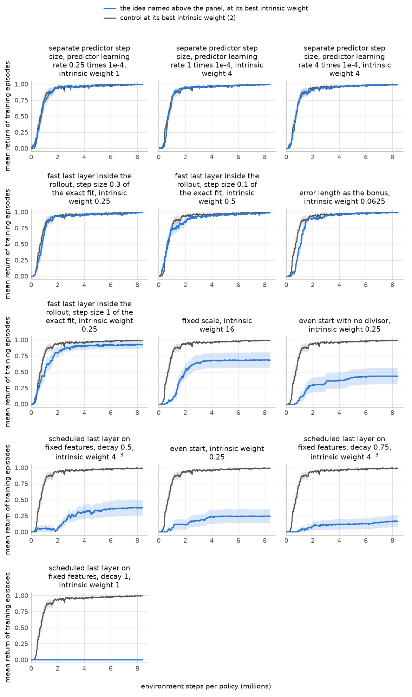
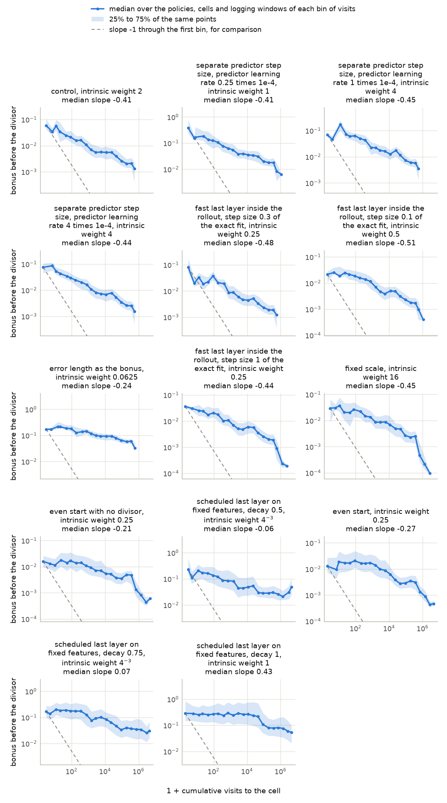

# Batch 1 screen on PointMaze Large with reward 1 on arrival: the start, the scale and the decay of the bonus

Generated 2026-11-12 16:27 PT by the command below. This file is generated: regenerate it, do not edit it. Times are Pacific, converted from machines running Eastern. Run folder: `2026-11-12-00-22_pointmaze-medium-large_antmaze-umaze-medium-large_beat-cleanrl-ppo-rnd-auto-research_reward-arrival-plus-1-and-step-cost_bonus-5-days_other-parts-5-days`; batch folder: `batches/01_start-scale-and-decay-of-the-bonus-on-continuous-inputs`.

```bash
cd /p/rlprojects/RND/10_jax_exploration_platform
bash "benchmark_runs/2026-11-12-00-17_pointmaze-antmaze_cleanrl-ppo-rnd_speed-30-ideas_screen-15-minutes-per-idea-per-card_h100-nvl_rtx-5080_rtx-a4500/infrastructure/submit_tests.sh" -s scripts/maze_campaign/analysis/batch_summary_job.py \
    --run-dir=runs/2026-11-12-00-22_pointmaze-medium-large_antmaze-umaze-medium-large_beat-cleanrl-ppo-rnd-auto-research_reward-arrival-plus-1-and-step-cost_bonus-5-days_other-parts-5-days \
    --batch=01_start-scale-and-decay-of-the-bonus-on-continuous-inputs
```

## Contents

| section | first written | last changed | status |
|---|---|---|---|
| [Units](#units) | 2026-11-12 14:12 PT | 2026-11-12 16:27 PT | unread |
| [Measures](#measures) | 2026-11-12 14:12 PT | 2026-11-12 16:13 PT | unread |
| [Discovery and optimization: whole-curve mean](#discovery-and-optimization-whole-curve-mean) | 2026-11-12 16:13 PT | 2026-11-12 16:13 PT | unread |
| [Whole-curve mean at every intrinsic weight](#whole-curve-mean-at-every-intrinsic-weight) | 2026-11-12 14:12 PT | 2026-11-12 16:27 PT | unread |
| [Discovery: mean capped first-goal time](#discovery-mean-capped-first-goal-time) | 2026-11-12 16:13 PT | 2026-11-12 16:27 PT | unread |
| [Mean capped first-goal time at every intrinsic weight](#mean-capped-first-goal-time-at-every-intrinsic-weight) | 2026-11-12 16:13 PT | 2026-11-12 16:27 PT | unread |
| [Training curves](#training-curves) | 2026-11-12 14:12 PT | 2026-11-12 16:13 PT | unread |
| [Properties of the bonus on the maze grid](#properties-of-the-bonus-on-the-maze-grid) | 2026-11-12 14:12 PT | 2026-11-12 16:13 PT | unread |
| [Predictions](#predictions) | 2026-11-12 14:12 PT | 2026-11-12 15:04 PT | unread |
| [Ideas against the control](#ideas-against-the-control) | 2026-11-12 14:12 PT | 2026-11-12 16:27 PT | unread |
| [Validation block](#validation-block) | 2026-11-12 16:13 PT | 2026-11-12 16:21 PT | unread |
| [Consistency check against the baseline run](#consistency-check-against-the-baseline-run) | 2026-11-12 14:12 PT | 2026-11-12 16:21 PT | unread |
| [Records that need a look](#records-that-need-a-look) | 2026-11-12 14:12 PT | 2026-11-12 15:04 PT | unread |

Times are Pacific, converted from machines running Eastern, and come from this report's own history of regenerations. [The same report with unread sections in blue and changed text in brown](summary.html). No section marks itself read.

## Units

20 of 22 units are complete. Only complete units enter the tables and figures below; nothing is estimated for the others. Left out: control, at the intrinsic weights 256, 1024, 4096; separate predictor step size, predictor learning rate 0.25 times 1e-4, at the intrinsic weights 256, 1024, 4096.

| unit | method | state | logging windows written | card | finished | place in the queue |
|---|---|---|---|---|---|---|
| 1 | control | complete | 256 of 256 | NVIDIA GeForce RTX 2080 Ti | 2026-11-12 13:52 PT | `queue/done` |
| 2 | even start | complete | 256 of 256 | NVIDIA GeForce RTX 2080 Ti | 2026-11-12 13:55 PT | `queue/done` |
| 3 | fixed scale | complete | 256 of 256 | NVIDIA GeForce RTX 2080 Ti | 2026-11-12 14:00 PT | `queue/done` |
| 4 | even start with no divisor | complete | 256 of 256 | NVIDIA RTX 4000 Ada Generation | 2026-11-12 14:01 PT | `queue/done` |
| 5 | separate predictor step size, predictor learning rate 0.25 times 1e-4 | complete | 256 of 256 | NVIDIA RTX 4000 Ada Generation | 2026-11-12 14:05 PT | `queue/done` |
| 6 | separate predictor step size, predictor learning rate 1 times 1e-4 | complete | 256 of 256 | NVIDIA GeForce RTX 2080 Ti | 2026-11-12 14:04 PT | `queue/done` |
| 7 | separate predictor step size, predictor learning rate 4 times 1e-4 | complete | 256 of 256 | NVIDIA GeForce RTX 2080 Ti | 2026-11-12 14:06 PT | `queue/done` |
| 8 | error length as the bonus | complete | 256 of 256 | NVIDIA GeForce RTX 2080 Ti | 2026-11-12 14:10 PT | `queue/done` |
| 9 | fast last layer inside the rollout, step size 0.1 of the exact fit | complete | 256 of 256 | NVIDIA RTX 4000 Ada Generation | 2026-11-12 14:36 PT | `queue/done` |
| 10 | fast last layer inside the rollout, step size 0.3 of the exact fit | complete | 256 of 256 | NVIDIA GeForce RTX 2080 Ti | 2026-11-12 14:54 PT | `queue/done` |
| 11 | fast last layer inside the rollout, step size 1 of the exact fit | complete | 256 of 256 | NVIDIA GeForce RTX 2080 Ti | 2026-11-12 15:01 PT | `queue/done` |
| 12 | scheduled last layer on fixed features, decay 0.5 | complete | 256 of 256 | NVIDIA RTX 4000 Ada Generation | 2026-11-12 14:31 PT | `queue/done` |
| 13 | scheduled last layer on fixed features, decay 0.75 | complete | 256 of 256 | NVIDIA GeForce RTX 2080 Ti | 2026-11-12 14:54 PT | `queue/done` |
| 14 | scheduled last layer on fixed features, decay 1 | complete | 256 of 256 | NVIDIA A30 | 2026-11-12 14:08 PT | `queue/done` |
| 15 | control, at the intrinsic weights 256, 1024, 4096 | unfinished | 157 of 256 | NVIDIA RTX 4000 Ada Generation | not finished | `queue/running` |
| 16 | separate predictor step size, predictor learning rate 0.25 times 1e-4, at the intrinsic weights 256, 1024, 4096 | unfinished | 58 of 256 | NVIDIA GeForce RTX 2080 Ti | not finished | `queue/running` |
| 17 | separate predictor step size, predictor learning rate 1 times 1e-4, at the intrinsic weights 256, 1024, 4096 | complete | 256 of 256 | NVIDIA A10 | 2026-11-12 16:14 PT | `queue/done` |
| 18 | separate predictor step size, predictor learning rate 4 times 1e-4, at the intrinsic weights 256, 1024, 4096 | complete | 256 of 256 | NVIDIA A30 | 2026-11-12 16:15 PT | `queue/done` |
| 19 | error length as the bonus, at the intrinsic weights 256, 1024, 4096 | complete | 256 of 256 | NVIDIA A10 | 2026-11-12 16:21 PT | `queue/done` |
| 20 | fast last layer inside the rollout, step size 0.1 of the exact fit, at the intrinsic weights 256, 1024, 4096 | complete | 256 of 256 | NVIDIA A10 | 2026-11-12 16:07 PT | `queue/done` |
| 21 | fast last layer inside the rollout, step size 0.3 of the exact fit, at the intrinsic weights 256, 1024, 4096 | complete | 256 of 256 | NVIDIA A10 | 2026-11-12 16:02 PT | `queue/done` |
| 22 | fast last layer inside the rollout, step size 1 of the exact fit, at the intrinsic weights 256, 1024, 4096 | complete | 256 of 256 | NVIDIA A10 | 2026-11-12 16:02 PT | `queue/done` |

Unit names, by the number in the first column:

1. `batch-01-screen_pointmaze-large_reward-arrival-plus-one_control-cleanrl-ppo-rnd_cells-01-to-12-of-12_seeds-0-to-15`
2. `batch-01-screen_pointmaze-large_reward-arrival-plus-one_even-start_cells-01-to-12-of-12_seeds-0-to-15`
3. `batch-01-screen_pointmaze-large_reward-arrival-plus-one_fixed-scale_cells-01-to-12-of-12_seeds-0-to-15`
4. `batch-01-screen_pointmaze-large_reward-arrival-plus-one_even-start-with-no-divisor_cells-01-to-12-of-12_seeds-0-to-15`
5. `batch-01-screen_pointmaze-large_reward-arrival-plus-one_separate-predictor-step-size-multiple-0-point-25_cells-01-to-12-of-12_seeds-0-to-15`
6. `batch-01-screen_pointmaze-large_reward-arrival-plus-one_separate-predictor-step-size-multiple-1_cells-01-to-12-of-12_seeds-0-to-15`
7. `batch-01-screen_pointmaze-large_reward-arrival-plus-one_separate-predictor-step-size-multiple-4_cells-01-to-12-of-12_seeds-0-to-15`
8. `batch-01-screen_pointmaze-large_reward-arrival-plus-one_error-length-as-the-bonus_cells-01-to-12-of-12_seeds-0-to-15`
9. `batch-01-screen_pointmaze-large_reward-arrival-plus-one_fast-last-layer-inside-the-rollout-step-0-point-1_cells-01-to-12-of-12_seeds-0-to-15`
10. `batch-01-screen_pointmaze-large_reward-arrival-plus-one_fast-last-layer-inside-the-rollout-step-0-point-3_cells-01-to-12-of-12_seeds-0-to-15`
11. `batch-01-screen_pointmaze-large_reward-arrival-plus-one_fast-last-layer-inside-the-rollout-step-1_cells-01-to-12-of-12_seeds-0-to-15`
12. `batch-01-screen_pointmaze-large_reward-arrival-plus-one_scheduled-last-layer-on-fixed-features-decay-0-point-5_cells-01-to-12-of-12_seeds-0-to-15`
13. `batch-01-screen_pointmaze-large_reward-arrival-plus-one_scheduled-last-layer-on-fixed-features-decay-0-point-75_cells-01-to-12-of-12_seeds-0-to-15`
14. `batch-01-screen_pointmaze-large_reward-arrival-plus-one_scheduled-last-layer-on-fixed-features-decay-1_cells-01-to-12-of-12_seeds-0-to-15`
15. `batch-01-screen-larger-weights_pointmaze-large_reward-arrival-plus-one_control-cleanrl-ppo-rnd_cells-1-to-3-of-3_seeds-0-to-15`
16. `batch-01-screen-larger-weights_pointmaze-large_reward-arrival-plus-one_separate-predictor-step-size-multiple-0-point-25_cells-1-to-3-of-3_seeds-0-to-15`
17. `batch-01-screen-larger-weights_pointmaze-large_reward-arrival-plus-one_separate-predictor-step-size-multiple-1_cells-1-to-3-of-3_seeds-0-to-15`
18. `batch-01-screen-larger-weights_pointmaze-large_reward-arrival-plus-one_separate-predictor-step-size-multiple-4_cells-1-to-3-of-3_seeds-0-to-15`
19. `batch-01-screen-larger-weights_pointmaze-large_reward-arrival-plus-one_error-length-as-the-bonus_cells-1-to-3-of-3_seeds-0-to-15`
20. `batch-01-screen-larger-weights_pointmaze-large_reward-arrival-plus-one_fast-last-layer-inside-the-rollout-step-0-point-1_cells-1-to-3-of-3_seeds-0-to-15`
21. `batch-01-screen-larger-weights_pointmaze-large_reward-arrival-plus-one_fast-last-layer-inside-the-rollout-step-0-point-3_cells-1-to-3-of-3_seeds-0-to-15`
22. `batch-01-screen-larger-weights_pointmaze-large_reward-arrival-plus-one_fast-last-layer-inside-the-rollout-step-1_cells-1-to-3-of-3_seeds-0-to-15`

## Measures

Two metrics are reported, each in its own table with its own best intrinsic weight per method: the whole-curve mean $W$ measures discovery and optimization together, and the mean capped first-goal time $M$ measures discovery alone. The two are never mixed in one choice.

Define $K$ as the number of policies (seeds) of one method at one intrinsic weight ($K = 16$, the development seeds 0 to 15), $B$ as the budget in environment steps per policy ($B$ = 8,388,608), $R_i(s)$ as the mean return of the training episodes of policy $i$ that end in the logging window containing step $s$, and $\Delta s$ as the number of that window's steps inside the range being averaged. An episode returns 1 if it reaches the goal and 0 otherwise. A window in which no episode ends takes the value of the window before it; before a policy's first finished episode the value is 0.

1. **Whole-curve mean:** $W(B) = \dfrac{1}{K}\sum_{i=1}^{K} \dfrac{1}{B}\sum_{s \le B} R_i(s) \thinspace \Delta s$, the area under the training curve divided by the budget.
2. **Final level:** $L(B) = \dfrac{1}{K}\sum_{i=1}^{K} \dfrac{1}{0.1 B}\sum_{0.9 B \lt s \le B} R_i(s) \thinspace \Delta s$, the same mean over the last 10% of the budget.
3. **Best intrinsic weight for the whole-curve mean:** per method, the one of the intrinsic weights it was trained at with the highest $W$; ties go to the higher $L$.
4. **Difference from the control:** define $d_i$ as the value of seed $i$ under the method at its best weight for $W$ minus its value under the control at the control's own best weight for $W$. The tables give $\bar d = \dfrac{1}{K}\sum_{i=1}^{K} d_i$ for $W$ and for $L$, each with a 95% interval: the 2.5% and 97.5% points of the means of 10,000 resamples of the $K$ seeds, drawn with replacement. An idea is ahead of the control when the interval is entirely above zero, behind when it is entirely below zero, and within the interval otherwise.
5. **Median first-arrival step:** define $T_i$ as the training step of policy $i$'s first arrival at the goal ($T_i = \infty$ if it has none by step $B$). The measure is the median of $T_i$ over the $K$ policies; it reads "none" when the median falls on a policy with no arrival.
6. **Policies that reach the goal:** the number of the $K$ policies with $T_i \le B$.
7. **Mean capped first-goal time, the secondary metric:** $M(B) = \dfrac{1}{K}\sum_{i=1}^{K} \min(T_i, B)$, the mean over the policies of the training step of the first arrival at the goal, a policy with no arrival by step $B$ counting as $B$. Smaller is better. The tables give $M$ in thousands of steps.
8. **Best intrinsic weight for the mean capped first-goal time:** per method, the one of the intrinsic weights it was trained at with the smallest $M$; ties go to the weight at which more policies reach the goal. It can differ from the best weight of item 3.
9. **Difference in the mean capped first-goal time from the control:** as item 4, with $d_i$ the value of $\min(T_i, B)$ of seed $i$ under the method at its best weight for $M$ minus the same under the control at the control's own best weight for $M$. A negative $\bar d$ means the goal was first reached earlier than under the control. An idea is ahead of the control on discovery when the 95% interval is entirely below zero, behind when it is entirely above zero, and within the interval otherwise.

Standard errors are over the $K$ policies.

## Discovery and optimization: whole-curve mean

Define $W$, $L$ and the other columns as in the section Measures. One row per method at its best intrinsic weight for $W$, read at 8,388,608 environment steps per policy. The control is the first row; the ideas follow, sorted by $W$. Per column, the best value is bold and the second best underlined; for the median first-arrival step the smallest value is the best. Differences are the method minus the control at the control's own best intrinsic weight (2), on the 16 seeds both have; the brackets hold the 95% interval. The seeds are the development seeds, on which each best weight was also chosen: this table is a screen and not a verdict.

| method | best intrinsic weight for $W$ | whole-curve mean $W$ ↑ ± standard error | difference in $W$ from the control [95% interval] | final level $L$ | difference in $L$ from the control [95% interval] | median first-arrival step | policies that reach the goal |
|---|---|---|---|---|---|---|---|
| control | 2 | <u>0.885</u> ± 0.010 | control | <u>0.994</u> | control | 191.9K | **16 of 16** |
| separate predictor step size, predictor learning rate 0.25 times 1e-4 | 1 | **0.887** ± 0.012 | **+0.003** [-0.027, +0.034] | **0.998** | **+0.003** [+0.001, +0.006] | 195.1K | **16 of 16** |
| separate predictor step size, predictor learning rate 1 times 1e-4 | 4 | 0.881 ± 0.006 | <u>-0.003</u> [-0.028, +0.024] | <u>0.994</u> | -0.001 [-0.004, +0.002] | <u>152.7K</u> | **16 of 16** |
| separate predictor step size, predictor learning rate 4 times 1e-4 | 4 | 0.878 ± 0.010 | -0.006 [-0.036, +0.025] | 0.991 | -0.004 [-0.012, +0.002] | 223.9K | **16 of 16** |
| fast last layer inside the rollout, step size 0.3 of the exact fit | 0.25 | 0.869 ± 0.008 | -0.016 [-0.036, +0.005] | 0.991 | -0.004 [-0.007, -0.000] | 166.1K | **16 of 16** |
| fast last layer inside the rollout, step size 0.1 of the exact fit | 0.5 | 0.862 ± 0.016 | -0.023 [-0.064, +0.013] | 0.984 | -0.010 [-0.016, -0.005] | **99.1K** | **16 of 16** |
| error length as the bonus | 0.0625 | 0.845 ± 0.008 | -0.040 [-0.064, -0.013] | <u>0.994</u> | <u>-0.000</u> [-0.003, +0.003] | 527.2K | **16 of 16** |
| fast last layer inside the rollout, step size 1 of the exact fit | 0.25 | 0.798 ± 0.056 | -0.086 [-0.205, -0.009] | 0.926 | -0.068 [-0.196, -0.001] | 336.7K | **16 of 16** |
| fixed scale | 16 | 0.547 ± 0.096 | -0.338 [-0.523, -0.171] | 0.687 | -0.307 [-0.558, -0.118] | 902.3K | <u>13 of 16</u> |
| even start with no divisor | 0.25 | 0.327 ± 0.099 | -0.557 [-0.737, -0.372] | 0.437 | -0.557 [-0.806, -0.308] | 1.67M | 10 of 16 |
| scheduled last layer on fixed features, decay 0.5 | $4^{-3}$ | 0.247 ± 0.083 | -0.637 [-0.799, -0.471] | 0.378 | -0.616 [-0.854, -0.372] | 1.86M | 11 of 16 |
| even start | 0.25 | 0.186 ± 0.085 | -0.698 [-0.841, -0.533] | 0.247 | -0.748 [-0.933, -0.503] | 2.59M | 9 of 16 |
| scheduled last layer on fixed features, decay 0.75 | $4^{-3}$ | 0.106 ± 0.067 | -0.779 [-0.882, -0.641] | 0.166 | -0.829 [-0.994, -0.643] | 3.24M | 11 of 16 |
| scheduled last layer on fixed features, decay 1 | 1 | 0.000 ± 0.000 | -0.884 [-0.901, -0.863] | 0.000 | -0.994 [-0.996, -0.992] | 5.16M | 9 of 16 |

## Whole-curve mean at every intrinsic weight

Define $W$ as in the section Measures. Rows are in the order of the table of the whole-curve mean. The 15 weights are split over three tables so that each fits the width of a printed page. A method that was not trained at a weight has an empty cell there. Per weight (column), the highest $W$ among the methods is bold and the second highest underlined. The last column names each method's best weight for $W$ and says when it is the smallest or the largest of the weights the method was trained at.

| method | weight $4^{-6}$ | weight $4^{-5}$ | weight $4^{-4}$ | weight $4^{-3}$ | weight 0.0625 | best intrinsic weight for $W$ |
|---|---|---|---|---|---|---|
| control | <u>0.000</u> | 0.000 | 0.000 | 0.090 | 0.159 | 2 |
| separate predictor step size, predictor learning rate 0.25 times 1e-4 | <u>0.000</u> | 0.025 | 0.000 | 0.000 | 0.176 | 1 |
| separate predictor step size, predictor learning rate 1 times 1e-4 | **0.059** | 0.000 | 0.000 | 0.000 | 0.096 | 4 |
| separate predictor step size, predictor learning rate 4 times 1e-4 | <u>0.000</u> | 0.000 | 0.000 | 0.000 | 0.227 | 4 |
| fast last layer inside the rollout, step size 0.3 of the exact fit | <u>0.000</u> | **0.050** | **0.156** | <u>0.507</u> | 0.740 | 0.25 |
| fast last layer inside the rollout, step size 0.1 of the exact fit | <u>0.000</u> | <u>0.047</u> | 0.050 | 0.478 | <u>0.790</u> | 0.5 |
| error length as the bonus | <u>0.000</u> | 0.000 | <u>0.051</u> | **0.607** | **0.845** | 0.0625 |
| fast last layer inside the rollout, step size 1 of the exact fit | <u>0.000</u> | 0.000 | 0.000 | 0.315 | 0.677 | 0.25 |
| fixed scale | <u>0.000</u> | 0.000 | 0.000 | 0.000 | 0.000 | 16 |
| even start with no divisor | <u>0.000</u> | 0.000 | 0.000 | 0.000 | 0.129 | 0.25 |
| scheduled last layer on fixed features, decay 0.5 | <u>0.000</u> | 0.000 | 0.039 | 0.247 | 0.166 | $4^{-3}$ |
| even start | <u>0.000</u> | 0.000 | 0.000 | 0.000 | 0.000 | 0.25 |
| scheduled last layer on fixed features, decay 0.75 | <u>0.000</u> | 0.000 | 0.037 | 0.106 | 0.000 | $4^{-3}$ |
| scheduled last layer on fixed features, decay 1 | <u>0.000</u> | 0.000 | 0.000 | 0.000 | 0.000 | 1 |

| method | weight 0.25 | weight 0.5 | weight 1 | weight 2 | weight 4 | best intrinsic weight for $W$ |
|---|---|---|---|---|---|---|
| control | 0.728 | 0.846 | 0.860 | **0.885** | 0.867 | 2 |
| separate predictor step size, predictor learning rate 0.25 times 1e-4 | 0.744 | <u>0.860</u> | **0.887** | <u>0.883</u> | 0.870 | 1 |
| separate predictor step size, predictor learning rate 1 times 1e-4 | 0.686 | 0.821 | <u>0.865</u> | 0.874 | **0.881** | 4 |
| separate predictor step size, predictor learning rate 4 times 1e-4 | 0.699 | 0.832 | 0.860 | 0.860 | <u>0.878</u> | 4 |
| fast last layer inside the rollout, step size 0.3 of the exact fit | **0.869** | 0.830 | 0.702 | 0.400 | 0.170 | 0.25 |
| fast last layer inside the rollout, step size 0.1 of the exact fit | <u>0.852</u> | **0.862** | 0.834 | 0.635 | 0.345 | 0.5 |
| error length as the bonus | 0.793 | 0.571 | 0.259 | 0.071 | 0.028 | 0.0625 |
| fast last layer inside the rollout, step size 1 of the exact fit | 0.798 | 0.780 | 0.725 | 0.462 | 0.160 | 0.25 |
| fixed scale | 0.038 | 0.115 | 0.131 | 0.274 | 0.370 | 16 |
| even start with no divisor | 0.327 | 0.199 | 0.182 | 0.037 | 0.000 | 0.25 |
| scheduled last layer on fixed features, decay 0.5 | 0.001 | 0.002 | 0.001 | 0.002 | 0.001 | $4^{-3}$ |
| even start | 0.186 | 0.184 | 0.086 | 0.016 | 0.000 | 0.25 |
| scheduled last layer on fixed features, decay 0.75 | 0.001 | 0.000 | 0.001 | 0.001 | 0.000 | $4^{-3}$ |
| scheduled last layer on fixed features, decay 1 | 0.000 | 0.000 | 0.000 | 0.000 | 0.000 | 1 |

| method | weight 16 | weight 64 | weight 256 | weight 1024 | weight 4096 | best intrinsic weight for $W$ |
|---|---|---|---|---|---|---|
| control | 0.575 | 0.065 |  |  |  | 2 |
| separate predictor step size, predictor learning rate 0.25 times 1e-4 | **0.739** | **0.194** |  |  |  | 1 |
| separate predictor step size, predictor learning rate 1 times 1e-4 | <u>0.722</u> | <u>0.175</u> | <u>0.016</u> | 0.010 | 0.011 | 4 |
| separate predictor step size, predictor learning rate 4 times 1e-4 | 0.718 | 0.153 | 0.013 | 0.011 | 0.011 | 4 |
| fast last layer inside the rollout, step size 0.3 of the exact fit | 0.015 | 0.013 | 0.008 | 0.009 | 0.008 | 0.25 |
| fast last layer inside the rollout, step size 0.1 of the exact fit | 0.036 | 0.021 | **0.017** | **0.017** | <u>0.016</u> | 0.5 |
| error length as the bonus | 0.021 | 0.018 | **0.017** | <u>0.016</u> | **0.017** | 0.0625 |
| fast last layer inside the rollout, step size 1 of the exact fit | 0.017 | 0.011 | 0.010 | 0.008 | 0.008 | 0.25 |
| fixed scale | 0.547 | 0.002 |  |  |  | 16 |
| even start with no divisor | 0.000 | 0.000 |  |  |  | 0.25 |
| scheduled last layer on fixed features, decay 0.5 | 0.001 | 0.001 |  |  |  | $4^{-3}$ |
| even start | 0.000 | 0.000 |  |  |  | 0.25 |
| scheduled last layer on fixed features, decay 0.75 | 0.000 | 0.000 |  |  |  | $4^{-3}$ |
| scheduled last layer on fixed features, decay 1 | 0.000 | 0.000 |  |  |  | 1 |

No method has its best weight at an end of the grid.

## Discovery: mean capped first-goal time

Define $M$, $W$ and $L$ as in the section Measures. One row per method at its best intrinsic weight for $M$ (the smallest $M$; ties go to the weight at which more policies reach the goal), read at 8,388,608 environment steps per policy. This weight can differ from the best weight for $W$ in the table of the whole-curve mean. $M$, its standard error and its differences are in thousands of steps. The control is the first row; the ideas follow, sorted by $M$ from the smallest. Per column, the best value is bold and the second best underlined: the smallest for $M$ and for its difference, the largest for the other columns. The columns $W$ and $L$ are read at the same weight as $M$, so they show what the configuration that is best for discovery gives on the primary metric. Differences are the method minus the control at the control's own best intrinsic weight for $M$ (64), on the 16 seeds both have; the brackets hold the 95% interval, and a negative difference means the goal was first reached earlier than under the control. A best weight marked "largest of the grid" or "smallest of the grid" is at an end of the weights the method was trained at: larger or smaller weights must be tried before anything is concluded from that row. The seeds are the development seeds, on which each best weight was also chosen: this table is a screen and not a verdict.

| method | best intrinsic weight for $M$ | $M$ ↓ ± standard error, thousand steps | difference in $M$ from the control [95% interval], thousand steps | policies that reach the goal | $W$ at that weight ± standard error | $L$ at that weight |
|---|---|---|---|---|---|---|
| control | 64 (largest of the grid) | 190 ± 50.8 | control | **16 of 16** | 0.065 ± 0.014 | 0.112 |
| fast last layer inside the rollout, step size 0.1 of the exact fit | 4096 (largest of the grid) | **49.7** ± 9.98 | **-140** [-249, -57.1] | **16 of 16** | 0.016 ± 0.001 | 0.012 |
| error length as the bonus | 4096 (largest of the grid) | <u>64.1</u> ± 9.59 | <u>-125</u> [-229, -55.4] | **16 of 16** | 0.017 ± 0.001 | 0.019 |
| fast last layer inside the rollout, step size 0.3 of the exact fit | 256 | 67.9 ± 11.3 | -122 [-242, -36.1] | **16 of 16** | 0.008 ± 0.001 | 0.006 |
| fast last layer inside the rollout, step size 1 of the exact fit | 16 | 114 ± 21.7 | -75.6 [-195, +13.9] | **16 of 16** | 0.017 ± 0.003 | 0.021 |
| separate predictor step size, predictor learning rate 1 times 1e-4 | 64 | 132 ± 25.5 | -57.7 [-131, +1.86] | **16 of 16** | 0.175 ± 0.023 | <u>0.291</u> |
| separate predictor step size, predictor learning rate 0.25 times 1e-4 | 64 (largest of the grid) | 137 ± 36.3 | -52.4 [-193, +71] | **16 of 16** | <u>0.194</u> ± 0.017 | **0.348** |
| separate predictor step size, predictor learning rate 4 times 1e-4 | 1024 | 151 ± 24.7 | -38.5 [-177, +72.7] | **16 of 16** | 0.011 ± 0.001 | 0.007 |
| fixed scale | 64 (largest of the grid) | 1,246 ± 487 | +1,057 [+406, +2,132] | <u>15 of 16</u> | 0.002 ± 0.000 | 0.000 |
| scheduled last layer on fixed features, decay 0.5 | 0.5 | 1,723 ± 648 | +1,533 [+434, +2,866] | <u>15 of 16</u> | 0.002 ± 0.001 | 0.001 |
| even start with no divisor | 0.5 | 2,743 ± 804 | +2,553 [+1,119, +4,133] | 13 of 16 | **0.199** ± 0.091 | 0.249 |
| scheduled last layer on fixed features, decay 0.75 | 1 | 2,971 ± 827 | +2,781 [+1,321, +4,432] | 13 of 16 | 0.001 ± 0.000 | 0.000 |
| even start | 1 | 3,730 ± 923 | +3,540 [+1,868, +5,355] | 11 of 16 | 0.086 ± 0.040 | 0.148 |
| scheduled last layer on fixed features, decay 1 | 0.0625 | 4,462 ± 927 | +4,272 [+2,564, +5,971] | 9 of 16 | 0.000 ± 0.000 | 0.000 |

## Mean capped first-goal time at every intrinsic weight

Define $M$ as in the section Measures; the cells give it in thousands of steps. Rows are in the order of the table of the mean capped first-goal time. The 15 weights are split over three tables so that each fits the width of a printed page. A method that was not trained at a weight has an empty cell there. Per weight (column), the smallest $M$ among the methods is bold and the second smallest underlined. The last column names each method's best weight for $M$ and says when it is the smallest or the largest of the weights the method was trained at.

| method | weight $4^{-6}$ | weight $4^{-5}$ | weight $4^{-4}$ | weight $4^{-3}$ | weight 0.0625 | best intrinsic weight for $M$ |
|---|---|---|---|---|---|---|
| control | **7,376** | 8,389 | 8,389 | 7,050 | 3,980 | 64 (largest of the grid) |
| fast last layer inside the rollout, step size 0.1 of the exact fit | 8,389 | 7,449 | 7,518 | 2,343 | <u>994</u> | 4096 (largest of the grid) |
| error length as the bonus | 8,389 | 8,389 | 6,690 | <u>2,306</u> | **577** | 4096 (largest of the grid) |
| fast last layer inside the rollout, step size 0.3 of the exact fit | 7,883 | **7,418** | 6,066 | **2,090** | 1,191 | 256 |
| fast last layer inside the rollout, step size 1 of the exact fit | <u>7,563</u> | 7,996 | 8,389 | 4,220 | 1,705 | 16 |
| separate predictor step size, predictor learning rate 1 times 1e-4 | 7,868 | 8,389 | 8,389 | 8,389 | 6,021 | 64 |
| separate predictor step size, predictor learning rate 0.25 times 1e-4 | 7,893 | 7,604 | 7,895 | 7,531 | 6,788 | 64 (largest of the grid) |
| separate predictor step size, predictor learning rate 4 times 1e-4 | 8,389 | 8,389 | 8,389 | 7,894 | 5,851 | 1024 |
| fixed scale | 8,389 | 8,389 | 8,389 | 8,389 | 8,389 | 64 (largest of the grid) |
| scheduled last layer on fixed features, decay 0.5 | 8,389 | 7,967 | **5,790** | 3,470 | 2,730 | 0.5 |
| even start with no divisor | 8,389 | 7,925 | 8,389 | 7,878 | 5,754 | 0.5 |
| scheduled last layer on fixed features, decay 0.75 | 8,389 | <u>7,426</u> | <u>5,938</u> | 4,030 | 5,240 | 1 |
| even start | 8,389 | 8,389 | 7,276 | 8,389 | 6,481 | 1 |
| scheduled last layer on fixed features, decay 1 | 7,893 | **7,418** | 7,479 | 6,126 | 4,462 | 0.0625 |

| method | weight 0.25 | weight 0.5 | weight 1 | weight 2 | weight 4 | best intrinsic weight for $M$ |
|---|---|---|---|---|---|---|
| control | 1,289 | 604 | 453 | 220 | 220 | 64 (largest of the grid) |
| fast last layer inside the rollout, step size 0.1 of the exact fit | **198** | 255 | **80.6** | **78.8** | **67** | 4096 (largest of the grid) |
| error length as the bonus | <u>225</u> | <u>212</u> | <u>101</u> | <u>109</u> | <u>104</u> | 4096 (largest of the grid) |
| fast last layer inside the rollout, step size 0.3 of the exact fit | 245 | **182** | 701 | 614 | 138 | 256 |
| fast last layer inside the rollout, step size 1 of the exact fit | 901 | 789 | 171 | 207 | 139 | 16 |
| separate predictor step size, predictor learning rate 1 times 1e-4 | 1,699 | 643 | 370 | 274 | 214 | 64 |
| separate predictor step size, predictor learning rate 0.25 times 1e-4 | 1,434 | 294 | 286 | 196 | 177 | 64 (largest of the grid) |
| separate predictor step size, predictor learning rate 4 times 1e-4 | 1,682 | 531 | 477 | 334 | 230 | 1024 |
| fixed scale | 8,054 | 6,794 | 6,572 | 4,246 | 3,239 | 64 (largest of the grid) |
| scheduled last layer on fixed features, decay 0.5 | 3,566 | 1,723 | 1,876 | 4,580 | 4,082 | 0.5 |
| even start with no divisor | 4,006 | 2,743 | 4,405 | 5,039 | 6,169 | 0.5 |
| scheduled last layer on fixed features, decay 0.75 | 4,400 | 3,974 | 2,971 | 4,381 | 3,795 | 1 |
| even start | 4,447 | 4,147 | 3,730 | 4,388 | 3,888 | 1 |
| scheduled last layer on fixed features, decay 1 | 5,561 | 6,002 | 4,858 | 7,098 | 5,778 | 0.0625 |

| method | weight 16 | weight 64 | weight 256 | weight 1024 | weight 4096 | best intrinsic weight for $M$ |
|---|---|---|---|---|---|---|
| control | 236 | 190 |  |  |  | 64 (largest of the grid) |
| fast last layer inside the rollout, step size 0.1 of the exact fit | **62** | **87.9** | 99.6 | **100** | **49.7** | 4096 (largest of the grid) |
| error length as the bonus | <u>89</u> | <u>88.4</u> | <u>74.6</u> | <u>103</u> | <u>64.1</u> | 4096 (largest of the grid) |
| fast last layer inside the rollout, step size 0.3 of the exact fit | 1,194 | 116 | **67.9** | 168 | 598 | 256 |
| fast last layer inside the rollout, step size 1 of the exact fit | 114 | 1,456 | 601 | 257 | 149 | 16 |
| separate predictor step size, predictor learning rate 1 times 1e-4 | 200 | 132 | 161 | 159 | 138 | 64 |
| separate predictor step size, predictor learning rate 0.25 times 1e-4 | 140 | 137 |  |  |  | 64 (largest of the grid) |
| separate predictor step size, predictor learning rate 4 times 1e-4 | 177 | 241 | 157 | 151 | 168 | 1024 |
| fixed scale | 2,233 | 1,246 |  |  |  | 64 (largest of the grid) |
| scheduled last layer on fixed features, decay 0.5 | 1,793 | 2,014 |  |  |  | 0.5 |
| even start with no divisor | 4,706 | 5,120 |  |  |  | 0.5 |
| scheduled last layer on fixed features, decay 0.75 | 3,877 | 3,909 |  |  |  | 1 |
| even start | 4,711 | 4,124 |  |  |  | 1 |
| scheduled last layer on fixed features, decay 1 | 5,126 | 5,376 |  |  |  | 0.0625 |

Best weight for $M$ at an end of the grid: control (64, the largest); fast last layer inside the rollout, step size 0.1 of the exact fit (4096, the largest); error length as the bonus (4096, the largest); separate predictor step size, predictor learning rate 0.25 times 1e-4 (64, the largest); fixed scale (64, the largest). Larger or smaller weights must be tried on that side before anything is concluded from these rows (the edge rule of `program.md`).

## Training curves

Define $\bar R(s) = \dfrac{1}{K}\sum_{i=1}^{K} R_i(s)$, with $R_i(s)$ and $K$ as in the section Measures. One panel per idea in the order of the table of the whole-curve mean: the idea at its best intrinsic weight for $W$ in blue, the control at its best intrinsic weight (2) in grey; bands are one standard error over the 16 seeds.



## Properties of the bonus on the maze grid

Every unit records, per policy and per open maze cell (46 cells), the bonus at one probe observation (the cell's centre, zero velocity) at the end of every logging window, and the visits to the cell. Define $b_i(c, w)$ as the bonus before the divisor of policy $i$ at the probe of cell $c$ at the end of logging window $w$, with $w = 0$ for the record written after the random-action rollouts and before the first training iteration; $r_i(c, w)$ as the same bonus after the divisor (the intrinsic reward); $n_i(c, w)$ as the number of states of policy $i$'s rollouts in cell $c$ from the first window to window $w$; $\beta$ as the intrinsic weight; $C$ as the number of open cells ($C = 46$); and $w_f$ as the last logging window that ends at or before the share $f$ of the budget (5% is read at step 393,216, 25% is read at step 2,097,152, 100% is read at step 8,388,608).

1. **Start ratio:** $E_i = \dfrac{\max_c b_i(c, 0)}{\min_c b_i(c, 0)}$, the largest over the smallest start bonus on the grid. The table gives the median over all policies of the unit (every weight).
2. **Decay slope:** define $x_w = \log(1 + n_i(c, w))$ and $y_w = \log b_i(c, w)$, and $\bar x$ and $\bar y$ as their means over the windows $w \ge 1$ with $n_i(c, w) \ge 1$. Per policy and cell, $a_i(c) = \dfrac{\sum_w (x_w - \bar x)(y_w - \bar y)}{\sum_w (x_w - \bar x)^2}$ over those windows: the least-squares slope of the logarithm of the bonus on the logarithm of one plus the cumulative visits. A slope of $-1$ means the bonus falls in proportion to $1/(1 + n)$. The table gives the median over the policies and cells at the method's best weight, and the smallest and the largest of the per-weight medians with the weights they belong to: when the two differ, the slope depends on the weight.
3. **Bonus at unvisited cells over its start:** $u_i(c, f) = \dfrac{b_i(c, w_f)}{b_i(c, 0)}$ for the (policy, cell) pairs with $n_i(c, w_f) = 0$, at the method's best weight. The table gives the median over those pairs and their number; a median over fewer than 20 pairs is not printed. A value below 1 means that training on other cells lowered the bonus of a cell with no visit.
4. **Weighted intrinsic reward:** $q(w) = \dfrac{\beta}{K C}\sum_{i=1}^{K}\sum_{c=1}^{C} r_i(c, w)$, at the method's best weight: the intrinsic reward a first visit to a cell would pay, times the intrinsic weight, averaged over cells and policies. It is read at the start ($w = 0$), at the end of the first logging window (step 32,768) and at 25% and 100% of the budget. The task pays 1 on arrival. The second table also gives the divisor (the median over the policies) in the start record and at the end of the first logging window. A divisor that follows the running standard deviation is 1 in the start record, because no rollout has entered its statistics yet, and the trainer updates it with each rollout before it divides that rollout's rewards; for such a method the start column is the bonus itself times the weight, and the first logging window is the earliest reading with a divisor the learner used.

Rows are in the order of the table of the whole-curve mean. These columns describe the bonus and have no better or worse direction, so no value is marked.

| method | start ratio, median over policies | decay slope at the best weight, median | decay slope, smallest and largest median over the weights (at weight) | bonus at unvisited cells over its start at 5% of the budget | bonus at unvisited cells over its start at 25% of the budget | bonus at unvisited cells over its start at 100% of the budget |
|---|---|---|---|---|---|---|
| control | 87.88 | -0.41 | -0.97 ($4^{-4}$) to -0.35 (1) | 0.00173 (73 pairs) | 0.000963 (29 pairs) | 0.00107 (29 pairs) |
| separate predictor step size, predictor learning rate 0.25 times 1e-4 | 87.86 | -0.41 | -1.07 ($4^{-4}$) to -0.41 (0.5) | 0.00957 (115 pairs) | 0.00614 (22 pairs) | 0.00662 (22 pairs) |
| separate predictor step size, predictor learning rate 1 times 1e-4 | 87.88 | -0.45 | -0.82 ($4^{-3}$) to -0.35 (1) | 0.00455 (51 pairs) | not printed: 11 pairs | not printed: 11 pairs |
| separate predictor step size, predictor learning rate 4 times 1e-4 | 87.88 | -0.44 | -0.89 ($4^{-3}$) to -0.17 ($4^{-6}$) | 0.00231 (60 pairs) | not printed: 5 pairs | not printed: 5 pairs |
| fast last layer inside the rollout, step size 0.3 of the exact fit | 87.88 | -0.48 | -0.89 ($4^{-5}$) to -0.39 ($4^{-3}$) | 0.00191 (72 pairs) | not printed: 16 pairs | not printed: 16 pairs |
| fast last layer inside the rollout, step size 0.1 of the exact fit | 87.86 | -0.51 | -1.04 ($4^{-6}$) to -0.35 (0.0625) | 0.00155 (85 pairs) | 0.000918 (23 pairs) | 0.000856 (23 pairs) |
| error length as the bonus | 9.37 | -0.24 | -0.53 ($4^{-5}$) to -0.21 ($4^{-3}$) | 0.0588 (342 pairs) | 0.0285 (33 pairs) | 0.0325 (33 pairs) |
| fast last layer inside the rollout, step size 1 of the exact fit | 87.88 | -0.44 | -1.05 ($4^{-6}$) to -0.44 (0.25) | 0.0023 (184 pairs) | 0.000968 (41 pairs) | 0.0011 (25 pairs) |
| fixed scale | 87.88 | -0.45 | -0.71 (0.25) to 0.13 ($4^{-6}$) | 0.00512 (320 pairs) | 0.000518 (57 pairs) | 0.000201 (52 pairs) |
| even start with no divisor | 1.00 | -0.21 | -0.51 ($4^{-3}$) to 0.00 (4) | 0.104 (440 pairs) | 0.0514 (219 pairs) | 0.0278 (184 pairs) |
| scheduled last layer on fixed features, decay 0.5 | 1.00 | -0.06 | -0.08 ($4^{-6}$) to 0.57 (64) | 0.128 (463 pairs) | 0.128 (180 pairs) | 0.245 (132 pairs) |
| even start | 1.00 | -0.27 | -0.68 ($4^{-3}$) to -0.09 ($4^{-4}$) | 0.0933 (446 pairs) | 0.0318 (193 pairs) | 0.037 (146 pairs) |
| scheduled last layer on fixed features, decay 0.75 | 1.00 | 0.07 | -0.26 ($4^{-6}$) to 0.50 (64) | 0.12 (498 pairs) | 0.114 (227 pairs) | 0.197 (171 pairs) |
| scheduled last layer on fixed features, decay 1 | 1.00 | 0.43 | -0.34 ($4^{-6}$) to 0.53 (0.25) | 0.0924 (334 pairs) | 0.178 (213 pairs) | 0.33 (177 pairs) |

| method | best intrinsic weight | divisor at the start, and at the end of the first logging window | weighted intrinsic reward at the start | weighted intrinsic reward at the end of the first logging window | weighted intrinsic reward at 25% of the budget | weighted intrinsic reward at 100% of the budget |
|---|---|---|---|---|---|---|
| control | 2 | 1 and 51 | 70 | 0.0156 | 0.00248 | 0.00451 |
| separate predictor step size, predictor learning rate 0.25 times 1e-4 | 1 | 1 and 351 | 35.7 | 0.0117 | 0.000649 | 0.00145 |
| separate predictor step size, predictor learning rate 1 times 1e-4 | 4 | 1 and 188 | 141 | 0.0182 | 0.00257 | 0.00503 |
| separate predictor step size, predictor learning rate 4 times 1e-4 | 4 | 1 and 86.7 | 141 | 0.0194 | 0.00311 | 0.00607 |
| fast last layer inside the rollout, step size 0.3 of the exact fit | 0.25 | 1 and 1.25 | 8.84 | 0.0611 | 0.00721 | 0.0124 |
| fast last layer inside the rollout, step size 0.1 of the exact fit | 0.5 | 1 and 3.36 | 17.9 | 0.037 | 0.00575 | 0.00933 |
| error length as the bonus | 0.0625 | 1 and 37.9 | 0.505 | 0.00212 | 0.000806 | 0.00143 |
| fast last layer inside the rollout, step size 1 of the exact fit | 0.25 | 1 and 0.632 | 8.84 | 0.191 | 0.0137 | 0.0231 |
| fixed scale | 16 | 236 and 236 | 2.36 | 0.0199 | 0.000965 | 0.000615 |
| even start with no divisor | 0.25 | 1 and 1 | 0.125 | 0.155 | 0.0258 | 0.0033 |
| scheduled last layer on fixed features, decay 0.5 | $4^{-3}$ | 1 and 1 | 0.0156 | 0.00201 | 0.00167 | 0.00305 |
| even start | 0.25 | 1 and 5.38 | 0.125 | 0.02 | 0.0127 | 0.00841 |
| scheduled last layer on fixed features, decay 0.75 | $4^{-3}$ | 1 and 1 | 0.0156 | 0.00215 | 0.00264 | 0.00557 |
| scheduled last layer on fixed features, decay 1 | 1 | 1 and 1 | 1 | 0.153 | 0.462 | 0.883 |

### Bonus against cumulative visits

One panel per method in the order of the table of the whole-curve mean, at the best intrinsic weight of this section. Each point is the median of $b_i(c, w)$ over the policies, cells and logging windows whose $1 + n_i(c, w)$ falls in one bin (each bin a factor of two wide; pairs with no visit are left out); the band holds the middle half of the same points. Both axes are logarithmic, and every panel shows the same range of visits and the same number of decades of the bonus, so equal slopes look equal. The dashed line has slope $-1$ and passes through the first bin.



## Predictions

The predictions were written in `ideas.md` before the runs. Each is quoted, then read part by part: a part held or did not hold on the numbers given, or cannot be read yet because a unit it needs is not complete. A prediction held when every part held, and did not hold when at least one part did not. Where a prediction leaves a choice, it is read as follows. Every method is read at its best intrinsic weight unless a weight is named. "Large weights" are 16 and 64. "Well above 2" is read as above 2. "Same final level" and "changes by less than its interval" are read as: the 95% interval of the difference from the control contains zero. The three separate predictor step sizes are compared with the middle one (1 times). The fast last layer is read at the step size with the highest $W$. "The highest final level at $a$ = 0.5" is read among the three decay values.

### Prediction 1: even start

> **Even start alone** changes the whole-curve mean by less than its interval; its start ratio is 1.00 against well above 2 for the control.

Observed: **did not hold**.

- The interval of the difference in $W$ from the control contains zero: **did not hold**. Difference in $W$ from the control: -0.698 [-0.841, -0.533].
- The start ratio of even start is 1.00: **held**. Median start ratio: 1.00.
- The start ratio of the control is above 2: **held**. Median start ratio: 87.88.

### Prediction 2: fixed scale, and even start with no divisor

> **Fixed scale** and **even start with no divisor** raise the final level at large weights (no late fall) and move the best weight upward; at the best weight the whole-curve mean rises by 0.02 to 0.05, because the bonus stops competing with the task reward once the maze is familiar.

Observed: **did not hold**.

- Fixed scale: the final level at the large weights is above the control's: **did not hold**. Final level at weight 16: 0.687 against 0.670 for the control; at weight 64: 0.000 against 0.112 for the control.
- Fixed scale: the best intrinsic weight is above the control's: **held**. Best intrinsic weight 16 against 2 for the control.
- Fixed scale: at the best weights, $W$ is 0.02 to 0.05 above the control's: **did not hold**. Difference in $W$ from the control: -0.338 [-0.523, -0.171].
- Even start with no divisor: the final level at the large weights is above the control's: **did not hold**. Final level at weight 16: 0.000 against 0.670 for the control; at weight 64: 0.000 against 0.112 for the control.
- Even start with no divisor: the best intrinsic weight is above the control's: **did not hold**. Best intrinsic weight 0.25 against 2 for the control.
- Even start with no divisor: at the best weights, $W$ is 0.02 to 0.05 above the control's: **did not hold**. Difference in $W$ from the control: -0.557 [-0.737, -0.372].

### Prediction 3: separate predictor step size

> **Separate predictor step size:** a faster predictor (4 times) lowers the median first-arrival step but lowers the final level; a slower one does the opposite; the best whole-curve mean is at 1 or 4 times.

Observed: **did not hold**.

- 4 times: lower median first-arrival step than 1 times: **did not hold**. Median first-arrival step 223.9K against 152.7K at 1 times.
- 4 times: lower final level than 1 times: **held**. Final level 0.991 against 0.994 at 1 times.
- 0.25 times: higher median first-arrival step than 1 times: **held**. Median first-arrival step 195.1K against 152.7K at 1 times.
- 0.25 times: higher final level than 1 times: **held**. Final level 0.998 against 0.994 at 1 times.
- The highest $W$ of the three step sizes is at 1 or 4 times: **did not hold**. $W$ 0.887 at 0.25 times; 0.881 at 1 times; 0.878 at 4 times.
- Beside: separate predictor step size, predictor learning rate 0.25 times 1e-4: $W$ 0.887, $L$ 0.998, median first arrival 195.1K; separate predictor step size, predictor learning rate 1 times 1e-4: $W$ 0.881, $L$ 0.994, median first arrival 152.7K; separate predictor step size, predictor learning rate 4 times 1e-4: $W$ 0.878, $L$ 0.991, median first arrival 223.9K.

### Prediction 4: error length as the bonus

> **Error length** behaves like a slower decay: later first arrival, same final level.

Observed: **held**.

- Later median first arrival than the control: **held**. Median first-arrival step 527.2K against 191.9K for the control.
- Same final level as the control: **held**. Difference in $L$ from the control: -0.000 [-0.003, +0.003].
- Beside: median decay slope -0.24 against -0.41 for the control (a slope nearer zero is a slower decay).

### Prediction 5: fast last layer inside the rollout

> **Fast last layer inside the rollout** lowers the median first-arrival step by at least 15%.

Observed: **did not hold**.

- The median first-arrival step is at least 15% below the control's, at the step size with the highest $W$: **did not hold**. fast last layer inside the rollout, step size 0.3 of the exact fit: median first-arrival step 166.1K against 191.9K for the control, 13% lower.
- Beside: fast last layer inside the rollout, step size 0.1 of the exact fit: $W$ 0.862, $L$ 0.984, median first arrival 99.1K; fast last layer inside the rollout, step size 0.3 of the exact fit: $W$ 0.869, $L$ 0.991, median first arrival 166.1K; fast last layer inside the rollout, step size 1 of the exact fit: $W$ 0.798, $L$ 0.926, median first arrival 336.7K.

### Prediction 6: scheduled last layer on fixed features

> **Scheduled last layer on fixed features** has the earliest median first arrival of the batch at $a$ = 1, and the highest final level at $a$ = 0.5; whether its whole-curve mean is ahead of the control depends on how much one input's fit lowers the error at inputs not yet visited, which the diagnostic measures.

Observed: **did not hold**.

- Decay 1 has the earliest median first arrival of the batch: **did not hold**. Median first-arrival step 5.16M; the earliest of the other complete methods is fast last layer inside the rollout, step size 0.1 of the exact fit at 99.1K.
- Decay 0.5 has the highest final level of the three decay values: **held**. Final level 0.378 at decay 0.5; 0.166 at decay 0.75; 0.000 at decay 1.
- Beside: difference in $W$ from the control, decay 0.5: -0.637 [-0.799, -0.471]; decay 0.75: -0.779 [-0.882, -0.641]; decay 1: -0.884 [-0.901, -0.863]. Bonus at unvisited cells over its start (how much one input's fit lowers the error at inputs not yet visited), control: 0.00173 (73 pairs) at 5%, 0.000963 (29 pairs) at 25%; decay 0.5: 0.128 (463 pairs) at 5%, 0.128 (180 pairs) at 25%; decay 0.75: 0.12 (498 pairs) at 5%, 0.114 (227 pairs) at 25%; decay 1: 0.0924 (334 pairs) at 5%, 0.178 (213 pairs) at 25%.

## Ideas against the control

Two readings, one per metric, each with the methods at their own best weights for that metric. Both are on the development seeds, on which the best weights were also chosen: a screen, not a verdict.

### Discovery and optimization: whole-curve mean

By the 95% interval of the difference in $W$ from the control (section Measures, item 4), on the development seeds. After each name: the difference in $W$ and its interval.

- **Ahead of the control** (interval entirely above zero): none.
- **Within the interval** (it contains zero): separate predictor step size, predictor learning rate 0.25 times 1e-4 (+0.003 [-0.027, +0.034]); separate predictor step size, predictor learning rate 1 times 1e-4 (-0.003 [-0.028, +0.024]); separate predictor step size, predictor learning rate 4 times 1e-4 (-0.006 [-0.036, +0.025]); fast last layer inside the rollout, step size 0.3 of the exact fit (-0.016 [-0.036, +0.005]); fast last layer inside the rollout, step size 0.1 of the exact fit (-0.023 [-0.064, +0.013]).
- **Behind the control** (interval entirely below zero): error length as the bonus (-0.040 [-0.064, -0.013]); fast last layer inside the rollout, step size 1 of the exact fit (-0.086 [-0.205, -0.009]); fixed scale (-0.338 [-0.523, -0.171]); even start with no divisor (-0.557 [-0.737, -0.372]); scheduled last layer on fixed features, decay 0.5 (-0.637 [-0.799, -0.471]); even start (-0.698 [-0.841, -0.533]); scheduled last layer on fixed features, decay 0.75 (-0.779 [-0.882, -0.641]); scheduled last layer on fixed features, decay 1 (-0.884 [-0.901, -0.863]).
- **Not compared yet** (unit not complete): none.

### Discovery: mean capped first-goal time

By the 95% interval of the difference in $M$ from the control (section Measures, item 9), on the development seeds. After each name: the difference in $M$ and its interval, in thousands of steps; a negative difference means the goal was first reached earlier than under the control.

- **Ahead of the control on discovery** (interval entirely below zero): fast last layer inside the rollout, step size 0.1 of the exact fit (-140 [-249, -57.1]); error length as the bonus (-125 [-229, -55.4]); fast last layer inside the rollout, step size 0.3 of the exact fit (-122 [-242, -36.1]).
- **Within the interval** (it contains zero): fast last layer inside the rollout, step size 1 of the exact fit (-75.6 [-195, +13.9]); separate predictor step size, predictor learning rate 1 times 1e-4 (-57.7 [-131, +1.86]); separate predictor step size, predictor learning rate 0.25 times 1e-4 (-52.4 [-193, +71]); separate predictor step size, predictor learning rate 4 times 1e-4 (-38.5 [-177, +72.7]).
- **Behind the control on discovery** (interval entirely above zero): fixed scale (+1,057 [+406, +2,132]); scheduled last layer on fixed features, decay 0.5 (+1,533 [+434, +2,866]); even start with no divisor (+2,553 [+1,119, +4,133]); scheduled last layer on fixed features, decay 0.75 (+2,781 [+1,321, +4,432]); even start (+3,540 [+1,868, +5,355]); scheduled last layer on fixed features, decay 1 (+4,272 [+2,564, +5,971]).
- **Not compared yet** (unit not complete): none.

## Validation block

The units of the phase `validation-block` in the screen's environment and reward setting. Each trains one method at one intrinsic weight on 256 seeds, from 10000 to 10255: these are neither the development seeds of the screen nor the confirmation seeds. 7 of 13 method and weight pairs have a complete unit; a unit that is not complete is listed under the tables and left out. Define $W$, $L$ and $M$ as in the section Measures, here with $K$ the number of seeds of a row and read at 8,388,608 environment steps per policy. Differences are the method minus the control at the same intrinsic weight, on the seeds both have, each with its 95% interval from 10,000 resamples of those seeds. Rows: the control first, then the other methods, each by intrinsic weight. Per column the best value is bold and the second best underlined.

### Discovery and optimization: whole-curve mean and final level

| method | intrinsic weight | $W$ ± standard error | difference in $W$ from the control [95% interval] | $L$ ± standard error | difference in $L$ from the control [95% interval] | seeds in common with the control |
|---|---|---|---|---|---|---|
| control | 1 | 0.876 ± 0.002 | control | <u>0.995</u> ± 0.000 | control | 256 |
| control | 2 | 0.878 ± 0.002 | control | 0.992 ± 0.001 | control | 256 |
| control | 4 | 0.863 ± 0.002 | control | 0.977 ± 0.002 | control | 256 |
| separate predictor step size, predictor learning rate 0.25 times 1e-4 | 1 | 0.876 ± 0.003 | -0.000 [-0.008, +0.007] | **0.998** ± 0.000 | +0.002 [+0.001, +0.003] | 256 |
| separate predictor step size, predictor learning rate 0.25 times 1e-4 | 2 | **0.886** ± 0.002 | <u>+0.008</u> [+0.001, +0.014] | <u>0.995</u> ± 0.001 | <u>+0.003</u> [+0.001, +0.005] | 256 |
| separate predictor step size, predictor learning rate 1 times 1e-4 | 2 | <u>0.880</u> ± 0.002 | +0.002 [-0.004, +0.008] | <u>0.995</u> ± 0.000 | <u>+0.003</u> [+0.002, +0.005] | 256 |
| separate predictor step size, predictor learning rate 1 times 1e-4 | 4 | 0.876 ± 0.002 | **+0.014** [+0.008, +0.020] | 0.993 ± 0.000 | **+0.017** [+0.013, +0.020] | 256 |

### Discovery: mean capped first-goal time

$M$, its standard error and its differences are in thousands of steps; the smallest value is the best, and a negative difference means the goal was first reached earlier than under the control.

| method | intrinsic weight | $M$ ± standard error, thousand steps | difference in $M$ from the control [95% interval], thousand steps | policies that reach the goal | seeds in common with the control |
|---|---|---|---|---|---|
| control | 1 | 385 ± 13.1 | control | 256 of 256 | 256 |
| control | 2 | 269 ± 10.8 | control | 256 of 256 | 256 |
| control | 4 | 205 ± 8.2 | control | 256 of 256 | 256 |
| separate predictor step size, predictor learning rate 0.25 times 1e-4 | 1 | 263 ± 15.4 | **-122** [-162, -81.7] | 256 of 256 | 256 |
| separate predictor step size, predictor learning rate 0.25 times 1e-4 | 2 | **171** ± 11 | <u>-98.7</u> [-130, -67] | 256 of 256 | 256 |
| separate predictor step size, predictor learning rate 1 times 1e-4 | 2 | 238 ± 12.4 | -31.2 [-63.1, +1.1] | 256 of 256 | 256 |
| separate predictor step size, predictor learning rate 1 times 1e-4 | 4 | <u>185</u> ± 10.1 | -19.8 [-43.1, +3.81] | 256 of 256 | 256 |

Not complete, left out:

- divisor held after one quarter of the run, intrinsic weight 4: not started (no shard).
- divisor held after one sixteenth of the run, intrinsic weight 2: not started (no shard).
- divisor held after one sixteenth of the run, intrinsic weight 4: not started (no shard).
- separate predictor step size, predictor learning rate 0.25 times 1e-4, intrinsic weight 4: not started (no shard).
- slower predictor with held divisor (predictor learning rate 0.25 times 1e-4, divisor held after one sixteenth of the run), intrinsic weight 2: not started (no shard).
- slower predictor with held divisor (predictor learning rate 0.25 times 1e-4, divisor held after one sixteenth of the run), intrinsic weight 4: not started (no shard).

## Consistency check against the baseline run

The control's cell with intrinsic weight 2, learning rate 0.002 has the settings and seeds of one cell of the unit `development-at-the-budget_pointmaze-large_reward-arrival-plus-one_cleanrl-ppo-rnd_cells-1-to-9-of-9_seeds-0-to-15` in the run folder `2026-11-12-02-24_cleanrl-ppo-rnd-baseline_pointmaze-medium-large_antmaze-umaze-medium-large_goal-termination_reward-arrival-plus-1-and-step-cost_first-pass-60-configurations_seeds-0-15_confirmation-seeds-from-30000`. Reported earlier for that cell: whole-curve mean 0.888 ± 0.008, final level 0.994 (`program.md`, RND's chosen configuration). Define $W$ and $L$ as in the section Measures; both rows are read at 8,388,608 steps per policy.

| run | whole-curve mean $W$ ± standard error | final level $L$ ± standard error | seeds | card |
|---|---|---|---|---|
| control of this batch (control) | 0.885 ± 0.010 | 0.994 ± 0.001 | 16 | NVIDIA RTX 4000 Ada Generation |
| the baseline run's unit | 0.888 ± 0.008 | 0.994 ± 0.001 | 16 | NVIDIA GeForce GTX 1080 Ti |

Paired difference (this batch minus the baseline run's unit) on the 16 seeds both have, with its 95% interval from 10,000 resamples of the seeds: in $W$: -0.003 [-0.019, +0.013]; the interval contains zero. in $L$: +0.000 [-0.002, +0.002]; the interval contains zero.

Settings that only the control records (its code has options the other did not have yet): `action_noise_generator` = threefry, `actor_critic_joint_trunk` = False, `advantage_scan_unroll` = 1, `intrinsic_sums_by_matrix_product` = False, `next_values_from_shifted_values` = False, `permutation_draw` = argsort_uniform, `skip_reset_draws_at_zero_noise` = False, `target_features_once_per_iteration` = False.

## Records that need a look

Per unit read: starts after the first one, continuations from a checkpoint, recorded values the measures cannot use (they are left out of the measure and counted here), and a bonus at a probe that rose above the largest bonus of the start record. A unit whose records lack a field stops the generation with an error that names it.

- even start (`batch-01-screen_pointmaze-large_reward-arrival-plus-one_even-start_cells-01-to-12-of-12_seeds-0-to-15`): the largest bonus at a probe in a logging window is 25.8, above the largest at the start (0.5), over all intrinsic weights.
- even start with no divisor (`batch-01-screen_pointmaze-large_reward-arrival-plus-one_even-start-with-no-divisor_cells-01-to-12-of-12_seeds-0-to-15`): the largest bonus at a probe in a logging window is 37.6, above the largest at the start (0.5), over all intrinsic weights.
- scheduled last layer on fixed features, decay 0.5 (`batch-01-screen_pointmaze-large_reward-arrival-plus-one_scheduled-last-layer-on-fixed-features-decay-0-point-5_cells-01-to-12-of-12_seeds-0-to-15`): the largest bonus at a probe in a logging window is 37.6, above the largest at the start (1), over all intrinsic weights.
- scheduled last layer on fixed features, decay 0.75 (`batch-01-screen_pointmaze-large_reward-arrival-plus-one_scheduled-last-layer-on-fixed-features-decay-0-point-75_cells-01-to-12-of-12_seeds-0-to-15`): the largest bonus at a probe in a logging window is 91.8, above the largest at the start (1), over all intrinsic weights.
- scheduled last layer on fixed features, decay 1 (`batch-01-screen_pointmaze-large_reward-arrival-plus-one_scheduled-last-layer-on-fixed-features-decay-1_cells-01-to-12-of-12_seeds-0-to-15`): the largest bonus at a probe in a logging window is 82.5, above the largest at the start (1), over all intrinsic weights.

