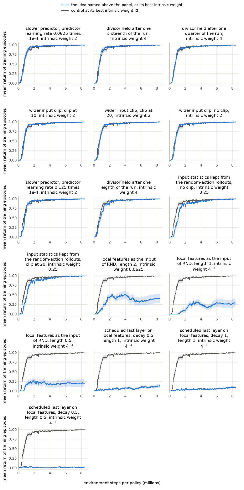
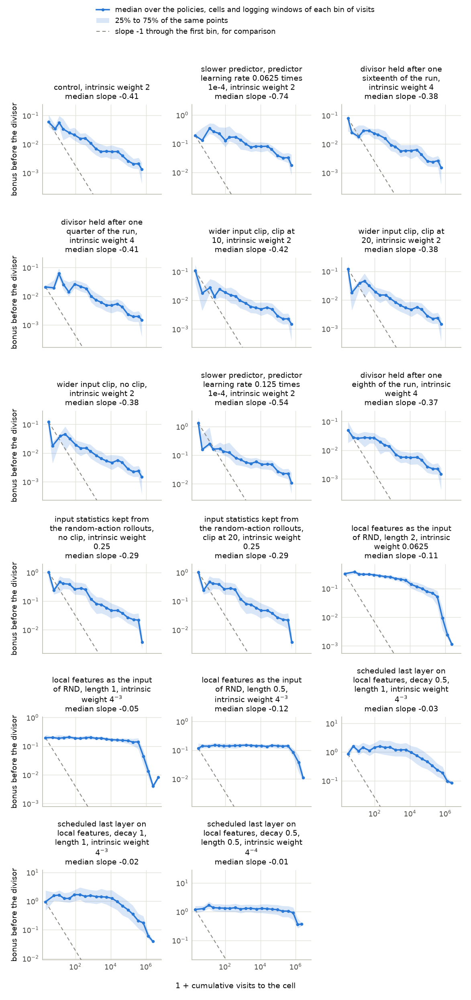

# Batch 2 screen on PointMaze Large with reward 1 on arrival: where the bonus points at the start, and features that keep the fit local

Generated 2026-11-12 17:01 PT by the command below. This file is generated: regenerate it, do not edit it. Times are Pacific, converted from machines running Eastern. Run folder: `2026-11-12-00-22_pointmaze-medium-large_antmaze-umaze-medium-large_beat-cleanrl-ppo-rnd-auto-research_reward-arrival-plus-1-and-step-cost_bonus-5-days_other-parts-5-days`; batch folder: `batches/02_where-the-bonus-points-at-the-start_and_features-that-keep-the-fit-local`.

```bash
cd /p/rlprojects/RND/10_jax_exploration_platform
bash "benchmark_runs/2026-11-12-00-17_pointmaze-antmaze_cleanrl-ppo-rnd_speed-30-ideas_screen-15-minutes-per-idea-per-card_h100-nvl_rtx-5080_rtx-a4500/infrastructure/submit_tests.sh" -s scripts/maze_campaign/analysis/batch_summary_job.py \
    --run-dir=runs/2026-11-12-00-22_pointmaze-medium-large_antmaze-umaze-medium-large_beat-cleanrl-ppo-rnd-auto-research_reward-arrival-plus-1-and-step-cost_bonus-5-days_other-parts-5-days \
    --batch=02_where-the-bonus-points-at-the-start_and_features-that-keep-the-fit-local
```

## Contents

| section | first written | last changed | status |
|---|---|---|---|
| [Units](#units) | 2026-11-12 16:20 PT | 2026-11-12 17:01 PT | unread |
| [Measures](#measures) | 2026-11-12 16:20 PT | 2026-11-12 16:20 PT | unread |
| [Discovery and optimization: whole-curve mean](#discovery-and-optimization-whole-curve-mean) | 2026-11-12 16:20 PT | 2026-11-12 17:01 PT | unread |
| [Whole-curve mean at every intrinsic weight](#whole-curve-mean-at-every-intrinsic-weight) | 2026-11-12 16:20 PT | 2026-11-12 17:01 PT | unread |
| [Discovery: mean capped first-goal time](#discovery-mean-capped-first-goal-time) | 2026-11-12 16:20 PT | 2026-11-12 17:01 PT | unread |
| [Mean capped first-goal time at every intrinsic weight](#mean-capped-first-goal-time-at-every-intrinsic-weight) | 2026-11-12 16:20 PT | 2026-11-12 17:01 PT | unread |
| [Training curves](#training-curves) | 2026-11-12 16:20 PT | 2026-11-12 17:01 PT | unread |
| [Properties of the bonus on the maze grid](#properties-of-the-bonus-on-the-maze-grid) | 2026-11-12 16:20 PT | 2026-11-12 17:01 PT | unread |
| [Predictions](#predictions) | 2026-11-12 16:20 PT | 2026-11-12 16:20 PT | unread |
| [Ideas against the control](#ideas-against-the-control) | 2026-11-12 16:20 PT | 2026-11-12 17:01 PT | unread |
| [Validation block](#validation-block) | 2026-11-12 16:20 PT | 2026-11-12 17:01 PT | unread |
| [Consistency check against the baseline run](#consistency-check-against-the-baseline-run) | 2026-11-12 16:20 PT | 2026-11-12 16:20 PT | unread |
| [Records that need a look](#records-that-need-a-look) | 2026-11-12 16:20 PT | 2026-11-12 17:01 PT | unread |

Times are Pacific, converted from machines running Eastern, and come from this report's own history of regenerations. [The same report with unread sections in blue and changed text in brown](summary.html). No section marks itself read.

## Units

17 of 18 units are complete. Only complete units enter the tables and figures below; nothing is estimated for the others. Left out: scheduled last layer on local features, decay 0.5, length 2.

| unit | method | state | logging windows written | card | finished | place in the queue |
|---|---|---|---|---|---|---|
| 1 | control | complete | 256 of 256 | NVIDIA GeForce RTX 2080 Ti | 2026-11-12 16:14 PT | `queue/done` |
| 2 | wider input clip, clip at 10 | complete | 256 of 256 | NVIDIA GeForce RTX 2080 Ti | 2026-11-12 16:14 PT | `queue/done` |
| 3 | wider input clip, clip at 20 | complete | 256 of 256 | NVIDIA GeForce RTX 2080 Ti | 2026-11-12 16:14 PT | `queue/done` |
| 4 | wider input clip, no clip | complete | 256 of 256 | NVIDIA GeForce RTX 2080 Ti | 2026-11-12 16:31 PT | `queue/done` |
| 5 | input statistics kept from the random-action rollouts, no clip | complete | 256 of 256 | NVIDIA GeForce RTX 2080 Ti | 2026-11-12 16:32 PT | `queue/done` |
| 6 | input statistics kept from the random-action rollouts, clip at 20 | complete | 256 of 256 | NVIDIA GeForce RTX 2080 Ti | 2026-11-12 16:32 PT | `queue/done` |
| 7 | slower predictor, predictor learning rate 0.0625 times 1e-4 | complete | 256 of 256 | NVIDIA RTX 4000 Ada Generation | 2026-11-12 16:34 PT | `queue/done` |
| 8 | slower predictor, predictor learning rate 0.125 times 1e-4 | complete | 256 of 256 | NVIDIA GeForce RTX 2080 Ti | 2026-11-12 16:35 PT | `queue/done` |
| 9 | local features as the input of RND, length 0.5 | complete | 256 of 256 | NVIDIA GeForce RTX 2080 Ti | 2026-11-12 16:44 PT | `queue/done` |
| 10 | local features as the input of RND, length 1 | complete | 256 of 256 | NVIDIA GeForce RTX 2080 Ti | 2026-11-12 16:45 PT | `queue/done` |
| 11 | local features as the input of RND, length 2 | complete | 256 of 256 | NVIDIA A30 | 2026-11-12 16:02 PT | `queue/done` |
| 12 | scheduled last layer on local features, decay 0.5, length 0.5 | complete | 256 of 256 | NVIDIA A30 | 2026-11-12 16:20 PT | `queue/done` |
| 13 | scheduled last layer on local features, decay 0.5, length 1 | complete | 256 of 256 | NVIDIA A30 | 2026-11-12 16:20 PT | `queue/done` |
| 14 | scheduled last layer on local features, decay 0.5, length 2 | not started (no shard) | 0 | none | not finished | `queue/remote_gilbreth` |
| 15 | scheduled last layer on local features, decay 1, length 1 | complete | 256 of 256 | NVIDIA A30 | 2026-11-12 16:10 PT | `queue/done` |
| 16 | divisor held after one sixteenth of the run | complete | 256 of 256 | NVIDIA A10 | 2026-11-12 15:45 PT | `queue/done` |
| 17 | divisor held after one eighth of the run | complete | 256 of 256 | NVIDIA A10 | 2026-11-12 15:45 PT | `queue/done` |
| 18 | divisor held after one quarter of the run | complete | 256 of 256 | NVIDIA A10 | 2026-11-12 15:52 PT | `queue/done` |

Unit names, by the number in the first column:

1. `batch-02-screen_pointmaze-large_reward-arrival-plus-one_control-cleanrl-ppo-rnd_cells-01-to-12-of-12_seeds-0-to-15`
2. `batch-02-screen_pointmaze-large_reward-arrival-plus-one_wider-input-clip-10_cells-01-to-12-of-12_seeds-0-to-15`
3. `batch-02-screen_pointmaze-large_reward-arrival-plus-one_wider-input-clip-20_cells-01-to-12-of-12_seeds-0-to-15`
4. `batch-02-screen_pointmaze-large_reward-arrival-plus-one_no-input-clip_cells-01-to-12-of-12_seeds-0-to-15`
5. `batch-02-screen_pointmaze-large_reward-arrival-plus-one_input-statistics-kept-from-the-random-action-rollouts-no-clip_cells-01-to-12-of-12_seeds-0-to-15`
6. `batch-02-screen_pointmaze-large_reward-arrival-plus-one_input-statistics-kept-from-the-random-action-rollouts-clip-20_cells-01-to-12-of-12_seeds-0-to-15`
7. `batch-02-screen_pointmaze-large_reward-arrival-plus-one_slower-predictor-0-point-0625-times-1e-4_cells-01-to-12-of-12_seeds-0-to-15`
8. `batch-02-screen_pointmaze-large_reward-arrival-plus-one_slower-predictor-0-point-125-times-1e-4_cells-01-to-12-of-12_seeds-0-to-15`
9. `batch-02-screen_pointmaze-large_reward-arrival-plus-one_local-features-as-the-input-of-rnd-length-0-point-5_cells-01-to-12-of-12_seeds-0-to-15`
10. `batch-02-screen_pointmaze-large_reward-arrival-plus-one_local-features-as-the-input-of-rnd-length-1_cells-01-to-12-of-12_seeds-0-to-15`
11. `batch-02-screen_pointmaze-large_reward-arrival-plus-one_local-features-as-the-input-of-rnd-length-2_cells-01-to-12-of-12_seeds-0-to-15`
12. `batch-02-screen_pointmaze-large_reward-arrival-plus-one_scheduled-last-layer-on-local-features-decay-0-point-5-length-0-point-5_cells-01-to-12-of-12_seeds-0-to-15`
13. `batch-02-screen_pointmaze-large_reward-arrival-plus-one_scheduled-last-layer-on-local-features-decay-0-point-5-length-1_cells-01-to-12-of-12_seeds-0-to-15`
14. `batch-02-screen_pointmaze-large_reward-arrival-plus-one_scheduled-last-layer-on-local-features-decay-0-point-5-length-2_cells-01-to-12-of-12_seeds-0-to-15`
15. `batch-02-screen_pointmaze-large_reward-arrival-plus-one_scheduled-last-layer-on-local-features-decay-1-length-1_cells-01-to-12-of-12_seeds-0-to-15`
16. `batch-02-screen_pointmaze-large_reward-arrival-plus-one_divisor-held-after-one-sixteenth-of-the-run_cells-01-to-12-of-12_seeds-0-to-15`
17. `batch-02-screen_pointmaze-large_reward-arrival-plus-one_divisor-held-after-one-eighth-of-the-run_cells-01-to-12-of-12_seeds-0-to-15`
18. `batch-02-screen_pointmaze-large_reward-arrival-plus-one_divisor-held-after-one-quarter-of-the-run_cells-01-to-12-of-12_seeds-0-to-15`

## Measures

Two metrics are reported, each in its own table with its own best intrinsic weight per method: the whole-curve mean $W$ measures discovery and optimization together, and the mean capped first-goal time $M$ measures discovery alone. The two are never mixed in one choice.

Define $K$ as the number of policies (seeds) of one method at one intrinsic weight ($K = 16$, the development seeds 0 to 15), $B$ as the budget in environment steps per policy ($B$ = 8,388,608), $R_i(s)$ as the mean return of the training episodes of policy $i$ that end in the logging window containing step $s$, and $\Delta s$ as the number of that window's steps inside the range being averaged. An episode returns 1 if it reaches the goal and 0 otherwise. A window in which no episode ends takes the value of the window before it; before a policy's first finished episode the value is 0.

1. **Whole-curve mean:** $W(B) = \dfrac{1}{K}\sum_{i=1}^{K} \dfrac{1}{B}\sum_{s \le B} R_i(s) \thinspace \Delta s$, the area under the training curve divided by the budget.
2. **Final level:** $L(B) = \dfrac{1}{K}\sum_{i=1}^{K} \dfrac{1}{0.1 B}\sum_{0.9 B \lt s \le B} R_i(s) \thinspace \Delta s$, the same mean over the last 10% of the budget.
3. **Best intrinsic weight for the whole-curve mean:** per method, the one of the intrinsic weights it was trained at with the highest $W$; ties go to the higher $L$.
4. **Difference from the control:** define $d_i$ as the value of seed $i$ under the method at its best weight for $W$ minus its value under the control at the control's own best weight for $W$. The tables give $\bar d = \dfrac{1}{K}\sum_{i=1}^{K} d_i$ for $W$ and for $L$, each with a 95% interval: the 2.5% and 97.5% points of the means of 10,000 resamples of the $K$ seeds, drawn with replacement. An idea is ahead of the control when the interval is entirely above zero, behind when it is entirely below zero, and within the interval otherwise.
5. **Median first-arrival step:** define $T_i$ as the training step of policy $i$'s first arrival at the goal ($T_i = \infty$ if it has none by step $B$). The measure is the median of $T_i$ over the $K$ policies; it reads "none" when the median falls on a policy with no arrival.
6. **Policies that reach the goal:** the number of the $K$ policies with $T_i \le B$.
7. **Mean capped first-goal time, the secondary metric:** $M(B) = \dfrac{1}{K}\sum_{i=1}^{K} \min(T_i, B)$, the mean over the policies of the training step of the first arrival at the goal, a policy with no arrival by step $B$ counting as $B$. Smaller is better. The tables give $M$ in thousands of steps.
8. **Best intrinsic weight for the mean capped first-goal time:** per method, the one of the intrinsic weights it was trained at with the smallest $M$; ties go to the weight at which more policies reach the goal. It can differ from the best weight of item 3.
9. **Difference in the mean capped first-goal time from the control:** as item 4, with $d_i$ the value of $\min(T_i, B)$ of seed $i$ under the method at its best weight for $M$ minus the same under the control at the control's own best weight for $M$. A negative $\bar d$ means the goal was first reached earlier than under the control. An idea is ahead of the control on discovery when the 95% interval is entirely below zero, behind when it is entirely above zero, and within the interval otherwise.

Standard errors are over the $K$ policies.

## Discovery and optimization: whole-curve mean

Define $W$, $L$ and the other columns as in the section Measures. One row per method at its best intrinsic weight for $W$, read at 8,388,608 environment steps per policy. The control is the first row; the ideas follow, sorted by $W$. Per column, the best value is bold and the second best underlined; for the median first-arrival step the smallest value is the best. Differences are the method minus the control at the control's own best intrinsic weight (2), on the 16 seeds both have; the brackets hold the 95% interval. The seeds are the development seeds, on which each best weight was also chosen: this table is a screen and not a verdict.

| method | best intrinsic weight for $W$ | whole-curve mean $W$ ↑ ± standard error | difference in $W$ from the control [95% interval] | final level $L$ | difference in $L$ from the control [95% interval] | median first-arrival step | policies that reach the goal |
|---|---|---|---|---|---|---|---|
| control | 2 | 0.885 ± 0.010 | control | 0.994 | control | 191.9K | **16 of 16** |
| slower predictor, predictor learning rate 0.0625 times 1e-4 | 2 | **0.897** ± 0.007 | **+0.012** [-0.010, +0.034] | <u>0.997</u> | <u>+0.002</u> [-0.001, +0.006] | **67.1K** | **16 of 16** |
| divisor held after one sixteenth of the run | 4 | <u>0.895</u> ± 0.005 | <u>+0.010</u> [-0.009, +0.032] | **0.998** | **+0.003** [+0.000, +0.006] | 174.4K | **16 of 16** |
| divisor held after one quarter of the run | 4 | 0.887 ± 0.005 | +0.002 [-0.017, +0.022] | 0.996 | +0.001 [-0.001, +0.004] | <u>139.9K</u> | **16 of 16** |
| wider input clip, clip at 10 | 2 | 0.887 ± 0.007 | +0.002 [-0.017, +0.023] | 0.994 | -0.000 [-0.003, +0.003] | 247.0K | **16 of 16** |
| wider input clip, clip at 20 | 2 | 0.883 ± 0.007 | -0.001 [-0.023, +0.022] | 0.994 | -0.001 [-0.003, +0.002] | 247.0K | **16 of 16** |
| wider input clip, no clip | 2 | 0.883 ± 0.007 | -0.001 [-0.024, +0.022] | 0.994 | -0.001 [-0.003, +0.002] | 247.0K | **16 of 16** |
| slower predictor, predictor learning rate 0.125 times 1e-4 | 2 | 0.883 ± 0.007 | -0.002 [-0.024, +0.022] | **0.998** | **+0.003** [+0.001, +0.005] | 238.2K | **16 of 16** |
| divisor held after one eighth of the run | 4 | 0.872 ± 0.013 | -0.012 [-0.046, +0.022] | 0.995 | +0.001 [-0.002, +0.004] | 191.7K | **16 of 16** |
| input statistics kept from the random-action rollouts, no clip | 0.25 | 0.831 ± 0.007 | -0.054 [-0.076, -0.026] | 0.991 | -0.003 [-0.012, +0.003] | 462.2K | **16 of 16** |
| input statistics kept from the random-action rollouts, clip at 20 | 0.25 | 0.831 ± 0.007 | -0.054 [-0.076, -0.028] | 0.991 | -0.003 [-0.013, +0.003] | 462.2K | **16 of 16** |
| local features as the input of RND, length 2 | 0.0625 | 0.352 ± 0.066 | -0.533 [-0.660, -0.405] | 0.402 | -0.592 [-0.813, -0.367] | 661.5K | **16 of 16** |
| local features as the input of RND, length 1 | $4^{-3}$ | 0.198 ± 0.063 | -0.687 [-0.800, -0.564] | 0.274 | -0.721 [-0.908, -0.498] | 1.25M | **16 of 16** |
| local features as the input of RND, length 0.5 | $4^{-3}$ | 0.182 ± 0.074 | -0.702 [-0.834, -0.551] | 0.205 | -0.789 [-0.954, -0.600] | 1.03M | 12 of 16 |
| scheduled last layer on local features, decay 0.5, length 1 | $4^{-3}$ | 0.069 ± 0.021 | -0.816 [-0.858, -0.766] | 0.122 | -0.873 [-0.950, -0.779] | 169.5K | **16 of 16** |
| scheduled last layer on local features, decay 1, length 1 | $4^{-3}$ | 0.052 ± 0.011 | -0.833 [-0.861, -0.793] | 0.095 | -0.899 [-0.947, -0.837] | 563.1K | **16 of 16** |
| scheduled last layer on local features, decay 0.5, length 0.5 | $4^{-4}$ | 0.016 ± 0.010 | -0.868 [-0.892, -0.839] | 0.020 | -0.974 [-0.994, -0.938] | 199.0K | <u>15 of 16</u> |

## Whole-curve mean at every intrinsic weight

Define $W$ as in the section Measures. Rows are in the order of the table of the whole-curve mean. The 12 weights are split over two tables so that each fits the width of a printed page. A method that was not trained at a weight has an empty cell there. Per weight (column), the highest $W$ among the methods is bold and the second highest underlined. The last column names each method's best weight for $W$ and says when it is the smallest or the largest of the weights the method was trained at.

| method | weight $4^{-6}$ | weight $4^{-5}$ | weight $4^{-4}$ | weight $4^{-3}$ | weight 0.0625 | weight 0.25 | best intrinsic weight for $W$ |
|---|---|---|---|---|---|---|---|
| control | 0.000 | 0.000 | 0.000 | 0.090 | 0.159 | 0.728 | 2 |
| slower predictor, predictor learning rate 0.0625 times 1e-4 | 0.000 | 0.000 | 0.000 | 0.060 | <u>0.354</u> | **0.849** | 2 |
| divisor held after one sixteenth of the run | 0.000 | 0.000 | 0.000 | 0.000 | 0.171 | 0.627 | 4 |
| divisor held after one quarter of the run | 0.000 | 0.000 | 0.000 | 0.053 | 0.227 | 0.769 | 4 |
| wider input clip, clip at 10 | **0.054** | 0.000 | 0.000 | 0.000 | 0.146 | 0.735 | 2 |
| wider input clip, clip at 20 | 0.000 | 0.000 | 0.000 | 0.000 | 0.125 | 0.761 | 2 |
| wider input clip, no clip | 0.000 | 0.000 | 0.000 | 0.000 | 0.080 | 0.761 | 2 |
| slower predictor, predictor learning rate 0.125 times 1e-4 | 0.000 | 0.000 | 0.000 | 0.000 | 0.260 | 0.703 | 2 |
| divisor held after one eighth of the run | 0.000 | 0.000 | 0.000 | 0.000 | 0.213 | 0.787 | 4 |
| input statistics kept from the random-action rollouts, no clip | 0.000 | 0.000 | 0.054 | 0.030 | **0.466** | <u>0.831</u> | 0.25 |
| input statistics kept from the random-action rollouts, clip at 20 | 0.000 | 0.000 | 0.054 | 0.030 | **0.466** | <u>0.831</u> | 0.25 |
| local features as the input of RND, length 2 | 0.000 | 0.000 | **0.086** | <u>0.183</u> | 0.352 | 0.008 | 0.0625 |
| local features as the input of RND, length 1 | 0.000 | 0.000 | 0.048 | **0.198** | 0.068 | 0.003 | $4^{-3}$ |
| local features as the input of RND, length 0.5 | 0.000 | 0.000 | <u>0.082</u> | 0.182 | 0.059 | 0.003 | $4^{-3}$ |
| scheduled last layer on local features, decay 0.5, length 1 | <u>0.009</u> | <u>0.005</u> | 0.047 | 0.069 | 0.021 | 0.013 | $4^{-3}$ |
| scheduled last layer on local features, decay 1, length 1 | 0.000 | 0.001 | 0.031 | 0.052 | 0.026 | 0.013 | $4^{-3}$ |
| scheduled last layer on local features, decay 0.5, length 0.5 | 0.003 | **0.010** | 0.016 | 0.003 | 0.002 | 0.002 | $4^{-4}$ |

| method | weight 0.5 | weight 1 | weight 2 | weight 4 | weight 16 | weight 64 | best intrinsic weight for $W$ |
|---|---|---|---|---|---|---|---|
| control | 0.846 | 0.860 | 0.885 | 0.867 | 0.575 | 0.065 | 2 |
| slower predictor, predictor learning rate 0.0625 times 1e-4 | **0.869** | **0.896** | **0.897** | 0.863 | 0.674 | 0.140 | 2 |
| divisor held after one sixteenth of the run | 0.843 | <u>0.878</u> | <u>0.892</u> | **0.895** | **0.803** | **0.415** | 4 |
| divisor held after one quarter of the run | 0.826 | 0.859 | 0.875 | <u>0.887</u> | 0.719 | 0.156 | 4 |
| wider input clip, clip at 10 | <u>0.863</u> | 0.876 | 0.887 | 0.884 | 0.603 | 0.078 | 2 |
| wider input clip, clip at 20 | 0.859 | 0.868 | 0.883 | 0.883 | 0.607 | 0.082 | 2 |
| wider input clip, no clip | 0.859 | 0.868 | 0.883 | 0.883 | 0.607 | 0.082 | 2 |
| slower predictor, predictor learning rate 0.125 times 1e-4 | 0.795 | 0.869 | 0.883 | 0.864 | 0.713 | 0.182 | 2 |
| divisor held after one eighth of the run | 0.855 | 0.861 | 0.872 | 0.872 | <u>0.757</u> | <u>0.283</u> | 4 |
| input statistics kept from the random-action rollouts, no clip | 0.782 | 0.551 | 0.316 | 0.071 | 0.021 | 0.015 | 0.25 |
| input statistics kept from the random-action rollouts, clip at 20 | 0.782 | 0.551 | 0.316 | 0.071 | 0.021 | 0.015 | 0.25 |
| local features as the input of RND, length 2 | 0.004 | 0.003 | 0.003 | 0.002 | 0.002 | 0.002 | 0.0625 |
| local features as the input of RND, length 1 | 0.002 | 0.002 | 0.002 | 0.001 | 0.001 | 0.001 | $4^{-3}$ |
| local features as the input of RND, length 0.5 | 0.001 | 0.001 | 0.001 | 0.001 | 0.001 | 0.001 | $4^{-3}$ |
| scheduled last layer on local features, decay 0.5, length 1 | 0.013 | 0.015 | 0.013 | 0.012 | 0.011 | 0.014 | $4^{-3}$ |
| scheduled last layer on local features, decay 1, length 1 | 0.013 | 0.014 | 0.008 | 0.013 | 0.013 | 0.011 | $4^{-3}$ |
| scheduled last layer on local features, decay 0.5, length 0.5 | 0.002 | 0.001 | 0.001 | 0.002 | 0.002 | 0.002 | $4^{-4}$ |

No method has its best weight at an end of the grid.

## Discovery: mean capped first-goal time

Define $M$, $W$ and $L$ as in the section Measures. One row per method at its best intrinsic weight for $M$ (the smallest $M$; ties go to the weight at which more policies reach the goal), read at 8,388,608 environment steps per policy. This weight can differ from the best weight for $W$ in the table of the whole-curve mean. $M$, its standard error and its differences are in thousands of steps. The control is the first row; the ideas follow, sorted by $M$ from the smallest. Per column, the best value is bold and the second best underlined: the smallest for $M$ and for its difference, the largest for the other columns. The columns $W$ and $L$ are read at the same weight as $M$, so they show what the configuration that is best for discovery gives on the primary metric. Differences are the method minus the control at the control's own best intrinsic weight for $M$ (64), on the 16 seeds both have; the brackets hold the 95% interval, and a negative difference means the goal was first reached earlier than under the control. A best weight marked "largest of the grid" or "smallest of the grid" is at an end of the weights the method was trained at: larger or smaller weights must be tried before anything is concluded from that row. The seeds are the development seeds, on which each best weight was also chosen: this table is a screen and not a verdict.

| method | best intrinsic weight for $M$ | $M$ ↓ ± standard error, thousand steps | difference in $M$ from the control [95% interval], thousand steps | policies that reach the goal | $W$ at that weight ± standard error | $L$ at that weight |
|---|---|---|---|---|---|---|
| control | 64 (largest of the grid) | 190 ± 50.8 | control | 16 of 16 | 0.065 ± 0.014 | 0.112 |
| scheduled last layer on local features, decay 1, length 1 | 4 | **45.1** ± 5.73 | **-144** [-256, -73.1] | 16 of 16 | 0.013 ± 0.002 | 0.010 |
| scheduled last layer on local features, decay 0.5, length 1 | 64 (largest of the grid) | <u>59</u> ± 10.7 | <u>-131</u> [-245, -53.4] | 16 of 16 | 0.014 ± 0.002 | 0.011 |
| scheduled last layer on local features, decay 0.5, length 0.5 | 1 | 64.5 ± 11.3 | -125 [-234, -51.1] | 16 of 16 | 0.001 ± 0.000 | 0.000 |
| input statistics kept from the random-action rollouts, no clip | 64 (largest of the grid) | 81.1 ± 13 | -109 [-221, -28.7] | 16 of 16 | 0.015 ± 0.001 | 0.014 |
| input statistics kept from the random-action rollouts, clip at 20 | 64 (largest of the grid) | 81.1 ± 13 | -109 [-222, -28.2] | 16 of 16 | 0.015 ± 0.001 | 0.014 |
| local features as the input of RND, length 2 | 64 (largest of the grid) | 83.8 ± 13.9 | -106 [-221, -23.5] | 16 of 16 | 0.002 ± 0.000 | 0.000 |
| local features as the input of RND, length 1 | 4 | 92.3 ± 11.7 | -97.2 [-210, -24.3] | 16 of 16 | 0.001 ± 0.000 | 0.000 |
| slower predictor, predictor learning rate 0.125 times 1e-4 | 16 | 108 ± 33.8 | -81.4 [-198, +22.1] | 16 of 16 | <u>0.713</u> ± 0.012 | <u>0.906</u> |
| slower predictor, predictor learning rate 0.0625 times 1e-4 | 64 (largest of the grid) | 115 ± 25.8 | -74.1 [-170, +0.803] | 16 of 16 | 0.140 ± 0.007 | 0.248 |
| local features as the input of RND, length 0.5 | 4 | 125 ± 21.8 | -64.3 [-165, +6.65] | 16 of 16 | 0.001 ± 0.000 | 0.000 |
| wider input clip, clip at 10 | 16 | 139 ± 20.6 | -50.1 [-175, +42.4] | 16 of 16 | 0.603 ± 0.032 | 0.757 |
| wider input clip, clip at 20 | 16 | 145 ± 29.6 | -44.3 [-175, +59.5] | 16 of 16 | 0.607 ± 0.032 | 0.745 |
| wider input clip, no clip | 16 | 145 ± 29.6 | -44.3 [-174, +57] | 16 of 16 | 0.607 ± 0.032 | 0.745 |
| divisor held after one quarter of the run | 64 (largest of the grid) | 162 ± 27.6 | -27.3 [-120, +50.4] | 16 of 16 | 0.156 ± 0.027 | 0.318 |
| divisor held after one sixteenth of the run | 16 | 177 ± 30.2 | -13 [-143, +92.1] | 16 of 16 | **0.803** ± 0.013 | **0.993** |
| divisor held after one eighth of the run | 64 (largest of the grid) | 183 ± 39.5 | -6.33 [-102, +89.6] | 16 of 16 | 0.283 ± 0.036 | 0.569 |

## Mean capped first-goal time at every intrinsic weight

Define $M$ as in the section Measures; the cells give it in thousands of steps. Rows are in the order of the table of the mean capped first-goal time. The 12 weights are split over two tables so that each fits the width of a printed page. A method that was not trained at a weight has an empty cell there. Per weight (column), the smallest $M$ among the methods is bold and the second smallest underlined. The last column names each method's best weight for $M$ and says when it is the smallest or the largest of the weights the method was trained at.

| method | weight $4^{-6}$ | weight $4^{-5}$ | weight $4^{-4}$ | weight $4^{-3}$ | weight 0.0625 | weight 0.25 | best intrinsic weight for $M$ |
|---|---|---|---|---|---|---|---|
| control | 7,376 | 8,389 | 8,389 | 7,050 | 3,980 | 1,289 | 64 (largest of the grid) |
| scheduled last layer on local features, decay 1, length 1 | 7,868 | 7,015 | 5,225 | <u>592</u> | 162 | **89.3** | 4 |
| scheduled last layer on local features, decay 0.5, length 1 | <u>6,617</u> | <u>3,516</u> | **669** | **209** | **83.3** | <u>96</u> | 64 (largest of the grid) |
| scheduled last layer on local features, decay 0.5, length 0.5 | **2,699** | **1,098** | <u>945</u> | 1,328 | <u>90.6</u> | 603 | 1 |
| input statistics kept from the random-action rollouts, no clip | 7,894 | 8,389 | 7,410 | 7,583 | 2,948 | 443 | 64 (largest of the grid) |
| input statistics kept from the random-action rollouts, clip at 20 | 7,894 | 8,389 | 7,410 | 7,583 | 2,948 | 443 | 64 (largest of the grid) |
| local features as the input of RND, length 2 | 8,389 | 8,048 | 6,681 | 2,288 | 657 | 301 | 64 (largest of the grid) |
| local features as the input of RND, length 1 | 8,389 | 8,389 | 6,131 | 1,529 | 538 | 266 | 4 |
| slower predictor, predictor learning rate 0.125 times 1e-4 | 8,389 | 8,389 | 8,389 | 7,590 | 4,209 | 796 | 16 |
| slower predictor, predictor learning rate 0.0625 times 1e-4 | 8,389 | 7,360 | 8,389 | 6,438 | 2,880 | 592 | 64 (largest of the grid) |
| local features as the input of RND, length 0.5 | 8,389 | 6,946 | 5,253 | 2,859 | 587 | 339 | 4 |
| wider input clip, clip at 10 | 7,145 | 7,908 | 7,491 | 8,389 | 4,828 | 1,032 | 16 |
| wider input clip, clip at 20 | 8,389 | 7,911 | 7,422 | 8,389 | 5,663 | 1,226 | 16 |
| wider input clip, no clip | 8,389 | 7,911 | 7,422 | 8,389 | 6,066 | 1,226 | 16 |
| divisor held after one quarter of the run | 8,389 | 8,389 | 8,389 | 6,701 | 5,047 | 1,318 | 64 (largest of the grid) |
| divisor held after one sixteenth of the run | 7,389 | 7,472 | 8,389 | 8,389 | 5,898 | 1,432 | 16 |
| divisor held after one eighth of the run | 8,389 | 8,389 | 8,389 | 7,901 | 5,482 | 905 | 64 (largest of the grid) |

| method | weight 0.5 | weight 1 | weight 2 | weight 4 | weight 16 | weight 64 | best intrinsic weight for $M$ |
|---|---|---|---|---|---|---|---|
| control | 604 | 453 | 220 | 220 | 236 | 190 | 64 (largest of the grid) |
| scheduled last layer on local features, decay 1, length 1 | **69.5** | <u>66.6</u> | **79.9** | **45.1** | **66.2** | <u>65</u> | 4 |
| scheduled last layer on local features, decay 0.5, length 1 | <u>84</u> | 155 | 98.4 | 103 | <u>82.8</u> | **59** | 64 (largest of the grid) |
| scheduled last layer on local features, decay 0.5, length 0.5 | 1,123 | **64.5** | 135 | 606 | 89.9 | 275 | 1 |
| input statistics kept from the random-action rollouts, no clip | 354 | 197 | 145 | <u>83.1</u> | 119 | 81.1 | 64 (largest of the grid) |
| input statistics kept from the random-action rollouts, clip at 20 | 354 | 197 | 145 | <u>83.1</u> | 119 | 81.1 | 64 (largest of the grid) |
| local features as the input of RND, length 2 | 153 | 95 | <u>95</u> | 112 | 87.9 | 83.8 | 64 (largest of the grid) |
| local features as the input of RND, length 1 | 172 | 127 | 118 | 92.3 | 152 | 141 | 4 |
| slower predictor, predictor learning rate 0.125 times 1e-4 | 447 | 138 | 248 | 148 | 108 | 115 | 16 |
| slower predictor, predictor learning rate 0.0625 times 1e-4 | 288 | 163 | 134 | 117 | 118 | 115 | 64 (largest of the grid) |
| local features as the input of RND, length 0.5 | 392 | 300 | 338 | 125 | 197 | 200 | 4 |
| wider input clip, clip at 10 | 466 | 386 | 271 | 203 | 139 | 172 | 16 |
| wider input clip, clip at 20 | 426 | 391 | 320 | 217 | 145 | 160 | 16 |
| wider input clip, no clip | 426 | 391 | 320 | 217 | 145 | 160 | 16 |
| divisor held after one quarter of the run | 667 | 385 | 298 | 165 | 164 | 162 | 64 (largest of the grid) |
| divisor held after one sixteenth of the run | 450 | 344 | 249 | 205 | 177 | 186 | 16 |
| divisor held after one eighth of the run | 415 | 412 | 266 | 200 | 236 | 183 | 64 (largest of the grid) |

Best weight for $M$ at an end of the grid: control (64, the largest); scheduled last layer on local features, decay 0.5, length 1 (64, the largest); input statistics kept from the random-action rollouts, no clip (64, the largest); input statistics kept from the random-action rollouts, clip at 20 (64, the largest); local features as the input of RND, length 2 (64, the largest); slower predictor, predictor learning rate 0.0625 times 1e-4 (64, the largest); divisor held after one quarter of the run (64, the largest); divisor held after one eighth of the run (64, the largest). Larger or smaller weights must be tried on that side before anything is concluded from these rows (the edge rule of `program.md`).

## Training curves

Define $\bar R(s) = \dfrac{1}{K}\sum_{i=1}^{K} R_i(s)$, with $R_i(s)$ and $K$ as in the section Measures. One panel per idea in the order of the table of the whole-curve mean: the idea at its best intrinsic weight for $W$ in blue, the control at its best intrinsic weight (2) in grey; bands are one standard error over the 16 seeds.



## Properties of the bonus on the maze grid

Every unit records, per policy and per open maze cell (46 cells), the bonus at one probe observation (the cell's centre, zero velocity) at the end of every logging window, and the visits to the cell. Define $b_i(c, w)$ as the bonus before the divisor of policy $i$ at the probe of cell $c$ at the end of logging window $w$, with $w = 0$ for the record written after the random-action rollouts and before the first training iteration; $r_i(c, w)$ as the same bonus after the divisor (the intrinsic reward); $n_i(c, w)$ as the number of states of policy $i$'s rollouts in cell $c$ from the first window to window $w$; $\beta$ as the intrinsic weight; $C$ as the number of open cells ($C = 46$); and $w_f$ as the last logging window that ends at or before the share $f$ of the budget (5% is read at step 393,216, 25% is read at step 2,097,152, 100% is read at step 8,388,608).

1. **Start ratio:** $E_i = \dfrac{\max_c b_i(c, 0)}{\min_c b_i(c, 0)}$, the largest over the smallest start bonus on the grid. The table gives the median over all policies of the unit (every weight).
2. **Decay slope:** define $x_w = \log(1 + n_i(c, w))$ and $y_w = \log b_i(c, w)$, and $\bar x$ and $\bar y$ as their means over the windows $w \ge 1$ with $n_i(c, w) \ge 1$. Per policy and cell, $a_i(c) = \dfrac{\sum_w (x_w - \bar x)(y_w - \bar y)}{\sum_w (x_w - \bar x)^2}$ over those windows: the least-squares slope of the logarithm of the bonus on the logarithm of one plus the cumulative visits. A slope of $-1$ means the bonus falls in proportion to $1/(1 + n)$. The table gives the median over the policies and cells at the method's best weight, and the smallest and the largest of the per-weight medians with the weights they belong to: when the two differ, the slope depends on the weight.
3. **Bonus at unvisited cells over its start:** $u_i(c, f) = \dfrac{b_i(c, w_f)}{b_i(c, 0)}$ for the (policy, cell) pairs with $n_i(c, w_f) = 0$, at the method's best weight. The table gives the median over those pairs and their number; a median over fewer than 20 pairs is not printed. A value below 1 means that training on other cells lowered the bonus of a cell with no visit.
4. **Weighted intrinsic reward:** $q(w) = \dfrac{\beta}{K C}\sum_{i=1}^{K}\sum_{c=1}^{C} r_i(c, w)$, at the method's best weight: the intrinsic reward a first visit to a cell would pay, times the intrinsic weight, averaged over cells and policies. It is read at the start ($w = 0$), at the end of the first logging window (step 32,768) and at 25% and 100% of the budget. The task pays 1 on arrival. The second table also gives the divisor (the median over the policies) in the start record and at the end of the first logging window. A divisor that follows the running standard deviation is 1 in the start record, because no rollout has entered its statistics yet, and the trainer updates it with each rollout before it divides that rollout's rewards; for such a method the start column is the bonus itself times the weight, and the first logging window is the earliest reading with a divisor the learner used.

Rows are in the order of the table of the whole-curve mean. These columns describe the bonus and have no better or worse direction, so no value is marked.

| method | start ratio, median over policies | decay slope at the best weight, median | decay slope, smallest and largest median over the weights (at weight) | bonus at unvisited cells over its start at 5% of the budget | bonus at unvisited cells over its start at 25% of the budget | bonus at unvisited cells over its start at 100% of the budget |
|---|---|---|---|---|---|---|
| control | 87.88 | -0.41 | -0.97 ($4^{-4}$) to -0.35 (1) | 0.00173 (73 pairs) | 0.000963 (29 pairs) | 0.00107 (29 pairs) |
| slower predictor, predictor learning rate 0.0625 times 1e-4 | 87.86 | -0.74 | -1.08 ($4^{-5}$) to -0.56 (0.25) | 0.0574 (34 pairs) | not printed: 15 pairs | not printed: 14 pairs |
| divisor held after one sixteenth of the run | 87.86 | -0.38 | -0.98 ($4^{-6}$) to -0.32 (0.5) | 0.00181 (51 pairs) | 0.000986 (21 pairs) | 0.00112 (21 pairs) |
| divisor held after one quarter of the run | 87.86 | -0.41 | -0.86 ($4^{-3}$) to -0.33 (0.5) | 0.00228 (29 pairs) | not printed: 18 pairs | not printed: 18 pairs |
| wider input clip, clip at 10 | 321.30 | -0.42 | -1.04 ($4^{-4}$) to -0.33 ($4^{-6}$) | 0.00107 (104 pairs) | 0.000294 (30 pairs) | 0.000298 (29 pairs) |
| wider input clip, clip at 20 | 521.70 | -0.38 | -1.05 ($4^{-3}$) to 0.01 ($4^{-6}$) | 0.000579 (123 pairs) | 0.000182 (22 pairs) | 0.000187 (22 pairs) |
| wider input clip, no clip | 521.70 | -0.38 | -1.06 ($4^{-3}$) to -0.01 ($4^{-6}$) | 0.000579 (123 pairs) | 0.000182 (22 pairs) | 0.000187 (22 pairs) |
| slower predictor, predictor learning rate 0.125 times 1e-4 | 87.88 | -0.54 | -0.98 ($4^{-3}$) to -0.43 (0.25) | 0.0275 (89 pairs) | 0.00709 (20 pairs) | 0.00785 (20 pairs) |
| divisor held after one eighth of the run | 87.86 | -0.37 | -0.83 ($4^{-4}$) to -0.33 (0.5) | 0.00175 (63 pairs) | not printed: 14 pairs | not printed: 14 pairs |
| input statistics kept from the random-action rollouts, no clip | 521.70 | -0.29 | -1.02 ($4^{-3}$) to -0.29 (0.25) | 0.00451 (205 pairs) | not printed: 13 pairs | not printed: 13 pairs |
| input statistics kept from the random-action rollouts, clip at 20 | 521.70 | -0.29 | -1.02 ($4^{-3}$) to -0.29 (0.25) | 0.00451 (205 pairs) | not printed: 13 pairs | not printed: 13 pairs |
| local features as the input of RND, length 2 | 1.82 | -0.11 | -0.23 ($4^{-5}$) to -0.09 ($4^{-6}$) | 0.415 (365 pairs) | not printed: 16 pairs | not printed: 8 pairs |
| local features as the input of RND, length 1 | 1.94 | -0.05 | -0.21 (16) to -0.05 ($4^{-3}$) | 0.392 (497 pairs) | 0.205 (99 pairs) | 0.186 (50 pairs) |
| local features as the input of RND, length 0.5 | 1.94 | -0.12 | -0.23 (4) to -0.12 ($4^{-3}$) | 0.25 (442 pairs) | 0.151 (108 pairs) | 0.113 (98 pairs) |
| scheduled last layer on local features, decay 0.5, length 1 | 1.00 | -0.03 | -0.30 ($4^{-6}$) to 0.01 (0.0625) | 1.07 (139 pairs) | not printed: 11 pairs | not printed: 7 pairs |
| scheduled last layer on local features, decay 1, length 1 | 1.00 | -0.02 | -0.38 ($4^{-6}$) to 0.01 (64) | 1.08 (328 pairs) | not printed: 12 pairs | not printed: 4 pairs |
| scheduled last layer on local features, decay 0.5, length 0.5 | 1.00 | -0.01 | -0.02 (4) to 0.02 ($4^{-6}$) | 1.23 (140 pairs) | 1.27 (68 pairs) | 1.12 (62 pairs) |

| method | best intrinsic weight | divisor at the start, and at the end of the first logging window | weighted intrinsic reward at the start | weighted intrinsic reward at the end of the first logging window | weighted intrinsic reward at 25% of the budget | weighted intrinsic reward at 100% of the budget |
|---|---|---|---|---|---|---|
| control | 2 | 1 and 51 | 70 | 0.0156 | 0.00248 | 0.00451 |
| slower predictor, predictor learning rate 0.0625 times 1e-4 | 2 | 1 and 498 | 70 | 0.0561 | 0.00141 | 0.00239 |
| divisor held after one sixteenth of the run | 4 | 1 and 49.4 | 141 | 0.0195 | 0.00237 | 0.00266 |
| divisor held after one quarter of the run | 4 | 1 and 48.9 | 141 | 0.0197 | 0.00361 | 0.00437 |
| wider input clip, clip at 10 | 2 | 1 and 51.5 | 176 | 0.0322 | 0.00236 | 0.00463 |
| wider input clip, clip at 20 | 2 | 1 and 51.5 | 229 | 0.0332 | 0.00234 | 0.00487 |
| wider input clip, no clip | 2 | 1 and 51.5 | 229 | 0.0332 | 0.00234 | 0.00487 |
| slower predictor, predictor learning rate 0.125 times 1e-4 | 2 | 1 and 416 | 70 | 0.0319 | 0.00107 | 0.00242 |
| divisor held after one eighth of the run | 4 | 1 and 49 | 141 | 0.027 | 0.00291 | 0.00335 |
| input statistics kept from the random-action rollouts, no clip | 0.25 | 1 and 45.9 | 29.6 | 0.0174 | 0.00266 | 0.00668 |
| input statistics kept from the random-action rollouts, clip at 20 | 0.25 | 1 and 45.9 | 29.6 | 0.0174 | 0.00266 | 0.00668 |
| local features as the input of RND, length 2 | 0.0625 | 1 and 10.6 | 0.0639 | 0.00258 | 0.00419 | 0.00676 |
| local features as the input of RND, length 1 | $4^{-3}$ | 1 and 11.9 | 0.016 | 0.000526 | 0.000742 | 0.00101 |
| local features as the input of RND, length 0.5 | $4^{-3}$ | 1 and 11.4 | 0.016 | 0.000493 | 0.000542 | 0.000605 |
| scheduled last layer on local features, decay 0.5, length 1 | $4^{-3}$ | 1 and 1 | 0.0156 | 0.0148 | 0.0195 | 0.0177 |
| scheduled last layer on local features, decay 1, length 1 | $4^{-3}$ | 1 and 1 | 0.0156 | 0.0153 | 0.0227 | 0.02 |
| scheduled last layer on local features, decay 0.5, length 0.5 | $4^{-4}$ | 1 and 1 | 0.00391 | 0.0049 | 0.00559 | 0.00519 |

### Bonus against cumulative visits

One panel per method in the order of the table of the whole-curve mean, at the best intrinsic weight of this section. Each point is the median of $b_i(c, w)$ over the policies, cells and logging windows whose $1 + n_i(c, w)$ falls in one bin (each bin a factor of two wide; pairs with no visit are left out); the band holds the middle half of the same points. Both axes are logarithmic, and every panel shows the same range of visits and the same number of decades of the bonus, so equal slopes look equal. The dashed line has slope $-1$ and passes through the first bin.



## Predictions

The predictions were written in `ideas.md` before the runs. Their readings from the records have not been written yet (this batch has no predictions module), so each is quoted and marked not read yet. The tables of this summary hold the numbers the predictions speak of.

### Prediction 1

> **Wider input clip:** the largest over the smallest starting bonus rises above 300 at c = 10 and above 1,000 with no clip. The median first arrival at the best weight is at least 15% earlier than the control's at c = 20 or with no clip. The whole-curve mean moves by less than 0.02 either way.

Observed: **not read yet**.

### Prediction 2

> **Input statistics kept from the random-action rollouts:** the bonus at cells never visited stays more than 10 times the bonus at visited cells through the first quarter of the budget. Either the whole-curve mean is 0.01 to 0.03 ahead with earlier arrivals, or it is behind because the predictor's very large errors at far inputs take over the shared gradient clip; the records will show which (the divisor after the first window, and the final level).

Observed: **not read yet**.

### Prediction 3

> **Slower predictor:** arrivals at weight 2 are earlier than the control's; the whole-curve mean is within the interval.

Observed: **not read yet**.

### Prediction 4

> **Local features as the input of RND** separates the two readings of the even start's failure. Its starting bonus is nearly even (largest over smallest below 3). If all 16 policies reach the goal and the whole-curve mean is above 0.8, the even start failed because fitting visited inputs lowered the bonus elsewhere, not because the slope was missing. If it fails like the even start (12 of 16 or fewer), the slope is what RND needs here.

Observed: **not read yet**.

### Prediction 5

> **Scheduled last layer on local features:** at $\ell$ = 0.5 and 1 the bonus at cells never visited stays above 0.9 until they are visited, and the decay slope is within 0.1 of $-a$. All 16 policies reach the goal at some weight. Its whole-curve mean is the highest of the batch if a bonus that only counts is enough; if it is behind the control with every policy reaching the goal late, the missing slope costs time at the start.

Observed: **not read yet**.

### Prediction 6

> **Divisor held after a part of the run** (written 2026-11-12 14:50 PT): intrinsic weight times the reward at the probes at the end of the run is below its value at a quarter of the budget (in the control it is 1.8 times higher). The final level at weights 4 and 16 is higher than the control's at the same weights. At the best weight the whole-curve mean is 0.005 to 0.015 ahead (a difference the validation block must resolve); $f$ = 1/16 (524 thousand steps, about when the first arrivals happen) may be too early and lose arrivals.

Observed: **not read yet**.

## Ideas against the control

Two readings, one per metric, each with the methods at their own best weights for that metric. Both are on the development seeds, on which the best weights were also chosen: a screen, not a verdict.

### Discovery and optimization: whole-curve mean

By the 95% interval of the difference in $W$ from the control (section Measures, item 4), on the development seeds. After each name: the difference in $W$ and its interval.

- **Ahead of the control** (interval entirely above zero): none.
- **Within the interval** (it contains zero): slower predictor, predictor learning rate 0.0625 times 1e-4 (+0.012 [-0.010, +0.034]); divisor held after one sixteenth of the run (+0.010 [-0.009, +0.032]); divisor held after one quarter of the run (+0.002 [-0.017, +0.022]); wider input clip, clip at 10 (+0.002 [-0.017, +0.023]); wider input clip, clip at 20 (-0.001 [-0.023, +0.022]); wider input clip, no clip (-0.001 [-0.024, +0.022]); slower predictor, predictor learning rate 0.125 times 1e-4 (-0.002 [-0.024, +0.022]); divisor held after one eighth of the run (-0.012 [-0.046, +0.022]).
- **Behind the control** (interval entirely below zero): input statistics kept from the random-action rollouts, no clip (-0.054 [-0.076, -0.026]); input statistics kept from the random-action rollouts, clip at 20 (-0.054 [-0.076, -0.028]); local features as the input of RND, length 2 (-0.533 [-0.660, -0.405]); local features as the input of RND, length 1 (-0.687 [-0.800, -0.564]); local features as the input of RND, length 0.5 (-0.702 [-0.834, -0.551]); scheduled last layer on local features, decay 0.5, length 1 (-0.816 [-0.858, -0.766]); scheduled last layer on local features, decay 1, length 1 (-0.833 [-0.861, -0.793]); scheduled last layer on local features, decay 0.5, length 0.5 (-0.868 [-0.892, -0.839]).
- **Not compared yet** (unit not complete): scheduled last layer on local features, decay 0.5, length 2.

### Discovery: mean capped first-goal time

By the 95% interval of the difference in $M$ from the control (section Measures, item 9), on the development seeds. After each name: the difference in $M$ and its interval, in thousands of steps; a negative difference means the goal was first reached earlier than under the control.

- **Ahead of the control on discovery** (interval entirely below zero): scheduled last layer on local features, decay 1, length 1 (-144 [-256, -73.1]); scheduled last layer on local features, decay 0.5, length 1 (-131 [-245, -53.4]); scheduled last layer on local features, decay 0.5, length 0.5 (-125 [-234, -51.1]); input statistics kept from the random-action rollouts, no clip (-109 [-221, -28.7]); input statistics kept from the random-action rollouts, clip at 20 (-109 [-222, -28.2]); local features as the input of RND, length 2 (-106 [-221, -23.5]); local features as the input of RND, length 1 (-97.2 [-210, -24.3]).
- **Within the interval** (it contains zero): slower predictor, predictor learning rate 0.125 times 1e-4 (-81.4 [-198, +22.1]); slower predictor, predictor learning rate 0.0625 times 1e-4 (-74.1 [-170, +0.803]); local features as the input of RND, length 0.5 (-64.3 [-165, +6.65]); wider input clip, clip at 10 (-50.1 [-175, +42.4]); wider input clip, clip at 20 (-44.3 [-175, +59.5]); wider input clip, no clip (-44.3 [-174, +57]); divisor held after one quarter of the run (-27.3 [-120, +50.4]); divisor held after one sixteenth of the run (-13 [-143, +92.1]); divisor held after one eighth of the run (-6.33 [-102, +89.6]).
- **Behind the control on discovery** (interval entirely above zero): none.
- **Not compared yet** (unit not complete): scheduled last layer on local features, decay 0.5, length 2.

## Validation block

The units of the phase `validation-block` in the screen's environment and reward setting. Each trains one method at one intrinsic weight on 256 seeds, from 10000 to 10255: these are neither the development seeds of the screen nor the confirmation seeds. 11 of 13 method and weight pairs have a complete unit; a unit that is not complete is listed under the tables and left out. Define $W$, $L$ and $M$ as in the section Measures, here with $K$ the number of seeds of a row and read at 8,388,608 environment steps per policy. Differences are the method minus the control at the same intrinsic weight, on the seeds both have, each with its 95% interval from 10,000 resamples of those seeds. Rows: the control first, then the other methods, each by intrinsic weight. Per column the best value is bold and the second best underlined.

### Discovery and optimization: whole-curve mean and final level

| method | intrinsic weight | $W$ ± standard error | difference in $W$ from the control [95% interval] | $L$ ± standard error | difference in $L$ from the control [95% interval] | seeds in common with the control |
|---|---|---|---|---|---|---|
| control | 1 | 0.876 ± 0.002 | control | <u>0.995</u> ± 0.000 | control | 256 |
| control | 2 | 0.878 ± 0.002 | control | 0.992 ± 0.001 | control | 256 |
| control | 4 | 0.863 ± 0.002 | control | 0.977 ± 0.002 | control | 256 |
| separate predictor step size, predictor learning rate 0.25 times 1e-4 | 1 | 0.876 ± 0.003 | -0.000 [-0.008, +0.007] | **0.998** ± 0.000 | +0.002 [+0.001, +0.003] | 256 |
| separate predictor step size, predictor learning rate 0.25 times 1e-4 | 2 | <u>0.886</u> ± 0.002 | +0.008 [+0.002, +0.014] | <u>0.995</u> ± 0.001 | +0.003 [+0.001, +0.005] | 256 |
| separate predictor step size, predictor learning rate 1 times 1e-4 | 2 | 0.880 ± 0.002 | +0.002 [-0.004, +0.008] | <u>0.995</u> ± 0.000 | +0.003 [+0.002, +0.005] | 256 |
| separate predictor step size, predictor learning rate 1 times 1e-4 | 4 | 0.876 ± 0.002 | <u>+0.014</u> [+0.007, +0.020] | 0.993 ± 0.000 | +0.017 [+0.013, +0.020] | 256 |
| divisor held after one sixteenth of the run | 2 | **0.888** ± 0.002 | +0.009 [+0.004, +0.015] | **0.998** ± 0.000 | +0.006 [+0.005, +0.007] | 256 |
| divisor held after one quarter of the run | 4 | 0.872 ± 0.002 | +0.009 [+0.008, +0.010] | <u>0.995</u> ± 0.000 | <u>+0.018</u> [+0.014, +0.022] | 256 |
| slower predictor with held divisor (predictor learning rate 0.25 times 1e-4, divisor held after one sixteenth of the run) | 2 | 0.885 ± 0.003 | +0.007 [-0.001, +0.014] | **0.998** ± 0.000 | +0.006 [+0.005, +0.007] | 256 |
| slower predictor with held divisor (predictor learning rate 0.25 times 1e-4, divisor held after one sixteenth of the run) | 4 | **0.888** ± 0.002 | **+0.026** [+0.020, +0.032] | **0.998** ± 0.000 | **+0.022** [+0.018, +0.026] | 256 |

### Discovery: mean capped first-goal time

$M$, its standard error and its differences are in thousands of steps; the smallest value is the best, and a negative difference means the goal was first reached earlier than under the control.

| method | intrinsic weight | $M$ ± standard error, thousand steps | difference in $M$ from the control [95% interval], thousand steps | policies that reach the goal | seeds in common with the control |
|---|---|---|---|---|---|
| control | 1 | 385 ± 13.1 | control | 256 of 256 | 256 |
| control | 2 | 269 ± 10.8 | control | 256 of 256 | 256 |
| control | 4 | 205 ± 8.2 | control | 256 of 256 | 256 |
| separate predictor step size, predictor learning rate 0.25 times 1e-4 | 1 | 263 ± 15.4 | **-122** [-162, -81.7] | 256 of 256 | 256 |
| separate predictor step size, predictor learning rate 0.25 times 1e-4 | 2 | <u>171</u> ± 11 | <u>-98.7</u> [-130, -67.3] | 256 of 256 | 256 |
| separate predictor step size, predictor learning rate 1 times 1e-4 | 2 | 238 ± 12.4 | -31.2 [-63.7, +0.464] | 256 of 256 | 256 |
| separate predictor step size, predictor learning rate 1 times 1e-4 | 4 | 185 ± 10.1 | -19.8 [-44.4, +4.84] | 256 of 256 | 256 |
| divisor held after one sixteenth of the run | 2 | 270 ± 10.5 | +0.579 [-28.1, +28.6] | 256 of 256 | 256 |
| divisor held after one quarter of the run | 4 | 205 ± 8.2 | +0 [+0, +0] | 256 of 256 | 256 |
| slower predictor with held divisor (predictor learning rate 0.25 times 1e-4, divisor held after one sixteenth of the run) | 2 | 182 ± 13.9 | -86.9 [-120, -51.4] | 256 of 256 | 256 |
| slower predictor with held divisor (predictor learning rate 0.25 times 1e-4, divisor held after one sixteenth of the run) | 4 | **153** ± 9.69 | -52 [-75.7, -27.6] | 256 of 256 | 256 |

Not complete, left out:

- divisor held after one sixteenth of the run, intrinsic weight 4: unfinished, 238 logging windows written.
- separate predictor step size, predictor learning rate 0.25 times 1e-4, intrinsic weight 4: unfinished, 219 logging windows written.

## Consistency check against the baseline run

The control's cell with intrinsic weight 2, learning rate 0.002 has the settings and seeds of one cell of the unit `development-at-the-budget_pointmaze-large_reward-arrival-plus-one_cleanrl-ppo-rnd_cells-1-to-9-of-9_seeds-0-to-15` in the run folder `2026-11-12-02-24_cleanrl-ppo-rnd-baseline_pointmaze-medium-large_antmaze-umaze-medium-large_goal-termination_reward-arrival-plus-1-and-step-cost_first-pass-60-configurations_seeds-0-15_confirmation-seeds-from-30000`. Reported earlier for that cell: whole-curve mean 0.888 ± 0.008, final level 0.994 (`program.md`, RND's chosen configuration). Define $W$ and $L$ as in the section Measures; both rows are read at 8,388,608 steps per policy.

| run | whole-curve mean $W$ ± standard error | final level $L$ ± standard error | seeds | card |
|---|---|---|---|---|
| control of this batch (control) | 0.885 ± 0.010 | 0.994 ± 0.001 | 16 | NVIDIA GeForce RTX 2080 Ti |
| the baseline run's unit | 0.888 ± 0.008 | 0.994 ± 0.001 | 16 | NVIDIA GeForce GTX 1080 Ti |

Paired difference (this batch minus the baseline run's unit) on the 16 seeds both have, with its 95% interval from 10,000 resamples of the seeds: in $W$: -0.003 [-0.019, +0.012]; the interval contains zero. in $L$: +0.000 [-0.002, +0.002]; the interval contains zero.

Settings that only the control records (its code has options the other did not have yet): `action_noise_generator` = threefry, `actor_critic_joint_trunk` = False, `advantage_scan_unroll` = 1, `intrinsic_sums_by_matrix_product` = False, `next_values_from_shifted_values` = False, `permutation_draw` = argsort_uniform, `skip_reset_draws_at_zero_noise` = False, `target_features_once_per_iteration` = False.

## Records that need a look

Per unit read: starts after the first one, continuations from a checkpoint, recorded values the measures cannot use (they are left out of the measure and counted here), and a bonus at a probe that rose above the largest bonus of the start record. A unit whose records lack a field stops the generation with an error that names it.

- wider input clip, no clip (`batch-02-screen_pointmaze-large_reward-arrival-plus-one_no-input-clip_cells-01-to-12-of-12_seeds-0-to-15`): the largest bonus at a probe in a logging window is 1730, above the largest at the start (475), over all intrinsic weights.
- scheduled last layer on local features, decay 0.5, length 0.5 (`batch-02-screen_pointmaze-large_reward-arrival-plus-one_scheduled-last-layer-on-local-features-decay-0-point-5-length-0-point-5_cells-01-to-12-of-12_seeds-0-to-15`): the largest bonus at a probe in a logging window is 9.09, above the largest at the start (1), over all intrinsic weights.
- scheduled last layer on local features, decay 0.5, length 1 (`batch-02-screen_pointmaze-large_reward-arrival-plus-one_scheduled-last-layer-on-local-features-decay-0-point-5-length-1_cells-01-to-12-of-12_seeds-0-to-15`): the largest bonus at a probe in a logging window is 12.7, above the largest at the start (1), over all intrinsic weights.
- scheduled last layer on local features, decay 1, length 1 (`batch-02-screen_pointmaze-large_reward-arrival-plus-one_scheduled-last-layer-on-local-features-decay-1-length-1_cells-01-to-12-of-12_seeds-0-to-15`): the largest bonus at a probe in a logging window is 19.6, above the largest at the start (1), over all intrinsic weights.

