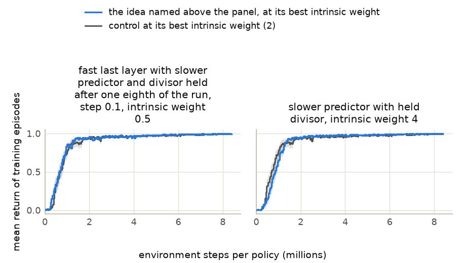
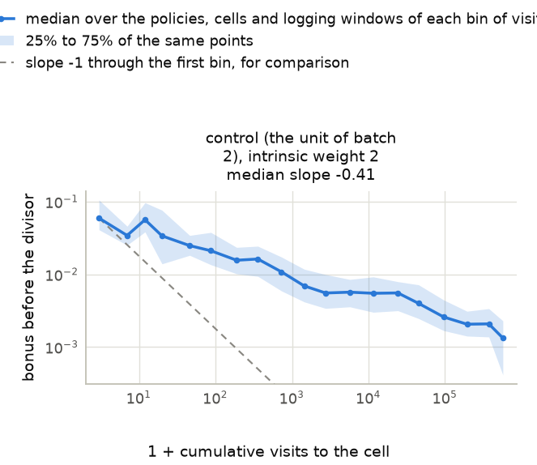

# Batch 3 screen on PointMaze Large with reward 1 on arrival: combinations of the slower predictor, the held divisor and the fast last layer

Generated 2026-11-12 19:44 PT by the command below. This file is generated: regenerate it, do not edit it. Times are Pacific, converted from machines running Eastern. Run folder: `2026-11-12-00-22_pointmaze-medium-large_antmaze-umaze-medium-large_beat-cleanrl-ppo-rnd-auto-research_reward-arrival-plus-1-and-step-cost_bonus-5-days_other-parts-5-days`; batch folder: `batches/03_combinations-of-slower-predictor_held-divisor_and-fast-last-layer`.

```bash
cd /p/rlprojects/RND/10_jax_exploration_platform
bash "benchmark_runs/2026-11-12-00-17_pointmaze-antmaze_cleanrl-ppo-rnd_speed-30-ideas_screen-15-minutes-per-idea-per-card_h100-nvl_rtx-5080_rtx-a4500/infrastructure/submit_tests.sh" -s scripts/maze_campaign/analysis/batch_summary_job.py \
    --run-dir=runs/2026-11-12-00-22_pointmaze-medium-large_antmaze-umaze-medium-large_beat-cleanrl-ppo-rnd-auto-research_reward-arrival-plus-1-and-step-cost_bonus-5-days_other-parts-5-days \
    --batch=03_combinations-of-slower-predictor_held-divisor_and-fast-last-layer
```

## Contents

| section | first written | last changed | status |
|---|---|---|---|
| [Units](#units) | 2026-11-12 16:21 PT | 2026-11-12 17:45 PT | unread |
| [Measures](#measures) | 2026-11-12 16:21 PT | 2026-11-12 16:21 PT | unread |
| [Discovery and optimization: whole-curve mean](#discovery-and-optimization-whole-curve-mean) | 2026-11-12 16:21 PT | 2026-11-12 17:45 PT | unread |
| [Whole-curve mean at every intrinsic weight](#whole-curve-mean-at-every-intrinsic-weight) | 2026-11-12 16:21 PT | 2026-11-12 17:45 PT | unread |
| [Discovery: mean capped first-goal time](#discovery-mean-capped-first-goal-time) | 2026-11-12 16:21 PT | 2026-11-12 17:45 PT | unread |
| [Mean capped first-goal time at every intrinsic weight](#mean-capped-first-goal-time-at-every-intrinsic-weight) | 2026-11-12 16:21 PT | 2026-11-12 17:45 PT | unread |
| [Training curves](#training-curves) | 2026-11-12 17:00 PT | 2026-11-12 17:45 PT | unread |
| [Properties of the bonus on the maze grid](#properties-of-the-bonus-on-the-maze-grid) | 2026-11-12 16:21 PT | 2026-11-12 17:45 PT | unread |
| [Predictions](#predictions) | 2026-11-12 16:21 PT | 2026-11-12 16:21 PT | unread |
| [Ideas against the control](#ideas-against-the-control) | 2026-11-12 16:21 PT | 2026-11-12 17:45 PT | unread |
| [Validation block](#validation-block) | 2026-11-12 16:21 PT | 2026-11-12 19:44 PT | unread |
| [Discovery checks beyond the screen](#discovery-checks-beyond-the-screen) | 2026-11-12 19:44 PT | 2026-11-12 19:44 PT | unread |
| [Records that need a look](#records-that-need-a-look) | 2026-11-12 16:21 PT | 2026-11-12 17:45 PT | unread |

Times are Pacific, converted from machines running Eastern, and come from this report's own history of regenerations. [The same report with unread sections in blue and changed text in brown](summary.html). No section marks itself read.

## Units

7 of 7 units are complete. Only complete units enter the tables and figures below; nothing is estimated for the others. No unit is left out.

| unit | method | state | logging windows written | card | finished | place in the queue |
|---|---|---|---|---|---|---|
| 1 | control (the unit of batch 2) | complete | 256 of 256 | NVIDIA GeForce RTX 2080 Ti | 2026-11-12 16:14 PT | `queue/done` |
| 2 | slower predictor with held divisor | complete | 256 of 256 | NVIDIA GeForce RTX 2080 Ti | 2026-11-12 16:42 PT | `queue/done` |
| 3 | fast last layer with held divisor, step 0.1 | complete | 256 of 256 | NVIDIA RTX 4000 Ada Generation | 2026-11-12 17:11 PT | `queue/done` |
| 4 | fast last layer with held divisor, step 0.3 | complete | 256 of 256 | NVIDIA GeForce RTX 2080 Ti | 2026-11-12 17:35 PT | `queue/done` |
| 5 | fast last layer with slower predictor, step 0.1 | complete | 256 of 256 | NVIDIA GeForce RTX 2080 Ti | 2026-11-12 17:31 PT | `queue/done` |
| 6 | fast last layer with slower predictor and held divisor, step 0.1 | complete | 256 of 256 | NVIDIA GeForce RTX 2080 Ti | 2026-11-12 17:39 PT | `queue/done` |
| 7 | fast last layer with slower predictor and divisor held after one eighth of the run, step 0.1 | complete | 256 of 256 | NVIDIA A30 | 2026-11-12 16:52 PT | `queue/done` |

Unit names, by the number in the first column:

1. `batch-02-screen_pointmaze-large_reward-arrival-plus-one_control-cleanrl-ppo-rnd_cells-01-to-12-of-12_seeds-0-to-15`
2. `batch-03-screen_pointmaze-large_reward-arrival-plus-one_slower-predictor-with-held-divisor_cells-01-to-12-of-12_seeds-0-to-15`
3. `batch-03-screen_pointmaze-large_reward-arrival-plus-one_fast-last-layer-step-0-point-1-with-held-divisor_cells-01-to-12-of-12_seeds-0-to-15`
4. `batch-03-screen_pointmaze-large_reward-arrival-plus-one_fast-last-layer-step-0-point-3-with-held-divisor_cells-01-to-12-of-12_seeds-0-to-15`
5. `batch-03-screen_pointmaze-large_reward-arrival-plus-one_fast-last-layer-step-0-point-1-with-slower-predictor_cells-01-to-12-of-12_seeds-0-to-15`
6. `batch-03-screen_pointmaze-large_reward-arrival-plus-one_fast-last-layer-step-0-point-1-slower-predictor-held-divisor_cells-01-to-12-of-12_seeds-0-to-15`
7. `batch-03-screen_pointmaze-large_reward-arrival-plus-one_fast-last-layer-step-0-point-1-slower-predictor-divisor-held-after-one-eighth_cells-01-to-12-of-12_seeds-0-to-15`

## Measures

Two metrics are reported, each in its own table with its own best intrinsic weight per method: the whole-curve mean $W$ measures discovery and optimization together, and the mean capped first-goal time $M$ measures discovery alone. The two are never mixed in one choice.

Define $K$ as the number of policies (seeds) of one method at one intrinsic weight ($K = 16$, the development seeds 0 to 15), $B$ as the budget in environment steps per policy ($B$ = 8,388,608), $R_i(s)$ as the mean return of the training episodes of policy $i$ that end in the logging window containing step $s$, and $\Delta s$ as the number of that window's steps inside the range being averaged. An episode returns 1 if it reaches the goal and 0 otherwise. A window in which no episode ends takes the value of the window before it; before a policy's first finished episode the value is 0.

1. **Whole-curve mean:** $W(B) = \dfrac{1}{K}\sum_{i=1}^{K} \dfrac{1}{B}\sum_{s \le B} R_i(s) \thinspace \Delta s$, the area under the training curve divided by the budget.
2. **Final level:** $L(B) = \dfrac{1}{K}\sum_{i=1}^{K} \dfrac{1}{0.1 B}\sum_{0.9 B \lt s \le B} R_i(s) \thinspace \Delta s$, the same mean over the last 10% of the budget.
3. **Best intrinsic weight for the whole-curve mean:** per method, the one of the intrinsic weights it was trained at with the highest $W$; ties go to the higher $L$.
4. **Difference from the control:** define $d_i$ as the value of seed $i$ under the method at its best weight for $W$ minus its value under the control at the control's own best weight for $W$. The tables give $\bar d = \dfrac{1}{K}\sum_{i=1}^{K} d_i$ for $W$ and for $L$, each with a 95% interval: the 2.5% and 97.5% points of the means of 10,000 resamples of the $K$ seeds, drawn with replacement. An idea is ahead of the control when the interval is entirely above zero, behind when it is entirely below zero, and within the interval otherwise.
5. **Median first-arrival step:** define $T_i$ as the training step of policy $i$'s first arrival at the goal ($T_i = \infty$ if it has none by step $B$). The measure is the median of $T_i$ over the $K$ policies; it reads "none" when the median falls on a policy with no arrival.
6. **Policies that reach the goal:** the number of the $K$ policies with $T_i \le B$.
7. **Mean capped first-goal time, the secondary metric:** $M(B) = \dfrac{1}{K}\sum_{i=1}^{K} \min(T_i, B)$, the mean over the policies of the training step of the first arrival at the goal, a policy with no arrival by step $B$ counting as $B$. Smaller is better. The tables give $M$ in thousands of steps.
8. **Best intrinsic weight for the mean capped first-goal time:** per method, the one of the intrinsic weights it was trained at with the smallest $M$; ties go to the weight at which more policies reach the goal. It can differ from the best weight of item 3.
9. **Difference in the mean capped first-goal time from the control:** as item 4, with $d_i$ the value of $\min(T_i, B)$ of seed $i$ under the method at its best weight for $M$ minus the same under the control at the control's own best weight for $M$. A negative $\bar d$ means the goal was first reached earlier than under the control. An idea is ahead of the control on discovery when the 95% interval is entirely below zero, behind when it is entirely above zero, and within the interval otherwise.

Standard errors are over the $K$ policies.

## Discovery and optimization: whole-curve mean

Define $W$, $L$ and the other columns as in the section Measures. One row per method at its best intrinsic weight for $W$, read at 8,388,608 environment steps per policy. The control is the first row; the ideas follow, sorted by $W$. Per column, the best value is bold and the second best underlined; for the median first-arrival step the smallest value is the best. Differences are the method minus the control at the control's own best intrinsic weight (2), on the 16 seeds both have; the brackets hold the 95% interval. The seeds are the development seeds, on which each best weight was also chosen: this table is a screen and not a verdict.

| method | best intrinsic weight for $W$ | whole-curve mean $W$ ↑ ± standard error | difference in $W$ from the control [95% interval] | final level $L$ | difference in $L$ from the control [95% interval] | median first-arrival step | policies that reach the goal |
|---|---|---|---|---|---|---|---|
| control (the unit of batch 2) | 2 | 0.885 ± 0.010 | control | 0.994 | control | 191.9K | 16 of 16 |
| fast last layer with slower predictor and held divisor, step 0.1 | 0.5 | **0.898** ± 0.008 | **+0.013** [-0.014, +0.042] | 0.996 | +0.002 [-0.002, +0.005] | 113.4K | 16 of 16 |
| fast last layer with slower predictor and divisor held after one eighth of the run, step 0.1 | 0.5 | <u>0.894</u> ± 0.006 | <u>+0.010</u> [-0.014, +0.037] | <u>0.997</u> | <u>+0.003</u> [+0.000, +0.006] | <u>113.3K</u> | 16 of 16 |
| fast last layer with held divisor, step 0.3 | 0.25 | 0.889 ± 0.007 | +0.004 [-0.013, +0.022] | **0.998** | **+0.004** [+0.002, +0.006] | 166.1K | 16 of 16 |
| fast last layer with slower predictor, step 0.1 | 0.5 | 0.883 ± 0.007 | -0.002 [-0.024, +0.025] | 0.990 | -0.004 [-0.009, +0.001] | 113.4K | 16 of 16 |
| slower predictor with held divisor | 4 | 0.881 ± 0.007 | -0.003 [-0.028, +0.026] | **0.998** | **+0.004** [+0.001, +0.006] | 114.3K | 16 of 16 |
| fast last layer with held divisor, step 0.1 | 1 | 0.875 ± 0.013 | -0.010 [-0.044, +0.025] | 0.995 | +0.000 [-0.004, +0.004] | **61.4K** | 16 of 16 |

## Whole-curve mean at every intrinsic weight

Define $W$ as in the section Measures. Rows are in the order of the table of the whole-curve mean. The 12 weights are split over two tables so that each fits the width of a printed page. A method that was not trained at a weight has an empty cell there. Per weight (column), the highest $W$ among the methods is bold and the second highest underlined. The last column names each method's best weight for $W$ and says when it is the smallest or the largest of the weights the method was trained at.

| method | weight $4^{-6}$ | weight $4^{-5}$ | weight $4^{-4}$ | weight $4^{-3}$ | weight 0.0625 | weight 0.25 | best intrinsic weight for $W$ |
|---|---|---|---|---|---|---|---|
| control (the unit of batch 2) | <u>0.000</u> | 0.000 | 0.000 | 0.090 | 0.159 | 0.728 | 2 |
| fast last layer with slower predictor and held divisor, step 0.1 | <u>0.000</u> | 0.000 | **0.107** | <u>0.407</u> | 0.759 | **0.889** | 0.5 |
| fast last layer with slower predictor and divisor held after one eighth of the run, step 0.1 | <u>0.000</u> | 0.000 | 0.000 | **0.442** | <u>0.821</u> | 0.866 | 0.5 |
| fast last layer with held divisor, step 0.3 | <u>0.000</u> | 0.000 | 0.000 | 0.312 | 0.776 | **0.889** | 0.25 |
| fast last layer with slower predictor, step 0.1 | <u>0.000</u> | 0.000 | <u>0.057</u> | 0.334 | **0.823** | <u>0.867</u> | 0.5 |
| slower predictor with held divisor | <u>0.000</u> | 0.000 | 0.000 | 0.000 | 0.087 | 0.547 | 4 |
| fast last layer with held divisor, step 0.1 | **0.100** | 0.000 | 0.043 | 0.354 | 0.807 | 0.863 | 1 |

| method | weight 0.5 | weight 1 | weight 2 | weight 4 | weight 16 | weight 64 | best intrinsic weight for $W$ |
|---|---|---|---|---|---|---|---|
| control (the unit of batch 2) | 0.846 | 0.860 | **0.885** | <u>0.867</u> | <u>0.575</u> | <u>0.065</u> | 2 |
| fast last layer with slower predictor and held divisor, step 0.1 | **0.898** | **0.878** | 0.849 | 0.758 | 0.282 | 0.038 | 0.5 |
| fast last layer with slower predictor and divisor held after one eighth of the run, step 0.1 | <u>0.894</u> | <u>0.876</u> | 0.831 | 0.714 | 0.189 | 0.035 | 0.5 |
| fast last layer with held divisor, step 0.3 | 0.815 | 0.819 | 0.671 | 0.579 | 0.091 | 0.018 | 0.25 |
| fast last layer with slower predictor, step 0.1 | 0.883 | 0.848 | 0.764 | 0.427 | 0.055 | 0.019 | 0.5 |
| slower predictor with held divisor | 0.795 | 0.848 | <u>0.861</u> | **0.881** | **0.833** | **0.588** | 4 |
| fast last layer with held divisor, step 0.1 | 0.866 | 0.875 | 0.851 | 0.746 | 0.243 | 0.040 | 1 |

No method has its best weight at an end of the grid.

## Discovery: mean capped first-goal time

Define $M$, $W$ and $L$ as in the section Measures. One row per method at its best intrinsic weight for $M$ (the smallest $M$; ties go to the weight at which more policies reach the goal), read at 8,388,608 environment steps per policy. This weight can differ from the best weight for $W$ in the table of the whole-curve mean. $M$, its standard error and its differences are in thousands of steps. The control is the first row; the ideas follow, sorted by $M$ from the smallest. Per column, the best value is bold and the second best underlined: the smallest for $M$ and for its difference, the largest for the other columns. The columns $W$ and $L$ are read at the same weight as $M$, so they show what the configuration that is best for discovery gives on the primary metric. Differences are the method minus the control at the control's own best intrinsic weight for $M$ (64), on the 16 seeds both have; the brackets hold the 95% interval, and a negative difference means the goal was first reached earlier than under the control. A best weight marked "largest of the grid" or "smallest of the grid" is at an end of the weights the method was trained at: larger or smaller weights must be tried before anything is concluded from that row. The seeds are the development seeds, on which each best weight was also chosen: this table is a screen and not a verdict.

| method | best intrinsic weight for $M$ | $M$ ↓ ± standard error, thousand steps | difference in $M$ from the control [95% interval], thousand steps | policies that reach the goal | $W$ at that weight ± standard error | $L$ at that weight |
|---|---|---|---|---|---|---|
| control (the unit of batch 2) | 64 (largest of the grid) | 190 ± 50.8 | control | 16 of 16 | 0.065 ± 0.014 | 0.112 |
| fast last layer with held divisor, step 0.1 | 16 | **62** ± 12.7 | **-128** [-244, -49.6] | 16 of 16 | 0.243 ± 0.023 | 0.483 |
| fast last layer with slower predictor and divisor held after one eighth of the run, step 0.1 | 4 | <u>63.4</u> ± 9.59 | <u>-126</u> [-236, -45.6] | 16 of 16 | **0.714** ± 0.016 | **0.973** |
| fast last layer with slower predictor, step 0.1 | 16 | 96 ± 24 | -93.5 [-221, +11.3] | 16 of 16 | 0.055 ± 0.007 | 0.102 |
| fast last layer with slower predictor and held divisor, step 0.1 | 16 | 96 ± 24 | -93.5 [-227, +11.3] | 16 of 16 | 0.282 ± 0.025 | 0.688 |
| slower predictor with held divisor | 64 (largest of the grid) | 110 ± 18 | -79.2 [-198, +9.56] | 16 of 16 | <u>0.588</u> ± 0.017 | <u>0.966</u> |
| fast last layer with held divisor, step 0.3 | 64 (largest of the grid) | 116 ± 30.2 | -74 [-192, +25.1] | 16 of 16 | 0.018 ± 0.004 | 0.022 |

## Mean capped first-goal time at every intrinsic weight

Define $M$ as in the section Measures; the cells give it in thousands of steps. Rows are in the order of the table of the mean capped first-goal time. The 12 weights are split over two tables so that each fits the width of a printed page. A method that was not trained at a weight has an empty cell there. Per weight (column), the smallest $M$ among the methods is bold and the second smallest underlined. The last column names each method's best weight for $M$ and says when it is the smallest or the largest of the weights the method was trained at.

| method | weight $4^{-6}$ | weight $4^{-5}$ | weight $4^{-4}$ | weight $4^{-3}$ | weight 0.0625 | weight 0.25 | best intrinsic weight for $M$ |
|---|---|---|---|---|---|---|---|
| control (the unit of batch 2) | **7,376** | 8,389 | 8,389 | 7,050 | 3,980 | 1,289 | 64 (largest of the grid) |
| fast last layer with held divisor, step 0.1 | <u>7,497</u> | **7,514** | 7,991 | 3,530 | 943 | <u>196</u> | 16 |
| fast last layer with slower predictor and divisor held after one eighth of the run, step 0.1 | 8,389 | 8,389 | 7,129 | 3,495 | **607** | 277 | 4 |
| fast last layer with slower predictor, step 0.1 | 8,389 | 7,886 | <u>6,789</u> | **2,711** | <u>797</u> | **157** | 16 |
| fast last layer with slower predictor and held divisor, step 0.1 | 7,947 | 7,886 | **6,109** | <u>3,426</u> | 1,195 | **157** | 16 |
| slower predictor with held divisor | 7,896 | 7,961 | 8,389 | 8,389 | 7,041 | 1,310 | 64 (largest of the grid) |
| fast last layer with held divisor, step 0.3 | 7,883 | <u>7,874</u> | 6,988 | 4,894 | 1,212 | 255 | 64 (largest of the grid) |

| method | weight 0.5 | weight 1 | weight 2 | weight 4 | weight 16 | weight 64 | best intrinsic weight for $M$ |
|---|---|---|---|---|---|---|---|
| control (the unit of batch 2) | 604 | 453 | 220 | 220 | 236 | 190 | 64 (largest of the grid) |
| fast last layer with held divisor, step 0.1 | 371 | **80.6** | **78.8** | <u>67</u> | **62** | **87.9** | 16 |
| fast last layer with slower predictor and divisor held after one eighth of the run, step 0.1 | **177** | <u>85.2</u> | <u>106</u> | **63.4** | 136 | 643 | 4 |
| fast last layer with slower predictor, step 0.1 | 187 | 117 | 110 | 97.8 | <u>96</u> | <u>97.1</u> | 16 |
| fast last layer with slower predictor and held divisor, step 0.1 | 185 | 117 | 110 | 97.8 | <u>96</u> | <u>97.1</u> | 16 |
| slower predictor with held divisor | 790 | 330 | 194 | 160 | 111 | 110 | 64 (largest of the grid) |
| fast last layer with held divisor, step 0.3 | <u>181</u> | 283 | 614 | 129 | 753 | 116 | 64 (largest of the grid) |

Best weight for $M$ at an end of the grid: control (the unit of batch 2) (64, the largest); slower predictor with held divisor (64, the largest); fast last layer with held divisor, step 0.3 (64, the largest). Larger or smaller weights must be tried on that side before anything is concluded from these rows (the edge rule of `program.md`).

## Training curves

Define $\bar R(s) = \dfrac{1}{K}\sum_{i=1}^{K} R_i(s)$, with $R_i(s)$ and $K$ as in the section Measures. One panel per idea in the order of the table of the whole-curve mean: the idea at its best intrinsic weight for $W$ in blue, the control at its best intrinsic weight (2) in grey; bands are one standard error over the 16 seeds.



## Properties of the bonus on the maze grid

Every unit records, per policy and per open maze cell (46 cells), the bonus at one probe observation (the cell's centre, zero velocity) at the end of every logging window, and the visits to the cell. Define $b_i(c, w)$ as the bonus before the divisor of policy $i$ at the probe of cell $c$ at the end of logging window $w$, with $w = 0$ for the record written after the random-action rollouts and before the first training iteration; $r_i(c, w)$ as the same bonus after the divisor (the intrinsic reward); $n_i(c, w)$ as the number of states of policy $i$'s rollouts in cell $c$ from the first window to window $w$; $\beta$ as the intrinsic weight; $C$ as the number of open cells ($C = 46$); and $w_f$ as the last logging window that ends at or before the share $f$ of the budget (5% is read at step 393,216, 25% is read at step 2,097,152, 100% is read at step 8,388,608).

1. **Start ratio:** $E_i = \dfrac{\max_c b_i(c, 0)}{\min_c b_i(c, 0)}$, the largest over the smallest start bonus on the grid. The table gives the median over all policies of the unit (every weight).
2. **Decay slope:** define $x_w = \log(1 + n_i(c, w))$ and $y_w = \log b_i(c, w)$, and $\bar x$ and $\bar y$ as their means over the windows $w \ge 1$ with $n_i(c, w) \ge 1$. Per policy and cell, $a_i(c) = \dfrac{\sum_w (x_w - \bar x)(y_w - \bar y)}{\sum_w (x_w - \bar x)^2}$ over those windows: the least-squares slope of the logarithm of the bonus on the logarithm of one plus the cumulative visits. A slope of $-1$ means the bonus falls in proportion to $1/(1 + n)$. The table gives the median over the policies and cells at the method's best weight, and the smallest and the largest of the per-weight medians with the weights they belong to: when the two differ, the slope depends on the weight.
3. **Bonus at unvisited cells over its start:** $u_i(c, f) = \dfrac{b_i(c, w_f)}{b_i(c, 0)}$ for the (policy, cell) pairs with $n_i(c, w_f) = 0$, at the method's best weight. The table gives the median over those pairs and their number; a median over fewer than 20 pairs is not printed. A value below 1 means that training on other cells lowered the bonus of a cell with no visit.
4. **Weighted intrinsic reward:** $q(w) = \dfrac{\beta}{K C}\sum_{i=1}^{K}\sum_{c=1}^{C} r_i(c, w)$, at the method's best weight: the intrinsic reward a first visit to a cell would pay, times the intrinsic weight, averaged over cells and policies. It is read at the start ($w = 0$), at the end of the first logging window (step 32,768) and at 25% and 100% of the budget. The task pays 1 on arrival. The second table also gives the divisor (the median over the policies) in the start record and at the end of the first logging window. A divisor that follows the running standard deviation is 1 in the start record, because no rollout has entered its statistics yet, and the trainer updates it with each rollout before it divides that rollout's rewards; for such a method the start column is the bonus itself times the weight, and the first logging window is the earliest reading with a divisor the learner used.

Rows are in the order of the table of the whole-curve mean. These columns describe the bonus and have no better or worse direction, so no value is marked.

| method | start ratio, median over policies | decay slope at the best weight, median | decay slope, smallest and largest median over the weights (at weight) | bonus at unvisited cells over its start at 5% of the budget | bonus at unvisited cells over its start at 25% of the budget | bonus at unvisited cells over its start at 100% of the budget |
|---|---|---|---|---|---|---|
| control (the unit of batch 2) | 87.88 | -0.41 | -0.97 ($4^{-4}$) to -0.35 (1) | 0.00173 (73 pairs) | 0.000963 (29 pairs) | 0.00107 (29 pairs) |
| fast last layer with slower predictor and held divisor, step 0.1 | 87.88 | -0.45 | -0.94 ($4^{-5}$) to -0.41 (0.0625) | 0.00704 (44 pairs) | not printed: 13 pairs | not printed: 13 pairs |
| fast last layer with slower predictor and divisor held after one eighth of the run, step 0.1 | 87.86 | -0.52 | -1.07 ($4^{-5}$) to -0.39 (0.0625) | 0.0106 (59 pairs) | 0.00489 (22 pairs) | not printed: 19 pairs |
| fast last layer with held divisor, step 0.3 | 87.88 | -0.41 | -0.93 ($4^{-4}$) to -0.34 (0.0625) | 0.00191 (72 pairs) | 0.000979 (22 pairs) | 0.00139 (22 pairs) |
| fast last layer with slower predictor, step 0.1 | 87.88 | -0.53 | -1.13 ($4^{-6}$) to -0.41 (0.0625) | 0.00704 (44 pairs) | not printed: 11 pairs | not printed: 11 pairs |
| slower predictor with held divisor | 87.88 | -0.43 | -0.79 (0.0625) to -0.38 (1) | 0.0107 (44 pairs) | not printed: 10 pairs | not printed: 9 pairs |
| fast last layer with held divisor, step 0.1 | 87.86 | -0.41 | -0.90 ($4^{-4}$) to -0.30 (0.0625) | 0.00205 (67 pairs) | not printed: 18 pairs | not printed: 18 pairs |

| method | best intrinsic weight | divisor at the start, and at the end of the first logging window | weighted intrinsic reward at the start | weighted intrinsic reward at the end of the first logging window | weighted intrinsic reward at 25% of the budget | weighted intrinsic reward at 100% of the budget |
|---|---|---|---|---|---|---|
| control (the unit of batch 2) | 2 | 1 and 51 | 70 | 0.0156 | 0.00248 | 0.00451 |
| fast last layer with slower predictor and held divisor, step 0.1 | 0.5 | 1 and 21 | 17.9 | 0.102 | 0.00221 | 0.00236 |
| fast last layer with slower predictor and divisor held after one eighth of the run, step 0.1 | 0.5 | 1 and 20.6 | 17.9 | 0.117 | 0.00282 | 0.00306 |
| fast last layer with held divisor, step 0.3 | 0.25 | 1 and 1.25 | 8.84 | 0.0611 | 0.00427 | 0.00524 |
| fast last layer with slower predictor, step 0.1 | 0.5 | 1 and 21 | 17.9 | 0.102 | 0.00339 | 0.00645 |
| slower predictor with held divisor | 4 | 1 and 379 | 141 | 0.0402 | 0.00104 | 0.0014 |
| fast last layer with held divisor, step 0.1 | 1 | 1 and 3.6 | 35.7 | 0.0552 | 0.0061 | 0.00646 |

### Bonus against cumulative visits

One panel per method in the order of the table of the whole-curve mean, at the best intrinsic weight of this section. Each point is the median of $b_i(c, w)$ over the policies, cells and logging windows whose $1 + n_i(c, w)$ falls in one bin (each bin a factor of two wide; pairs with no visit are left out); the band holds the middle half of the same points. Both axes are logarithmic, and every panel shows the same range of visits and the same number of decades of the bonus, so equal slopes look equal. The dashed line has slope $-1$ and passes through the first bin.



## Predictions

The predictions were written in `ideas.md` before the runs. Their readings from the records have not been written yet (this batch has no predictions module), so each is quoted and marked not read yet. The tables of this summary hold the numbers the predictions speak of.

### Prediction 1

> **Slower predictor with held divisor:** the two gains add: whole-curve mean at the best weight at least 0.015 above the control's best on these seeds (a difference the validation block must then confirm), final level at least the control's.

Observed: **not read yet**.

### Prediction 2

> **Fast last layer with held divisor:** the final level at weights 1 and 2 rises to 0.99 or more (from 0.96 and 0.75 without the held divisor), because the reward can no longer rise again after the hold; the mean capped first-goal time stays below 100 thousand steps at its best weight; the whole-curve mean at its best weight is above the control's best. If the final level does not recover, the fast last layer's late cost is not the divisor's rise, and the records of the reward at the probes will show what it is.

Observed: **not read yet**.

### Prediction 3

> **All three:** the smallest mean capped first-goal time of the batch and the highest whole-curve mean of the batch; holding after 1/8 instead of 1/16 changes the whole-curve mean by less than 0.01.

Observed: **not read yet**.

### Prediction 4

> **If a combination is refused by the option checks or fails,** it is reported as not runnable and the reason is read from the unit's log before anything is changed.

Observed: **not read yet**.

## Ideas against the control

Two readings, one per metric, each with the methods at their own best weights for that metric. Both are on the development seeds, on which the best weights were also chosen: a screen, not a verdict.

### Discovery and optimization: whole-curve mean

By the 95% interval of the difference in $W$ from the control (section Measures, item 4), on the development seeds. After each name: the difference in $W$ and its interval.

- **Ahead of the control** (interval entirely above zero): none.
- **Within the interval** (it contains zero): fast last layer with slower predictor and held divisor, step 0.1 (+0.013 [-0.014, +0.042]); fast last layer with slower predictor and divisor held after one eighth of the run, step 0.1 (+0.010 [-0.014, +0.037]); fast last layer with held divisor, step 0.3 (+0.004 [-0.013, +0.022]); fast last layer with slower predictor, step 0.1 (-0.002 [-0.024, +0.025]); slower predictor with held divisor (-0.003 [-0.028, +0.026]); fast last layer with held divisor, step 0.1 (-0.010 [-0.044, +0.025]).
- **Behind the control** (interval entirely below zero): none.
- **Not compared yet** (unit not complete): none.

### Discovery: mean capped first-goal time

By the 95% interval of the difference in $M$ from the control (section Measures, item 9), on the development seeds. After each name: the difference in $M$ and its interval, in thousands of steps; a negative difference means the goal was first reached earlier than under the control.

- **Ahead of the control on discovery** (interval entirely below zero): fast last layer with held divisor, step 0.1 (-128 [-244, -49.6]); fast last layer with slower predictor and divisor held after one eighth of the run, step 0.1 (-126 [-236, -45.6]).
- **Within the interval** (it contains zero): fast last layer with slower predictor, step 0.1 (-93.5 [-221, +11.3]); fast last layer with slower predictor and held divisor, step 0.1 (-93.5 [-227, +11.3]); slower predictor with held divisor (-79.2 [-198, +9.56]); fast last layer with held divisor, step 0.3 (-74 [-192, +25.1]).
- **Behind the control on discovery** (interval entirely above zero): none.
- **Not compared yet** (unit not complete): none.

## Validation block

The units of the phase `validation-block` in the screen's environment and reward setting. Each trains one method at one intrinsic weight on 256 seeds, from 10000 to 10255: these are neither the development seeds of the screen nor the confirmation seeds. 19 of 21 method and weight pairs have a complete unit; a unit that is not complete is listed under the tables and left out. Define $W$, $L$ and $M$ as in the section Measures, here with $K$ the number of seeds of a row and read at 8,388,608 environment steps per policy. Differences are the method minus the control at the same intrinsic weight, on the seeds both have, each with its 95% interval from 10,000 resamples of those seeds. Rows: the control first, then the other methods, each by intrinsic weight. Per column the best value is bold and the second best underlined.

### Discovery and optimization: whole-curve mean and final level

| method | intrinsic weight | $W$ ± standard error | difference in $W$ from the control [95% interval] | $L$ ± standard error | difference in $L$ from the control [95% interval] | seeds in common with the control |
|---|---|---|---|---|---|---|
| control | 1 | 0.876 ± 0.002 | control | 0.995 ± 0.000 | control | 256 |
| control | 2 | 0.878 ± 0.002 | control | 0.992 ± 0.001 | control | 256 |
| control | 4 | 0.863 ± 0.002 | control | 0.977 ± 0.002 | control | 256 |
| separate predictor step size, predictor learning rate 0.25 times 1e-4 | 1 | 0.876 ± 0.003 | -0.000 [-0.008, +0.007] | **0.998** ± 0.000 | +0.002 [+0.001, +0.003] | 256 |
| separate predictor step size, predictor learning rate 0.25 times 1e-4 | 2 | 0.886 ± 0.002 | +0.008 [+0.001, +0.014] | 0.995 ± 0.001 | +0.003 [+0.001, +0.005] | 256 |
| separate predictor step size, predictor learning rate 0.25 times 1e-4 | 4 | 0.878 ± 0.002 | +0.016 [+0.009, +0.022] | 0.993 ± 0.000 | +0.016 [+0.013, +0.020] | 256 |
| separate predictor step size, predictor learning rate 1 times 1e-4 | 2 | 0.880 ± 0.002 | +0.002 [-0.004, +0.008] | 0.995 ± 0.000 | +0.003 [+0.002, +0.005] | 256 |
| separate predictor step size, predictor learning rate 1 times 1e-4 | 4 | 0.876 ± 0.002 | +0.014 [+0.007, +0.020] | 0.993 ± 0.000 | +0.017 [+0.013, +0.020] | 256 |
| divisor held after one sixteenth of the run | 2 | <u>0.888</u> ± 0.002 | +0.009 [+0.004, +0.015] | **0.998** ± 0.000 | +0.006 [+0.005, +0.007] | 256 |
| divisor held after one sixteenth of the run | 4 | 0.882 ± 0.002 | <u>+0.019</u> [+0.014, +0.025] | <u>0.997</u> ± 0.000 | <u>+0.020</u> [+0.017, +0.024] | 256 |
| divisor held after one quarter of the run | 4 | 0.872 ± 0.002 | +0.009 [+0.008, +0.011] | 0.995 ± 0.000 | +0.018 [+0.014, +0.022] | 256 |
| slower predictor with held divisor (predictor learning rate 0.25 times 1e-4, divisor held after one sixteenth of the run) | 2 | 0.885 ± 0.003 | +0.007 [-0.000, +0.014] | **0.998** ± 0.000 | +0.006 [+0.005, +0.007] | 256 |
| slower predictor with held divisor (predictor learning rate 0.25 times 1e-4, divisor held after one sixteenth of the run) | 4 | <u>0.888</u> ± 0.002 | **+0.026** [+0.020, +0.032] | **0.998** ± 0.000 | **+0.022** [+0.018, +0.026] | 256 |
| fast last layer with slower predictor and held divisor, step 0.1 (divisor held after one sixteenth of the run) | 0.25 | 0.878 ± 0.005 | no complete control unit at this weight | <u>0.997</u> ± 0.000 | no complete control unit at this weight | not compared |
| fast last layer with slower predictor and held divisor, step 0.1 (divisor held after one sixteenth of the run) | 0.5 | **0.892** ± 0.003 | no complete control unit at this weight | <u>0.997</u> ± 0.000 | no complete control unit at this weight | not compared |
| fast last layer with slower predictor and held divisor, step 0.1 (divisor held after one sixteenth of the run) | 1 | 0.878 ± 0.002 | +0.002 [-0.004, +0.008] | 0.995 ± 0.000 | -0.001 [-0.002, +0.000] | 256 |
| fast last layer with slower predictor and divisor held after one eighth of the run, step 0.1 | 0.25 | 0.885 ± 0.003 | no complete control unit at this weight | <u>0.997</u> ± 0.001 | no complete control unit at this weight | not compared |
| fast last layer with slower predictor and divisor held after one eighth of the run, step 0.1 | 0.5 | 0.886 ± 0.002 | no complete control unit at this weight | 0.995 ± 0.001 | no complete control unit at this weight | not compared |
| fast last layer with slower predictor and divisor held after one eighth of the run, step 0.1 | 1 | 0.871 ± 0.002 | -0.005 [-0.011, +0.002] | 0.993 ± 0.000 | -0.002 [-0.003, -0.001] | 256 |

### Discovery: mean capped first-goal time

$M$, its standard error and its differences are in thousands of steps; the smallest value is the best, and a negative difference means the goal was first reached earlier than under the control.

| method | intrinsic weight | $M$ ± standard error, thousand steps | difference in $M$ from the control [95% interval], thousand steps | policies that reach the goal | seeds in common with the control |
|---|---|---|---|---|---|
| control | 1 | 385 ± 13.1 | control | 256 of 256 | 256 |
| control | 2 | 269 ± 10.8 | control | 256 of 256 | 256 |
| control | 4 | 205 ± 8.2 | control | 256 of 256 | 256 |
| separate predictor step size, predictor learning rate 0.25 times 1e-4 | 1 | 263 ± 15.4 | -122 [-162, -80.2] | 256 of 256 | 256 |
| separate predictor step size, predictor learning rate 0.25 times 1e-4 | 2 | 171 ± 11 | -98.7 [-129, -67.3] | 256 of 256 | 256 |
| separate predictor step size, predictor learning rate 0.25 times 1e-4 | 4 | 133 ± 7.88 | -71.9 [-93.8, -49.8] | 256 of 256 | 256 |
| separate predictor step size, predictor learning rate 1 times 1e-4 | 2 | 238 ± 12.4 | -31.2 [-62.3, +1.19] | 256 of 256 | 256 |
| separate predictor step size, predictor learning rate 1 times 1e-4 | 4 | 185 ± 10.1 | -19.8 [-43.4, +4.32] | 256 of 256 | 256 |
| divisor held after one sixteenth of the run | 2 | 270 ± 10.5 | +0.579 [-27.2, +28.5] | 256 of 256 | 256 |
| divisor held after one sixteenth of the run | 4 | 213 ± 8.15 | +8.39 [-13.7, +30.6] | 256 of 256 | 256 |
| divisor held after one quarter of the run | 4 | 205 ± 8.2 | +0 [+0, +0] | 256 of 256 | 256 |
| slower predictor with held divisor (predictor learning rate 0.25 times 1e-4, divisor held after one sixteenth of the run) | 2 | 182 ± 13.9 | -86.9 [-120, -51.4] | 256 of 256 | 256 |
| slower predictor with held divisor (predictor learning rate 0.25 times 1e-4, divisor held after one sixteenth of the run) | 4 | 153 ± 9.69 | -52 [-76.2, -28.2] | 256 of 256 | 256 |
| fast last layer with slower predictor and held divisor, step 0.1 (divisor held after one sixteenth of the run) | 0.25 | 284 ± 20.3 | no complete control unit at this weight | 256 of 256 | not compared |
| fast last layer with slower predictor and held divisor, step 0.1 (divisor held after one sixteenth of the run) | 0.5 | 160 ± 11.2 | no complete control unit at this weight | 256 of 256 | not compared |
| fast last layer with slower predictor and held divisor, step 0.1 (divisor held after one sixteenth of the run) | 1 | <u>124</u> ± 9.81 | <u>-261</u> [-291, -229] | 256 of 256 | 256 |
| fast last layer with slower predictor and divisor held after one eighth of the run, step 0.1 | 0.25 | 243 ± 13.5 | no complete control unit at this weight | 256 of 256 | not compared |
| fast last layer with slower predictor and divisor held after one eighth of the run, step 0.1 | 0.5 | 172 ± 11.1 | no complete control unit at this weight | 256 of 256 | not compared |
| fast last layer with slower predictor and divisor held after one eighth of the run, step 0.1 | 1 | **120** ± 7.9 | **-265** [-293, -236] | 256 of 256 | 256 |

### Each method at its best intrinsic weight against the control at its best weight

The two tables above compare at equal intrinsic weights. A method and the control need not have the same best weight, so here each method stands at its own best weight for the metric and the control at its own: for $W$ the weight with the highest $W$ (ties: the higher $L$), for $M$ the weight with the smallest $M$ (ties: more policies reach the goal). The weight column names the weights each was chosen among. Each best weight was chosen on these same seeds, among the weights the method was run at in this block, and the control's was chosen the same way: a side that was run at more weights had more chances, so these differences lean slightly towards it. They are a second selection step, not the comparison on the confirmation seeds. Differences are the method minus the control on the seeds both have, with the 95% interval from 10,000 resamples of those seeds. The control is the first row; the other methods follow from the best value of the sorted column on. Per column the best value is bold and the second best underlined.

**Whole-curve mean, at the best weights for $W$.** The last difference column gives the mean capped first-goal time at these same weights, in thousands of steps (negative: the goal was first reached earlier than under the control).

| method | best intrinsic weight for $W$ | $W$ ↑ ± standard error | difference in $W$ from the control [95% interval] | $L$ ± standard error | difference in $L$ from the control [95% interval] | difference in $M$ at these weights [95% interval], thousand steps | seeds in common with the control |
|---|---|---|---|---|---|---|---|
| control | 2 (of 1, 2, 4) | 0.8781 ± 0.0021 | control | 0.9920 ± 0.0005 | control | control | 256 |
| fast last layer with slower predictor and held divisor, step 0.1 (divisor held after one sixteenth of the run) | 0.5 (of 0.25, 0.5, 1) | **0.8917** ± 0.0026 | **+0.0137** [+0.0071, +0.0203] | 0.9969 ± 0.0004 | +0.0049 [+0.0036, +0.0062] | <u>-109</u> [-137, -78.9] | 256 |
| slower predictor with held divisor (predictor learning rate 0.25 times 1e-4, divisor held after one sixteenth of the run) | 4 (of 2, 4) | <u>0.8883</u> ± 0.0021 | <u>+0.0102</u> [+0.0046, +0.0158] | **0.9982** ± 0.0002 | **+0.0062** [+0.0052, +0.0073] | **-117** [-145, -87.3] | 256 |
| divisor held after one sixteenth of the run | 2 (of 2, 4) | 0.8876 ± 0.0021 | +0.0095 [+0.0039, +0.0151] | <u>0.9976</u> ± 0.0003 | <u>+0.0056</u> [+0.0045, +0.0067] | +0.579 [-27.2, +27.9] | 256 |
| separate predictor step size, predictor learning rate 0.25 times 1e-4 | 2 (of 1, 2, 4) | 0.8859 ± 0.0024 | +0.0078 [+0.0016, +0.0142] | 0.9954 ± 0.0007 | +0.0033 [+0.0015, +0.0050] | -98.7 [-129, -67.5] | 256 |
| fast last layer with slower predictor and divisor held after one eighth of the run, step 0.1 | 0.5 (of 0.25, 0.5, 1) | 0.8859 ± 0.0025 | +0.0078 [+0.0013, +0.0141] | 0.9954 ± 0.0005 | +0.0033 [+0.0019, +0.0047] | -97.4 [-127, -67.3] | 256 |
| separate predictor step size, predictor learning rate 1 times 1e-4 | 2 (of 2, 4) | 0.8804 ± 0.0024 | +0.0024 [-0.0036, +0.0083] | 0.9954 ± 0.0004 | +0.0034 [+0.0022, +0.0047] | -31.2 [-62, -0.195] | 256 |
| divisor held after one quarter of the run | 4 (its only weight) | 0.8718 ± 0.0024 | -0.0063 [-0.0126, -0.0001] | 0.9946 ± 0.0005 | +0.0026 [+0.0012, +0.0039] | -64.5 [-90.1, -39.7] | 256 |

**Mean capped first-goal time, at the best weights for $M$.** $M$, its standard error and its difference are in thousands of steps; $W$ and $L$ are read at the same weight as $M$.

| method | best intrinsic weight for $M$ | $M$ ↓ ± standard error, thousand steps | difference in $M$ from the control [95% interval], thousand steps | policies that reach the goal | $W$ at that weight | $L$ at that weight | seeds in common with the control |
|---|---|---|---|---|---|---|---|
| control | 4 (of 1, 2, 4) | 205 ± 8.2 | control | 256 of 256 | 0.8626 | 0.9765 | 256 |
| fast last layer with slower predictor and divisor held after one eighth of the run, step 0.1 | 1 (of 0.25, 0.5, 1) | **120** ± 7.9 | **-84.7** [-105, -63.1] | 256 of 256 | 0.8712 | 0.9935 | 256 |
| fast last layer with slower predictor and held divisor, step 0.1 (divisor held after one sixteenth of the run) | 1 (of 0.25, 0.5, 1) | <u>124</u> ± 9.81 | <u>-80.7</u> [-104, -56.1] | 256 of 256 | 0.8779 | 0.9948 | 256 |
| separate predictor step size, predictor learning rate 0.25 times 1e-4 | 4 (of 1, 2, 4) | 133 ± 7.88 | -71.9 [-94.3, -49.5] | 256 of 256 | 0.8783 | 0.9927 | 256 |
| slower predictor with held divisor (predictor learning rate 0.25 times 1e-4, divisor held after one sixteenth of the run) | 4 (of 2, 4) | 153 ± 9.69 | -52 [-76.2, -27.2] | 256 of 256 | **0.8883** | **0.9982** | 256 |
| separate predictor step size, predictor learning rate 1 times 1e-4 | 4 (of 2, 4) | 185 ± 10.1 | -19.8 [-43.3, +4.23] | 256 of 256 | 0.8762 | 0.9931 | 256 |
| divisor held after one quarter of the run | 4 (its only weight) | 205 ± 8.2 | +0 [+0, +0] | 256 of 256 | 0.8718 | 0.9946 | 256 |
| divisor held after one sixteenth of the run | 4 (of 2, 4) | 213 ± 8.15 | +8.39 [-13.2, +30] | 256 of 256 | <u>0.8821</u> | <u>0.9970</u> | 256 |

Not complete, left out:

- control, intrinsic weight 2: not started (no shard).
- control, intrinsic weight 2: not started (no shard).

## Discovery checks beyond the screen

The screen reads each method on one grid of intrinsic weights at the control's other settings. For the secondary metric each method, and the baseline, has its own configuration: the one with the smallest mean capped first-goal time $M$. This section follows that choice in PointMaze Large, reward 1 on arrival: sweeps of whole configurations on the development seeds, and the leading configurations of each sweep again on the validation seeds.

### On the validation seeds: the leading configurations for the first-goal time

The units of the phase `discovery-validation` in PointMaze Large, reward 1 on arrival. Each trains one configuration on 256 seeds, from 10000 to 10255: neither the development seeds, on which these configurations were picked as the leading ones of each method's discovery sweep, nor the confirmation seeds. Read at 8,388,608 environment steps per policy. Define $M$, $W$ and $L$ as in the section Measures. First table: every configuration, the control first, each method from its smallest $M$ on; per column the best value is bold and the second best underlined (the smallest for $M$).

| method | configuration | $M$ ± standard error, thousand steps | policies that reach the goal | $W$ ± standard error | $L$ |
|---|---|---|---|---|---|
| control (CleanRL PPO-RND) | intrinsic weight 64, learning rate 0.006, entropy coefficient 0.01 | **119** ± 5.46 | **256 of 256** | <u>0.0054</u> ± 0.0002 | <u>0.0000</u> |
| control (CleanRL PPO-RND) | intrinsic weight 64, learning rate 0.01, entropy coefficient 0.01 | <u>135</u> ± 6.06 | **256 of 256** | **0.0063** ± 0.0002 | **0.0015** |
| control (CleanRL PPO-RND) | intrinsic weight 256, learning rate 0.001, entropy coefficient 0.03 | 245 ± 45.9 | <u>254 of 256</u> | 0.0006 ± 0.0000 | <u>0.0000</u> |

Second table: each method at its best configuration for $M$ on these seeds against the control at its own, paired on the seeds both have, with the 95% interval from 10,000 resamples of those seeds. Each best configuration was chosen on these same seeds, among the few run here: a second selection step, not the comparison on the confirmation seeds.

No method other than the control has a complete unit yet.

Not complete, left out: fast last layer inside the rollout, step 0.1: 0 of 3 configurations read (0 of 3 units complete); fast last layer with slower predictor and divisor held after one eighth of the run, step 0.1: 0 of 3 configurations read (0 of 3 units complete).

#### Units

| unit | method | case | configurations | state | logging windows written | finished | restarts |
|---|---|---|---|---|---|---|---|
| 1 | control (CleanRL PPO-RND) | PointMaze Large, reward 1 on arrival | 1 | complete | 256 of 256 | 2026-11-12 19:11 PT | none |
| 2 | control (CleanRL PPO-RND) | PointMaze Large, reward 1 on arrival | 1 | complete | 256 of 256 | 2026-11-12 19:11 PT | none |
| 3 | control (CleanRL PPO-RND) | PointMaze Large, reward 1 on arrival | 1 | complete | 256 of 256 | 2026-11-12 19:08 PT | none |
| 4 | fast last layer inside the rollout, step 0.1 | PointMaze Large, reward 1 on arrival | 1 | unfinished | 252 of 256 | not finished | none |
| 5 | fast last layer inside the rollout, step 0.1 | PointMaze Large, reward 1 on arrival | 1 | unfinished | 248 of 256 | not finished | none |
| 6 | fast last layer inside the rollout, step 0.1 | PointMaze Large, reward 1 on arrival | 1 | unfinished | 245 of 256 | not finished | none |
| 7 | fast last layer with slower predictor and divisor held after one eighth of the run, step 0.1 | PointMaze Large, reward 1 on arrival | 1 | unfinished | 253 of 256 | not finished | none |
| 8 | fast last layer with slower predictor and divisor held after one eighth of the run, step 0.1 | PointMaze Large, reward 1 on arrival | 1 | unfinished | 248 of 256 | not finished | none |
| 9 | fast last layer with slower predictor and divisor held after one eighth of the run, step 0.1 | PointMaze Large, reward 1 on arrival | 1 | unfinished | 251 of 256 | not finished | none |

Unit names, by the number in the first column:

1. `discovery-validation_pointmaze-large_reward-arrival-plus-one_control-cleanrl-ppo-rnd_learning-rate-0.001_entropy-coefficient-0.03_intrinsic-weight-256.0_clip-coefficient-0.1_seeds-10000-to-10255`
2. `discovery-validation_pointmaze-large_reward-arrival-plus-one_control-cleanrl-ppo-rnd_learning-rate-0.006_entropy-coefficient-0.01_intrinsic-weight-64.0_clip-coefficient-0.1_seeds-10000-to-10255`
3. `discovery-validation_pointmaze-large_reward-arrival-plus-one_control-cleanrl-ppo-rnd_learning-rate-0.01_entropy-coefficient-0.01_intrinsic-weight-64.0_clip-coefficient-0.1_seeds-10000-to-10255`
4. `discovery-validation_pointmaze-large_reward-arrival-plus-one_fast-last-layer-step-0-point-1_learning-rate-0.002_entropy-coefficient-0.01_intrinsic-weight-16.0_clip-coefficient-0.1_seeds-10000-to-10255`
5. `discovery-validation_pointmaze-large_reward-arrival-plus-one_fast-last-layer-step-0-point-1_learning-rate-0.002_entropy-coefficient-0.03_intrinsic-weight-4.0_clip-coefficient-0.1_seeds-10000-to-10255`
6. `discovery-validation_pointmaze-large_reward-arrival-plus-one_fast-last-layer-step-0-point-1_learning-rate-0.006_entropy-coefficient-0.03_intrinsic-weight-16.0_clip-coefficient-0.1_seeds-10000-to-10255`
7. `discovery-validation_pointmaze-large_reward-arrival-plus-one_three-parts-held-one-eighth_learning-rate-0.002_entropy-coefficient-0.03_intrinsic-weight-64.0_clip-coefficient-0.1_seeds-10000-to-10255`
8. `discovery-validation_pointmaze-large_reward-arrival-plus-one_three-parts-held-one-eighth_learning-rate-0.006_entropy-coefficient-0.03_intrinsic-weight-16.0_clip-coefficient-0.1_seeds-10000-to-10255`
9. `discovery-validation_pointmaze-large_reward-arrival-plus-one_three-parts-held-one-eighth_learning-rate-0.01_entropy-coefficient-0.03_intrinsic-weight-4.0_clip-coefficient-0.1_seeds-10000-to-10255`

### On the development seeds: discovery sweeps against the baseline's

The sweeps of the phases `development-for-discovery`, `development-for-discovery-grid-of-rnd` in PointMaze Large, reward 1 on arrival, on the development seeds, against the sweeps of CleanRL PPO-RND (run folder `2026-11-12-02-24_cleanrl-ppo-rnd-baseline_pointmaze-medium-large_antmaze-umaze-medium-large_goal-termination_reward-arrival-plus-1-and-step-cost_first-pass-60-configurations_seeds-0-15_confirmation-seeds-from-30000`, phases `development-for-discovery`, `development-for-discovery-extension`). Read at 8,388,608 environment steps per policy. One row per method at its configuration with the smallest $M$ among those read (ties: more policies reach the goal), the baseline first; the cell of the best configuration says how many configurations it was the best of. Differences are the method minus the baseline at the baseline's own best configuration, on the seeds both have.

CleanRL PPO-RND: 84 of 84 configurations read (6 of 6 units complete). fast last layer inside the rollout, step 0.1: 18 of 86 configurations read (1 of 6 units complete). fast last layer with slower predictor and divisor held after one eighth of the run, step 0.1: 18 of 86 configurations read (1 of 6 units complete). scheduled last layer on local features, decay 1, length 1: 0 of 18 configurations read (0 of 1 units complete).

| method | best configuration for $M$ | $M$ ↓ ± standard error, thousand steps | difference in $M$ from the baseline [95% interval], thousand steps | policies that reach the goal | $W$ at that configuration | $L$ at that configuration | best configuration at an end of its grid | seeds in common with the baseline |
|---|---|---|---|---|---|---|---|---|
| CleanRL PPO-RND | intrinsic weight 64, learning rate 0.01, entropy coefficient 0.01 (best of 84) | 95.5 ± 21.1 | baseline | 16 of 16 | <u>0.005</u> | <u>0.001</u> | entropy coefficient at the smallest of its grid | 16 |
| fast last layer inside the rollout, step 0.1 | intrinsic weight 16, learning rate 0.002, entropy coefficient 0.01 (best of 18) | **46.2** ± 4.69 | **-49.2** [-89.7, -16] | 16 of 16 | **0.049** | **0.066** | learning rate at the smallest of its grid; entropy coefficient at the smallest | 16 |
| fast last layer with slower predictor and divisor held after one eighth of the run, step 0.1 | intrinsic weight 16, learning rate 0.006, entropy coefficient 0.03 (best of 18) | <u>57.7</u> ± 8.58 | <u>-37.8</u> [-83.8, +2.84] | 16 of 16 | 0.001 | 0.000 | entropy coefficient at the largest of its grid | 16 |

**A best of many configurations on few seeds is too low.** The smallest $M$ among many configurations on the development seeds is partly luck of those seeds, the more so the more configurations there are, so the numbers of this table are not what the same configurations give on other seeds. On 1,024 confirmation seeds the same configuration of CleanRL PPO-RND has $M$ 136 ± 3.31 thousand steps. The methods' rows carry the same effect; the validation seeds above and the confirmation seeds are what decides.

Best configuration for $M$ at an end of its grid: fast last layer inside the rollout, step 0.1 (learning rate at the smallest of its grid; entropy coefficient at the smallest); fast last layer with slower predictor and divisor held after one eighth of the run, step 0.1 (entropy coefficient at the largest of its grid); CleanRL PPO-RND (entropy coefficient at the smallest of its grid). The edge rule of `program.md` asks for more values on that side before anything is confirmed.

#### Units

| unit | method | case | configurations | state | logging windows written | finished | restarts |
|---|---|---|---|---|---|---|---|
| 1 | fast last layer inside the rollout, step 0.1 | PointMaze Large, reward 1 on arrival | 12 | unfinished | 225 of 256 | not finished | none |
| 2 | fast last layer inside the rollout, step 0.1 | PointMaze Large, reward 1 on arrival | 18 | unfinished | 216 of 256 | not finished | none |
| 3 | fast last layer inside the rollout, step 0.1 | PointMaze Large, reward 1 on arrival | 18 | unfinished | 216 of 256 | not finished | none |
| 4 | fast last layer inside the rollout, step 0.1 | PointMaze Large, reward 1 on arrival | 18 | unfinished | 214 of 256 | not finished | none |
| 5 | fast last layer inside the rollout, step 0.1 | PointMaze Large, reward 1 on arrival | 18 | unfinished | 196 of 256 | not finished | 1 continued from a checkpoint |
| 6 | fast last layer inside the rollout, step 0.1 | PointMaze Large, reward 1 on arrival | 18 | complete | 256 of 256 | 2026-11-12 18:34 PT | 1 continued from a checkpoint |
| 7 | fast last layer with slower predictor and divisor held after one eighth of the run, step 0.1 | PointMaze Large, reward 1 on arrival | 12 | unfinished | 161 of 256 | not finished | none |
| 8 | fast last layer with slower predictor and divisor held after one eighth of the run, step 0.1 | PointMaze Large, reward 1 on arrival | 18 | unfinished | 170 of 256 | not finished | none |
| 9 | fast last layer with slower predictor and divisor held after one eighth of the run, step 0.1 | PointMaze Large, reward 1 on arrival | 18 | unfinished | 174 of 256 | not finished | none |
| 10 | fast last layer with slower predictor and divisor held after one eighth of the run, step 0.1 | PointMaze Large, reward 1 on arrival | 18 | unfinished | 123 of 256 | not finished | none |
| 11 | fast last layer with slower predictor and divisor held after one eighth of the run, step 0.1 | PointMaze Large, reward 1 on arrival | 18 | unfinished | 124 of 256 | not finished | none |
| 12 | fast last layer with slower predictor and divisor held after one eighth of the run, step 0.1 | PointMaze Large, reward 1 on arrival | 18 | complete | 256 of 256 | 2026-11-12 18:31 PT | none |
| 13 | scheduled last layer on local features, decay 1, length 1 | PointMaze Large, reward 1 on arrival | 18 | unfinished | 196 of 256 | not finished | 1 continued from a checkpoint |

Unit names, by the number in the first column:

1. `development-for-discovery-grid-of-rnd_pointmaze-large_reward-arrival-plus-one_fast-last-layer-inside-the-rollout-step-0-point-1_cells-01-to-12-of-12_seeds-0-to-15`
2. `development-for-discovery-grid-of-rnd_pointmaze-large_reward-arrival-plus-one_fast-last-layer-inside-the-rollout-step-0-point-1_cells-01-to-18-of-72_seeds-0-to-15`
3. `development-for-discovery-grid-of-rnd_pointmaze-large_reward-arrival-plus-one_fast-last-layer-inside-the-rollout-step-0-point-1_cells-19-to-36-of-72_seeds-0-to-15`
4. `development-for-discovery-grid-of-rnd_pointmaze-large_reward-arrival-plus-one_fast-last-layer-inside-the-rollout-step-0-point-1_cells-37-to-54-of-72_seeds-0-to-15`
5. `development-for-discovery-grid-of-rnd_pointmaze-large_reward-arrival-plus-one_fast-last-layer-inside-the-rollout-step-0-point-1_cells-55-to-72-of-72_seeds-0-to-15`
6. `development-for-discovery_pointmaze-large_reward-arrival-plus-one_fast-last-layer-inside-the-rollout-step-0-point-1_cells-01-to-18-of-18_seeds-0-to-15`
7. `development-for-discovery-grid-of-rnd_pointmaze-large_reward-arrival-plus-one_fast-last-layer-step-0-point-1-slower-predictor-divisor-held-after-one-eighth_cells-01-to-12-of-12_seeds-0-to-15`
8. `development-for-discovery-grid-of-rnd_pointmaze-large_reward-arrival-plus-one_fast-last-layer-step-0-point-1-slower-predictor-divisor-held-after-one-eighth_cells-01-to-18-of-72_seeds-0-to-15`
9. `development-for-discovery-grid-of-rnd_pointmaze-large_reward-arrival-plus-one_fast-last-layer-step-0-point-1-slower-predictor-divisor-held-after-one-eighth_cells-19-to-36-of-72_seeds-0-to-15`
10. `development-for-discovery-grid-of-rnd_pointmaze-large_reward-arrival-plus-one_fast-last-layer-step-0-point-1-slower-predictor-divisor-held-after-one-eighth_cells-37-to-54-of-72_seeds-0-to-15`
11. `development-for-discovery-grid-of-rnd_pointmaze-large_reward-arrival-plus-one_fast-last-layer-step-0-point-1-slower-predictor-divisor-held-after-one-eighth_cells-55-to-72-of-72_seeds-0-to-15`
12. `development-for-discovery_pointmaze-large_reward-arrival-plus-one_fast-last-layer-step-0-point-1-slower-predictor-divisor-held-after-one-eighth_cells-01-to-18-of-18_seeds-0-to-15`
13. `development-for-discovery_pointmaze-large_reward-arrival-plus-one_scheduled-last-layer-on-local-features-decay-1-length-1_cells-01-to-18-of-18_seeds-0-to-15`

## Records that need a look

Per unit read: starts after the first one, continuations from a checkpoint, recorded values the measures cannot use (they are left out of the measure and counted here), and a bonus at a probe that rose above the largest bonus of the start record. A unit whose records lack a field stops the generation with an error that names it.

- fast last layer with held divisor, step 0.3 (`batch-03-screen_pointmaze-large_reward-arrival-plus-one_fast-last-layer-step-0-point-3-with-held-divisor_cells-01-to-12-of-12_seeds-0-to-15`): continued from a checkpoint 1 time(s).

