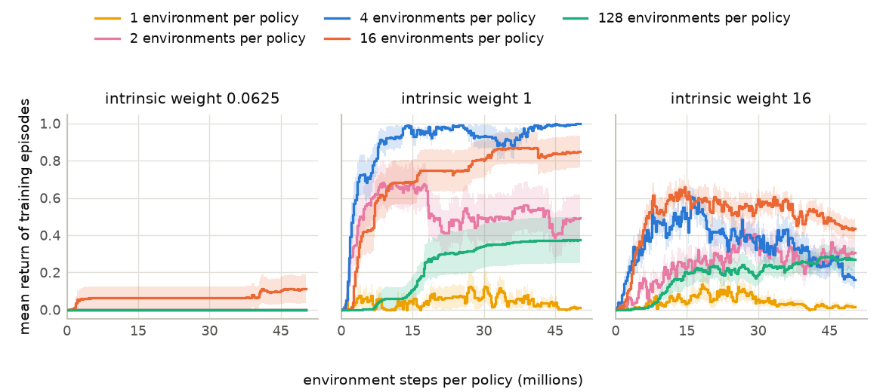
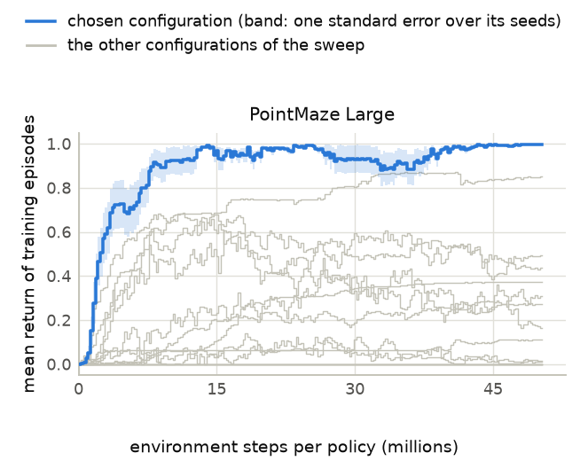

# Training-return report

Generated 2026-11-12 10:45 PT; times are Pacific, converted from machines running Eastern. Run folder: `2026-11-12-01-29_rollout-shape-check_cleanrl-ppo-rnd_goal-termination_reward-arrival-plus-1_pointmaze-large_antmaze-umaze_environments-per-policy-4-16-128_intrinsic-weights-0.0625-1-16_seeds-0-15_pointmaze-steps-50331648`.

## Contents

| section | first written | last changed | status |
|---|---|---|---|
| [Measures](#measures) | 2026-11-12 02:06 PT | 2026-11-12 02:32 PT | unread |
| [Records read](#records-read) | 2026-11-12 02:06 PT | 2026-11-12 10:37 PT | unread |
| [Rollout shape: environments per policy](#rollout-shape-environments-per-policy) | 2026-11-12 02:06 PT | 2026-11-12 10:37 PT | unread |
| [Development sweeps](#development-sweeps) | 2026-11-12 02:06 PT | 2026-11-12 10:37 PT | unread |
| [Budget](#budget) | 2026-11-12 02:32 PT | 2026-11-12 10:45 PT | unread |
| [Training curves](#training-curves) | 2026-11-12 02:06 PT | 2026-11-12 10:37 PT | unread |
| [Final level against the training length](#final-level-against-the-training-length) | 2026-11-12 02:06 PT | 2026-11-12 02:06 PT | unread |
| [Decline check](#decline-check) | 2026-11-12 02:06 PT | 2026-11-12 02:35 PT | unread |

Times are Pacific, converted from machines running Eastern, and come from this report's own history of regenerations. [The same report with unread sections in blue and changed text in brown](analysis.html). No section marks itself read.

## Measures

Define $K$ as the number of policies (seeds) of a configuration, $B$ as the budget in environment steps per policy, $R_i(s)$ as the mean return of the training episodes of policy $i$ that end in the logging window containing step $s$, and $\Delta s$ as the number of a logging window's steps that lie inside the range being averaged. The return is of the reward the learner sees. With reward 1 on arrival an episode returns 1 if it reaches the goal and 0 otherwise. With the step cost it returns $-(t-1)/H$ when it reaches the goal at step $t$ of an episode limited to $H$ steps, and $-1$ otherwise. Define $R_0$ as the return of an episode that never reaches the goal ($R_0 = 0$ with reward 1 on arrival, $R_0 = -1$ with the step cost).

A window in which no episode ends takes the value of the window before it; before a policy's first finished episode the value is $R_0$. A window that straddles an end of a range counts in proportion to its steps inside the range.

1. **Training curve:** $\bar R(s) = \dfrac{1}{K}\sum_{i=1}^{K} R_i(s)$. Bands in the figures are one standard error over the $K$ policies.
2. **Whole-curve mean, which chooses configurations:** $W(B) = \dfrac{1}{K}\sum_{i=1}^{K} \dfrac{1}{B}\sum_{s \le B} R_i(s) \thinspace \Delta s$, the area under the curve divided by the budget.
3. **Final level:** $L(B) = \dfrac{1}{K}\sum_{i=1}^{K} \dfrac{1}{0.1 B}\sum_{0.9 B \lt s \le B} R_i(s) \thinspace \Delta s$, the same mean over the last 10% of the budget. The final level at a share $f$ of the budget is $L(f B)$ read from the same runs: the mean over the steps from $0.9 f B$ to $f B$.
4. **Final level over peak:** define $S(s)$ as the mean of the seed-averaged curve $\bar R$ over the $0.1 B$ steps that end at step $s$, and $P(B) = \max_{0.1 B \le s \le B} S(s)$ as its highest value. The ratio is $\dfrac{L(B) - R_0}{P(B) - R_0}$; both are measured from $R_0$, so the ratio means the same in both reward settings. The smoothing has the width of the final level, so $S(B) = L(B)$ and the ratio is at most 1. The decline check also gives the ratio with the highest single window of $\bar R$ in place of $P(B)$; that ratio is the stricter one, because one window of a few seeds is raised by noise.
5. **Mean capped first-goal step:** define $T_i$ as the training step of policy $i$'s first arrival at the goal ($T_i = \infty$ if it has none). The measure is $M(B) = \dfrac{1}{K}\sum_{i=1}^{K} \min(T_i, B)$.
6. **Policies that reach the goal:** $F(B) = \dfrac{1}{K}\sum_{i=1}^{K} \mathbf{1}[T_i \le B]$.
7. **Maze cells reached:** the share of open maze cells a policy has reached in training by step $B$, averaged over the policies.
8. **Mean steps to the goal, last 10%:** the mean length of the configuration's training episodes that reach the goal in the last 10% of the budget, over all its policies together.
9. **Episodes that reach the goal, last 10%:** per policy, the share of its training episodes ending in the last 10% of the budget that reach the goal; then the mean over the policies.

Standard errors are over the $K$ policies. Measures 4 to 9 are reported beside $W$ and $L$ and never choose a configuration.

**Choice and comparison.** A configuration is chosen on the development seeds (below 30000) by the highest $W(B)$; ties go to the higher $L(B)$. On the confirmation seeds (30000 on), define $d_i$ as the value of seed $i$ under a method minus its value under the baseline, on the $K$ seeds both have. The tables give $\bar d = \dfrac{1}{K}\sum_{i=1}^{K} d_i$ for $W$ and for $L$, each with a 95% interval: the 2.5% and 97.5% points of the means of 10,000 resamples of the seeds, drawn with replacement. A difference is ahead when its interval is entirely above zero, behind when it is entirely below zero, and level otherwise. A method beats the baseline in one environment and reward setting when $W$ is ahead and $L$ is not behind. It succeeds when it beats the baseline in all five environments in one reward setting.

**Unfinished runs.** A table compares its rows at one step count: the planned steps per policy when at least one row has trained that far, else the largest step count every policy of the table has reached. Rows that have not reached it are listed under the table without measures. The learning rate falls to zero over the planned steps, so the measures of an unfinished run are not those of a run trained for fewer steps.

## Records read

5 units, 5 complete; 240 policies with at least one logging window. A unit that was continued from a checkpoint keeps one unbroken sequence of windows; a unit that was started again from zero is read from its last start. Episodes restarted after a non-finite physics state count as episodes that reach the step limit, and stay in every sum (the records hold sums per window, not single episodes).

| unit | environment | reward setting | method | environments per policy | policies | steps per policy so far | planned steps per policy | state |
|---|---|---|---|---|---|---|---|---|
| 1 | PointMaze Large | reward 1 on arrival | CleanRL PPO-RND | 128 | 48 | 50,331,648 | 50,331,648 | complete |
| 2 | PointMaze Large | reward 1 on arrival | CleanRL PPO-RND | 16 | 48 | 50,331,648 | 50,331,648 | complete |
| 3 | PointMaze Large | reward 1 on arrival | CleanRL PPO-RND | 1 | 48 | 50,331,648 | 50,331,648 | complete |
| 4 | PointMaze Large | reward 1 on arrival | CleanRL PPO-RND | 2 | 48 | 50,331,648 | 50,331,648 | complete |
| 5 | PointMaze Large | reward 1 on arrival | CleanRL PPO-RND | 4 | 48 | 50,331,648 | 50,331,648 | complete |

Unit names, by the number in the first column:

1. `pointmaze-large_reward-arrival-plus-one_environments-per-policy-128_intrinsic-weights-0.0625-1-16_seeds-0-15`
2. `pointmaze-large_reward-arrival-plus-one_environments-per-policy-16_intrinsic-weights-0.0625-1-16_seeds-0-15`
3. `pointmaze-large_reward-arrival-plus-one_environments-per-policy-1_intrinsic-weights-0.0625-1-16_seeds-0-15`
4. `pointmaze-large_reward-arrival-plus-one_environments-per-policy-2_intrinsic-weights-0.0625-1-16_seeds-0-15`
5. `pointmaze-large_reward-arrival-plus-one_environments-per-policy-4_intrinsic-weights-0.0625-1-16_seeds-0-15`

## Rollout shape: environments per policy

Define $W$ and $L$ as in the section Measures: the whole-curve mean and the final level of the training return, read at the step count named in each subsection.

### PointMaze Large, reward 1 on arrival, CleanRL PPO-RND

Every number of environments per policy is compared at the same 50,331,648 environment steps per policy, with 16 seeds per configuration. Each row is one number of environments per policy at its own best configuration (highest $W$, ties by $L$); rows are sorted by that $W$.

| environments per policy | best whole-curve mean $W$ ↑ ± standard error | at | its final level $L$ ± standard error | mean $W$ over its configurations | policies that reach the goal, best configuration | steps per policy so far |
|---|---|---|---|---|---|---|
| 4 | **0.890** ± 0.025 | intrinsic weight 1 | **0.994** ± 0.002 | <u>0.414</u> | **100.0%** | 50,331,648 |
| 16 | <u>0.704</u> ± 0.081 | intrinsic weight 1 | <u>0.844</u> ± 0.087 | **0.423** | <u>87.5%</u> | 50,331,648 |
| 2 | 0.511 ± 0.103 | intrinsic weight 1 | 0.466 ± 0.121 | 0.253 | 75.0% | 50,331,648 |
| 128 | 0.240 ± 0.083 | intrinsic weight 1 | 0.373 ± 0.123 | 0.141 | 81.2% | 50,331,648 |
| 1 | 0.044 ± 0.029 | intrinsic weight 1 | 0.008 ± 0.006 | 0.030 | 68.8% | 50,331,648 |

Best at these steps: **4 environments per policy** ($W$ = 0.890, intrinsic weight 1).

$W$ and $L$ of every configuration at these steps, each with its standard error; the best $W$ of each column is bold and the second best underlined.

| environments per policy | intrinsic weight 0.0625 | intrinsic weight 1 | intrinsic weight 16 |
|---|---|---|---|
| 1 | $W$ <u>0.000</u> ± 0.000; $L$ 0.000 ± 0.000 | $W$ 0.044 ± 0.029; $L$ 0.008 ± 0.006 | $W$ 0.044 ± 0.018; $L$ 0.017 ± 0.015 |
| 2 | $W$ <u>0.000</u> ± 0.000; $L$ 0.000 ± 0.000 | $W$ 0.511 ± 0.103; $L$ 0.466 ± 0.121 | $W$ 0.248 ± 0.040; $L$ 0.313 ± 0.073 |
| 4 | $W$ <u>0.000</u> ± 0.000; $L$ 0.000 ± 0.000 | $W$ **0.890** ± 0.025; $L$ 0.994 ± 0.002 | $W$ <u>0.354</u> ± 0.033; $L$ 0.217 ± 0.046 |
| 16 | $W$ **0.069** ± 0.060; $L$ 0.110 ± 0.076 | $W$ <u>0.704</u> ± 0.081; $L$ 0.844 ± 0.087 | $W$ **0.496** ± 0.038; $L$ 0.450 ± 0.050 |
| 128 | $W$ <u>0.000</u> ± 0.000; $L$ 0.000 ± 0.000 | $W$ 0.240 ± 0.083; $L$ 0.373 ± 0.123 | $W$ 0.183 ± 0.043; $L$ 0.273 ± 0.062 |

Seed-mean training curves, one panel per setting, one line per number of environments per policy; bands are one standard error.

## Development sweeps

Define $W$, $L$ and the other measures as in the section Measures. Each table holds one method's configurations in one environment and reward setting, trained on the development seeds (below 30000).

### PointMaze Large, reward 1 on arrival, CleanRL PPO-RND

15 configurations with 16 seeds each, compared at 50,331,648 environment steps per policy. Rows are sorted by $W$; the best value of each column is bold and the second best underlined. For the mean capped first-goal step and the mean steps to the goal the smallest value is the best.

| configuration | whole-curve mean $W$ ↑ ± standard error | final level $L$ ± standard error | final level over peak | mean capped first-goal step | policies that reach the goal | maze cells reached | mean steps to the goal, last 10% | episodes that reach the goal, last 10% | seeds |
|---|---|---|---|---|---|---|---|---|---|
| 4 environments per policy, intrinsic weight 1 | **0.890** ± 0.025 | **0.994** ± 0.002 | **100.0%** | 2.39M | **100.0%** | 95.8% | 306.0 | **99.4%** | 16 |
| 16 environments per policy, intrinsic weight 1 | <u>0.704</u> ± 0.081 | <u>0.844</u> ± 0.087 | 97.2% | 12.70M | <u>87.5%</u> | 95.2% | **300.2** | <u>84.4%</u> | 16 |
| 2 environments per policy, intrinsic weight 1 | 0.511 ± 0.103 | 0.466 ± 0.121 | 70.3% | 13.24M | 75.0% | 90.5% | 310.6 | 46.9% | 16 |
| 16 environments per policy, intrinsic weight 16 | 0.496 ± 0.038 | 0.450 ± 0.050 | 73.5% | 1.23M | **100.0%** | 99.6% | 346.2 | 45.1% | 16 |
| 4 environments per policy, intrinsic weight 16 | 0.354 ± 0.033 | 0.217 ± 0.046 | 40.9% | **533.4K** | **100.0%** | <u>99.9%</u> | 347.7 | 21.9% | 16 |
| 2 environments per policy, intrinsic weight 16 | 0.248 ± 0.040 | 0.313 ± 0.073 | 83.9% | 1.33M | **100.0%** | **100.0%** | 344.0 | 31.4% | 16 |
| 128 environments per policy, intrinsic weight 1 | 0.240 ± 0.083 | 0.373 ± 0.123 | **100.0%** | 23.70M | 81.2% | 88.2% | <u>304.7</u> | 37.3% | 16 |
| 128 environments per policy, intrinsic weight 16 | 0.183 ± 0.043 | 0.273 ± 0.062 | <u>98.2%</u> | 4.85M | **100.0%** | 97.4% | 341.5 | 27.3% | 16 |
| 16 environments per policy, intrinsic weight 0.0625 | 0.069 ± 0.060 | 0.110 ± 0.076 | **100.0%** | 46.05M | 12.5% | 34.6% | 321.2 | 11.0% | 16 |
| 1 environment per policy, intrinsic weight 1 | 0.044 ± 0.029 | 0.008 ± 0.006 | 8.9% | 18.11M | 68.8% | 84.8% | 358.7 | 0.8% | 16 |
| 1 environment per policy, intrinsic weight 16 | 0.044 ± 0.018 | 0.017 ± 0.015 | 19.0% | <u>828.3K</u> | **100.0%** | 99.5% | 357.8 | 1.7% | 16 |
| 128 environments per policy, intrinsic weight 0.0625 | 0.000 ± 0.000 | 0.000 ± 0.000 | 0.0% | 47.25M | 6.2% | 33.7% | none | 0.0% | 16 |
| 4 environments per policy, intrinsic weight 0.0625 | 0.000 ± 0.000 | 0.000 ± 0.000 | 0.0% | 48.43M | 6.2% | 34.4% | none | 0.0% | 16 |
| 1 environment per policy, intrinsic weight 0.0625 | 0.000 ± 0.000 | 0.000 ± 0.000 | none | 50.33M | 0.0% | 38.0% | none | 0.0% | 16 |
| 2 environments per policy, intrinsic weight 0.0625 | 0.000 ± 0.000 | 0.000 ± 0.000 | none | 50.33M | 0.0% | 39.4% | none | 0.0% | 16 |

Chosen (highest $W$, ties by $L$): **4 environments per policy, intrinsic weight 1, learning rate 0.0001, entropy coefficient 0.001**. Place in the sweep: intrinsic weight 1 is inside its 3 swept values.

## Budget

Define $\bar R$, $W$, $L$ and $R_0$ as in the section Measures, $N$ as the steps per policy a sweep was trained for, and $S_5(s)$ as the mean of $\bar R$ over the $0.05 N$ steps that end at step $s$. The rule reads the three CleanRL PPO-RND configurations with the highest $W(N)$ on the development seeds. For each, define $t$ as the first logged step $s \ge 0.05 N$ with $S_5(s) - R_0 \ge 0.95 \thinspace (L(N) - R_0)$. The proposed budget is twice the largest $t$, rounded up to a power of two, and never above $N$. A configuration that never reaches 95% of its final level counts as $t = N$.

### PointMaze Large, reward 1 on arrival, 1 environment per policy

The sweep was trained for 50,331,648 steps per policy with 16 seeds per configuration.

| configuration | whole-curve mean $W$ ± standard error | final level $L$ | 95% of the final level, measured from $R_0$ | first step at which the smoothed curve reaches it |
|---|---|---|---|---|
| intrinsic weight 1 | 0.044 ± 0.029 | 0.008 | 0.008 | 2,621,440 (the earliest step the rule can read) |
| intrinsic weight 16 | 0.044 ± 0.018 | 0.017 | 0.016 | 6,815,744 |
| intrinsic weight 0.0625 | 0.000 ± 0.000 | 0.000 | 0.000 | never: its final level is $R_0$ |

Proposed budget: **50,331,648 steps per policy**, the run's own length. Twice the largest step count is 100,663,296, which rounds up to 134,217,728, above the 50,331,648 steps of the run, so the cap applies. Never at 95% of its final level: intrinsic weight 0.0625. Such a configuration counts as the whole run, so the largest step count is the run's length.

The budget is the run's own length, so the measures at the budget are those of the sweep table in the section Development sweeps.

### PointMaze Large, reward 1 on arrival, 2 environments per policy

The sweep was trained for 50,331,648 steps per policy with 16 seeds per configuration.

| configuration | whole-curve mean $W$ ± standard error | final level $L$ | 95% of the final level, measured from $R_0$ | first step at which the smoothed curve reaches it |
|---|---|---|---|---|
| intrinsic weight 1 | 0.511 ± 0.103 | 0.466 | 0.443 | 4,980,736 |
| intrinsic weight 16 | 0.248 ± 0.040 | 0.313 | 0.297 | 25,427,968 |
| intrinsic weight 0.0625 | 0.000 ± 0.000 | 0.000 | 0.000 | never: its final level is $R_0$ |

Proposed budget: **50,331,648 steps per policy**, the run's own length. Twice the largest step count is 100,663,296, which rounds up to 134,217,728, above the 50,331,648 steps of the run, so the cap applies. Never at 95% of its final level: intrinsic weight 0.0625. Such a configuration counts as the whole run, so the largest step count is the run's length.

The budget is the run's own length, so the measures at the budget are those of the sweep table in the section Development sweeps.

### PointMaze Large, reward 1 on arrival, 4 environments per policy

The sweep was trained for 50,331,648 steps per policy with 16 seeds per configuration.

| configuration | whole-curve mean $W$ ± standard error | final level $L$ | 95% of the final level, measured from $R_0$ | first step at which the smoothed curve reaches it |
|---|---|---|---|---|
| intrinsic weight 1 | 0.890 ± 0.025 | 0.994 | 0.944 | 13,893,632 |
| intrinsic weight 16 | 0.354 ± 0.033 | 0.217 | 0.206 | 4,194,304 |
| intrinsic weight 0.0625 | 0.000 ± 0.000 | 0.000 | 0.000 | never: its final level is $R_0$ |

Proposed budget: **50,331,648 steps per policy**, the run's own length. Twice the largest step count is 100,663,296, which rounds up to 134,217,728, above the 50,331,648 steps of the run, so the cap applies. Never at 95% of its final level: intrinsic weight 0.0625. Such a configuration counts as the whole run, so the largest step count is the run's length.

The budget is the run's own length, so the measures at the budget are those of the sweep table in the section Development sweeps.

### PointMaze Large, reward 1 on arrival, 16 environments per policy

The sweep was trained for 50,331,648 steps per policy with 16 seeds per configuration.

| configuration | whole-curve mean $W$ ± standard error | final level $L$ | 95% of the final level, measured from $R_0$ | first step at which the smoothed curve reaches it |
|---|---|---|---|---|
| intrinsic weight 1 | 0.704 ± 0.081 | 0.844 | 0.801 | 29,884,416 |
| intrinsic weight 16 | 0.496 ± 0.038 | 0.450 | 0.428 | 7,340,032 |
| intrinsic weight 0.0625 | 0.069 ± 0.060 | 0.110 | 0.105 | 46,661,632 |

Proposed budget: **50,331,648 steps per policy**, the run's own length. Twice the largest step count is 93,323,264, which rounds up to 134,217,728, above the 50,331,648 steps of the run, so the cap applies.

The budget is the run's own length, so the measures at the budget are those of the sweep table in the section Development sweeps.

### PointMaze Large, reward 1 on arrival, 128 environments per policy

The sweep was trained for 50,331,648 steps per policy with 16 seeds per configuration.

| configuration | whole-curve mean $W$ ± standard error | final level $L$ | 95% of the final level, measured from $R_0$ | first step at which the smoothed curve reaches it |
|---|---|---|---|---|
| intrinsic weight 1 | 0.240 ± 0.083 | 0.373 | 0.355 | 35,913,728 |
| intrinsic weight 16 | 0.183 ± 0.043 | 0.273 | 0.259 | 43,515,904 |
| intrinsic weight 0.0625 | 0.000 ± 0.000 | 0.000 | 0.000 | never: its final level is $R_0$ |

Proposed budget: **50,331,648 steps per policy**, the run's own length. Twice the largest step count is 100,663,296, which rounds up to 134,217,728, above the 50,331,648 steps of the run, so the cap applies. Never at 95% of its final level: intrinsic weight 0.0625. Such a configuration counts as the whole run, so the largest step count is the run's length.

The budget is the run's own length, so the measures at the budget are those of the sweep table in the section Development sweeps.

## Training curves

Define $\bar R(s)$ as in the section Measures: the mean over a configuration's policies of the mean return of the training episodes that end in the logging window containing step $s$.

### Development seeds, reward 1 on arrival, CleanRL PPO-RND

Seed-mean training curve of the chosen configuration with a band of one standard error, and the other configurations of the sweep in grey.

## Final level against the training length

Define $L(f B)$ as in the section Measures: the mean of the training curve over the last 10% of the first share $f$ of the planned steps $B$, read from the runs trained for $B$ steps. Each cell gives $L$; a method's cell adds its paired difference to the baseline (method minus baseline, same seeds) with the 95% interval and its side. A run trained for another number of steps is a separate table, because its learning rate falls to zero over its own length; its curve is in the section Training curves.

### PointMaze Large, reward 1 on arrival, 50,331,648 planned steps (development seeds, chosen configurations)

| row | 25% of the planned steps | 50% of the planned steps | 75% of the planned steps | 100% of the planned steps |
|---|---|---|---|---|
| CleanRL PPO-RND, 4 environments per policy, intrinsic weight 1, learning rate 0.0001, entropy coefficient 0.001 | 0.927 | 0.983 | 0.907 | 0.994 |

## Decline check

Define $P(B)$ as the highest value of the seed-averaged curve smoothed over 10% of the budget and $R_0$ as the return of an episode that never reaches the goal (section Measures). The final level over the smoothed peak is $\dfrac{L(B) - R_0}{P(B) - R_0}$; the ratio with the highest single window puts that window's value in place of $P(B)$ and is the stricter of the two. A chosen configuration declines when the ratio with the smoothed peak is below 90%. The table gives both ratios of each of the 1 chosen configuration (the choice of every development sweep and every confirmation row): 0 below 90% of the smoothed peak, 0 below 90% of the highest single window only.

| environment and reward setting | seeds | configuration | final level $L$ | peak smoothed over 10% of the budget, and the step its range ends at | final level over the smoothed peak | highest single window, and its step | final level over the highest single window | verdict | read at step |
|---|---|---|---|---|---|---|---|---|---|
| PointMaze Large, reward 1 on arrival | development | CleanRL PPO-RND, 4 environments per policy, intrinsic weight 1, learning rate 0.0001, entropy coefficient 0.001 | 0.994 | 0.994 at 50.33M | 100.0% | 0.998 at 49.81M | 99.6% | no decline | 50.33M |

