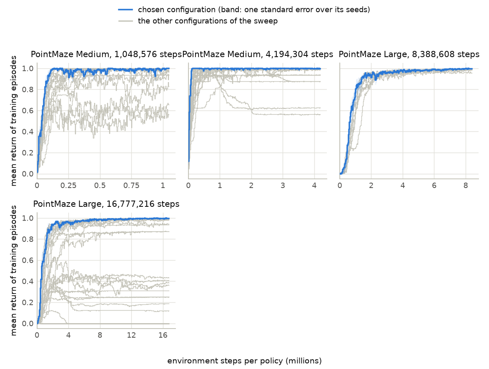
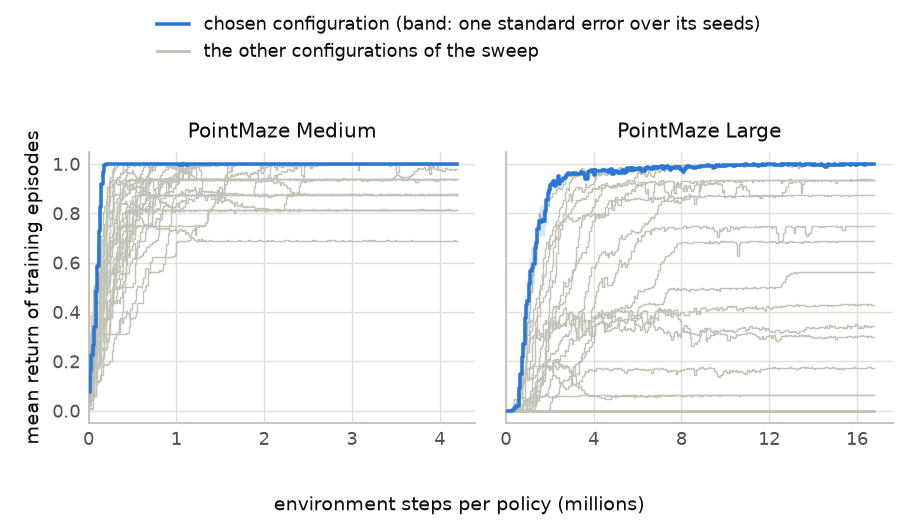
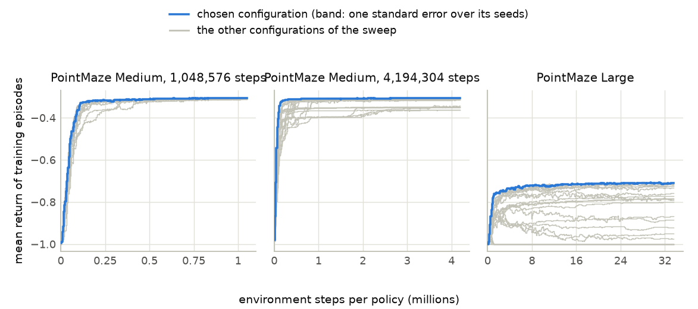
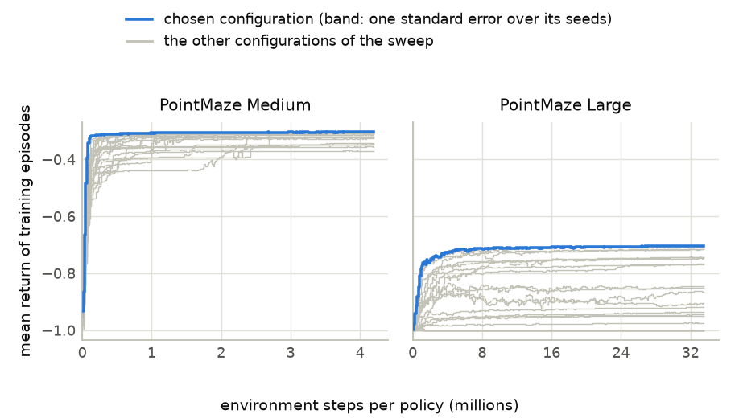
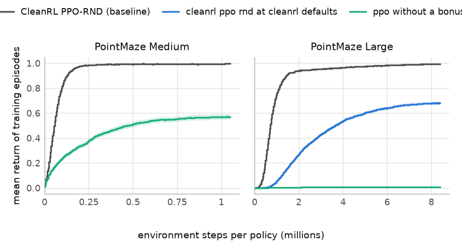
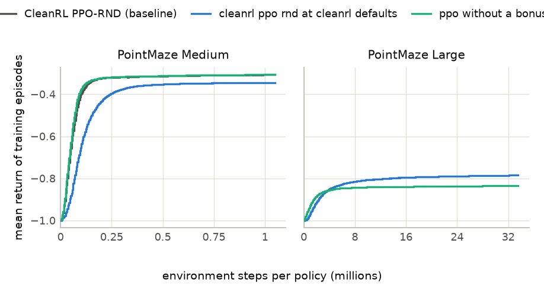

# CleanRL PPO-RND baseline on PointMaze: development sweeps and confirmation

Generated 2026-11-12 19:21 PT; times are Pacific, converted from machines running Eastern. Run folder: `2026-11-12-02-24_cleanrl-ppo-rnd-baseline_pointmaze-medium-large_antmaze-umaze-medium-large_goal-termination_reward-arrival-plus-1-and-step-cost_first-pass-60-configurations_seeds-0-15_confirmation-seeds-from-30000`.

## Contents

| section | first written | last changed | status |
|---|---|---|---|
| [Measures](#measures) | 2026-11-12 10:40 PT | 2026-11-12 16:14 PT | unread |
| [Records read](#records-read) | 2026-11-12 10:40 PT | 2026-11-12 19:22 PT | unread |
| [Configurations trained more than once](#configurations-trained-more-than-once) | 2026-11-12 14:20 PT | 2026-11-12 18:01 PT | unread |
| [Development sweeps](#development-sweeps) | 2026-11-12 10:40 PT | 2026-11-12 18:01 PT | unread |
| [Budget](#budget) | 2026-11-12 10:40 PT | 2026-11-12 17:48 PT | unread |
| [Training curves](#training-curves) | 2026-11-12 10:40 PT | 2026-11-12 17:48 PT | unread |
| [Comparison with the baseline on the confirmation seeds](#comparison-with-the-baseline-on-the-confirmation-seeds) | 2026-11-12 13:06 PT | 2026-11-12 19:22 PT | unread |
| [Final level against the training length](#final-level-against-the-training-length) | 2026-11-12 10:40 PT | 2026-11-12 17:45 PT | unread |
| [Decline check](#decline-check) | 2026-11-12 10:40 PT | 2026-11-12 17:45 PT | unread |

Times are Pacific, converted from machines running Eastern, and come from this report's own history of regenerations. [The same report with unread sections in blue and changed text in brown](analysis.html). No section marks itself read.

## Measures

Define $K$ as the number of policies (seeds) of a configuration, $B$ as the budget in environment steps per policy, $R_i(s)$ as the mean return of the training episodes of policy $i$ that end in the logging window containing step $s$, and $\Delta s$ as the number of a logging window's steps that lie inside the range being averaged. The return is of the reward the learner sees. With reward 1 on arrival an episode returns 1 if it reaches the goal and 0 otherwise. With the step cost it returns $-(t-1)/H$ when it reaches the goal at step $t$ of an episode limited to $H$ steps, and $-1$ otherwise. Define $R_0$ as the return of an episode that never reaches the goal ($R_0 = 0$ with reward 1 on arrival, $R_0 = -1$ with the step cost).

A window in which no episode ends takes the value of the window before it; before a policy's first finished episode the value is $R_0$. A window that straddles an end of a range counts in proportion to its steps inside the range.

1. **Training curve:** $\bar R(s) = \dfrac{1}{K}\sum_{i=1}^{K} R_i(s)$. Bands in the figures are one standard error over the $K$ policies.
2. **Whole-curve mean, which chooses configurations:** $W(B) = \dfrac{1}{K}\sum_{i=1}^{K} \dfrac{1}{B}\sum_{s \le B} R_i(s) \thinspace \Delta s$, the area under the curve divided by the budget.
3. **Final level:** $L(B) = \dfrac{1}{K}\sum_{i=1}^{K} \dfrac{1}{0.1 B}\sum_{0.9 B \lt s \le B} R_i(s) \thinspace \Delta s$, the same mean over the last 10% of the budget. The final level at a share $f$ of the budget is $L(f B)$ read from the same runs: the mean over the steps from $0.9 f B$ to $f B$.
4. **Final level over peak:** define $S(s)$ as the mean of the seed-averaged curve $\bar R$ over the $0.1 B$ steps that end at step $s$, and $P(B) = \max_{0.1 B \le s \le B} S(s)$ as its highest value. The ratio is $\dfrac{L(B) - R_0}{P(B) - R_0}$; both are measured from $R_0$, so the ratio means the same in both reward settings. The smoothing has the width of the final level, so $S(B) = L(B)$ and the ratio is at most 1. The decline check also gives the ratio with the highest single window of $\bar R$ in place of $P(B)$; that ratio is the stricter one, because one window of a few seeds is raised by noise.
5. **Mean capped first-goal step, the secondary metric, which chooses its own configurations:** define $T_i$ as the training step of policy $i$'s first arrival at the goal ($T_i = \infty$ if it has none). The measure is $M(B) = \dfrac{1}{K}\sum_{i=1}^{K} \min(T_i, B)$: a policy with no arrival by step $B$ counts as $B$, and smaller is better. $W$ measures discovery and optimization together; $M$ measures discovery alone.
6. **Policies that reach the goal:** $F(B) = \dfrac{1}{K}\sum_{i=1}^{K} \mathbf{1}[T_i \le B]$. It breaks ties in $M$.
7. **Maze cells reached:** the share of open maze cells a policy has reached in training by step $B$, averaged over the policies.
8. **Mean steps to the goal, last 10%:** the mean length of the configuration's training episodes that reach the goal in the last 10% of the budget, over all its policies together.
9. **Episodes that reach the goal, last 10%:** per policy, the share of its training episodes ending in the last 10% of the budget that reach the goal; then the mean over the policies.

Standard errors are over the $K$ policies. Measures 4 and 6 to 9 are reported beside the two metrics and never choose a configuration, except that $F$ breaks ties in $M$.

**Choice and comparison, primary metric.** A configuration is chosen on the development seeds (below 30000) by the highest $W(B)$; ties go to the higher $L(B)$. On the confirmation seeds (30000 on), define $d_i$ as the value of seed $i$ under a method minus its value under the baseline, on the $K$ seeds both have. The tables give $\bar d = \dfrac{1}{K}\sum_{i=1}^{K} d_i$ for $W$ and for $L$, each with a 95% interval: the 2.5% and 97.5% points of the means of 10,000 resamples of the seeds, drawn with replacement. A difference is ahead when its interval is entirely above zero, behind when it is entirely below zero, and level otherwise. A method beats the baseline in one environment and reward setting when $W$ is ahead and $L$ is not behind. It succeeds when it beats the baseline in all five environments in one reward setting.

**Choice and comparison, secondary metric.** For $M$ every method, the baseline included, has its own configuration: the one with the smallest $M(B)$ on the development seeds, ties going to the larger $F(B)$. It may differ from the configuration chosen for $W$. Each metric has its own tables with its own chosen configurations; the two are never mixed in one row. On the confirmation seeds, $d_i$ is the capped first-goal step $\min(T_i, B)$ of seed $i$ under a method at its configuration for $M$ minus the same under the baseline at the baseline's configuration for $M$, and $\bar d$ gets the same 95% interval. A method is ahead on discovery when the interval is entirely below zero (it first reaches the goal earlier), behind when it is entirely above zero, and within the interval otherwise. A method that is ahead on discovery in all five environments in one reward setting is noted; this is not part of the success rule. A configuration for $M$ that has no confirmation units is reported as not confirmed yet; the configuration chosen for $W$ is never put in its place. The tables of the secondary metric give $M$, its standard error and its differences in thousands of steps.

**Unfinished runs.** A table compares its rows at one step count: the planned steps per policy when at least one row has trained that far, else the largest step count every policy of the table has reached. Rows that have not reached it are listed under the table without measures. The learning rate falls to zero over the planned steps, so the measures of an unfinished run are not those of a run trained for fewer steps.

## Records read

113 units, 113 complete; 26,608 policies with at least one logging window. A unit that was continued from a checkpoint keeps one unbroken sequence of windows; a unit that was started again from zero is read from its last start. Episodes restarted after a non-finite physics state count as episodes that reach the step limit, and stay in every sum (the records hold sums per window, not single episodes). 560 of these policies repeat a configuration and seed that another unit finished earlier; they are left out of the tables and figures and shown in the section Configurations trained more than once.

| unit | environment | reward setting | method | environments per policy | policies | steps per policy so far | planned steps per policy | state |
|---|---|---|---|---|---|---|---|---|
| 1 | PointMaze Large | reward 1 on arrival | CleanRL PPO-RND | 4 | 256 | 8,388,608 | 8,388,608 | complete |
| 2 | PointMaze Large | reward 1 on arrival | CleanRL PPO-RND | 4 | 256 | 8,388,608 | 8,388,608 | complete |
| 3 | PointMaze Large | reward 1 on arrival | CleanRL PPO-RND | 4 | 256 | 8,388,608 | 8,388,608 | complete |
| 4 | PointMaze Large | reward 1 on arrival | CleanRL PPO-RND | 4 | 256 | 8,388,608 | 8,388,608 | complete |
| 5 | PointMaze Large | step cost | CleanRL PPO-RND | 4 | 256 | 33,554,432 | 33,554,432 | complete |
| 6 | PointMaze Large | step cost | CleanRL PPO-RND | 4 | 256 | 33,554,432 | 33,554,432 | complete |
| 7 | PointMaze Large | step cost | CleanRL PPO-RND | 4 | 256 | 33,554,432 | 33,554,432 | complete |
| 8 | PointMaze Large | step cost | CleanRL PPO-RND | 4 | 256 | 33,554,432 | 33,554,432 | complete |
| 9 | PointMaze Medium | reward 1 on arrival | CleanRL PPO-RND | 4 | 256 | 1,048,576 | 1,048,576 | complete |
| 10 | PointMaze Medium | reward 1 on arrival | CleanRL PPO-RND | 4 | 256 | 1,048,576 | 1,048,576 | complete |
| 11 | PointMaze Medium | reward 1 on arrival | CleanRL PPO-RND | 4 | 256 | 1,048,576 | 1,048,576 | complete |
| 12 | PointMaze Medium | reward 1 on arrival | CleanRL PPO-RND | 4 | 256 | 1,048,576 | 1,048,576 | complete |
| 13 | PointMaze Medium | reward 1 on arrival | CleanRL PPO-RND | 4 | 256 | 1,048,576 | 1,048,576 | complete |
| 14 | PointMaze Medium | reward 1 on arrival | CleanRL PPO-RND | 4 | 256 | 1,048,576 | 1,048,576 | complete |
| 15 | PointMaze Medium | reward 1 on arrival | CleanRL PPO-RND | 4 | 256 | 1,048,576 | 1,048,576 | complete |
| 16 | PointMaze Medium | reward 1 on arrival | CleanRL PPO-RND | 4 | 256 | 1,048,576 | 1,048,576 | complete |
| 17 | PointMaze Medium | step cost | CleanRL PPO-RND | 4 | 256 | 1,048,576 | 1,048,576 | complete |
| 18 | PointMaze Medium | step cost | CleanRL PPO-RND | 4 | 256 | 1,048,576 | 1,048,576 | complete |
| 19 | PointMaze Medium | step cost | CleanRL PPO-RND | 4 | 256 | 1,048,576 | 1,048,576 | complete |
| 20 | PointMaze Medium | step cost | CleanRL PPO-RND | 4 | 256 | 1,048,576 | 1,048,576 | complete |
| 21 | PointMaze Large | reward 1 on arrival | cleanrl ppo rnd at cleanrl defaults | 4 | 256 | 8,388,608 | 8,388,608 | complete |
| 22 | PointMaze Large | reward 1 on arrival | cleanrl ppo rnd at cleanrl defaults | 4 | 256 | 8,388,608 | 8,388,608 | complete |
| 23 | PointMaze Large | reward 1 on arrival | cleanrl ppo rnd at cleanrl defaults | 4 | 256 | 8,388,608 | 8,388,608 | complete |
| 24 | PointMaze Large | reward 1 on arrival | cleanrl ppo rnd at cleanrl defaults | 4 | 256 | 8,388,608 | 8,388,608 | complete |
| 25 | PointMaze Large | reward 1 on arrival | CleanRL PPO-RND | 4 | 256 | 8,388,608 | 8,388,608 | complete |
| 26 | PointMaze Large | reward 1 on arrival | CleanRL PPO-RND | 4 | 256 | 8,388,608 | 8,388,608 | complete |
| 27 | PointMaze Large | reward 1 on arrival | CleanRL PPO-RND | 4 | 256 | 8,388,608 | 8,388,608 | complete |
| 28 | PointMaze Large | reward 1 on arrival | CleanRL PPO-RND | 4 | 256 | 8,388,608 | 8,388,608 | complete |
| 29 | PointMaze Large | reward 1 on arrival | ppo without a bonus | 4 | 256 | 8,388,608 | 8,388,608 | complete |
| 30 | PointMaze Large | reward 1 on arrival | ppo without a bonus | 4 | 256 | 8,388,608 | 8,388,608 | complete |
| 31 | PointMaze Large | reward 1 on arrival | ppo without a bonus | 4 | 256 | 8,388,608 | 8,388,608 | complete |
| 32 | PointMaze Large | reward 1 on arrival | ppo without a bonus | 4 | 256 | 8,388,608 | 8,388,608 | complete |
| 33 | PointMaze Large | step cost | cleanrl ppo rnd at cleanrl defaults | 4 | 256 | 33,554,432 | 33,554,432 | complete |
| 34 | PointMaze Large | step cost | cleanrl ppo rnd at cleanrl defaults | 4 | 256 | 33,554,432 | 33,554,432 | complete |
| 35 | PointMaze Large | step cost | cleanrl ppo rnd at cleanrl defaults | 4 | 256 | 33,554,432 | 33,554,432 | complete |
| 36 | PointMaze Large | step cost | cleanrl ppo rnd at cleanrl defaults | 4 | 256 | 33,554,432 | 33,554,432 | complete |
| 37 | PointMaze Large | step cost | CleanRL PPO-RND | 4 | 256 | 33,554,432 | 33,554,432 | complete |
| 38 | PointMaze Large | step cost | CleanRL PPO-RND | 4 | 256 | 33,554,432 | 33,554,432 | complete |
| 39 | PointMaze Large | step cost | CleanRL PPO-RND | 4 | 256 | 33,554,432 | 33,554,432 | complete |
| 40 | PointMaze Large | step cost | CleanRL PPO-RND | 4 | 256 | 33,554,432 | 33,554,432 | complete |
| 41 | PointMaze Large | step cost | ppo without a bonus | 4 | 256 | 33,554,432 | 33,554,432 | complete |
| 42 | PointMaze Large | step cost | ppo without a bonus | 4 | 256 | 33,554,432 | 33,554,432 | complete |
| 43 | PointMaze Large | step cost | ppo without a bonus | 4 | 256 | 33,554,432 | 33,554,432 | complete |
| 44 | PointMaze Large | step cost | ppo without a bonus | 4 | 256 | 33,554,432 | 33,554,432 | complete |
| 45 | PointMaze Medium | reward 1 on arrival | cleanrl ppo rnd at cleanrl defaults | 4 | 256 | 1,048,576 | 1,048,576 | complete |
| 46 | PointMaze Medium | reward 1 on arrival | cleanrl ppo rnd at cleanrl defaults | 4 | 256 | 1,048,576 | 1,048,576 | complete |
| 47 | PointMaze Medium | reward 1 on arrival | cleanrl ppo rnd at cleanrl defaults | 4 | 256 | 1,048,576 | 1,048,576 | complete |
| 48 | PointMaze Medium | reward 1 on arrival | cleanrl ppo rnd at cleanrl defaults | 4 | 256 | 1,048,576 | 1,048,576 | complete |
| 49 | PointMaze Medium | reward 1 on arrival | CleanRL PPO-RND | 4 | 256 | 1,048,576 | 1,048,576 | complete |
| 50 | PointMaze Medium | reward 1 on arrival | CleanRL PPO-RND | 4 | 256 | 1,048,576 | 1,048,576 | complete |
| 51 | PointMaze Medium | reward 1 on arrival | CleanRL PPO-RND | 4 | 256 | 1,048,576 | 1,048,576 | complete |
| 52 | PointMaze Medium | reward 1 on arrival | CleanRL PPO-RND | 4 | 256 | 1,048,576 | 1,048,576 | complete |
| 53 | PointMaze Medium | reward 1 on arrival | ppo without a bonus | 4 | 256 | 1,048,576 | 1,048,576 | complete |
| 54 | PointMaze Medium | reward 1 on arrival | ppo without a bonus | 4 | 256 | 1,048,576 | 1,048,576 | complete |
| 55 | PointMaze Medium | reward 1 on arrival | ppo without a bonus | 4 | 256 | 1,048,576 | 1,048,576 | complete |
| 56 | PointMaze Medium | reward 1 on arrival | ppo without a bonus | 4 | 256 | 1,048,576 | 1,048,576 | complete |
| 57 | PointMaze Medium | step cost | cleanrl ppo rnd at cleanrl defaults | 4 | 256 | 1,048,576 | 1,048,576 | complete |
| 58 | PointMaze Medium | step cost | cleanrl ppo rnd at cleanrl defaults | 4 | 256 | 1,048,576 | 1,048,576 | complete |
| 59 | PointMaze Medium | step cost | cleanrl ppo rnd at cleanrl defaults | 4 | 256 | 1,048,576 | 1,048,576 | complete |
| 60 | PointMaze Medium | step cost | cleanrl ppo rnd at cleanrl defaults | 4 | 256 | 1,048,576 | 1,048,576 | complete |
| 61 | PointMaze Medium | step cost | CleanRL PPO-RND | 4 | 256 | 1,048,576 | 1,048,576 | complete |
| 62 | PointMaze Medium | step cost | CleanRL PPO-RND | 4 | 256 | 1,048,576 | 1,048,576 | complete |
| 63 | PointMaze Medium | step cost | CleanRL PPO-RND | 4 | 256 | 1,048,576 | 1,048,576 | complete |
| 64 | PointMaze Medium | step cost | CleanRL PPO-RND | 4 | 256 | 1,048,576 | 1,048,576 | complete |
| 65 | PointMaze Medium | step cost | ppo without a bonus | 4 | 256 | 1,048,576 | 1,048,576 | complete |
| 66 | PointMaze Medium | step cost | ppo without a bonus | 4 | 256 | 1,048,576 | 1,048,576 | complete |
| 67 | PointMaze Medium | step cost | ppo without a bonus | 4 | 256 | 1,048,576 | 1,048,576 | complete |
| 68 | PointMaze Medium | step cost | ppo without a bonus | 4 | 256 | 1,048,576 | 1,048,576 | complete |
| 69 | PointMaze Medium | reward 1 on arrival | CleanRL PPO-RND | 4 | 96 | 1,048,576 | 1,048,576 | complete |
| 70 | PointMaze Medium | step cost | CleanRL PPO-RND | 4 | 96 | 1,048,576 | 1,048,576 | complete |
| 71 | PointMaze Large | reward 1 on arrival | CleanRL PPO-RND | 4 | 144 | 8,388,608 | 8,388,608 | complete |
| 72 | PointMaze Large | step cost | cleanrl ppo rnd with intrinsic discount 0 point 999 | 4 | 192 | 33,554,432 | 33,554,432 | complete |
| 73 | PointMaze Large | step cost | CleanRL PPO-RND | 4 | 192 | 33,554,432 | 33,554,432 | complete |
| 74 | PointMaze Medium | reward 1 on arrival | CleanRL PPO-RND | 4 | 192 | 1,048,576 | 1,048,576 | complete |
| 75 | PointMaze Medium | step cost | CleanRL PPO-RND | 4 | 192 | 1,048,576 | 1,048,576 | complete |
| 76 | PointMaze Large | reward 1 on arrival | CleanRL PPO-RND | 4 | 192 | 8,388,608 | 8,388,608 | complete |
| 77 | PointMaze Large | step cost | CleanRL PPO-RND | 4 | 256 | 33,554,432 | 33,554,432 | complete |
| 78 | PointMaze Large | step cost | CleanRL PPO-RND | 4 | 32 | 33,554,432 | 33,554,432 | complete |
| 79 | PointMaze Medium | reward 1 on arrival | CleanRL PPO-RND | 4 | 256 | 1,048,576 | 1,048,576 | complete |
| 80 | PointMaze Medium | reward 1 on arrival | CleanRL PPO-RND | 4 | 32 | 1,048,576 | 1,048,576 | complete |
| 81 | PointMaze Medium | step cost | CleanRL PPO-RND | 4 | 256 | 1,048,576 | 1,048,576 | complete |
| 82 | PointMaze Medium | step cost | CleanRL PPO-RND | 4 | 32 | 1,048,576 | 1,048,576 | complete |
| 83 | PointMaze Large | reward 1 on arrival | CleanRL PPO-RND | 4 | 256 | 8,388,608 | 8,388,608 | complete |
| 84 | PointMaze Large | reward 1 on arrival | CleanRL PPO-RND | 4 | 256 | 8,388,608 | 8,388,608 | complete |
| 85 | PointMaze Large | reward 1 on arrival | CleanRL PPO-RND | 4 | 256 | 8,388,608 | 8,388,608 | complete |
| 86 | PointMaze Large | reward 1 on arrival | CleanRL PPO-RND | 4 | 256 | 8,388,608 | 8,388,608 | complete |
| 87 | PointMaze Large | reward 1 on arrival | CleanRL PPO-RND | 4 | 128 | 8,388,608 | 8,388,608 | complete |
| 88 | PointMaze Medium | reward 1 on arrival | CleanRL PPO-RND | 4 | 256 | 1,048,576 | 1,048,576 | complete |
| 89 | PointMaze Medium | reward 1 on arrival | CleanRL PPO-RND | 4 | 256 | 1,048,576 | 1,048,576 | complete |
| 90 | PointMaze Medium | reward 1 on arrival | CleanRL PPO-RND | 4 | 256 | 1,048,576 | 1,048,576 | complete |
| 91 | PointMaze Medium | reward 1 on arrival | CleanRL PPO-RND | 4 | 256 | 1,048,576 | 1,048,576 | complete |
| 92 | PointMaze Medium | reward 1 on arrival | CleanRL PPO-RND | 4 | 128 | 1,048,576 | 1,048,576 | complete |
| 93 | PointMaze Medium | step cost | CleanRL PPO-RND | 4 | 256 | 1,048,576 | 1,048,576 | complete |
| 94 | PointMaze Medium | step cost | CleanRL PPO-RND | 4 | 256 | 1,048,576 | 1,048,576 | complete |
| 95 | PointMaze Medium | step cost | CleanRL PPO-RND | 4 | 256 | 1,048,576 | 1,048,576 | complete |
| 96 | PointMaze Medium | step cost | CleanRL PPO-RND | 4 | 256 | 1,048,576 | 1,048,576 | complete |
| 97 | PointMaze Medium | step cost | CleanRL PPO-RND | 4 | 128 | 1,048,576 | 1,048,576 | complete |
| 98 | PointMaze Large | reward 1 on arrival | cleanrl ppo rnd with intrinsic discount 0 point 999 | 4 | 256 | 16,777,216 | 16,777,216 | complete |
| 99 | PointMaze Large | reward 1 on arrival | cleanrl ppo rnd with intrinsic discount 0 point 999 | 4 | 256 | 16,777,216 | 16,777,216 | complete |
| 100 | PointMaze Large | reward 1 on arrival | CleanRL PPO-RND | 4 | 256 | 16,777,216 | 16,777,216 | complete |
| 101 | PointMaze Large | reward 1 on arrival | CleanRL PPO-RND | 4 | 256 | 16,777,216 | 16,777,216 | complete |
| 102 | PointMaze Large | step cost | cleanrl ppo rnd with intrinsic discount 0 point 999 | 4 | 256 | 33,554,432 | 33,554,432 | complete |
| 103 | PointMaze Large | step cost | cleanrl ppo rnd with intrinsic discount 0 point 999 | 4 | 128 | 33,554,432 | 33,554,432 | complete |
| 104 | PointMaze Large | step cost | CleanRL PPO-RND | 4 | 256 | 33,554,432 | 33,554,432 | complete |
| 105 | PointMaze Large | step cost | CleanRL PPO-RND | 4 | 128 | 33,554,432 | 33,554,432 | complete |
| 106 | PointMaze Medium | reward 1 on arrival | cleanrl ppo rnd with intrinsic discount 0 point 999 | 4 | 256 | 4,194,304 | 4,194,304 | complete |
| 107 | PointMaze Medium | reward 1 on arrival | cleanrl ppo rnd with intrinsic discount 0 point 999 | 4 | 256 | 4,194,304 | 4,194,304 | complete |
| 108 | PointMaze Medium | reward 1 on arrival | CleanRL PPO-RND | 4 | 256 | 4,194,304 | 4,194,304 | complete |
| 109 | PointMaze Medium | reward 1 on arrival | CleanRL PPO-RND | 4 | 256 | 4,194,304 | 4,194,304 | complete |
| 110 | PointMaze Medium | step cost | cleanrl ppo rnd with intrinsic discount 0 point 999 | 4 | 256 | 4,194,304 | 4,194,304 | complete |
| 111 | PointMaze Medium | step cost | cleanrl ppo rnd with intrinsic discount 0 point 999 | 4 | 128 | 4,194,304 | 4,194,304 | complete |
| 112 | PointMaze Medium | step cost | CleanRL PPO-RND | 4 | 256 | 4,194,304 | 4,194,304 | complete |
| 113 | PointMaze Medium | step cost | CleanRL PPO-RND | 4 | 128 | 4,194,304 | 4,194,304 | complete |

Unit names, by the number in the first column:

1. `confirmation-for-discovery_pointmaze-large_reward-arrival-plus-one_cleanrl-ppo-rnd_learning-rate-0.01_entropy-coefficient-0.01_intrinsic-weight-64.0_clip-coefficient-0.1_seeds-30000-to-30255`
2. `confirmation-for-discovery_pointmaze-large_reward-arrival-plus-one_cleanrl-ppo-rnd_learning-rate-0.01_entropy-coefficient-0.01_intrinsic-weight-64.0_clip-coefficient-0.1_seeds-30256-to-30511`
3. `confirmation-for-discovery_pointmaze-large_reward-arrival-plus-one_cleanrl-ppo-rnd_learning-rate-0.01_entropy-coefficient-0.01_intrinsic-weight-64.0_clip-coefficient-0.1_seeds-30512-to-30767`
4. `confirmation-for-discovery_pointmaze-large_reward-arrival-plus-one_cleanrl-ppo-rnd_learning-rate-0.01_entropy-coefficient-0.01_intrinsic-weight-64.0_clip-coefficient-0.1_seeds-30768-to-31023`
5. `confirmation-for-discovery_pointmaze-large_reward-step-cost_cleanrl-ppo-rnd_learning-rate-0.0045_entropy-coefficient-0.01_intrinsic-weight-8.0_clip-coefficient-0.1_seeds-30000-to-30255`
6. `confirmation-for-discovery_pointmaze-large_reward-step-cost_cleanrl-ppo-rnd_learning-rate-0.0045_entropy-coefficient-0.01_intrinsic-weight-8.0_clip-coefficient-0.1_seeds-30256-to-30511`
7. `confirmation-for-discovery_pointmaze-large_reward-step-cost_cleanrl-ppo-rnd_learning-rate-0.0045_entropy-coefficient-0.01_intrinsic-weight-8.0_clip-coefficient-0.1_seeds-30512-to-30767`
8. `confirmation-for-discovery_pointmaze-large_reward-step-cost_cleanrl-ppo-rnd_learning-rate-0.0045_entropy-coefficient-0.01_intrinsic-weight-8.0_clip-coefficient-0.1_seeds-30768-to-31023`
9. `confirmation-for-discovery_pointmaze-medium_reward-arrival-plus-one_cleanrl-ppo-rnd_learning-rate-0.02_entropy-coefficient-0.01_intrinsic-weight-4.0_clip-coefficient-0.1_seeds-30000-to-30255`
10. `confirmation-for-discovery_pointmaze-medium_reward-arrival-plus-one_cleanrl-ppo-rnd_learning-rate-0.02_entropy-coefficient-0.01_intrinsic-weight-4.0_clip-coefficient-0.1_seeds-30256-to-30511`
11. `confirmation-for-discovery_pointmaze-medium_reward-arrival-plus-one_cleanrl-ppo-rnd_learning-rate-0.02_entropy-coefficient-0.01_intrinsic-weight-4.0_clip-coefficient-0.1_seeds-30512-to-30767`
12. `confirmation-for-discovery_pointmaze-medium_reward-arrival-plus-one_cleanrl-ppo-rnd_learning-rate-0.02_entropy-coefficient-0.01_intrinsic-weight-4.0_clip-coefficient-0.1_seeds-30768-to-31023`
13. `confirmation-for-discovery_pointmaze-medium_reward-arrival-plus-one_cleanrl-ppo-rnd_learning-rate-0.02_entropy-coefficient-0.1_intrinsic-weight-4.0_clip-coefficient-0.1_seeds-30000-to-30255`
14. `confirmation-for-discovery_pointmaze-medium_reward-arrival-plus-one_cleanrl-ppo-rnd_learning-rate-0.02_entropy-coefficient-0.1_intrinsic-weight-4.0_clip-coefficient-0.1_seeds-30256-to-30511`
15. `confirmation-for-discovery_pointmaze-medium_reward-arrival-plus-one_cleanrl-ppo-rnd_learning-rate-0.02_entropy-coefficient-0.1_intrinsic-weight-4.0_clip-coefficient-0.1_seeds-30512-to-30767`
16. `confirmation-for-discovery_pointmaze-medium_reward-arrival-plus-one_cleanrl-ppo-rnd_learning-rate-0.02_entropy-coefficient-0.1_intrinsic-weight-4.0_clip-coefficient-0.1_seeds-30768-to-31023`
17. `confirmation-for-discovery_pointmaze-medium_reward-step-cost_cleanrl-ppo-rnd_learning-rate-0.01_entropy-coefficient-0.01_intrinsic-weight-4.0_clip-coefficient-0.1_seeds-30000-to-30255`
18. `confirmation-for-discovery_pointmaze-medium_reward-step-cost_cleanrl-ppo-rnd_learning-rate-0.01_entropy-coefficient-0.01_intrinsic-weight-4.0_clip-coefficient-0.1_seeds-30256-to-30511`
19. `confirmation-for-discovery_pointmaze-medium_reward-step-cost_cleanrl-ppo-rnd_learning-rate-0.01_entropy-coefficient-0.01_intrinsic-weight-4.0_clip-coefficient-0.1_seeds-30512-to-30767`
20. `confirmation-for-discovery_pointmaze-medium_reward-step-cost_cleanrl-ppo-rnd_learning-rate-0.01_entropy-coefficient-0.01_intrinsic-weight-4.0_clip-coefficient-0.1_seeds-30768-to-31023`
21. `confirmation_pointmaze-large_reward-arrival-plus-one_cleanrl-ppo-rnd-at-cleanrl-defaults_learning-rate-0.0001_entropy-coefficient-0.001_intrinsic-weight-1.0_clip-coefficient-0.1_seeds-30000-to-30255`
22. `confirmation_pointmaze-large_reward-arrival-plus-one_cleanrl-ppo-rnd-at-cleanrl-defaults_learning-rate-0.0001_entropy-coefficient-0.001_intrinsic-weight-1.0_clip-coefficient-0.1_seeds-30256-to-30511`
23. `confirmation_pointmaze-large_reward-arrival-plus-one_cleanrl-ppo-rnd-at-cleanrl-defaults_learning-rate-0.0001_entropy-coefficient-0.001_intrinsic-weight-1.0_clip-coefficient-0.1_seeds-30512-to-30767`
24. `confirmation_pointmaze-large_reward-arrival-plus-one_cleanrl-ppo-rnd-at-cleanrl-defaults_learning-rate-0.0001_entropy-coefficient-0.001_intrinsic-weight-1.0_clip-coefficient-0.1_seeds-30768-to-31023`
25. `confirmation_pointmaze-large_reward-arrival-plus-one_cleanrl-ppo-rnd_learning-rate-0.002_entropy-coefficient-0.01_intrinsic-weight-2.0_clip-coefficient-0.1_seeds-30000-to-30255`
26. `confirmation_pointmaze-large_reward-arrival-plus-one_cleanrl-ppo-rnd_learning-rate-0.002_entropy-coefficient-0.01_intrinsic-weight-2.0_clip-coefficient-0.1_seeds-30256-to-30511`
27. `confirmation_pointmaze-large_reward-arrival-plus-one_cleanrl-ppo-rnd_learning-rate-0.002_entropy-coefficient-0.01_intrinsic-weight-2.0_clip-coefficient-0.1_seeds-30512-to-30767`
28. `confirmation_pointmaze-large_reward-arrival-plus-one_cleanrl-ppo-rnd_learning-rate-0.002_entropy-coefficient-0.01_intrinsic-weight-2.0_clip-coefficient-0.1_seeds-30768-to-31023`
29. `confirmation_pointmaze-large_reward-arrival-plus-one_ppo-without-a-bonus_learning-rate-0.002_entropy-coefficient-0.01_clip-coefficient-0.1_seeds-30000-to-30255`
30. `confirmation_pointmaze-large_reward-arrival-plus-one_ppo-without-a-bonus_learning-rate-0.002_entropy-coefficient-0.01_clip-coefficient-0.1_seeds-30256-to-30511`
31. `confirmation_pointmaze-large_reward-arrival-plus-one_ppo-without-a-bonus_learning-rate-0.002_entropy-coefficient-0.01_clip-coefficient-0.1_seeds-30512-to-30767`
32. `confirmation_pointmaze-large_reward-arrival-plus-one_ppo-without-a-bonus_learning-rate-0.002_entropy-coefficient-0.01_clip-coefficient-0.1_seeds-30768-to-31023`
33. `confirmation_pointmaze-large_reward-step-cost_cleanrl-ppo-rnd-at-cleanrl-defaults_learning-rate-0.0001_entropy-coefficient-0.001_intrinsic-weight-1.0_clip-coefficient-0.1_seeds-30000-to-30255`
34. `confirmation_pointmaze-large_reward-step-cost_cleanrl-ppo-rnd-at-cleanrl-defaults_learning-rate-0.0001_entropy-coefficient-0.001_intrinsic-weight-1.0_clip-coefficient-0.1_seeds-30256-to-30511`
35. `confirmation_pointmaze-large_reward-step-cost_cleanrl-ppo-rnd-at-cleanrl-defaults_learning-rate-0.0001_entropy-coefficient-0.001_intrinsic-weight-1.0_clip-coefficient-0.1_seeds-30512-to-30767`
36. `confirmation_pointmaze-large_reward-step-cost_cleanrl-ppo-rnd-at-cleanrl-defaults_learning-rate-0.0001_entropy-coefficient-0.001_intrinsic-weight-1.0_clip-coefficient-0.1_seeds-30768-to-31023`
37. `confirmation_pointmaze-large_reward-step-cost_cleanrl-ppo-rnd_learning-rate-0.002_entropy-coefficient-0.01_intrinsic-weight-4.0_clip-coefficient-0.1_seeds-30000-to-30255`
38. `confirmation_pointmaze-large_reward-step-cost_cleanrl-ppo-rnd_learning-rate-0.002_entropy-coefficient-0.01_intrinsic-weight-4.0_clip-coefficient-0.1_seeds-30256-to-30511`
39. `confirmation_pointmaze-large_reward-step-cost_cleanrl-ppo-rnd_learning-rate-0.002_entropy-coefficient-0.01_intrinsic-weight-4.0_clip-coefficient-0.1_seeds-30512-to-30767`
40. `confirmation_pointmaze-large_reward-step-cost_cleanrl-ppo-rnd_learning-rate-0.002_entropy-coefficient-0.01_intrinsic-weight-4.0_clip-coefficient-0.1_seeds-30768-to-31023`
41. `confirmation_pointmaze-large_reward-step-cost_ppo-without-a-bonus_learning-rate-0.002_entropy-coefficient-0.01_clip-coefficient-0.1_seeds-30000-to-30255`
42. `confirmation_pointmaze-large_reward-step-cost_ppo-without-a-bonus_learning-rate-0.002_entropy-coefficient-0.01_clip-coefficient-0.1_seeds-30256-to-30511`
43. `confirmation_pointmaze-large_reward-step-cost_ppo-without-a-bonus_learning-rate-0.002_entropy-coefficient-0.01_clip-coefficient-0.1_seeds-30512-to-30767`
44. `confirmation_pointmaze-large_reward-step-cost_ppo-without-a-bonus_learning-rate-0.002_entropy-coefficient-0.01_clip-coefficient-0.1_seeds-30768-to-31023`
45. `confirmation_pointmaze-medium_reward-arrival-plus-one_cleanrl-ppo-rnd-at-cleanrl-defaults_learning-rate-0.0001_entropy-coefficient-0.001_intrinsic-weight-1.0_clip-coefficient-0.1_seeds-30000-to-30255`
46. `confirmation_pointmaze-medium_reward-arrival-plus-one_cleanrl-ppo-rnd-at-cleanrl-defaults_learning-rate-0.0001_entropy-coefficient-0.001_intrinsic-weight-1.0_clip-coefficient-0.1_seeds-30256-to-30511`
47. `confirmation_pointmaze-medium_reward-arrival-plus-one_cleanrl-ppo-rnd-at-cleanrl-defaults_learning-rate-0.0001_entropy-coefficient-0.001_intrinsic-weight-1.0_clip-coefficient-0.1_seeds-30512-to-30767`
48. `confirmation_pointmaze-medium_reward-arrival-plus-one_cleanrl-ppo-rnd-at-cleanrl-defaults_learning-rate-0.0001_entropy-coefficient-0.001_intrinsic-weight-1.0_clip-coefficient-0.1_seeds-30768-to-31023`
49. `confirmation_pointmaze-medium_reward-arrival-plus-one_cleanrl-ppo-rnd_learning-rate-0.006_entropy-coefficient-0.01_intrinsic-weight-2.0_clip-coefficient-0.1_seeds-30000-to-30255`
50. `confirmation_pointmaze-medium_reward-arrival-plus-one_cleanrl-ppo-rnd_learning-rate-0.006_entropy-coefficient-0.01_intrinsic-weight-2.0_clip-coefficient-0.1_seeds-30256-to-30511`
51. `confirmation_pointmaze-medium_reward-arrival-plus-one_cleanrl-ppo-rnd_learning-rate-0.006_entropy-coefficient-0.01_intrinsic-weight-2.0_clip-coefficient-0.1_seeds-30512-to-30767`
52. `confirmation_pointmaze-medium_reward-arrival-plus-one_cleanrl-ppo-rnd_learning-rate-0.006_entropy-coefficient-0.01_intrinsic-weight-2.0_clip-coefficient-0.1_seeds-30768-to-31023`
53. `confirmation_pointmaze-medium_reward-arrival-plus-one_ppo-without-a-bonus_learning-rate-0.006_entropy-coefficient-0.01_clip-coefficient-0.1_seeds-30000-to-30255`
54. `confirmation_pointmaze-medium_reward-arrival-plus-one_ppo-without-a-bonus_learning-rate-0.006_entropy-coefficient-0.01_clip-coefficient-0.1_seeds-30256-to-30511`
55. `confirmation_pointmaze-medium_reward-arrival-plus-one_ppo-without-a-bonus_learning-rate-0.006_entropy-coefficient-0.01_clip-coefficient-0.1_seeds-30512-to-30767`
56. `confirmation_pointmaze-medium_reward-arrival-plus-one_ppo-without-a-bonus_learning-rate-0.006_entropy-coefficient-0.01_clip-coefficient-0.1_seeds-30768-to-31023`
57. `confirmation_pointmaze-medium_reward-step-cost_cleanrl-ppo-rnd-at-cleanrl-defaults_learning-rate-0.0001_entropy-coefficient-0.001_intrinsic-weight-1.0_clip-coefficient-0.1_seeds-30000-to-30255`
58. `confirmation_pointmaze-medium_reward-step-cost_cleanrl-ppo-rnd-at-cleanrl-defaults_learning-rate-0.0001_entropy-coefficient-0.001_intrinsic-weight-1.0_clip-coefficient-0.1_seeds-30256-to-30511`
59. `confirmation_pointmaze-medium_reward-step-cost_cleanrl-ppo-rnd-at-cleanrl-defaults_learning-rate-0.0001_entropy-coefficient-0.001_intrinsic-weight-1.0_clip-coefficient-0.1_seeds-30512-to-30767`
60. `confirmation_pointmaze-medium_reward-step-cost_cleanrl-ppo-rnd-at-cleanrl-defaults_learning-rate-0.0001_entropy-coefficient-0.001_intrinsic-weight-1.0_clip-coefficient-0.1_seeds-30768-to-31023`
61. `confirmation_pointmaze-medium_reward-step-cost_cleanrl-ppo-rnd_learning-rate-0.006_entropy-coefficient-0.01_intrinsic-weight-0.001953125_clip-coefficient-0.1_seeds-30000-to-30255`
62. `confirmation_pointmaze-medium_reward-step-cost_cleanrl-ppo-rnd_learning-rate-0.006_entropy-coefficient-0.01_intrinsic-weight-0.001953125_clip-coefficient-0.1_seeds-30256-to-30511`
63. `confirmation_pointmaze-medium_reward-step-cost_cleanrl-ppo-rnd_learning-rate-0.006_entropy-coefficient-0.01_intrinsic-weight-0.001953125_clip-coefficient-0.1_seeds-30512-to-30767`
64. `confirmation_pointmaze-medium_reward-step-cost_cleanrl-ppo-rnd_learning-rate-0.006_entropy-coefficient-0.01_intrinsic-weight-0.001953125_clip-coefficient-0.1_seeds-30768-to-31023`
65. `confirmation_pointmaze-medium_reward-step-cost_ppo-without-a-bonus_learning-rate-0.006_entropy-coefficient-0.01_clip-coefficient-0.1_seeds-30000-to-30255`
66. `confirmation_pointmaze-medium_reward-step-cost_ppo-without-a-bonus_learning-rate-0.006_entropy-coefficient-0.01_clip-coefficient-0.1_seeds-30256-to-30511`
67. `confirmation_pointmaze-medium_reward-step-cost_ppo-without-a-bonus_learning-rate-0.006_entropy-coefficient-0.01_clip-coefficient-0.1_seeds-30512-to-30767`
68. `confirmation_pointmaze-medium_reward-step-cost_ppo-without-a-bonus_learning-rate-0.006_entropy-coefficient-0.01_clip-coefficient-0.1_seeds-30768-to-31023`
69. `development-at-the-budget-higher-learning-rates_pointmaze-medium_reward-arrival-plus-one_cleanrl-ppo-rnd_cells-1-to-6-of-6_seeds-0-to-15`
70. `development-at-the-budget-lower-intrinsic-weights_pointmaze-medium_reward-step-cost_cleanrl-ppo-rnd_cells-1-to-6-of-6_seeds-0-to-15`
71. `development-at-the-budget_pointmaze-large_reward-arrival-plus-one_cleanrl-ppo-rnd_cells-1-to-9-of-9_seeds-0-to-15`
72. `development-at-the-budget_pointmaze-large_reward-step-cost_cleanrl-ppo-rnd-with-intrinsic-discount-0-point-999_cells-01-to-12-of-12_seeds-0-to-15`
73. `development-at-the-budget_pointmaze-large_reward-step-cost_cleanrl-ppo-rnd_cells-01-to-12-of-12_seeds-0-to-15`
74. `development-at-the-budget_pointmaze-medium_reward-arrival-plus-one_cleanrl-ppo-rnd_cells-01-to-12-of-12_seeds-0-to-15`
75. `development-at-the-budget_pointmaze-medium_reward-step-cost_cleanrl-ppo-rnd_cells-01-to-12-of-12_seeds-0-to-15`
76. `development-for-discovery-extension_pointmaze-large_reward-arrival-plus-one_cleanrl-ppo-rnd_cells-01-to-12-of-12_seeds-0-to-15`
77. `development-for-discovery-extension_pointmaze-large_reward-step-cost_cleanrl-ppo-rnd_cells-01-to-16-of-18_seeds-0-to-15`
78. `development-for-discovery-extension_pointmaze-large_reward-step-cost_cleanrl-ppo-rnd_cells-17-to-18-of-18_seeds-0-to-15`
79. `development-for-discovery-extension_pointmaze-medium_reward-arrival-plus-one_cleanrl-ppo-rnd_cells-01-to-16-of-18_seeds-0-to-15`
80. `development-for-discovery-extension_pointmaze-medium_reward-arrival-plus-one_cleanrl-ppo-rnd_cells-17-to-18-of-18_seeds-0-to-15`
81. `development-for-discovery-extension_pointmaze-medium_reward-step-cost_cleanrl-ppo-rnd_cells-01-to-16-of-18_seeds-0-to-15`
82. `development-for-discovery-extension_pointmaze-medium_reward-step-cost_cleanrl-ppo-rnd_cells-17-to-18-of-18_seeds-0-to-15`
83. `development-for-discovery_pointmaze-large_reward-arrival-plus-one_cleanrl-ppo-rnd_cells-01-to-16-of-72_seeds-0-to-15`
84. `development-for-discovery_pointmaze-large_reward-arrival-plus-one_cleanrl-ppo-rnd_cells-17-to-32-of-72_seeds-0-to-15`
85. `development-for-discovery_pointmaze-large_reward-arrival-plus-one_cleanrl-ppo-rnd_cells-33-to-48-of-72_seeds-0-to-15`
86. `development-for-discovery_pointmaze-large_reward-arrival-plus-one_cleanrl-ppo-rnd_cells-49-to-64-of-72_seeds-0-to-15`
87. `development-for-discovery_pointmaze-large_reward-arrival-plus-one_cleanrl-ppo-rnd_cells-65-to-72-of-72_seeds-0-to-15`
88. `development-for-discovery_pointmaze-medium_reward-arrival-plus-one_cleanrl-ppo-rnd_cells-01-to-16-of-72_seeds-0-to-15`
89. `development-for-discovery_pointmaze-medium_reward-arrival-plus-one_cleanrl-ppo-rnd_cells-17-to-32-of-72_seeds-0-to-15`
90. `development-for-discovery_pointmaze-medium_reward-arrival-plus-one_cleanrl-ppo-rnd_cells-33-to-48-of-72_seeds-0-to-15`
91. `development-for-discovery_pointmaze-medium_reward-arrival-plus-one_cleanrl-ppo-rnd_cells-49-to-64-of-72_seeds-0-to-15`
92. `development-for-discovery_pointmaze-medium_reward-arrival-plus-one_cleanrl-ppo-rnd_cells-65-to-72-of-72_seeds-0-to-15`
93. `development-for-discovery_pointmaze-medium_reward-step-cost_cleanrl-ppo-rnd_cells-01-to-16-of-72_seeds-0-to-15`
94. `development-for-discovery_pointmaze-medium_reward-step-cost_cleanrl-ppo-rnd_cells-17-to-32-of-72_seeds-0-to-15`
95. `development-for-discovery_pointmaze-medium_reward-step-cost_cleanrl-ppo-rnd_cells-33-to-48-of-72_seeds-0-to-15`
96. `development-for-discovery_pointmaze-medium_reward-step-cost_cleanrl-ppo-rnd_cells-49-to-64-of-72_seeds-0-to-15`
97. `development-for-discovery_pointmaze-medium_reward-step-cost_cleanrl-ppo-rnd_cells-65-to-72-of-72_seeds-0-to-15`
98. `development-second-pass_pointmaze-large_reward-arrival-plus-one_cleanrl-ppo-rnd-with-intrinsic-discount-0-point-999_cells-01-to-16-of-32_seeds-0-to-15`
99. `development-second-pass_pointmaze-large_reward-arrival-plus-one_cleanrl-ppo-rnd-with-intrinsic-discount-0-point-999_cells-17-to-32-of-32_seeds-0-to-15`
100. `development-second-pass_pointmaze-large_reward-arrival-plus-one_cleanrl-ppo-rnd_cells-01-to-16-of-32_seeds-0-to-15`
101. `development-second-pass_pointmaze-large_reward-arrival-plus-one_cleanrl-ppo-rnd_cells-17-to-32-of-32_seeds-0-to-15`
102. `development-second-pass_pointmaze-large_reward-step-cost_cleanrl-ppo-rnd-with-intrinsic-discount-0-point-999_cells-01-to-16-of-24_seeds-0-to-15`
103. `development-second-pass_pointmaze-large_reward-step-cost_cleanrl-ppo-rnd-with-intrinsic-discount-0-point-999_cells-17-to-24-of-24_seeds-0-to-15`
104. `development-second-pass_pointmaze-large_reward-step-cost_cleanrl-ppo-rnd_cells-01-to-16-of-24_seeds-0-to-15`
105. `development-second-pass_pointmaze-large_reward-step-cost_cleanrl-ppo-rnd_cells-17-to-24-of-24_seeds-0-to-15`
106. `development-second-pass_pointmaze-medium_reward-arrival-plus-one_cleanrl-ppo-rnd-with-intrinsic-discount-0-point-999_cells-01-to-16-of-32_seeds-0-to-15`
107. `development-second-pass_pointmaze-medium_reward-arrival-plus-one_cleanrl-ppo-rnd-with-intrinsic-discount-0-point-999_cells-17-to-32-of-32_seeds-0-to-15`
108. `development-second-pass_pointmaze-medium_reward-arrival-plus-one_cleanrl-ppo-rnd_cells-01-to-16-of-32_seeds-0-to-15`
109. `development-second-pass_pointmaze-medium_reward-arrival-plus-one_cleanrl-ppo-rnd_cells-17-to-32-of-32_seeds-0-to-15`
110. `development-second-pass_pointmaze-medium_reward-step-cost_cleanrl-ppo-rnd-with-intrinsic-discount-0-point-999_cells-01-to-16-of-24_seeds-0-to-15`
111. `development-second-pass_pointmaze-medium_reward-step-cost_cleanrl-ppo-rnd-with-intrinsic-discount-0-point-999_cells-17-to-24-of-24_seeds-0-to-15`
112. `development-second-pass_pointmaze-medium_reward-step-cost_cleanrl-ppo-rnd_cells-01-to-16-of-24_seeds-0-to-15`
113. `development-second-pass_pointmaze-medium_reward-step-cost_cleanrl-ppo-rnd_cells-17-to-24-of-24_seeds-0-to-15`

## Configurations trained more than once

The report settings allow repeated configurations (`"repeated_configurations": "show"`). Where more than one unit trained the same configuration on the same seed, every table, choice and figure of this report uses the unit that finished first. A unit that has not finished counts as later than every finished one, and units with the same finishing time are taken in the order of their names. The other runs are shown here only. Define $W$ and $L$ as in the section Measures. Each difference is a later run minus the run that is used, paired by seed, with its 95% interval from 10,000 resamples of the seeds. Unit numbers are those of the section Records read. A unit read for the secondary metric only (`discovery_units` in `report_settings.json`) is used only for the seeds no other unit trained, whenever it finished.

### PointMaze Medium, reward 1 on arrival, CleanRL PPO-RND, intrinsic weight 2, learning rate 0.01, entropy coefficient 0.01, trained for 1,048,576 steps

Read at 1,048,576 environment steps per policy.

| run | finished | used in the tables | whole-curve mean $W$ ± standard error | final level $L$ ± standard error | seeds |
|---|---|---|---|---|---|
| unit 74: development at the budget, pointmaze medium, reward arrival plus one, cleanrl ppo rnd, cells 01 to 12 of 12, seeds 0 to 15 | 2026-11-12 12:52 PT | yes | 0.944 ± 0.006 | 0.993 ± 0.004 | 16 |
| unit 69: development at the budget higher learning rates, pointmaze medium, reward arrival plus one, cleanrl ppo rnd, cells 1 to 6 of 6, seeds 0 to 15 | 2026-11-12 13:45 PT | no | 0.917 ± 0.011 | 0.987 ± 0.005 | 16 |

Unit 69 minus unit 74, on the 16 seeds both have: in $W$ -0.027 [-0.050, -0.005] (the interval does not contain zero); in $L$ -0.006 [-0.018, +0.008] (the interval contains zero).

### PointMaze Medium, reward 1 on arrival, CleanRL PPO-RND, intrinsic weight 4, learning rate 0.01, entropy coefficient 0.01, trained for 1,048,576 steps

Read at 1,048,576 environment steps per policy.

| run | finished | used in the tables | whole-curve mean $W$ ± standard error | final level $L$ ± standard error | seeds |
|---|---|---|---|---|---|
| unit 74: development at the budget, pointmaze medium, reward arrival plus one, cleanrl ppo rnd, cells 01 to 12 of 12, seeds 0 to 15 | 2026-11-12 12:52 PT | yes | 0.880 ± 0.009 | 0.949 ± 0.012 | 16 |
| unit 69: development at the budget higher learning rates, pointmaze medium, reward arrival plus one, cleanrl ppo rnd, cells 1 to 6 of 6, seeds 0 to 15 | 2026-11-12 13:45 PT | no | 0.876 ± 0.014 | 0.965 ± 0.009 | 16 |
| unit 90: development for discovery, pointmaze medium, reward arrival plus one, cleanrl ppo rnd, cells 33 to 48 of 72, seeds 0 to 15 | 2026-11-12 16:14 PT | no | 0.866 ± 0.018 | 0.967 ± 0.010 | 16 |

Unit 69 minus unit 74, on the 16 seeds both have: in $W$ -0.004 [-0.035, +0.021] (the interval contains zero); in $L$ +0.016 [-0.016, +0.048] (the interval contains zero). Unit 90 minus unit 74, on the 16 seeds both have: in $W$ -0.014 [-0.061, +0.024] (the interval contains zero); in $L$ +0.018 [-0.013, +0.049] (the interval contains zero).

### PointMaze Medium, reward 1 on arrival, CleanRL PPO-RND, intrinsic weight 4, learning rate 0.02, entropy coefficient 0.01, trained for 1,048,576 steps

Read at 1,048,576 environment steps per policy.

| run | finished | used in the tables | whole-curve mean $W$ ± standard error | final level $L$ ± standard error | seeds |
|---|---|---|---|---|---|
| unit 69: development at the budget higher learning rates, pointmaze medium, reward arrival plus one, cleanrl ppo rnd, cells 1 to 6 of 6, seeds 0 to 15 | 2026-11-12 13:45 PT | yes | 0.655 ± 0.026 | 0.812 ± 0.021 | 16 |
| unit 91: development for discovery, pointmaze medium, reward arrival plus one, cleanrl ppo rnd, cells 49 to 64 of 72, seeds 0 to 15 | 2026-11-12 15:57 PT | no | 0.645 ± 0.029 | 0.788 ± 0.025 | 16 |

Unit 91 minus unit 69, on the 16 seeds both have: in $W$ -0.010 [-0.070, +0.049] (the interval contains zero); in $L$ -0.024 [-0.068, +0.016] (the interval contains zero).

### PointMaze Large, reward 1 on arrival, CleanRL PPO-RND, intrinsic weight 1, learning rate 0.001, entropy coefficient 0.01, trained for 8,388,608 steps

Read at 8,388,608 environment steps per policy.

| run | finished | used in the tables | whole-curve mean $W$ ± standard error | final level $L$ ± standard error | seeds |
|---|---|---|---|---|---|
| unit 71: development at the budget, pointmaze large, reward arrival plus one, cleanrl ppo rnd, cells 1 to 9 of 9, seeds 0 to 15 | 2026-11-12 12:46 PT | yes | 0.835 ± 0.018 | 0.996 ± 0.002 | 16 |
| unit 83: development for discovery, pointmaze large, reward arrival plus one, cleanrl ppo rnd, cells 01 to 16 of 72, seeds 0 to 15 | 2026-11-12 16:20 PT | no | 0.854 ± 0.017 | 0.994 ± 0.002 | 16 |

Unit 83 minus unit 71, on the 16 seeds both have: in $W$ +0.019 [-0.017, +0.056] (the interval contains zero); in $L$ -0.002 [-0.006, +0.002] (the interval contains zero).

### PointMaze Large, reward 1 on arrival, CleanRL PPO-RND, intrinsic weight 4, learning rate 0.001, entropy coefficient 0.01, trained for 8,388,608 steps

Read at 8,388,608 environment steps per policy.

| run | finished | used in the tables | whole-curve mean $W$ ± standard error | final level $L$ ± standard error | seeds |
|---|---|---|---|---|---|
| unit 71: development at the budget, pointmaze large, reward arrival plus one, cleanrl ppo rnd, cells 1 to 9 of 9, seeds 0 to 15 | 2026-11-12 12:46 PT | yes | 0.850 ± 0.013 | 0.986 ± 0.002 | 16 |
| unit 83: development for discovery, pointmaze large, reward arrival plus one, cleanrl ppo rnd, cells 01 to 16 of 72, seeds 0 to 15 | 2026-11-12 16:20 PT | no | 0.844 ± 0.012 | 0.966 ± 0.009 | 16 |

Unit 83 minus unit 71, on the 16 seeds both have: in $W$ -0.006 [-0.036, +0.026] (the interval contains zero); in $L$ -0.020 [-0.040, -0.007] (the interval does not contain zero).

### PointMaze Large, reward 1 on arrival, CleanRL PPO-RND, intrinsic weight 1, learning rate 0.002, entropy coefficient 0.01, trained for 8,388,608 steps

Read at 8,388,608 environment steps per policy.

| run | finished | used in the tables | whole-curve mean $W$ ± standard error | final level $L$ ± standard error | seeds |
|---|---|---|---|---|---|
| unit 71: development at the budget, pointmaze large, reward arrival plus one, cleanrl ppo rnd, cells 1 to 9 of 9, seeds 0 to 15 | 2026-11-12 12:46 PT | yes | 0.870 ± 0.007 | 0.996 ± 0.001 | 16 |
| unit 84: development for discovery, pointmaze large, reward arrival plus one, cleanrl ppo rnd, cells 17 to 32 of 72, seeds 0 to 15 | 2026-11-12 16:19 PT | no | 0.866 ± 0.010 | 0.996 ± 0.001 | 16 |

Unit 84 minus unit 71, on the 16 seeds both have: in $W$ -0.004 [-0.030, +0.021] (the interval contains zero); in $L$ +0.000 [-0.002, +0.002] (the interval contains zero).

### PointMaze Large, reward 1 on arrival, CleanRL PPO-RND, intrinsic weight 4, learning rate 0.002, entropy coefficient 0.01, trained for 8,388,608 steps

Read at 8,388,608 environment steps per policy.

| run | finished | used in the tables | whole-curve mean $W$ ± standard error | final level $L$ ± standard error | seeds |
|---|---|---|---|---|---|
| unit 71: development at the budget, pointmaze large, reward arrival plus one, cleanrl ppo rnd, cells 1 to 9 of 9, seeds 0 to 15 | 2026-11-12 12:46 PT | yes | 0.858 ± 0.009 | 0.981 ± 0.007 | 16 |
| unit 84: development for discovery, pointmaze large, reward arrival plus one, cleanrl ppo rnd, cells 17 to 32 of 72, seeds 0 to 15 | 2026-11-12 16:19 PT | no | 0.880 ± 0.008 | 0.988 ± 0.003 | 16 |

Unit 84 minus unit 71, on the 16 seeds both have: in $W$ +0.022 [+0.005, +0.040] (the interval does not contain zero); in $L$ +0.006 [-0.005, +0.022] (the interval contains zero).

### PointMaze Large, reward 1 on arrival, CleanRL PPO-RND, intrinsic weight 1, learning rate 0.003, entropy coefficient 0.01, trained for 8,388,608 steps

Read at 8,388,608 environment steps per policy.

| run | finished | used in the tables | whole-curve mean $W$ ± standard error | final level $L$ ± standard error | seeds |
|---|---|---|---|---|---|
| unit 71: development at the budget, pointmaze large, reward arrival plus one, cleanrl ppo rnd, cells 1 to 9 of 9, seeds 0 to 15 | 2026-11-12 12:46 PT | yes | 0.865 ± 0.015 | 0.995 ± 0.002 | 16 |
| unit 85: development for discovery, pointmaze large, reward arrival plus one, cleanrl ppo rnd, cells 33 to 48 of 72, seeds 0 to 15 | 2026-11-12 16:19 PT | no | 0.891 ± 0.006 | 0.994 ± 0.002 | 16 |

Unit 85 minus unit 71, on the 16 seeds both have: in $W$ +0.026 [-0.005, +0.060] (the interval contains zero); in $L$ -0.001 [-0.006, +0.005] (the interval contains zero).

### PointMaze Large, reward 1 on arrival, CleanRL PPO-RND, intrinsic weight 4, learning rate 0.003, entropy coefficient 0.01, trained for 8,388,608 steps

Read at 8,388,608 environment steps per policy.

| run | finished | used in the tables | whole-curve mean $W$ ± standard error | final level $L$ ± standard error | seeds |
|---|---|---|---|---|---|
| unit 71: development at the budget, pointmaze large, reward arrival plus one, cleanrl ppo rnd, cells 1 to 9 of 9, seeds 0 to 15 | 2026-11-12 12:46 PT | yes | 0.848 ± 0.011 | 0.961 ± 0.008 | 16 |
| unit 85: development for discovery, pointmaze large, reward arrival plus one, cleanrl ppo rnd, cells 33 to 48 of 72, seeds 0 to 15 | 2026-11-12 16:19 PT | no | 0.834 ± 0.012 | 0.952 ± 0.013 | 16 |

Unit 85 minus unit 71, on the 16 seeds both have: in $W$ -0.014 [-0.038, +0.010] (the interval contains zero); in $L$ -0.009 [-0.043, +0.021] (the interval contains zero).

### PointMaze Large, step cost, cleanrl ppo rnd with intrinsic discount 0 point 999, intrinsic weight 2, learning rate 0.003, entropy coefficient 0.01, trained for 33,554,432 steps

Read at 33,554,432 environment steps per policy.

| run | finished | used in the tables | whole-curve mean $W$ ± standard error | final level $L$ ± standard error | seeds |
|---|---|---|---|---|---|
| unit 102: development second pass, pointmaze large, reward step cost, cleanrl ppo rnd with intrinsic discount 0 point 999, cells 01 to 16 of 24, seeds 0 to 15 | 2026-11-12 13:00 PT | yes | -0.730 ± 0.012 | -0.715 ± 0.012 | 16 |
| unit 72: development at the budget, pointmaze large, reward step cost, cleanrl ppo rnd with intrinsic discount 0 point 999, cells 01 to 12 of 12, seeds 0 to 15 | 2026-11-12 14:25 PT | no | -0.741 ± 0.016 | -0.726 ± 0.016 | 16 |

Unit 72 minus unit 102, on the 16 seeds both have: in $W$ -0.012 [-0.048, +0.025] (the interval contains zero); in $L$ -0.011 [-0.050, +0.026] (the interval contains zero).

### PointMaze Large, step cost, cleanrl ppo rnd with intrinsic discount 0 point 999, intrinsic weight 4, learning rate 0.003, entropy coefficient 0.01, trained for 33,554,432 steps

Read at 33,554,432 environment steps per policy.

| run | finished | used in the tables | whole-curve mean $W$ ± standard error | final level $L$ ± standard error | seeds |
|---|---|---|---|---|---|
| unit 102: development second pass, pointmaze large, reward step cost, cleanrl ppo rnd with intrinsic discount 0 point 999, cells 01 to 16 of 24, seeds 0 to 15 | 2026-11-12 13:00 PT | yes | -0.718 ± 0.001 | -0.704 ± 0.000 | 16 |
| unit 72: development at the budget, pointmaze large, reward step cost, cleanrl ppo rnd with intrinsic discount 0 point 999, cells 01 to 12 of 12, seeds 0 to 15 | 2026-11-12 14:25 PT | no | -0.766 ± 0.021 | -0.748 ± 0.020 | 16 |

Unit 72 minus unit 102, on the 16 seeds both have: in $W$ -0.048 [-0.092, -0.013] (the interval does not contain zero); in $L$ -0.044 [-0.089, -0.010] (the interval does not contain zero).

### PointMaze Large, step cost, cleanrl ppo rnd with intrinsic discount 0 point 999, intrinsic weight 8, learning rate 0.003, entropy coefficient 0.01, trained for 33,554,432 steps

Read at 33,554,432 environment steps per policy.

| run | finished | used in the tables | whole-curve mean $W$ ± standard error | final level $L$ ± standard error | seeds |
|---|---|---|---|---|---|
| unit 103: development second pass, pointmaze large, reward step cost, cleanrl ppo rnd with intrinsic discount 0 point 999, cells 17 to 24 of 24, seeds 0 to 15 | 2026-11-12 11:20 PT | yes | -0.722 ± 0.001 | -0.708 ± 0.001 | 16 |
| unit 72: development at the budget, pointmaze large, reward step cost, cleanrl ppo rnd with intrinsic discount 0 point 999, cells 01 to 12 of 12, seeds 0 to 15 | 2026-11-12 14:25 PT | no | -0.731 ± 0.010 | -0.716 ± 0.010 | 16 |

Unit 72 minus unit 103, on the 16 seeds both have: in $W$ -0.009 [-0.031, +0.002] (the interval contains zero); in $L$ -0.008 [-0.029, +0.003] (the interval contains zero).

### PointMaze Large, step cost, CleanRL PPO-RND, intrinsic weight 4, learning rate 0.002, entropy coefficient 0.01, trained for 33,554,432 steps

Read at 33,554,432 environment steps per policy.

| run | finished | used in the tables | whole-curve mean $W$ ± standard error | final level $L$ ± standard error | seeds |
|---|---|---|---|---|---|
| unit 73: development at the budget, pointmaze large, reward step cost, cleanrl ppo rnd, cells 01 to 12 of 12, seeds 0 to 15 | 2026-11-12 14:25 PT | yes | -0.725 ± 0.001 | -0.712 ± 0.002 | 16 |
| unit 77: development for discovery extension, pointmaze large, reward step cost, cleanrl ppo rnd, cells 01 to 16 of 18, seeds 0 to 15 | 2026-11-12 17:25 PT | no | -0.725 ± 0.001 | -0.711 ± 0.002 | 16 |

Unit 77 minus unit 73, on the 16 seeds both have: in $W$ -0.000 [-0.004, +0.003] (the interval contains zero); in $L$ +0.001 [-0.004, +0.005] (the interval contains zero).

### PointMaze Large, step cost, CleanRL PPO-RND, intrinsic weight 2, learning rate 0.003, entropy coefficient 0.01, trained for 33,554,432 steps

Read at 33,554,432 environment steps per policy.

| run | finished | used in the tables | whole-curve mean $W$ ± standard error | final level $L$ ± standard error | seeds |
|---|---|---|---|---|---|
| unit 104: development second pass, pointmaze large, reward step cost, cleanrl ppo rnd, cells 01 to 16 of 24, seeds 0 to 15 | 2026-11-12 13:01 PT | yes | -0.725 ± 0.001 | -0.711 ± 0.003 | 16 |
| unit 73: development at the budget, pointmaze large, reward step cost, cleanrl ppo rnd, cells 01 to 12 of 12, seeds 0 to 15 | 2026-11-12 14:25 PT | no | -0.736 ± 0.009 | -0.708 ± 0.001 | 16 |

Unit 73 minus unit 104, on the 16 seeds both have: in $W$ -0.011 [-0.033, +0.003] (the interval contains zero); in $L$ +0.003 [-0.001, +0.008] (the interval contains zero).

### PointMaze Large, step cost, CleanRL PPO-RND, intrinsic weight 4, learning rate 0.003, entropy coefficient 0.01, trained for 33,554,432 steps

Read at 33,554,432 environment steps per policy.

| run | finished | used in the tables | whole-curve mean $W$ ± standard error | final level $L$ ± standard error | seeds |
|---|---|---|---|---|---|
| unit 104: development second pass, pointmaze large, reward step cost, cleanrl ppo rnd, cells 01 to 16 of 24, seeds 0 to 15 | 2026-11-12 13:01 PT | yes | -0.743 ± 0.004 | -0.733 ± 0.005 | 16 |
| unit 73: development at the budget, pointmaze large, reward step cost, cleanrl ppo rnd, cells 01 to 12 of 12, seeds 0 to 15 | 2026-11-12 14:25 PT | no | -0.738 ± 0.003 | -0.724 ± 0.005 | 16 |

Unit 73 minus unit 104, on the 16 seeds both have: in $W$ +0.005 [-0.003, +0.014] (the interval contains zero); in $L$ +0.009 [-0.004, +0.021] (the interval contains zero).

### PointMaze Large, step cost, CleanRL PPO-RND, intrinsic weight 8, learning rate 0.003, entropy coefficient 0.01, trained for 33,554,432 steps

Read at 33,554,432 environment steps per policy.

| run | finished | used in the tables | whole-curve mean $W$ ± standard error | final level $L$ ± standard error | seeds |
|---|---|---|---|---|---|
| unit 105: development second pass, pointmaze large, reward step cost, cleanrl ppo rnd, cells 17 to 24 of 24, seeds 0 to 15 | 2026-11-12 12:05 PT | yes | -0.780 ± 0.007 | -0.788 ± 0.011 | 16 |
| unit 73: development at the budget, pointmaze large, reward step cost, cleanrl ppo rnd, cells 01 to 12 of 12, seeds 0 to 15 | 2026-11-12 14:25 PT | no | -0.770 ± 0.007 | -0.778 ± 0.008 | 16 |

Unit 73 minus unit 105, on the 16 seeds both have: in $W$ +0.010 [-0.006, +0.028] (the interval contains zero); in $L$ +0.010 [-0.011, +0.031] (the interval contains zero).

### PointMaze Large, step cost, CleanRL PPO-RND, intrinsic weight 4, learning rate 0.006, entropy coefficient 0.01, trained for 33,554,432 steps

Read at 33,554,432 environment steps per policy.

| run | finished | used in the tables | whole-curve mean $W$ ± standard error | final level $L$ ± standard error | seeds |
|---|---|---|---|---|---|
| unit 73: development at the budget, pointmaze large, reward step cost, cleanrl ppo rnd, cells 01 to 12 of 12, seeds 0 to 15 | 2026-11-12 14:25 PT | yes | -0.853 ± 0.010 | -0.841 ± 0.010 | 16 |
| unit 77: development for discovery extension, pointmaze large, reward step cost, cleanrl ppo rnd, cells 01 to 16 of 18, seeds 0 to 15 | 2026-11-12 17:25 PT | no | -0.840 ± 0.011 | -0.826 ± 0.011 | 16 |

Unit 77 minus unit 73, on the 16 seeds both have: in $W$ +0.013 [-0.006, +0.031] (the interval contains zero); in $L$ +0.016 [-0.004, +0.036] (the interval contains zero).

### PointMaze Medium, reward 1 on arrival, CleanRL PPO-RND, intrinsic weight 1, learning rate 0.003, entropy coefficient 0.01, trained for 1,048,576 steps

Read at 1,048,576 environment steps per policy.

| run | finished | used in the tables | whole-curve mean $W$ ± standard error | final level $L$ ± standard error | seeds |
|---|---|---|---|---|---|
| unit 74: development at the budget, pointmaze medium, reward arrival plus one, cleanrl ppo rnd, cells 01 to 12 of 12, seeds 0 to 15 | 2026-11-12 12:52 PT | yes | 0.913 ± 0.016 | 1.000 ± 0.000 | 16 |
| unit 88: development for discovery, pointmaze medium, reward arrival plus one, cleanrl ppo rnd, cells 01 to 16 of 72, seeds 0 to 15 | 2026-11-12 16:05 PT | no | 0.927 ± 0.015 | 1.000 ± 0.000 | 16 |

Unit 88 minus unit 74, on the 16 seeds both have: in $W$ +0.014 [-0.029, +0.055] (the interval contains zero); in $L$ +0.000 [+0.000, +0.000] (the interval contains zero).

### PointMaze Medium, reward 1 on arrival, CleanRL PPO-RND, intrinsic weight 4, learning rate 0.003, entropy coefficient 0.01, trained for 1,048,576 steps

Read at 1,048,576 environment steps per policy.

| run | finished | used in the tables | whole-curve mean $W$ ± standard error | final level $L$ ± standard error | seeds |
|---|---|---|---|---|---|
| unit 74: development at the budget, pointmaze medium, reward arrival plus one, cleanrl ppo rnd, cells 01 to 12 of 12, seeds 0 to 15 | 2026-11-12 12:52 PT | yes | 0.931 ± 0.012 | 0.973 ± 0.009 | 16 |
| unit 88: development for discovery, pointmaze medium, reward arrival plus one, cleanrl ppo rnd, cells 01 to 16 of 72, seeds 0 to 15 | 2026-11-12 16:05 PT | no | 0.937 ± 0.007 | 0.983 ± 0.006 | 16 |

Unit 88 minus unit 74, on the 16 seeds both have: in $W$ +0.006 [-0.019, +0.036] (the interval contains zero); in $L$ +0.011 [-0.007, +0.033] (the interval contains zero).

### PointMaze Medium, reward 1 on arrival, CleanRL PPO-RND, intrinsic weight 1, learning rate 0.006, entropy coefficient 0.01, trained for 1,048,576 steps

Read at 1,048,576 environment steps per policy.

| run | finished | used in the tables | whole-curve mean $W$ ± standard error | final level $L$ ± standard error | seeds |
|---|---|---|---|---|---|
| unit 74: development at the budget, pointmaze medium, reward arrival plus one, cleanrl ppo rnd, cells 01 to 12 of 12, seeds 0 to 15 | 2026-11-12 12:52 PT | yes | 0.937 ± 0.018 | 1.000 ± 0.000 | 16 |
| unit 89: development for discovery, pointmaze medium, reward arrival plus one, cleanrl ppo rnd, cells 17 to 32 of 72, seeds 0 to 15 | 2026-11-12 16:10 PT | no | 0.945 ± 0.010 | 0.999 ± 0.001 | 16 |

Unit 89 minus unit 74, on the 16 seeds both have: in $W$ +0.008 [-0.017, +0.037] (the interval contains zero); in $L$ -0.001 [-0.002, +0.000] (the interval contains zero).

### PointMaze Medium, reward 1 on arrival, CleanRL PPO-RND, intrinsic weight 4, learning rate 0.006, entropy coefficient 0.01, trained for 1,048,576 steps

Read at 1,048,576 environment steps per policy.

| run | finished | used in the tables | whole-curve mean $W$ ± standard error | final level $L$ ± standard error | seeds |
|---|---|---|---|---|---|
| unit 74: development at the budget, pointmaze medium, reward arrival plus one, cleanrl ppo rnd, cells 01 to 12 of 12, seeds 0 to 15 | 2026-11-12 12:52 PT | yes | 0.941 ± 0.007 | 0.983 ± 0.005 | 16 |
| unit 89: development for discovery, pointmaze medium, reward arrival plus one, cleanrl ppo rnd, cells 17 to 32 of 72, seeds 0 to 15 | 2026-11-12 16:10 PT | no | 0.919 ± 0.008 | 0.978 ± 0.007 | 16 |

Unit 89 minus unit 74, on the 16 seeds both have: in $W$ -0.022 [-0.042, -0.004] (the interval does not contain zero); in $L$ -0.005 [-0.025, +0.014] (the interval contains zero).

### PointMaze Medium, reward 1 on arrival, CleanRL PPO-RND, intrinsic weight 1, learning rate 0.01, entropy coefficient 0.01, trained for 1,048,576 steps

Read at 1,048,576 environment steps per policy.

| run | finished | used in the tables | whole-curve mean $W$ ± standard error | final level $L$ ± standard error | seeds |
|---|---|---|---|---|---|
| unit 74: development at the budget, pointmaze medium, reward arrival plus one, cleanrl ppo rnd, cells 01 to 12 of 12, seeds 0 to 15 | 2026-11-12 12:52 PT | yes | 0.932 ± 0.010 | 0.999 ± 0.001 | 16 |
| unit 90: development for discovery, pointmaze medium, reward arrival plus one, cleanrl ppo rnd, cells 33 to 48 of 72, seeds 0 to 15 | 2026-11-12 16:14 PT | no | 0.948 ± 0.009 | 0.990 ± 0.008 | 16 |

Unit 90 minus unit 74, on the 16 seeds both have: in $W$ +0.016 [-0.007, +0.040] (the interval contains zero); in $L$ -0.008 [-0.026, +0.002] (the interval contains zero).

### PointMaze Medium, reward 1 on arrival, CleanRL PPO-RND, intrinsic weight 4, learning rate 0.01, entropy coefficient 0.1, trained for 1,048,576 steps

Read at 1,048,576 environment steps per policy.

| run | finished | used in the tables | whole-curve mean $W$ ± standard error | final level $L$ ± standard error | seeds |
|---|---|---|---|---|---|
| unit 91: development for discovery, pointmaze medium, reward arrival plus one, cleanrl ppo rnd, cells 49 to 64 of 72, seeds 0 to 15 | 2026-11-12 15:57 PT | yes | 0.012 ± 0.003 | 0.005 ± 0.001 | 16 |
| unit 79: development for discovery extension, pointmaze medium, reward arrival plus one, cleanrl ppo rnd, cells 01 to 16 of 18, seeds 0 to 15 | 2026-11-12 16:47 PT | no | 0.011 ± 0.002 | 0.003 ± 0.001 | 16 |

Unit 79 minus unit 91, on the 16 seeds both have: in $W$ -0.001 [-0.007, +0.005] (the interval contains zero); in $L$ -0.002 [-0.005, +0.001] (the interval contains zero).

### PointMaze Medium, reward 1 on arrival, CleanRL PPO-RND, intrinsic weight 1024, learning rate 0.01, entropy coefficient 0.1, trained for 1,048,576 steps

Read at 1,048,576 environment steps per policy.

| run | finished | used in the tables | whole-curve mean $W$ ± standard error | final level $L$ ± standard error | seeds |
|---|---|---|---|---|---|
| unit 91: development for discovery, pointmaze medium, reward arrival plus one, cleanrl ppo rnd, cells 49 to 64 of 72, seeds 0 to 15 | 2026-11-12 15:57 PT | yes | 0.008 ± 0.000 | 0.005 ± 0.001 | 16 |
| unit 79: development for discovery extension, pointmaze medium, reward arrival plus one, cleanrl ppo rnd, cells 01 to 16 of 18, seeds 0 to 15 | 2026-11-12 16:47 PT | no | 0.007 ± 0.000 | 0.003 ± 0.001 | 16 |

Unit 79 minus unit 91, on the 16 seeds both have: in $W$ -0.001 [-0.002, +0.000] (the interval contains zero); in $L$ -0.003 [-0.005, +0.000] (the interval contains zero).

### PointMaze Medium, reward 1 on arrival, CleanRL PPO-RND, intrinsic weight 4, learning rate 0.02, entropy coefficient 0.1, trained for 1,048,576 steps

Read at 1,048,576 environment steps per policy.

| run | finished | used in the tables | whole-curve mean $W$ ± standard error | final level $L$ ± standard error | seeds |
|---|---|---|---|---|---|
| unit 92: development for discovery, pointmaze medium, reward arrival plus one, cleanrl ppo rnd, cells 65 to 72 of 72, seeds 0 to 15 | 2026-11-12 15:57 PT | yes | 0.010 ± 0.002 | 0.000 ± 0.000 | 16 |
| unit 79: development for discovery extension, pointmaze medium, reward arrival plus one, cleanrl ppo rnd, cells 01 to 16 of 18, seeds 0 to 15 | 2026-11-12 16:47 PT | no | 0.009 ± 0.001 | 0.000 ± 0.000 | 16 |

Unit 79 minus unit 92, on the 16 seeds both have: in $W$ -0.002 [-0.008, +0.003] (the interval contains zero); in $L$ +0.000 [+0.000, +0.000] (the interval contains zero).

### PointMaze Medium, reward 1 on arrival, CleanRL PPO-RND, intrinsic weight 1024, learning rate 0.02, entropy coefficient 0.1, trained for 1,048,576 steps

Read at 1,048,576 environment steps per policy.

| run | finished | used in the tables | whole-curve mean $W$ ± standard error | final level $L$ ± standard error | seeds |
|---|---|---|---|---|---|
| unit 92: development for discovery, pointmaze medium, reward arrival plus one, cleanrl ppo rnd, cells 65 to 72 of 72, seeds 0 to 15 | 2026-11-12 15:57 PT | yes | 0.004 ± 0.000 | 0.000 ± 0.000 | 16 |
| unit 79: development for discovery extension, pointmaze medium, reward arrival plus one, cleanrl ppo rnd, cells 01 to 16 of 18, seeds 0 to 15 | 2026-11-12 16:47 PT | no | 0.005 ± 0.000 | 0.000 ± 0.000 | 16 |

Unit 79 minus unit 92, on the 16 seeds both have: in $W$ +0.001 [-0.000, +0.002] (the interval contains zero); in $L$ +0.000 [+0.000, +0.000] (the interval contains zero).

### PointMaze Medium, step cost, CleanRL PPO-RND, intrinsic weight 4, learning rate 0.01, entropy coefficient 0.01, trained for 1,048,576 steps

Read at 1,048,576 environment steps per policy.

| run | finished | used in the tables | whole-curve mean $W$ ± standard error | final level $L$ ± standard error | seeds |
|---|---|---|---|---|---|
| unit 95: development for discovery, pointmaze medium, reward step cost, cleanrl ppo rnd, cells 33 to 48 of 72, seeds 0 to 15 | 2026-11-12 15:53 PT | yes | -0.371 ± 0.009 | -0.320 ± 0.005 | 16 |
| unit 81: development for discovery extension, pointmaze medium, reward step cost, cleanrl ppo rnd, cells 01 to 16 of 18, seeds 0 to 15 | 2026-11-12 16:53 PT | no | -0.371 ± 0.006 | -0.324 ± 0.004 | 16 |

Unit 81 minus unit 95, on the 16 seeds both have: in $W$ +0.000 [-0.020, +0.025] (the interval contains zero); in $L$ -0.005 [-0.018, +0.011] (the interval contains zero).

### PointMaze Medium, step cost, CleanRL PPO-RND, intrinsic weight 1024, learning rate 0.01, entropy coefficient 0.01, trained for 1,048,576 steps

Read at 1,048,576 environment steps per policy.

| run | finished | used in the tables | whole-curve mean $W$ ± standard error | final level $L$ ± standard error | seeds |
|---|---|---|---|---|---|
| unit 95: development for discovery, pointmaze medium, reward step cost, cleanrl ppo rnd, cells 33 to 48 of 72, seeds 0 to 15 | 2026-11-12 15:53 PT | yes | -0.945 ± 0.003 | -0.950 ± 0.006 | 16 |
| unit 81: development for discovery extension, pointmaze medium, reward step cost, cleanrl ppo rnd, cells 01 to 16 of 18, seeds 0 to 15 | 2026-11-12 16:53 PT | no | -0.944 ± 0.003 | -0.955 ± 0.005 | 16 |

Unit 81 minus unit 95, on the 16 seeds both have: in $W$ +0.000 [-0.008, +0.008] (the interval contains zero); in $L$ -0.005 [-0.019, +0.009] (the interval contains zero).

### PointMaze Medium, step cost, CleanRL PPO-RND, intrinsic weight 4, learning rate 0.01, entropy coefficient 0.1, trained for 1,048,576 steps

Read at 1,048,576 environment steps per policy.

| run | finished | used in the tables | whole-curve mean $W$ ± standard error | final level $L$ ± standard error | seeds |
|---|---|---|---|---|---|
| unit 96: development for discovery, pointmaze medium, reward step cost, cleanrl ppo rnd, cells 49 to 64 of 72, seeds 0 to 15 | 2026-11-12 15:54 PT | yes | -0.995 ± 0.000 | -0.999 ± 0.000 | 16 |
| unit 81: development for discovery extension, pointmaze medium, reward step cost, cleanrl ppo rnd, cells 01 to 16 of 18, seeds 0 to 15 | 2026-11-12 16:53 PT | no | -0.995 ± 0.000 | -0.999 ± 0.000 | 16 |

Unit 81 minus unit 96, on the 16 seeds both have: in $W$ +0.000 [-0.001, +0.001] (the interval contains zero); in $L$ +0.000 [-0.000, +0.001] (the interval contains zero).

### PointMaze Medium, step cost, CleanRL PPO-RND, intrinsic weight 1024, learning rate 0.01, entropy coefficient 0.1, trained for 1,048,576 steps

Read at 1,048,576 environment steps per policy.

| run | finished | used in the tables | whole-curve mean $W$ ± standard error | final level $L$ ± standard error | seeds |
|---|---|---|---|---|---|
| unit 96: development for discovery, pointmaze medium, reward step cost, cleanrl ppo rnd, cells 49 to 64 of 72, seeds 0 to 15 | 2026-11-12 15:54 PT | yes | -0.999 ± 0.000 | -0.999 ± 0.000 | 16 |
| unit 81: development for discovery extension, pointmaze medium, reward step cost, cleanrl ppo rnd, cells 01 to 16 of 18, seeds 0 to 15 | 2026-11-12 16:53 PT | no | -0.998 ± 0.000 | -0.999 ± 0.000 | 16 |

Unit 81 minus unit 96, on the 16 seeds both have: in $W$ +0.000 [+0.000, +0.001] (the interval does not contain zero); in $L$ +0.000 [-0.001, +0.001] (the interval contains zero).

### PointMaze Medium, step cost, CleanRL PPO-RND, intrinsic weight 4, learning rate 0.02, entropy coefficient 0.01, trained for 1,048,576 steps

Read at 1,048,576 environment steps per policy.

| run | finished | used in the tables | whole-curve mean $W$ ± standard error | final level $L$ ± standard error | seeds |
|---|---|---|---|---|---|
| unit 96: development for discovery, pointmaze medium, reward step cost, cleanrl ppo rnd, cells 49 to 64 of 72, seeds 0 to 15 | 2026-11-12 15:54 PT | yes | -0.412 ± 0.006 | -0.342 ± 0.007 | 16 |
| unit 81: development for discovery extension, pointmaze medium, reward step cost, cleanrl ppo rnd, cells 01 to 16 of 18, seeds 0 to 15 | 2026-11-12 16:53 PT | no | -0.408 ± 0.011 | -0.338 ± 0.008 | 16 |

Unit 81 minus unit 96, on the 16 seeds both have: in $W$ +0.004 [-0.025, +0.030] (the interval contains zero); in $L$ +0.004 [-0.019, +0.025] (the interval contains zero).

### PointMaze Medium, step cost, CleanRL PPO-RND, intrinsic weight 1024, learning rate 0.02, entropy coefficient 0.01, trained for 1,048,576 steps

Read at 1,048,576 environment steps per policy.

| run | finished | used in the tables | whole-curve mean $W$ ± standard error | final level $L$ ± standard error | seeds |
|---|---|---|---|---|---|
| unit 96: development for discovery, pointmaze medium, reward step cost, cleanrl ppo rnd, cells 49 to 64 of 72, seeds 0 to 15 | 2026-11-12 15:54 PT | yes | -0.954 ± 0.003 | -0.956 ± 0.004 | 16 |
| unit 81: development for discovery extension, pointmaze medium, reward step cost, cleanrl ppo rnd, cells 01 to 16 of 18, seeds 0 to 15 | 2026-11-12 16:53 PT | no | -0.954 ± 0.003 | -0.949 ± 0.006 | 16 |

Unit 81 minus unit 96, on the 16 seeds both have: in $W$ -0.001 [-0.010, +0.009] (the interval contains zero); in $L$ +0.007 [-0.008, +0.023] (the interval contains zero).

### PointMaze Medium, step cost, CleanRL PPO-RND, intrinsic weight 4, learning rate 0.02, entropy coefficient 0.1, trained for 1,048,576 steps

Read at 1,048,576 environment steps per policy.

| run | finished | used in the tables | whole-curve mean $W$ ± standard error | final level $L$ ± standard error | seeds |
|---|---|---|---|---|---|
| unit 97: development for discovery, pointmaze medium, reward step cost, cleanrl ppo rnd, cells 65 to 72 of 72, seeds 0 to 15 | 2026-11-12 15:54 PT | yes | -0.997 ± 0.000 | -1.000 ± 0.000 | 16 |
| unit 81: development for discovery extension, pointmaze medium, reward step cost, cleanrl ppo rnd, cells 01 to 16 of 18, seeds 0 to 15 | 2026-11-12 16:53 PT | no | -0.998 ± 0.000 | -1.000 ± 0.000 | 16 |

Unit 81 minus unit 97, on the 16 seeds both have: in $W$ -0.001 [-0.001, +0.000] (the interval contains zero); in $L$ +0.000 [+0.000, +0.000] (the interval contains zero).

### PointMaze Medium, step cost, CleanRL PPO-RND, intrinsic weight 1024, learning rate 0.02, entropy coefficient 0.1, trained for 1,048,576 steps

Read at 1,048,576 environment steps per policy.

| run | finished | used in the tables | whole-curve mean $W$ ± standard error | final level $L$ ± standard error | seeds |
|---|---|---|---|---|---|
| unit 97: development for discovery, pointmaze medium, reward step cost, cleanrl ppo rnd, cells 65 to 72 of 72, seeds 0 to 15 | 2026-11-12 15:54 PT | yes | -0.999 ± 0.000 | -1.000 ± 0.000 | 16 |
| unit 81: development for discovery extension, pointmaze medium, reward step cost, cleanrl ppo rnd, cells 01 to 16 of 18, seeds 0 to 15 | 2026-11-12 16:53 PT | no | -0.999 ± 0.000 | -1.000 ± 0.000 | 16 |

Unit 81 minus unit 97, on the 16 seeds both have: in $W$ +0.000 [-0.000, +0.001] (the interval contains zero); in $L$ +0.000 [+0.000, +0.000] (the interval contains zero).

## Development sweeps

Define $W$, $L$, $M$ and the other measures as in the section Measures. Each subsection holds one method's configurations in one environment and reward setting, trained on the development seeds (below 30000): first the table of the primary metric, sorted by $W$, with the configuration chosen for $W$; then the table of the secondary metric, sorted by $M$, with the configuration chosen for $M$. The two choices can differ.

### PointMaze Medium, reward 1 on arrival, CleanRL PPO-RND, trained for 1,048,576 steps

16 configurations with 16 seeds each, compared at 1,048,576 environment steps per policy. Rows are sorted by $W$; the best value of each column is bold and the second best underlined. For the mean capped first-goal step and the mean steps to the goal the smallest value is the best.

| configuration | whole-curve mean $W$ ↑ ± standard error | final level $L$ ± standard error | final level over peak | mean capped first-goal step | policies that reach the goal | maze cells reached | mean steps to the goal, last 10% | episodes that reach the goal, last 10% | seeds |
|---|---|---|---|---|---|---|---|---|---|
| intrinsic weight 2, learning rate 0.01 | **0.944** ± 0.006 | 0.993 ± 0.004 | **100.0%** | <u>12.0K</u> | 100.0% | 97.8% | 131.4 | 99.4% | 16 |
| intrinsic weight 2, learning rate 0.006 | <u>0.942</u> ± 0.007 | <u>0.999</u> ± 0.000 | **100.0%** | 31.7K | 100.0% | 95.9% | 130.5 | <u>99.9%</u> | 16 |
| intrinsic weight 4, learning rate 0.006 | 0.941 ± 0.007 | 0.983 ± 0.005 | 99.5% | 16.9K | 100.0% | 98.6% | 137.0 | 98.7% | 16 |
| intrinsic weight 2, learning rate 0.003 | 0.940 ± 0.011 | 0.995 ± 0.003 | 99.6% | 26.3K | 100.0% | 96.6% | 130.4 | 99.7% | 16 |
| intrinsic weight 1, learning rate 0.006 | 0.937 ± 0.018 | **1.000** ± 0.000 | **100.0%** | 26.9K | 100.0% | 97.4% | 127.1 | **100.0%** | 16 |
| intrinsic weight 1, learning rate 0.01 | 0.932 ± 0.010 | <u>0.999</u> ± 0.001 | <u>99.9%</u> | 27.1K | 100.0% | 97.6% | <u>125.1</u> | <u>99.9%</u> | 16 |
| intrinsic weight 4, learning rate 0.003 | 0.931 ± 0.012 | 0.973 ± 0.009 | 97.4% | 28.7K | 100.0% | 96.9% | 140.0 | 97.9% | 16 |
| intrinsic weight 1, learning rate 0.003 | 0.913 ± 0.016 | **1.000** ± 0.000 | **100.0%** | 45.3K | 100.0% | 94.5% | **124.9** | **100.0%** | 16 |
| intrinsic weight 4, learning rate 0.001 | 0.910 ± 0.020 | 0.989 ± 0.006 | 99.1% | 37.1K | 100.0% | 98.6% | 138.7 | 99.0% | 16 |
| intrinsic weight 2, learning rate 0.001 | 0.887 ± 0.029 | **1.000** ± 0.000 | **100.0%** | 33.7K | 100.0% | 97.1% | 130.1 | **100.0%** | 16 |
| intrinsic weight 4, learning rate 0.01 | 0.880 ± 0.009 | 0.949 ± 0.012 | **100.0%** | 21.0K | 100.0% | <u>99.0%</u> | 140.7 | 95.5% | 16 |
| intrinsic weight 1, learning rate 0.001 | 0.837 ± 0.062 | 0.939 ± 0.061 | **100.0%** | 103.7K | 100.0% | 93.3% | 128.0 | 93.9% | 16 |
| intrinsic weight 2, learning rate 0.02 | 0.810 ± 0.019 | 0.910 ± 0.016 | **100.0%** | 18.9K | 100.0% | **100.0%** | 148.5 | 91.7% | 16 |
| intrinsic weight 4, learning rate 0.02 | 0.655 ± 0.026 | 0.812 ± 0.021 | **100.0%** | **8.7K** | 100.0% | **100.0%** | 162.8 | 82.5% | 16 |
| intrinsic weight 2, learning rate 0.03 | 0.545 ± 0.043 | 0.617 ± 0.061 | 96.8% | 27.6K | 100.0% | **100.0%** | 181.2 | 62.8% | 16 |
| intrinsic weight 4, learning rate 0.03 | 0.482 ± 0.053 | 0.552 ± 0.068 | **100.0%** | 24.0K | 100.0% | **100.0%** | 175.4 | 56.0% | 16 |

Chosen (highest $W$, ties by $L$): **intrinsic weight 2, learning rate 0.01, entropy coefficient 0.01**. Place in the sweep: intrinsic weight 2 is inside its 3 swept values; learning rate 0.01 is inside its 6 swept values.

**Discovery (secondary metric).** 95 configurations with 16 seeds each, read at 1,048,576 environment steps per policy from units 69, 74, 79 to 80, 88 to 92 of the section Records read. The table holds the 5 configurations with the smallest $M$, sorted by $M$, with $W$ and $L$ of the same configurations beside. $M$ and its standard error are in thousands of steps. Per column the best value among these rows is bold and the second best underlined; for $M$ the smallest is the best.

| configuration | $M$ ↓ ± standard error, thousand steps | policies that reach the goal | whole-curve mean $W$ ± standard error | final level $L$ ± standard error | seeds |
|---|---|---|---|---|---|
| intrinsic weight 4, learning rate 0.02, entropy coefficient 0.01 | **8.73** ± 1.31 | 100.0% | **0.655** ± 0.026 | **0.812** ± 0.021 | 16 |
| intrinsic weight 1024, learning rate 0.01, entropy coefficient 0.1 | <u>9.67</u> ± 1.82 | 100.0% | 0.008 ± 0.000 | <u>0.005</u> ± 0.001 | 16 |
| intrinsic weight 4, learning rate 0.02, entropy coefficient 0.03 | 9.76 ± 1.69 | 100.0% | <u>0.126</u> ± 0.006 | <u>0.005</u> ± 0.001 | 16 |
| intrinsic weight 4, learning rate 0.02, entropy coefficient 0.1 | 9.89 ± 2.02 | 100.0% | 0.010 ± 0.002 | 0.000 ± 0.000 | 16 |
| intrinsic weight 256, learning rate 0.01, entropy coefficient 0.1 | 10.1 ± 1.49 | 100.0% | 0.007 ± 0.001 | <u>0.005</u> ± 0.001 | 16 |

Chosen for discovery (smallest $M$, ties by the larger share of policies that reach the goal): **intrinsic weight 4, learning rate 0.02, entropy coefficient 0.01**. Place in the sweep: intrinsic weight 4 is inside its 8 swept values; learning rate 0.02 is inside its 7 swept values; entropy coefficient 0.01 is the smallest of its 4 swept values. The configuration chosen for $W$ (intrinsic weight 2, learning rate 0.01, entropy coefficient 0.01) has $M$ = 12 ± 2.47 thousand steps: place 14 of 95 by $M$. Among the units read for the secondary metric only, intrinsic weight 1, learning rate 0.006, entropy coefficient 0.03 has the highest $W$ of all configurations read here (0.948 ± 0.009), against 0.944 ± 0.006 for the configuration chosen for $W$, whose choice does not read those units.

### PointMaze Medium, reward 1 on arrival, CleanRL PPO-RND, trained for 4,194,304 steps

32 configurations with 16 seeds each, compared at 4,194,304 environment steps per policy. Rows are sorted by $W$; the best value of each column is bold and the second best underlined. For the mean capped first-goal step and the mean steps to the goal the smallest value is the best.

| configuration | whole-curve mean $W$ ↑ ± standard error | final level $L$ ± standard error | final level over peak | mean capped first-goal step | policies that reach the goal | maze cells reached | mean steps to the goal, last 10% | episodes that reach the goal, last 10% | seeds |
|---|---|---|---|---|---|---|---|---|---|
| intrinsic weight 2, learning rate 0.003, entropy coefficient 0.01, clip coefficient 0.1 | **0.988** ± 0.002 | 0.997 ± 0.002 | <u>99.9%</u> | 17.6K | 100.0% | 96.4% | 129.1 | 99.7% | 16 |
| intrinsic weight 2, learning rate 0.001, entropy coefficient 0.03, clip coefficient 0.1 | <u>0.984</u> ± 0.003 | **1.000** ± 0.000 | **100.0%** | 19.9K | 100.0% | 94.5% | 129.5 | **100.0%** | 16 |
| intrinsic weight 1, learning rate 0.003, entropy coefficient 0.01, clip coefficient 0.1 | 0.983 ± 0.003 | **1.000** ± 0.000 | **100.0%** | 31.9K | 100.0% | 96.9% | 124.3 | **100.0%** | 16 |
| intrinsic weight 4, learning rate 0.003, entropy coefficient 0.01, clip coefficient 0.1 | 0.980 ± 0.002 | 0.994 ± 0.001 | **100.0%** | 15.5K | 100.0% | 96.2% | 134.9 | 99.5% | 16 |
| intrinsic weight 4, learning rate 0.001, entropy coefficient 0.03, clip coefficient 0.1 | 0.980 ± 0.002 | 0.996 ± 0.001 | **100.0%** | <u>14.5K</u> | 100.0% | 97.4% | 136.3 | 99.6% | 16 |
| intrinsic weight 1, learning rate 0.003, entropy coefficient 0.03, clip coefficient 0.1 | 0.980 ± 0.003 | **1.000** ± 0.000 | **100.0%** | 31.8K | 100.0% | 94.7% | **123.0** | **100.0%** | 16 |
| intrinsic weight 2, learning rate 0.003, entropy coefficient 0.01, clip coefficient 0.2 | 0.980 ± 0.005 | <u>0.999</u> ± 0.001 | <u>99.9%</u> | 17.0K | 100.0% | 95.7% | 129.4 | <u>99.9%</u> | 16 |
| intrinsic weight 2, learning rate 0.001, entropy coefficient 0.03, clip coefficient 0.2 | 0.977 ± 0.004 | <u>0.999</u> ± 0.001 | <u>99.9%</u> | 21.9K | 100.0% | 98.8% | 128.4 | <u>99.9%</u> | 16 |
| intrinsic weight 2, learning rate 0.001, entropy coefficient 0.01, clip coefficient 0.1 | 0.977 ± 0.009 | 0.998 ± 0.001 | 99.8% | 54.3K | 100.0% | 95.7% | 129.8 | 99.8% | 16 |
| intrinsic weight 1, learning rate 0.003, entropy coefficient 0.01, clip coefficient 0.2 | 0.975 ± 0.006 | <u>0.999</u> ± 0.000 | **100.0%** | 43.1K | 100.0% | 96.4% | 125.5 | <u>99.9%</u> | 16 |
| intrinsic weight 4, learning rate 0.001, entropy coefficient 0.01, clip coefficient 0.1 | 0.975 ± 0.003 | 0.991 ± 0.003 | 99.5% | **13.9K** | 100.0% | <u>99.3%</u> | 135.1 | 99.2% | 16 |
| intrinsic weight 1, learning rate 0.001, entropy coefficient 0.01, clip coefficient 0.1 | 0.975 ± 0.008 | **1.000** ± 0.000 | **100.0%** | 54.5K | 100.0% | 94.2% | 125.7 | **100.0%** | 16 |
| intrinsic weight 0.5, learning rate 0.003, entropy coefficient 0.01, clip coefficient 0.1 | 0.974 ± 0.007 | **1.000** ± 0.000 | **100.0%** | 63.8K | 100.0% | 94.7% | 124.4 | **100.0%** | 16 |
| intrinsic weight 4, learning rate 0.001, entropy coefficient 0.03, clip coefficient 0.2 | 0.972 ± 0.004 | 0.998 ± 0.001 | **100.0%** | 40.7K | 100.0% | 98.8% | 134.8 | 99.8% | 16 |
| intrinsic weight 0.5, learning rate 0.001, entropy coefficient 0.03, clip coefficient 0.1 | 0.971 ± 0.006 | **1.000** ± 0.000 | **100.0%** | 56.1K | 100.0% | 94.0% | 125.1 | **100.0%** | 16 |
| intrinsic weight 1, learning rate 0.001, entropy coefficient 0.03, clip coefficient 0.1 | 0.970 ± 0.007 | **1.000** ± 0.000 | **100.0%** | 37.6K | 100.0% | 98.3% | 126.5 | **100.0%** | 16 |
| intrinsic weight 2, learning rate 0.001, entropy coefficient 0.01, clip coefficient 0.2 | 0.965 ± 0.011 | 0.997 ± 0.003 | 99.7% | 57.1K | 100.0% | 98.1% | 129.3 | 99.7% | 16 |
| intrinsic weight 1, learning rate 0.001, entropy coefficient 0.03, clip coefficient 0.2 | 0.963 ± 0.009 | **1.000** ± 0.000 | **100.0%** | 64.0K | 100.0% | 97.4% | 124.7 | **100.0%** | 16 |
| intrinsic weight 0.5, learning rate 0.003, entropy coefficient 0.01, clip coefficient 0.2 | 0.963 ± 0.008 | **1.000** ± 0.000 | **100.0%** | 25.1K | 100.0% | 96.4% | 123.4 | **100.0%** | 16 |
| intrinsic weight 0.5, learning rate 0.001, entropy coefficient 0.03, clip coefficient 0.2 | 0.958 ± 0.012 | **1.000** ± 0.000 | **100.0%** | 89.1K | 100.0% | 96.6% | 123.4 | **100.0%** | 16 |
| intrinsic weight 0.5, learning rate 0.003, entropy coefficient 0.03, clip coefficient 0.2 | 0.954 ± 0.027 | 0.938 ± 0.062 | 93.8% | 32.6K | 100.0% | 95.4% | <u>123.1</u> | 93.8% | 16 |
| intrinsic weight 0.5, learning rate 0.003, entropy coefficient 0.03, clip coefficient 0.1 | 0.953 ± 0.026 | 0.938 ± 0.062 | 93.8% | 40.6K | 100.0% | 93.5% | <u>123.1</u> | 93.8% | 16 |
| intrinsic weight 0.5, learning rate 0.001, entropy coefficient 0.01, clip coefficient 0.1 | 0.945 ± 0.011 | **1.000** ± 0.000 | **100.0%** | 86.9K | 100.0% | 94.7% | 124.3 | **100.0%** | 16 |
| intrinsic weight 1, learning rate 0.001, entropy coefficient 0.01, clip coefficient 0.2 | 0.943 ± 0.022 | **1.000** ± 0.000 | **100.0%** | 55.3K | 100.0% | 97.6% | 126.8 | **100.0%** | 16 |
| intrinsic weight 1, learning rate 0.003, entropy coefficient 0.03, clip coefficient 0.2 | 0.939 ± 0.048 | 0.938 ± 0.062 | 94.4% | 20.4K | 100.0% | 96.2% | 123.2 | 93.8% | 16 |
| intrinsic weight 4, learning rate 0.001, entropy coefficient 0.01, clip coefficient 0.2 | 0.937 ± 0.021 | 0.988 ± 0.004 | 99.7% | 80.1K | 100.0% | **99.5%** | 136.4 | 99.0% | 16 |
| intrinsic weight 4, learning rate 0.003, entropy coefficient 0.01, clip coefficient 0.2 | 0.932 ± 0.028 | 0.993 ± 0.002 | **100.0%** | 27.9K | 100.0% | 98.8% | 134.1 | 99.4% | 16 |
| intrinsic weight 2, learning rate 0.003, entropy coefficient 0.03, clip coefficient 0.1 | 0.927 ± 0.040 | 0.875 ± 0.085 | 87.8% | 22.4K | 100.0% | 97.4% | 125.8 | 87.5% | 16 |
| intrinsic weight 0.5, learning rate 0.001, entropy coefficient 0.01, clip coefficient 0.2 | 0.912 ± 0.026 | **1.000** ± 0.000 | **100.0%** | 113.1K | 100.0% | 94.0% | 125.1 | **100.0%** | 16 |
| intrinsic weight 2, learning rate 0.003, entropy coefficient 0.03, clip coefficient 0.2 | 0.886 ± 0.065 | 0.876 ± 0.085 | 88.6% | 21.3K | 100.0% | 98.3% | 124.7 | 87.6% | 16 |
| intrinsic weight 4, learning rate 0.003, entropy coefficient 0.03, clip coefficient 0.1 | 0.703 ± 0.093 | 0.626 ± 0.124 | 63.9% | 17.0K | 100.0% | 97.8% | 137.1 | 62.6% | 16 |
| intrinsic weight 4, learning rate 0.003, entropy coefficient 0.03, clip coefficient 0.2 | 0.672 ± 0.091 | 0.564 ± 0.127 | 59.5% | 31.2K | 100.0% | 98.8% | 139.1 | 56.4% | 16 |

Chosen (highest $W$, ties by $L$): **intrinsic weight 2, learning rate 0.003, entropy coefficient 0.01**. Place in the sweep: intrinsic weight 2 is inside its 4 swept values; learning rate 0.003 is the largest of its 2 swept values; entropy coefficient 0.01 is the smallest of its 2 swept values.

**Discovery (secondary metric).** 32 configurations with 16 seeds each, read at 4,194,304 environment steps per policy from units 108 to 109 of the section Records read. The table holds the 5 configurations with the smallest $M$, sorted by $M$, with $W$ and $L$ of the same configurations beside. $M$ and its standard error are in thousands of steps. Per column the best value among these rows is bold and the second best underlined; for $M$ the smallest is the best.

| configuration | $M$ ↓ ± standard error, thousand steps | policies that reach the goal | whole-curve mean $W$ ± standard error | final level $L$ ± standard error | seeds |
|---|---|---|---|---|---|
| intrinsic weight 4, learning rate 0.001, entropy coefficient 0.01, clip coefficient 0.1 | **13.9** ± 3.19 | 100.0% | <u>0.975</u> ± 0.003 | 0.991 ± 0.003 | 16 |
| intrinsic weight 4, learning rate 0.001, entropy coefficient 0.03, clip coefficient 0.1 | <u>14.5</u> ± 2.37 | 100.0% | **0.980** ± 0.002 | <u>0.996</u> ± 0.001 | 16 |
| intrinsic weight 4, learning rate 0.003, entropy coefficient 0.01, clip coefficient 0.1 | 15.5 ± 2.87 | 100.0% | **0.980** ± 0.002 | 0.994 ± 0.001 | 16 |
| intrinsic weight 2, learning rate 0.003, entropy coefficient 0.01, clip coefficient 0.2 | 17 ± 5.4 | 100.0% | **0.980** ± 0.005 | **0.999** ± 0.001 | 16 |
| intrinsic weight 4, learning rate 0.003, entropy coefficient 0.03, clip coefficient 0.1 | 17 ± 3.15 | 100.0% | 0.703 ± 0.093 | 0.626 ± 0.124 | 16 |

Chosen for discovery (smallest $M$, ties by the larger share of policies that reach the goal): **intrinsic weight 4, learning rate 0.001, entropy coefficient 0.01, clip coefficient 0.1**. Place in the sweep: intrinsic weight 4 is the largest of its 4 swept values; learning rate 0.001 is the smallest of its 2 swept values; entropy coefficient 0.01 is the smallest of its 2 swept values. The intrinsic weight is at an end of its grid, so the edge rule of the protocol asks for three more values on that side before anything is confirmed. The configuration chosen for $W$ (intrinsic weight 2, learning rate 0.003, entropy coefficient 0.01) has $M$ = 17.6 ± 5.69 thousand steps: place 6 of 32 by $M$.

### PointMaze Medium, reward 1 on arrival, cleanrl ppo rnd with intrinsic discount 0 point 999, trained for 4,194,304 steps

32 configurations with 16 seeds each, compared at 4,194,304 environment steps per policy. Rows are sorted by $W$; the best value of each column is bold and the second best underlined. For the mean capped first-goal step and the mean steps to the goal the smallest value is the best.

| configuration | whole-curve mean $W$ ↑ ± standard error | final level $L$ ± standard error | final level over peak | mean capped first-goal step | policies that reach the goal | maze cells reached | mean steps to the goal, last 10% | episodes that reach the goal, last 10% | seeds |
|---|---|---|---|---|---|---|---|---|---|
| intrinsic weight 2, learning rate 0.003, entropy coefficient 0.01, clip coefficient 0.1 | **0.979** ± 0.003 | **1.000** ± 0.000 | **100.0%** | 66.4K | 100.0% | 93.3% | <u>122.2</u> | **100.0%** | 16 |
| intrinsic weight 2, learning rate 0.003, entropy coefficient 0.03, clip coefficient 0.2 | <u>0.971</u> ± 0.005 | **1.000** ± 0.000 | **100.0%** | <u>62.0K</u> | 100.0% | 95.7% | 122.9 | **100.0%** | 16 |
| intrinsic weight 4, learning rate 0.003, entropy coefficient 0.01, clip coefficient 0.1 | 0.969 ± 0.008 | **1.000** ± 0.000 | **100.0%** | 78.0K | 100.0% | 94.0% | 122.8 | **100.0%** | 16 |
| intrinsic weight 1, learning rate 0.003, entropy coefficient 0.01, clip coefficient 0.1 | 0.964 ± 0.007 | **1.000** ± 0.000 | **100.0%** | 84.4K | 100.0% | 92.1% | 124.1 | **100.0%** | 16 |
| intrinsic weight 1, learning rate 0.003, entropy coefficient 0.01, clip coefficient 0.2 | 0.961 ± 0.010 | **1.000** ± 0.000 | **100.0%** | 75.1K | 100.0% | 92.1% | 125.1 | **100.0%** | 16 |
| intrinsic weight 2, learning rate 0.003, entropy coefficient 0.01, clip coefficient 0.2 | 0.946 ± 0.015 | **1.000** ± 0.000 | **100.0%** | 68.9K | 100.0% | 94.7% | 123.4 | **100.0%** | 16 |
| intrinsic weight 0.5, learning rate 0.003, entropy coefficient 0.01, clip coefficient 0.1 | 0.944 ± 0.015 | **1.000** ± 0.000 | **100.0%** | 160.0K | 100.0% | 95.4% | 125.2 | **100.0%** | 16 |
| intrinsic weight 2, learning rate 0.001, entropy coefficient 0.03, clip coefficient 0.1 | 0.941 ± 0.012 | **1.000** ± 0.000 | **100.0%** | 109.3K | 100.0% | 93.0% | 124.0 | **100.0%** | 16 |
| intrinsic weight 4, learning rate 0.001, entropy coefficient 0.03, clip coefficient 0.1 | 0.932 ± 0.012 | **1.000** ± 0.000 | **100.0%** | 233.5K | 100.0% | 91.1% | 125.0 | **100.0%** | 16 |
| intrinsic weight 2, learning rate 0.001, entropy coefficient 0.03, clip coefficient 0.2 | 0.931 ± 0.016 | **1.000** ± 0.000 | **100.0%** | 139.2K | 100.0% | 94.0% | 123.6 | **100.0%** | 16 |
| intrinsic weight 1, learning rate 0.001, entropy coefficient 0.03, clip coefficient 0.2 | 0.930 ± 0.019 | **1.000** ± 0.000 | **100.0%** | 185.6K | 100.0% | 93.8% | 123.3 | **100.0%** | 16 |
| intrinsic weight 0.5, learning rate 0.003, entropy coefficient 0.01, clip coefficient 0.2 | 0.928 ± 0.017 | 0.997 ± 0.003 | 99.7% | 85.8K | 100.0% | 92.8% | 127.3 | 99.7% | 16 |
| intrinsic weight 1, learning rate 0.001, entropy coefficient 0.03, clip coefficient 0.1 | 0.922 ± 0.019 | **1.000** ± 0.000 | **100.0%** | 148.6K | 100.0% | 91.6% | 124.7 | **100.0%** | 16 |
| intrinsic weight 4, learning rate 0.003, entropy coefficient 0.03, clip coefficient 0.1 | 0.920 ± 0.045 | 0.938 ± 0.062 | 93.9% | **55.9K** | 100.0% | 94.5% | 122.9 | 93.8% | 16 |
| intrinsic weight 2, learning rate 0.001, entropy coefficient 0.01, clip coefficient 0.1 | 0.911 ± 0.020 | **1.000** ± 0.000 | **100.0%** | 289.3K | 100.0% | 91.8% | 126.3 | **100.0%** | 16 |
| intrinsic weight 2, learning rate 0.003, entropy coefficient 0.03, clip coefficient 0.1 | 0.908 ± 0.058 | 0.938 ± 0.062 | 98.5% | 81.8K | 100.0% | 96.6% | 124.0 | 93.8% | 16 |
| intrinsic weight 4, learning rate 0.001, entropy coefficient 0.03, clip coefficient 0.2 | 0.908 ± 0.011 | **1.000** ± 0.000 | **100.0%** | 263.2K | 100.0% | <u>97.1%</u> | 123.7 | **100.0%** | 16 |
| intrinsic weight 4, learning rate 0.001, entropy coefficient 0.01, clip coefficient 0.2 | 0.906 ± 0.022 | **1.000** ± 0.000 | **100.0%** | 180.7K | 100.0% | 95.0% | 124.5 | **100.0%** | 16 |
| intrinsic weight 4, learning rate 0.003, entropy coefficient 0.01, clip coefficient 0.2 | 0.903 ± 0.031 | <u>0.998</u> ± 0.002 | <u>99.8%</u> | 194.9K | 100.0% | <u>97.1%</u> | 125.6 | <u>99.9%</u> | 16 |
| intrinsic weight 4, learning rate 0.001, entropy coefficient 0.01, clip coefficient 0.1 | 0.894 ± 0.029 | **1.000** ± 0.000 | **100.0%** | 201.3K | 100.0% | 92.5% | 126.1 | **100.0%** | 16 |
| intrinsic weight 4, learning rate 0.003, entropy coefficient 0.03, clip coefficient 0.2 | 0.886 ± 0.066 | 0.876 ± 0.085 | 93.4% | 72.0K | 100.0% | 96.9% | 123.0 | 87.6% | 16 |
| intrinsic weight 2, learning rate 0.001, entropy coefficient 0.01, clip coefficient 0.2 | 0.877 ± 0.036 | **1.000** ± 0.000 | **100.0%** | 326.9K | 100.0% | 96.4% | 124.0 | **100.0%** | 16 |
| intrinsic weight 1, learning rate 0.001, entropy coefficient 0.01, clip coefficient 0.2 | 0.864 ± 0.041 | **1.000** ± 0.000 | **100.0%** | 118.4K | 100.0% | 93.5% | 125.1 | **100.0%** | 16 |
| intrinsic weight 0.5, learning rate 0.001, entropy coefficient 0.01, clip coefficient 0.1 | 0.863 ± 0.054 | 0.980 ± 0.020 | **100.0%** | 371.9K | 100.0% | 92.5% | 132.6 | 98.0% | 16 |
| intrinsic weight 1, learning rate 0.003, entropy coefficient 0.03, clip coefficient 0.2 | 0.850 ± 0.080 | 0.876 ± 0.085 | 96.9% | 101.4K | 100.0% | **97.4%** | **122.0** | 87.6% | 16 |
| intrinsic weight 1, learning rate 0.001, entropy coefficient 0.01, clip coefficient 0.1 | 0.847 ± 0.029 | **1.000** ± 0.000 | **100.0%** | 376.9K | 100.0% | 96.6% | 124.0 | **100.0%** | 16 |
| intrinsic weight 0.5, learning rate 0.001, entropy coefficient 0.03, clip coefficient 0.2 | 0.799 ± 0.078 | 0.876 ± 0.085 | 98.4% | 360.8K | 100.0% | 95.4% | 122.9 | 87.6% | 16 |
| intrinsic weight 0.5, learning rate 0.003, entropy coefficient 0.03, clip coefficient 0.1 | 0.795 ± 0.097 | 0.814 ± 0.100 | 98.3% | 107.6K | 100.0% | 92.3% | 123.6 | 81.4% | 16 |
| intrinsic weight 1, learning rate 0.003, entropy coefficient 0.03, clip coefficient 0.1 | 0.789 ± 0.091 | 0.814 ± 0.100 | 91.1% | 127.2K | 100.0% | 95.9% | 122.6 | 81.4% | 16 |
| intrinsic weight 0.5, learning rate 0.001, entropy coefficient 0.03, clip coefficient 0.1 | 0.784 ± 0.092 | 0.814 ± 0.100 | 94.1% | 302.6K | 100.0% | 93.0% | 124.8 | 81.4% | 16 |
| intrinsic weight 0.5, learning rate 0.001, entropy coefficient 0.01, clip coefficient 0.2 | 0.769 ± 0.068 | 0.936 ± 0.062 | **100.0%** | 334.7K | 100.0% | 96.6% | 128.1 | 93.7% | 16 |
| intrinsic weight 0.5, learning rate 0.003, entropy coefficient 0.03, clip coefficient 0.2 | 0.686 ± 0.108 | 0.688 ± 0.119 | 87.9% | 86.8K | 100.0% | 94.7% | 122.6 | 68.8% | 16 |

Chosen (highest $W$, ties by $L$): **intrinsic weight 2, learning rate 0.003, entropy coefficient 0.01**. Place in the sweep: intrinsic weight 2 is inside its 4 swept values; learning rate 0.003 is the largest of its 2 swept values; entropy coefficient 0.01 is the smallest of its 2 swept values.

**Discovery (secondary metric).** 32 configurations with 16 seeds each, read at 4,194,304 environment steps per policy from units 106 to 107 of the section Records read. The table holds the 5 configurations with the smallest $M$, sorted by $M$, with $W$ and $L$ of the same configurations beside. $M$ and its standard error are in thousands of steps. Per column the best value among these rows is bold and the second best underlined; for $M$ the smallest is the best.

| configuration | $M$ ↓ ± standard error, thousand steps | policies that reach the goal | whole-curve mean $W$ ± standard error | final level $L$ ± standard error | seeds |
|---|---|---|---|---|---|
| intrinsic weight 4, learning rate 0.003, entropy coefficient 0.03, clip coefficient 0.1 | **55.9** ± 17.9 | 100.0% | 0.920 ± 0.045 | <u>0.938</u> ± 0.062 | 16 |
| intrinsic weight 2, learning rate 0.003, entropy coefficient 0.03, clip coefficient 0.2 | <u>62</u> ± 16.8 | 100.0% | <u>0.971</u> ± 0.005 | **1.000** ± 0.000 | 16 |
| intrinsic weight 2, learning rate 0.003, entropy coefficient 0.01, clip coefficient 0.1 | 66.4 ± 12.9 | 100.0% | **0.979** ± 0.003 | **1.000** ± 0.000 | 16 |
| intrinsic weight 2, learning rate 0.003, entropy coefficient 0.01, clip coefficient 0.2 | 68.9 ± 23.9 | 100.0% | 0.946 ± 0.015 | **1.000** ± 0.000 | 16 |
| intrinsic weight 4, learning rate 0.003, entropy coefficient 0.03, clip coefficient 0.2 | 72 ± 27.6 | 100.0% | 0.886 ± 0.066 | 0.876 ± 0.085 | 16 |

Chosen for discovery (smallest $M$, ties by the larger share of policies that reach the goal): **intrinsic weight 4, learning rate 0.003, entropy coefficient 0.03, clip coefficient 0.1**. Place in the sweep: intrinsic weight 4 is the largest of its 4 swept values; learning rate 0.003 is the largest of its 2 swept values; entropy coefficient 0.03 is the largest of its 2 swept values. The intrinsic weight is at an end of its grid, so the edge rule of the protocol asks for three more values on that side before anything is confirmed. The configuration chosen for $W$ (intrinsic weight 2, learning rate 0.003, entropy coefficient 0.01) has $M$ = 66.4 ± 12.9 thousand steps: place 3 of 32 by $M$.

### PointMaze Medium, step cost, CleanRL PPO-RND, trained for 1,048,576 steps

18 configurations with 16 seeds each, compared at 1,048,576 environment steps per policy. Rows are sorted by $W$; the best value of each column is bold and the second best underlined. For the mean capped first-goal step and the mean steps to the goal the smallest value is the best.

| configuration | whole-curve mean $W$ ↑ ± standard error | final level $L$ ± standard error | final level over peak | mean capped first-goal step | policies that reach the goal | maze cells reached | mean steps to the goal, last 10% | episodes that reach the goal, last 10% | seeds |
|---|---|---|---|---|---|---|---|---|---|
| intrinsic weight 0.00195312, learning rate 0.006 | **-0.341** ± 0.003 | **-0.304** ± 0.000 | **100.0%** | **10.6K** | 100.0% | 97.6% | <u>122.6</u> | **100.0%** | 16 |
| intrinsic weight 0.0078125, learning rate 0.006 | **-0.341** ± 0.004 | <u>-0.306</u> ± 0.002 | **100.0%** | 12.1K | 100.0% | 95.9% | 123.3 | **100.0%** | 16 |
| intrinsic weight 0.0625, learning rate 0.003 | <u>-0.342</u> ± 0.007 | -0.307 ± 0.002 | **100.0%** | <u>11.2K</u> | 100.0% | 92.3% | 123.9 | **100.0%** | 16 |
| intrinsic weight 0.03125, learning rate 0.006 | <u>-0.342</u> ± 0.003 | **-0.304** ± 0.001 | **100.0%** | 13.6K | 100.0% | 96.2% | **122.5** | **100.0%** | 16 |
| intrinsic weight 0.000488281, learning rate 0.003 | <u>-0.342</u> ± 0.005 | <u>-0.306</u> ± 0.002 | **100.0%** | 17.1K | 100.0% | 93.5% | 123.3 | **100.0%** | 16 |
| intrinsic weight 0.03125, learning rate 0.003 | -0.343 ± 0.005 | <u>-0.306</u> ± 0.002 | **100.0%** | 17.1K | 100.0% | 93.0% | 123.4 | **100.0%** | 16 |
| intrinsic weight 0.015625, learning rate 0.003 | -0.346 ± 0.006 | -0.311 ± 0.004 | <u>99.9%</u> | 16.0K | 100.0% | <u>98.3%</u> | 125.1 | <u>99.9%</u> | 16 |
| intrinsic weight 0.00012207, learning rate 0.003 | -0.346 ± 0.004 | -0.309 ± 0.003 | **100.0%** | 17.1K | 100.0% | 95.4% | 124.6 | **100.0%** | 16 |
| intrinsic weight 0.000488281, learning rate 0.006 | -0.347 ± 0.004 | -0.308 ± 0.003 | **100.0%** | 18.2K | 100.0% | 95.0% | 124.0 | **100.0%** | 16 |
| intrinsic weight 0.015625, learning rate 0.001 | -0.348 ± 0.005 | -0.310 ± 0.003 | **100.0%** | 15.7K | 100.0% | 95.2% | 124.8 | **100.0%** | 16 |
| intrinsic weight 0.0078125, learning rate 0.003 | -0.348 ± 0.006 | -0.310 ± 0.004 | **100.0%** | 15.5K | 100.0% | 96.4% | 124.6 | **100.0%** | 16 |
| intrinsic weight 0.0625, learning rate 0.006 | -0.350 ± 0.008 | -0.309 ± 0.004 | **100.0%** | 15.8K | 100.0% | 95.4% | 124.2 | **100.0%** | 16 |
| intrinsic weight 0.0625, learning rate 0.001 | -0.351 ± 0.006 | -0.307 ± 0.002 | **100.0%** | 23.2K | 100.0% | 95.2% | 123.9 | **100.0%** | 16 |
| intrinsic weight 0.00195312, learning rate 0.003 | -0.353 ± 0.009 | <u>-0.306</u> ± 0.001 | **100.0%** | 27.5K | 100.0% | 95.9% | 123.3 | **100.0%** | 16 |
| intrinsic weight 0.015625, learning rate 0.006 | -0.355 ± 0.010 | -0.312 ± 0.005 | **100.0%** | 14.3K | 100.0% | 96.2% | 125.3 | **100.0%** | 16 |
| intrinsic weight 0.03125, learning rate 0.001 | -0.362 ± 0.013 | -0.310 ± 0.003 | **100.0%** | 17.0K | 100.0% | 97.4% | 124.9 | **100.0%** | 16 |
| intrinsic weight 0.00012207, learning rate 0.006 | -0.367 ± 0.023 | -0.321 ± 0.017 | **100.0%** | 18.9K | 100.0% | 96.6% | 126.1 | **100.0%** | 16 |
| intrinsic weight 0.0078125, learning rate 0.001 | -0.377 ± 0.019 | -0.313 ± 0.004 | **100.0%** | 21.4K | 100.0% | **98.8%** | 125.9 | **100.0%** | 16 |

Chosen (highest $W$, ties by $L$): **intrinsic weight 0.00195312, learning rate 0.006, entropy coefficient 0.01**. Place in the sweep: intrinsic weight 0.00195312 is inside its 7 swept values; learning rate 0.006 is the largest of its 3 swept values.

**Discovery (secondary metric).** 100 configurations with 16 seeds each, read at 1,048,576 environment steps per policy from units 70, 75, 81 to 82, 93 to 97 of the section Records read. The table holds the 5 configurations with the smallest $M$, sorted by $M$, with $W$ and $L$ of the same configurations beside. $M$ and its standard error are in thousands of steps. Per column the best value among these rows is bold and the second best underlined; for $M$ the smallest is the best.

| configuration | $M$ ↓ ± standard error, thousand steps | policies that reach the goal | whole-curve mean $W$ ± standard error | final level $L$ ± standard error | seeds |
|---|---|---|---|---|---|
| intrinsic weight 4, learning rate 0.01, entropy coefficient 0.01 | **8.33** ± 1.5 | 100.0% | <u>-0.371</u> ± 0.009 | <u>-0.320</u> ± 0.005 | 16 |
| intrinsic weight 4, learning rate 0.02, entropy coefficient 0.1 | <u>8.6</u> ± 1.85 | 100.0% | -0.997 ± 0.000 | -1.000 ± 0.000 | 16 |
| intrinsic weight 1, learning rate 0.006, entropy coefficient 0.03 | 9.51 ± 2.43 | 100.0% | **-0.342** ± 0.003 | **-0.308** ± 0.001 | 16 |
| intrinsic weight 256, learning rate 0.02, entropy coefficient 0.03 | 9.82 ± 1.33 | 100.0% | -0.990 ± 0.001 | -0.999 ± 0.000 | 16 |
| intrinsic weight 4, learning rate 0.02, entropy coefficient 0.01 | 9.89 ± 2.05 | 100.0% | -0.412 ± 0.006 | -0.342 ± 0.007 | 16 |

Chosen for discovery (smallest $M$, ties by the larger share of policies that reach the goal): **intrinsic weight 4, learning rate 0.01, entropy coefficient 0.01**. Place in the sweep: intrinsic weight 4 is inside its 13 swept values; learning rate 0.01 is inside its 6 swept values; entropy coefficient 0.01 is the smallest of its 4 swept values. The configuration chosen for $W$ (intrinsic weight 0.00195312, learning rate 0.006, entropy coefficient 0.01) has $M$ = 10.6 ± 1.56 thousand steps: place 14 of 100 by $M$. Among the units read for the secondary metric only, intrinsic weight 1, learning rate 0.006, entropy coefficient 0.01 has the highest $W$ of all configurations read here (-0.339 ± 0.002), against -0.341 ± 0.003 for the configuration chosen for $W$, whose choice does not read those units.

### PointMaze Medium, step cost, CleanRL PPO-RND, trained for 4,194,304 steps

24 configurations with 16 seeds each, compared at 4,194,304 environment steps per policy. Rows are sorted by $W$; the best value of each column is bold and the second best underlined. For the mean capped first-goal step and the mean steps to the goal the smallest value is the best.

| configuration | whole-curve mean $W$ ↑ ± standard error | final level $L$ ± standard error | final level over peak | mean capped first-goal step | policies that reach the goal | maze cells reached | mean steps to the goal, last 10% | episodes that reach the goal, last 10% | seeds |
|---|---|---|---|---|---|---|---|---|---|
| intrinsic weight 0.03125, learning rate 0.001, entropy coefficient 0.01, clip coefficient 0.1 | **-0.317** ± 0.003 | -0.306 ± 0.002 | **100.0%** | 14.7K | 100.0% | 96.6% | 123.4 | **100.0%** | 16 |
| intrinsic weight 0.0078125, learning rate 0.0003, entropy coefficient 0.01, clip coefficient 0.1 | **-0.317** ± 0.002 | **-0.304** ± 0.001 | **100.0%** | 17.5K | 100.0% | 97.6% | **122.6** | **100.0%** | 16 |
| intrinsic weight 0.015625, learning rate 0.001, entropy coefficient 0.01, clip coefficient 0.1 | <u>-0.319</u> ± 0.003 | -0.307 ± 0.003 | **100.0%** | 20.7K | 100.0% | 90.9% | 123.5 | **100.0%** | 16 |
| intrinsic weight 0.03125, learning rate 0.001, entropy coefficient 0.01, clip coefficient 0.2 | <u>-0.319</u> ± 0.004 | -0.308 ± 0.003 | **100.0%** | 15.8K | 100.0% | 98.3% | 123.9 | **100.0%** | 16 |
| intrinsic weight 0.03125, learning rate 0.001, entropy coefficient 0.001, clip coefficient 0.1 | -0.321 ± 0.004 | -0.308 ± 0.003 | **100.0%** | 16.4K | 100.0% | 95.9% | 123.9 | **100.0%** | 16 |
| intrinsic weight 0.03125, learning rate 0.0003, entropy coefficient 0.001, clip coefficient 0.1 | -0.322 ± 0.005 | <u>-0.305</u> ± 0.001 | **100.0%** | 17.9K | 100.0% | 98.8% | <u>123.0</u> | **100.0%** | 16 |
| intrinsic weight 0.0078125, learning rate 0.001, entropy coefficient 0.01, clip coefficient 0.1 | -0.322 ± 0.004 | <u>-0.305</u> ± 0.002 | **100.0%** | 42.7K | 100.0% | 93.0% | 123.1 | **100.0%** | 16 |
| intrinsic weight 0.015625, learning rate 0.001, entropy coefficient 0.001, clip coefficient 0.1 | -0.323 ± 0.006 | <u>-0.305</u> ± 0.002 | **100.0%** | 20.4K | 100.0% | 94.2% | <u>123.0</u> | **100.0%** | 16 |
| intrinsic weight 0.015625, learning rate 0.0003, entropy coefficient 0.001, clip coefficient 0.1 | -0.323 ± 0.003 | -0.307 ± 0.002 | **100.0%** | **12.2K** | 100.0% | 96.6% | 123.8 | **100.0%** | 16 |
| intrinsic weight 0.0078125, learning rate 0.0003, entropy coefficient 0.001, clip coefficient 0.2 | -0.324 ± 0.004 | -0.308 ± 0.002 | **100.0%** | 22.0K | 100.0% | 97.8% | 124.3 | **100.0%** | 16 |
| intrinsic weight 0.0078125, learning rate 0.001, entropy coefficient 0.001, clip coefficient 0.1 | -0.325 ± 0.006 | -0.312 ± 0.005 | **100.0%** | <u>12.4K</u> | 100.0% | 93.5% | 125.4 | **100.0%** | 16 |
| intrinsic weight 0.015625, learning rate 0.001, entropy coefficient 0.001, clip coefficient 0.2 | -0.327 ± 0.011 | -0.313 ± 0.007 | **100.0%** | 19.4K | 100.0% | 95.7% | 125.5 | **100.0%** | 16 |
| intrinsic weight 0.015625, learning rate 0.001, entropy coefficient 0.01, clip coefficient 0.2 | -0.327 ± 0.008 | -0.310 ± 0.005 | **100.0%** | 16.9K | 100.0% | 95.9% | 124.4 | **100.0%** | 16 |
| intrinsic weight 0.0078125, learning rate 0.0003, entropy coefficient 0.01, clip coefficient 0.2 | -0.328 ± 0.009 | <u>-0.305</u> ± 0.001 | **100.0%** | 18.6K | 100.0% | 97.6% | 123.1 | **100.0%** | 16 |
| intrinsic weight 0.015625, learning rate 0.0003, entropy coefficient 0.001, clip coefficient 0.2 | -0.330 ± 0.008 | <u>-0.305</u> ± 0.002 | **100.0%** | 21.8K | 100.0% | 96.2% | <u>123.0</u> | **100.0%** | 16 |
| intrinsic weight 0.0078125, learning rate 0.001, entropy coefficient 0.01, clip coefficient 0.2 | -0.333 ± 0.009 | -0.315 ± 0.007 | **100.0%** | 19.2K | 100.0% | 95.2% | 126.1 | **100.0%** | 16 |
| intrinsic weight 0.03125, learning rate 0.001, entropy coefficient 0.001, clip coefficient 0.2 | -0.345 ± 0.015 | -0.316 ± 0.008 | **100.0%** | 21.8K | 100.0% | 97.8% | 126.5 | **100.0%** | 16 |
| intrinsic weight 0.0078125, learning rate 0.0003, entropy coefficient 0.001, clip coefficient 0.1 | -0.367 ± 0.042 | -0.349 ± 0.043 | **100.0%** | 144.7K | 100.0% | <u>99.3%</u> | 123.2 | 93.8% | 16 |
| intrinsic weight 0.03125, learning rate 0.0003, entropy coefficient 0.001, clip coefficient 0.2 | -0.368 ± 0.042 | -0.351 ± 0.043 | **100.0%** | 24.8K | 100.0% | **99.5%** | 123.9 | 93.8% | 16 |
| intrinsic weight 0.03125, learning rate 0.0003, entropy coefficient 0.01, clip coefficient 0.2 | -0.371 ± 0.042 | -0.349 ± 0.043 | **100.0%** | 50.5K | 100.0% | 97.6% | 123.1 | 93.8% | 16 |
| intrinsic weight 0.015625, learning rate 0.0003, entropy coefficient 0.01, clip coefficient 0.2 | -0.380 ± 0.044 | -0.363 ± 0.045 | **100.0%** | 24.5K | 100.0% | 98.3% | 126.3 | 93.8% | 16 |
| intrinsic weight 0.015625, learning rate 0.0003, entropy coefficient 0.01, clip coefficient 0.1 | -0.385 ± 0.045 | -0.349 ± 0.043 | **100.0%** | 24.1K | 100.0% | <u>99.3%</u> | 123.2 | 93.8% | 16 |
| intrinsic weight 0.0078125, learning rate 0.001, entropy coefficient 0.001, clip coefficient 0.2 | -0.390 ± 0.050 | -0.363 ± 0.045 | **100.0%** | 25.2K | 100.0% | 97.1% | 126.0 | 93.7% | 16 |
| intrinsic weight 0.03125, learning rate 0.0003, entropy coefficient 0.01, clip coefficient 0.1 | -0.396 ± 0.046 | -0.345 ± 0.034 | <u>99.9%</u> | 19.3K | 100.0% | 97.4% | 126.7 | <u>96.2%</u> | 16 |

Chosen (highest $W$, ties by $L$): **intrinsic weight 0.03125, learning rate 0.001, entropy coefficient 0.01**. Place in the sweep: intrinsic weight 0.03125 is the largest of its 3 swept values; learning rate 0.001 is the largest of its 2 swept values; entropy coefficient 0.01 is the largest of its 2 swept values. The intrinsic weight is at an end of its grid, so the edge rule of the protocol asks for three more values on that side before anything is confirmed.

**Discovery (secondary metric).** 24 configurations with 16 seeds each, read at 4,194,304 environment steps per policy from units 112 to 113 of the section Records read. The table holds the 5 configurations with the smallest $M$, sorted by $M$, with $W$ and $L$ of the same configurations beside. $M$ and its standard error are in thousands of steps. Per column the best value among these rows is bold and the second best underlined; for $M$ the smallest is the best.

| configuration | $M$ ↓ ± standard error, thousand steps | policies that reach the goal | whole-curve mean $W$ ± standard error | final level $L$ ± standard error | seeds |
|---|---|---|---|---|---|
| intrinsic weight 0.015625, learning rate 0.0003, entropy coefficient 0.001, clip coefficient 0.1 | **12.2** ± 2.73 | 100.0% | -0.323 ± 0.003 | <u>-0.307</u> ± 0.002 | 16 |
| intrinsic weight 0.0078125, learning rate 0.001, entropy coefficient 0.001, clip coefficient 0.1 | <u>12.4</u> ± 1.99 | 100.0% | -0.325 ± 0.006 | -0.312 ± 0.005 | 16 |
| intrinsic weight 0.03125, learning rate 0.001, entropy coefficient 0.01, clip coefficient 0.1 | 14.7 ± 2.55 | 100.0% | **-0.317** ± 0.003 | **-0.306** ± 0.002 | 16 |
| intrinsic weight 0.03125, learning rate 0.001, entropy coefficient 0.01, clip coefficient 0.2 | 15.8 ± 3.44 | 100.0% | <u>-0.319</u> ± 0.004 | -0.308 ± 0.003 | 16 |
| intrinsic weight 0.03125, learning rate 0.001, entropy coefficient 0.001, clip coefficient 0.1 | 16.4 ± 2.35 | 100.0% | -0.321 ± 0.004 | -0.308 ± 0.003 | 16 |

Chosen for discovery (smallest $M$, ties by the larger share of policies that reach the goal): **intrinsic weight 0.015625, learning rate 0.0003, entropy coefficient 0.001, clip coefficient 0.1**. Place in the sweep: intrinsic weight 0.015625 is inside its 3 swept values; learning rate 0.0003 is the smallest of its 2 swept values; entropy coefficient 0.001 is the smallest of its 2 swept values. The configuration chosen for $W$ (intrinsic weight 0.03125, learning rate 0.001, entropy coefficient 0.01) has $M$ = 14.7 ± 2.55 thousand steps: place 3 of 24 by $M$.

### PointMaze Medium, step cost, cleanrl ppo rnd with intrinsic discount 0 point 999, trained for 4,194,304 steps

24 configurations with 16 seeds each, compared at 4,194,304 environment steps per policy. Rows are sorted by $W$; the best value of each column is bold and the second best underlined. For the mean capped first-goal step and the mean steps to the goal the smallest value is the best.

| configuration | whole-curve mean $W$ ↑ ± standard error | final level $L$ ± standard error | final level over peak | mean capped first-goal step | policies that reach the goal | maze cells reached | mean steps to the goal, last 10% | episodes that reach the goal, last 10% | seeds |
|---|---|---|---|---|---|---|---|---|---|
| intrinsic weight 0.015625, learning rate 0.001, entropy coefficient 0.01, clip coefficient 0.2 | **-0.314** ± 0.001 | <u>-0.304</u> ± 0.001 | **100.0%** | 17.1K | 100.0% | 98.3% | <u>122.7</u> | **100.0%** | 16 |
| intrinsic weight 0.0078125, learning rate 0.001, entropy coefficient 0.001, clip coefficient 0.1 | <u>-0.318</u> ± 0.005 | **-0.303** ± 0.002 | **100.0%** | <u>16.2K</u> | 100.0% | 93.5% | **122.3** | **100.0%** | 16 |
| intrinsic weight 0.0078125, learning rate 0.001, entropy coefficient 0.01, clip coefficient 0.1 | <u>-0.318</u> ± 0.003 | <u>-0.304</u> ± 0.001 | **100.0%** | 22.7K | 100.0% | 93.8% | <u>122.7</u> | **100.0%** | 16 |
| intrinsic weight 0.03125, learning rate 0.001, entropy coefficient 0.001, clip coefficient 0.1 | -0.319 ± 0.004 | -0.306 ± 0.002 | **100.0%** | 18.3K | 100.0% | 97.4% | 123.1 | **100.0%** | 16 |
| intrinsic weight 0.015625, learning rate 0.0003, entropy coefficient 0.01, clip coefficient 0.1 | -0.319 ± 0.002 | -0.306 ± 0.001 | **100.0%** | 19.2K | 100.0% | 97.8% | 123.2 | **100.0%** | 16 |
| intrinsic weight 0.0078125, learning rate 0.0003, entropy coefficient 0.001, clip coefficient 0.2 | -0.321 ± 0.005 | -0.306 ± 0.002 | **100.0%** | 22.0K | 100.0% | 96.2% | 123.2 | **100.0%** | 16 |
| intrinsic weight 0.03125, learning rate 0.001, entropy coefficient 0.01, clip coefficient 0.2 | -0.322 ± 0.004 | -0.306 ± 0.001 | **100.0%** | 18.2K | 100.0% | 96.2% | 123.4 | **100.0%** | 16 |
| intrinsic weight 0.015625, learning rate 0.001, entropy coefficient 0.01, clip coefficient 0.1 | -0.323 ± 0.005 | -0.310 ± 0.004 | **100.0%** | 18.3K | 100.0% | 97.1% | 124.7 | **100.0%** | 16 |
| intrinsic weight 0.0078125, learning rate 0.001, entropy coefficient 0.01, clip coefficient 0.2 | -0.326 ± 0.006 | <u>-0.304</u> ± 0.001 | **100.0%** | 19.9K | 100.0% | 93.3% | <u>122.7</u> | **100.0%** | 16 |
| intrinsic weight 0.03125, learning rate 0.001, entropy coefficient 0.01, clip coefficient 0.1 | -0.326 ± 0.006 | -0.313 ± 0.005 | **100.0%** | 16.8K | 100.0% | 94.0% | 125.9 | **100.0%** | 16 |
| intrinsic weight 0.015625, learning rate 0.001, entropy coefficient 0.001, clip coefficient 0.1 | -0.327 ± 0.009 | -0.305 ± 0.002 | **100.0%** | 25.7K | 100.0% | 96.2% | 123.0 | **100.0%** | 16 |
| intrinsic weight 0.03125, learning rate 0.0003, entropy coefficient 0.01, clip coefficient 0.1 | -0.328 ± 0.009 | -0.309 ± 0.003 | **100.0%** | 19.4K | 100.0% | 98.8% | 124.4 | **100.0%** | 16 |
| intrinsic weight 0.03125, learning rate 0.001, entropy coefficient 0.001, clip coefficient 0.2 | -0.334 ± 0.019 | -0.320 ± 0.017 | **100.0%** | 29.3K | 100.0% | 95.0% | 126.0 | **100.0%** | 16 |
| intrinsic weight 0.0078125, learning rate 0.001, entropy coefficient 0.001, clip coefficient 0.2 | -0.340 ± 0.022 | -0.323 ± 0.015 | <u>99.9%</u> | 21.4K | 100.0% | 95.0% | 127.5 | **100.0%** | 16 |
| intrinsic weight 0.015625, learning rate 0.0003, entropy coefficient 0.01, clip coefficient 0.2 | -0.341 ± 0.011 | -0.310 ± 0.002 | **100.0%** | 50.0K | 100.0% | <u>99.0%</u> | 124.7 | **100.0%** | 16 |
| intrinsic weight 0.015625, learning rate 0.001, entropy coefficient 0.001, clip coefficient 0.2 | -0.342 ± 0.019 | -0.327 ± 0.017 | **100.0%** | **15.6K** | 100.0% | 97.6% | 128.8 | **100.0%** | 16 |
| intrinsic weight 0.0078125, learning rate 0.0003, entropy coefficient 0.01, clip coefficient 0.2 | -0.343 ± 0.014 | -0.305 ± 0.001 | **100.0%** | 33.2K | 100.0% | 98.1% | 122.9 | **100.0%** | 16 |
| intrinsic weight 0.0078125, learning rate 0.0003, entropy coefficient 0.01, clip coefficient 0.1 | -0.353 ± 0.027 | -0.309 ± 0.003 | **100.0%** | 26.8K | 100.0% | 98.6% | 124.4 | **100.0%** | 16 |
| intrinsic weight 0.03125, learning rate 0.0003, entropy coefficient 0.01, clip coefficient 0.2 | -0.362 ± 0.028 | -0.320 ± 0.014 | **100.0%** | 28.6K | 100.0% | 96.6% | 126.7 | **100.0%** | 16 |
| intrinsic weight 0.0078125, learning rate 0.0003, entropy coefficient 0.001, clip coefficient 0.1 | -0.371 ± 0.042 | -0.355 ± 0.043 | **100.0%** | 27.6K | 100.0% | 95.9% | 125.7 | 93.8% | 16 |
| intrinsic weight 0.03125, learning rate 0.0003, entropy coefficient 0.001, clip coefficient 0.1 | -0.377 ± 0.045 | -0.347 ± 0.044 | **100.0%** | 16.7K | 100.0% | 96.4% | **122.3** | 93.8% | 16 |
| intrinsic weight 0.015625, learning rate 0.0003, entropy coefficient 0.001, clip coefficient 0.1 | -0.390 ± 0.046 | -0.370 ± 0.045 | **100.0%** | 81.0K | 100.0% | <u>99.0%</u> | 128.6 | <u>93.9%</u> | 16 |
| intrinsic weight 0.015625, learning rate 0.0003, entropy coefficient 0.001, clip coefficient 0.2 | -0.392 ± 0.048 | -0.348 ± 0.043 | **100.0%** | 25.6K | 100.0% | **99.3%** | <u>122.7</u> | 93.8% | 16 |
| intrinsic weight 0.03125, learning rate 0.0003, entropy coefficient 0.001, clip coefficient 0.2 | -0.399 ± 0.045 | -0.342 ± 0.023 | **100.0%** | 125.2K | 100.0% | 96.2% | 132.1 | **100.0%** | 16 |

Chosen (highest $W$, ties by $L$): **intrinsic weight 0.015625, learning rate 0.001, entropy coefficient 0.01**. Place in the sweep: intrinsic weight 0.015625 is inside its 3 swept values; learning rate 0.001 is the largest of its 2 swept values; entropy coefficient 0.01 is the largest of its 2 swept values.

**Discovery (secondary metric).** 24 configurations with 16 seeds each, read at 4,194,304 environment steps per policy from units 110 to 111 of the section Records read. The table holds the 5 configurations with the smallest $M$, sorted by $M$, with $W$ and $L$ of the same configurations beside. $M$ and its standard error are in thousands of steps. Per column the best value among these rows is bold and the second best underlined; for $M$ the smallest is the best.

| configuration | $M$ ↓ ± standard error, thousand steps | policies that reach the goal | whole-curve mean $W$ ± standard error | final level $L$ ± standard error | seeds |
|---|---|---|---|---|---|
| intrinsic weight 0.015625, learning rate 0.001, entropy coefficient 0.001, clip coefficient 0.2 | **15.6** ± 3.49 | 100.0% | -0.342 ± 0.019 | -0.327 ± 0.017 | 16 |
| intrinsic weight 0.0078125, learning rate 0.001, entropy coefficient 0.001, clip coefficient 0.1 | <u>16.2</u> ± 3.06 | 100.0% | <u>-0.318</u> ± 0.005 | **-0.303** ± 0.002 | 16 |
| intrinsic weight 0.03125, learning rate 0.0003, entropy coefficient 0.001, clip coefficient 0.1 | 16.7 ± 4.29 | 100.0% | -0.377 ± 0.045 | -0.347 ± 0.044 | 16 |
| intrinsic weight 0.03125, learning rate 0.001, entropy coefficient 0.01, clip coefficient 0.1 | 16.8 ± 4.08 | 100.0% | -0.326 ± 0.006 | -0.313 ± 0.005 | 16 |
| intrinsic weight 0.015625, learning rate 0.001, entropy coefficient 0.01, clip coefficient 0.2 | 17.1 ± 3.7 | 100.0% | **-0.314** ± 0.001 | <u>-0.304</u> ± 0.001 | 16 |

Chosen for discovery (smallest $M$, ties by the larger share of policies that reach the goal): **intrinsic weight 0.015625, learning rate 0.001, entropy coefficient 0.001, clip coefficient 0.2**. Place in the sweep: intrinsic weight 0.015625 is inside its 3 swept values; learning rate 0.001 is the largest of its 2 swept values; entropy coefficient 0.001 is the smallest of its 2 swept values. The configuration chosen for $W$ (intrinsic weight 0.015625, learning rate 0.001, entropy coefficient 0.01) has $M$ = 17.1 ± 3.7 thousand steps: place 5 of 24 by $M$.

### PointMaze Large, reward 1 on arrival, CleanRL PPO-RND, trained for 8,388,608 steps

9 configurations with 16 seeds each, compared at 8,388,608 environment steps per policy. Rows are sorted by $W$; the best value of each column is bold and the second best underlined. For the mean capped first-goal step and the mean steps to the goal the smallest value is the best.

| configuration | whole-curve mean $W$ ↑ ± standard error | final level $L$ ± standard error | final level over peak | mean capped first-goal step | policies that reach the goal | maze cells reached | mean steps to the goal, last 10% | episodes that reach the goal, last 10% | seeds |
|---|---|---|---|---|---|---|---|---|---|
| intrinsic weight 2, learning rate 0.002 | **0.888** ± 0.008 | 0.994 ± 0.001 | **100.0%** | 251.4K | 100.0% | 97.1% | 285.4 | 99.4% | 16 |
| intrinsic weight 2, learning rate 0.001 | <u>0.881</u> ± 0.008 | 0.989 ± 0.004 | **100.0%** | 316.1K | 100.0% | 97.1% | 286.6 | 98.9% | 16 |
| intrinsic weight 1, learning rate 0.002 | 0.870 ± 0.007 | **0.996** ± 0.001 | **100.0%** | 444.5K | 100.0% | 96.1% | <u>284.9</u> | **99.6%** | 16 |
| intrinsic weight 2, learning rate 0.003 | 0.866 ± 0.008 | 0.993 ± 0.001 | **100.0%** | <u>239.4K</u> | 100.0% | <u>98.8%</u> | 287.2 | 99.3% | 16 |
| intrinsic weight 1, learning rate 0.003 | 0.865 ± 0.015 | <u>0.995</u> ± 0.002 | **100.0%** | 272.5K | 100.0% | 96.6% | 289.1 | <u>99.5%</u> | 16 |
| intrinsic weight 4, learning rate 0.002 | 0.858 ± 0.009 | 0.981 ± 0.007 | **100.0%** | 263.0K | 100.0% | **99.2%** | 291.6 | 98.1% | 16 |
| intrinsic weight 4, learning rate 0.001 | 0.850 ± 0.013 | 0.986 ± 0.002 | **100.0%** | 332.4K | 100.0% | 98.5% | 292.2 | 98.7% | 16 |
| intrinsic weight 4, learning rate 0.003 | 0.848 ± 0.011 | 0.961 ± 0.008 | <u>99.3%</u> | **147.3K** | 100.0% | 98.0% | 297.9 | 96.1% | 16 |
| intrinsic weight 1, learning rate 0.001 | 0.835 ± 0.018 | **0.996** ± 0.002 | **100.0%** | 603.5K | 100.0% | 97.6% | **284.1** | **99.6%** | 16 |

Chosen (highest $W$, ties by $L$): **intrinsic weight 2, learning rate 0.002, entropy coefficient 0.01**. Place in the sweep: intrinsic weight 2 is inside its 3 swept values; learning rate 0.002 is inside its 3 swept values.

**Discovery (secondary metric).** 87 configurations with 16 seeds each, read at 8,388,608 environment steps per policy from units 71, 76, 83 to 87 of the section Records read. The table holds the 5 configurations with the smallest $M$, sorted by $M$, with $W$ and $L$ of the same configurations beside. $M$ and its standard error are in thousands of steps. Per column the best value among these rows is bold and the second best underlined; for $M$ the smallest is the best.

| configuration | $M$ ↓ ± standard error, thousand steps | policies that reach the goal | whole-curve mean $W$ ± standard error | final level $L$ ± standard error | seeds |
|---|---|---|---|---|---|
| intrinsic weight 64, learning rate 0.01, entropy coefficient 0.01 | **95.5** ± 21.1 | 100.0% | <u>0.005</u> ± 0.001 | <u>0.001</u> ± 0.001 | 16 |
| intrinsic weight 64, learning rate 0.006, entropy coefficient 0.01 | <u>111</u> ± 17.3 | 100.0% | 0.004 ± 0.000 | 0.000 ± 0.000 | 16 |
| intrinsic weight 256, learning rate 0.001, entropy coefficient 0.03 | 117 ± 29.5 | 100.0% | 0.001 ± 0.000 | 0.000 ± 0.000 | 16 |
| intrinsic weight 64, learning rate 0.002, entropy coefficient 0.01 | 119 ± 20.8 | 100.0% | **0.064** ± 0.016 | **0.094** ± 0.030 | 16 |
| intrinsic weight 256, learning rate 0.003, entropy coefficient 0.03 | 125 ± 18.1 | 100.0% | 0.000 ± 0.000 | 0.000 ± 0.000 | 16 |

Chosen for discovery (smallest $M$, ties by the larger share of policies that reach the goal): **intrinsic weight 64, learning rate 0.01, entropy coefficient 0.01**. Place in the sweep: intrinsic weight 64 is inside its 7 swept values; learning rate 0.01 is inside its 6 swept values; entropy coefficient 0.01 is the smallest of its 3 swept values. The configuration chosen for $W$ (intrinsic weight 2, learning rate 0.002, entropy coefficient 0.01) has $M$ = 251 ± 32.6 thousand steps: place 34 of 87 by $M$.

### PointMaze Large, reward 1 on arrival, CleanRL PPO-RND, trained for 16,777,216 steps

32 configurations with 16 seeds each, compared at 16,777,216 environment steps per policy. Rows are sorted by $W$; the best value of each column is bold and the second best underlined. For the mean capped first-goal step and the mean steps to the goal the smallest value is the best.

| configuration | whole-curve mean $W$ ↑ ± standard error | final level $L$ ± standard error | final level over peak | mean capped first-goal step | policies that reach the goal | maze cells reached | mean steps to the goal, last 10% | episodes that reach the goal, last 10% | seeds |
|---|---|---|---|---|---|---|---|---|---|
| intrinsic weight 2, learning rate 0.001, entropy coefficient 0.01, clip coefficient 0.1 | **0.933** ± 0.006 | 0.996 ± 0.002 | **100.0%** | 411.3K | **100.0%** | 96.6% | 288.4 | 99.6% | 16 |
| intrinsic weight 2, learning rate 0.003, entropy coefficient 0.01, clip coefficient 0.1 | <u>0.928</u> ± 0.004 | 0.989 ± 0.002 | <u>99.9%</u> | 211.1K | **100.0%** | 97.6% | 289.5 | 98.9% | 16 |
| intrinsic weight 1, learning rate 0.003, entropy coefficient 0.01, clip coefficient 0.1 | <u>0.928</u> ± 0.003 | <u>0.997</u> ± 0.001 | **100.0%** | 284.7K | **100.0%** | 98.4% | <u>285.3</u> | <u>99.7%</u> | 16 |
| intrinsic weight 1, learning rate 0.001, entropy coefficient 0.01, clip coefficient 0.1 | 0.926 ± 0.009 | <u>0.997</u> ± 0.001 | **100.0%** | 467.9K | **100.0%** | 95.8% | 285.5 | <u>99.7%</u> | 16 |
| intrinsic weight 0.5, learning rate 0.003, entropy coefficient 0.01, clip coefficient 0.1 | 0.921 ± 0.005 | **0.998** ± 0.001 | <u>99.9%</u> | 430.8K | **100.0%** | 97.4% | 287.6 | **99.8%** | 16 |
| intrinsic weight 4, learning rate 0.001, entropy coefficient 0.01, clip coefficient 0.1 | 0.915 ± 0.006 | 0.984 ± 0.005 | **100.0%** | 411.0K | **100.0%** | 96.3% | 292.4 | 98.4% | 16 |
| intrinsic weight 2, learning rate 0.001, entropy coefficient 0.01, clip coefficient 0.2 | 0.904 ± 0.009 | 0.992 ± 0.003 | **100.0%** | 466.7K | **100.0%** | 97.7% | 286.5 | 99.2% | 16 |
| intrinsic weight 4, learning rate 0.001, entropy coefficient 0.01, clip coefficient 0.2 | 0.878 ± 0.011 | 0.977 ± 0.007 | 99.2% | 381.5K | **100.0%** | 98.5% | 291.3 | 97.7% | 16 |
| intrinsic weight 4, learning rate 0.003, entropy coefficient 0.01, clip coefficient 0.1 | 0.877 ± 0.012 | 0.943 ± 0.017 | 98.6% | 208.0K | **100.0%** | 98.5% | 302.0 | 94.3% | 16 |
| intrinsic weight 0.5, learning rate 0.001, entropy coefficient 0.01, clip coefficient 0.1 | 0.830 ± 0.058 | 0.937 ± 0.062 | **100.0%** | 972.0K | **100.0%** | 97.0% | **285.1** | 93.7% | 16 |
| intrinsic weight 1, learning rate 0.001, entropy coefficient 0.01, clip coefficient 0.2 | 0.756 ± 0.077 | 0.873 ± 0.085 | **100.0%** | 1.86M | <u>93.8%</u> | 97.1% | 286.1 | 87.3% | 16 |
| intrinsic weight 0.5, learning rate 0.001, entropy coefficient 0.01, clip coefficient 0.2 | 0.748 ± 0.074 | 0.872 ± 0.085 | **100.0%** | 3.24M | 87.5% | 95.0% | 287.5 | 87.2% | 16 |
| intrinsic weight 4, learning rate 0.003, entropy coefficient 0.01, clip coefficient 0.2 | 0.407 ± 0.087 | 0.379 ± 0.107 | 67.0% | <u>127.1K</u> | **100.0%** | <u>99.5%</u> | 319.5 | 38.0% | 16 |
| intrinsic weight 0.5, learning rate 0.003, entropy coefficient 0.01, clip coefficient 0.2 | 0.407 ± 0.106 | 0.436 ± 0.122 | 95.0% | 3.63M | 81.2% | 94.3% | 292.3 | 43.6% | 16 |
| intrinsic weight 1, learning rate 0.003, entropy coefficient 0.01, clip coefficient 0.2 | 0.386 ± 0.099 | 0.408 ± 0.119 | 92.1% | 1.90M | <u>93.8%</u> | 97.4% | 295.9 | 40.8% | 16 |
| intrinsic weight 2, learning rate 0.003, entropy coefficient 0.01, clip coefficient 0.2 | 0.341 ± 0.079 | 0.357 ± 0.099 | 83.4% | 388.1K | **100.0%** | **99.6%** | 325.1 | 35.7% | 16 |
| intrinsic weight 2, learning rate 0.001, entropy coefficient 0.03, clip coefficient 0.2 | 0.294 ± 0.113 | 0.312 ± 0.120 | **100.0%** | 4.37M | 75.0% | 90.6% | 290.7 | 31.2% | 16 |
| intrinsic weight 1, learning rate 0.001, entropy coefficient 0.03, clip coefficient 0.2 | 0.250 ± 0.102 | 0.250 ± 0.112 | 82.4% | 4.39M | 75.0% | 89.3% | 286.3 | 25.0% | 16 |
| intrinsic weight 2, learning rate 0.001, entropy coefficient 0.03, clip coefficient 0.1 | 0.245 ± 0.099 | 0.250 ± 0.112 | 77.2% | 2.39M | 87.5% | 93.8% | 292.8 | 25.0% | 16 |
| intrinsic weight 1, learning rate 0.001, entropy coefficient 0.03, clip coefficient 0.1 | 0.236 ± 0.106 | 0.250 ± 0.112 | **100.0%** | 3.39M | 81.2% | 89.1% | 287.0 | 25.0% | 16 |
| intrinsic weight 4, learning rate 0.001, entropy coefficient 0.03, clip coefficient 0.2 | 0.197 ± 0.086 | 0.186 ± 0.100 | 55.1% | 1.18M | <u>93.8%</u> | 97.0% | 304.6 | 18.6% | 16 |
| intrinsic weight 4, learning rate 0.001, entropy coefficient 0.03, clip coefficient 0.1 | 0.162 ± 0.076 | 0.118 ± 0.081 | 30.5% | 210.6K | **100.0%** | 97.1% | 309.7 | 11.8% | 16 |
| intrinsic weight 0.5, learning rate 0.001, entropy coefficient 0.03, clip coefficient 0.1 | 0.019 ± 0.013 | 0.000 ± 0.000 | 0.0% | 8.54M | 50.0% | 73.2% | none | 0.0% | 16 |
| intrinsic weight 2, learning rate 0.003, entropy coefficient 0.03, clip coefficient 0.1 | 0.000 ± 0.000 | 0.000 ± 0.000 | 0.0% | 4.32M | 75.0% | 83.8% | none | 0.0% | 16 |
| intrinsic weight 4, learning rate 0.003, entropy coefficient 0.03, clip coefficient 0.2 | 0.000 ± 0.000 | 0.000 ± 0.000 | 0.0% | 4.27M | 75.0% | 89.7% | none | 0.0% | 16 |
| intrinsic weight 4, learning rate 0.003, entropy coefficient 0.03, clip coefficient 0.1 | 0.000 ± 0.000 | 0.000 ± 0.000 | 0.0% | **126.4K** | **100.0%** | 89.3% | none | 0.0% | 16 |
| intrinsic weight 1, learning rate 0.003, entropy coefficient 0.03, clip coefficient 0.1 | 0.000 ± 0.000 | 0.000 ± 0.000 | 0.0% | 6.38M | 62.5% | 78.0% | none | 0.0% | 16 |
| intrinsic weight 2, learning rate 0.003, entropy coefficient 0.03, clip coefficient 0.2 | 0.000 ± 0.000 | 0.000 ± 0.000 | 0.0% | 4.29M | 75.0% | 81.0% | none | 0.0% | 16 |
| intrinsic weight 1, learning rate 0.003, entropy coefficient 0.03, clip coefficient 0.2 | 0.000 ± 0.000 | 0.000 ± 0.000 | 0.0% | 6.39M | 62.5% | 70.9% | none | 0.0% | 16 |
| intrinsic weight 0.5, learning rate 0.001, entropy coefficient 0.03, clip coefficient 0.2 | 0.000 ± 0.000 | 0.000 ± 0.000 | 0.0% | 10.59M | 37.5% | 71.9% | none | 0.0% | 16 |
| intrinsic weight 0.5, learning rate 0.003, entropy coefficient 0.03, clip coefficient 0.1 | 0.000 ± 0.000 | 0.000 ± 0.000 | 0.0% | 11.60M | 31.2% | 61.3% | none | 0.0% | 16 |
| intrinsic weight 0.5, learning rate 0.003, entropy coefficient 0.03, clip coefficient 0.2 | 0.000 ± 0.000 | 0.000 ± 0.000 | 0.0% | 14.70M | 12.5% | 62.4% | none | 0.0% | 16 |

Chosen (highest $W$, ties by $L$): **intrinsic weight 2, learning rate 0.001, entropy coefficient 0.01**. Place in the sweep: intrinsic weight 2 is inside its 4 swept values; learning rate 0.001 is the smallest of its 2 swept values; entropy coefficient 0.01 is the smallest of its 2 swept values.

**Discovery (secondary metric).** 32 configurations with 16 seeds each, read at 16,777,216 environment steps per policy from units 100 to 101 of the section Records read. The table holds the 5 configurations with the smallest $M$, sorted by $M$, with $W$ and $L$ of the same configurations beside. $M$ and its standard error are in thousands of steps. Per column the best value among these rows is bold and the second best underlined; for $M$ the smallest is the best.

| configuration | $M$ ↓ ± standard error, thousand steps | policies that reach the goal | whole-curve mean $W$ ± standard error | final level $L$ ± standard error | seeds |
|---|---|---|---|---|---|
| intrinsic weight 4, learning rate 0.003, entropy coefficient 0.03, clip coefficient 0.1 | **126** ± 16.9 | 100.0% | 0.000 ± 0.000 | 0.000 ± 0.000 | 16 |
| intrinsic weight 4, learning rate 0.003, entropy coefficient 0.01, clip coefficient 0.2 | <u>127</u> ± 20.3 | 100.0% | 0.407 ± 0.087 | 0.379 ± 0.107 | 16 |
| intrinsic weight 4, learning rate 0.003, entropy coefficient 0.01, clip coefficient 0.1 | 208 ± 34.1 | 100.0% | <u>0.877</u> ± 0.012 | <u>0.943</u> ± 0.017 | 16 |
| intrinsic weight 4, learning rate 0.001, entropy coefficient 0.03, clip coefficient 0.1 | 211 ± 38 | 100.0% | 0.162 ± 0.076 | 0.118 ± 0.081 | 16 |
| intrinsic weight 2, learning rate 0.003, entropy coefficient 0.01, clip coefficient 0.1 | 211 ± 30.9 | 100.0% | **0.928** ± 0.004 | **0.989** ± 0.002 | 16 |

Chosen for discovery (smallest $M$, ties by the larger share of policies that reach the goal): **intrinsic weight 4, learning rate 0.003, entropy coefficient 0.03, clip coefficient 0.1**. Place in the sweep: intrinsic weight 4 is the largest of its 4 swept values; learning rate 0.003 is the largest of its 2 swept values; entropy coefficient 0.03 is the largest of its 2 swept values. The intrinsic weight is at an end of its grid, so the edge rule of the protocol asks for three more values on that side before anything is confirmed. The configuration chosen for $W$ (intrinsic weight 2, learning rate 0.001, entropy coefficient 0.01) has $M$ = 411 ± 76.2 thousand steps: place 10 of 32 by $M$.

### PointMaze Large, reward 1 on arrival, cleanrl ppo rnd with intrinsic discount 0 point 999, trained for 16,777,216 steps

32 configurations with 16 seeds each, compared at 16,777,216 environment steps per policy. Rows are sorted by $W$; the best value of each column is bold and the second best underlined. For the mean capped first-goal step and the mean steps to the goal the smallest value is the best.

| configuration | whole-curve mean $W$ ↑ ± standard error | final level $L$ ± standard error | final level over peak | mean capped first-goal step | policies that reach the goal | maze cells reached | mean steps to the goal, last 10% | episodes that reach the goal, last 10% | seeds |
|---|---|---|---|---|---|---|---|---|---|
| intrinsic weight 4, learning rate 0.003, entropy coefficient 0.01, clip coefficient 0.1 | **0.916** ± 0.005 | <u>0.999</u> ± 0.001 | **100.0%** | <u>473.7K</u> | **100.0%** | **98.6%** | 283.7 | <u>99.9%</u> | 16 |
| intrinsic weight 1, learning rate 0.003, entropy coefficient 0.01, clip coefficient 0.1 | <u>0.914</u> ± 0.007 | **1.000** ± 0.000 | **100.0%** | 643.3K | **100.0%** | 98.1% | <u>283.2</u> | **100.0%** | 16 |
| intrinsic weight 4, learning rate 0.001, entropy coefficient 0.01, clip coefficient 0.1 | 0.880 ± 0.009 | 0.998 ± 0.001 | **100.0%** | 1.20M | **100.0%** | 97.1% | 292.9 | 99.8% | 16 |
| intrinsic weight 2, learning rate 0.001, entropy coefficient 0.01, clip coefficient 0.1 | 0.858 ± 0.009 | <u>0.999</u> ± 0.001 | **100.0%** | 1.30M | **100.0%** | <u>98.4%</u> | 292.2 | <u>99.9%</u> | 16 |
| intrinsic weight 0.5, learning rate 0.003, entropy coefficient 0.01, clip coefficient 0.1 | 0.833 ± 0.057 | 0.937 ± 0.062 | **100.0%** | 1.83M | <u>93.8%</u> | 95.9% | **282.5** | 93.7% | 16 |
| intrinsic weight 1, learning rate 0.001, entropy coefficient 0.01, clip coefficient 0.1 | 0.823 ± 0.018 | <u>0.999</u> ± 0.000 | **100.0%** | 1.51M | **100.0%** | 98.1% | 286.9 | <u>99.9%</u> | 16 |
| intrinsic weight 2, learning rate 0.003, entropy coefficient 0.01, clip coefficient 0.1 | 0.784 ± 0.078 | 0.874 ± 0.085 | **100.0%** | **404.6K** | **100.0%** | **98.6%** | 283.4 | 87.4% | 16 |
| intrinsic weight 4, learning rate 0.001, entropy coefficient 0.01, clip coefficient 0.2 | 0.756 ± 0.053 | 0.935 ± 0.062 | **100.0%** | 2.35M | <u>93.8%</u> | 94.0% | 290.9 | 93.5% | 16 |
| intrinsic weight 1, learning rate 0.001, entropy coefficient 0.01, clip coefficient 0.2 | 0.711 ± 0.057 | 0.937 ± 0.062 | **100.0%** | 2.33M | **100.0%** | 98.2% | 298.8 | 93.7% | 16 |
| intrinsic weight 2, learning rate 0.001, entropy coefficient 0.01, clip coefficient 0.2 | 0.578 ± 0.088 | 0.748 ± 0.111 | **100.0%** | 4.47M | 87.5% | 91.2% | 295.9 | 74.8% | 16 |
| intrinsic weight 0.5, learning rate 0.001, entropy coefficient 0.01, clip coefficient 0.2 | 0.508 ± 0.093 | 0.687 ± 0.120 | **100.0%** | 5.13M | 81.2% | 88.7% | 288.9 | 68.7% | 16 |
| intrinsic weight 0.5, learning rate 0.001, entropy coefficient 0.01, clip coefficient 0.1 | 0.392 ± 0.096 | 0.562 ± 0.128 | **100.0%** | 7.57M | 68.8% | 90.4% | 297.8 | 56.2% | 16 |
| intrinsic weight 2, learning rate 0.003, entropy coefficient 0.01, clip coefficient 0.2 | 0.377 ± 0.111 | 0.431 ± 0.126 | **100.0%** | 2.59M | 87.5% | 91.3% | 291.7 | 43.1% | 16 |
| intrinsic weight 1, learning rate 0.003, entropy coefficient 0.01, clip coefficient 0.2 | 0.320 ± 0.102 | 0.342 ± 0.116 | 87.0% | 1.99M | <u>93.8%</u> | 93.2% | 292.6 | 34.2% | 16 |
| intrinsic weight 4, learning rate 0.003, entropy coefficient 0.01, clip coefficient 0.2 | 0.303 ± 0.100 | 0.301 ± 0.115 | 80.8% | 2.65M | 87.5% | 97.3% | 296.9 | 30.1% | 16 |
| intrinsic weight 0.5, learning rate 0.003, entropy coefficient 0.01, clip coefficient 0.2 | 0.155 ± 0.082 | 0.174 ± 0.094 | <u>99.8%</u> | 4.90M | 75.0% | 85.9% | 307.2 | 17.4% | 16 |
| intrinsic weight 2, learning rate 0.001, entropy coefficient 0.03, clip coefficient 0.1 | 0.073 ± 0.058 | 0.062 ± 0.062 | 36.8% | 7.59M | 56.2% | 71.9% | 283.5 | 6.2% | 16 |
| intrinsic weight 4, learning rate 0.001, entropy coefficient 0.03, clip coefficient 0.1 | 0.058 ± 0.058 | 0.062 ± 0.062 | **100.0%** | 7.49M | 56.2% | 81.8% | 284.0 | 6.2% | 16 |
| intrinsic weight 4, learning rate 0.001, entropy coefficient 0.03, clip coefficient 0.2 | 0.000 ± 0.000 | 0.000 ± 0.000 | 0.0% | 10.61M | 37.5% | 77.9% | none | 0.0% | 16 |
| intrinsic weight 4, learning rate 0.003, entropy coefficient 0.03, clip coefficient 0.1 | 0.000 ± 0.000 | 0.000 ± 0.000 | 0.0% | 12.64M | 25.0% | 68.1% | none | 0.0% | 16 |
| intrinsic weight 1, learning rate 0.003, entropy coefficient 0.03, clip coefficient 0.1 | 0.000 ± 0.000 | 0.000 ± 0.000 | 0.0% | 14.70M | 12.5% | 56.4% | none | 0.0% | 16 |
| intrinsic weight 2, learning rate 0.003, entropy coefficient 0.03, clip coefficient 0.1 | 0.000 ± 0.000 | 0.000 ± 0.000 | 0.0% | 14.71M | 12.5% | 57.6% | none | 0.0% | 16 |
| intrinsic weight 1, learning rate 0.003, entropy coefficient 0.03, clip coefficient 0.2 | 0.000 ± 0.000 | 0.000 ± 0.000 | 0.0% | 12.64M | 25.0% | 55.4% | none | 0.0% | 16 |
| intrinsic weight 1, learning rate 0.001, entropy coefficient 0.03, clip coefficient 0.1 | 0.000 ± 0.000 | 0.000 ± 0.000 | 0.0% | 12.69M | 25.0% | 62.0% | none | 0.0% | 16 |
| intrinsic weight 0.5, learning rate 0.003, entropy coefficient 0.03, clip coefficient 0.2 | 0.000 ± 0.000 | 0.000 ± 0.000 | 0.0% | 14.70M | 12.5% | 50.0% | none | 0.0% | 16 |
| intrinsic weight 2, learning rate 0.003, entropy coefficient 0.03, clip coefficient 0.2 | 0.000 ± 0.000 | 0.000 ± 0.000 | 0.0% | 13.66M | 18.8% | 54.9% | none | 0.0% | 16 |
| intrinsic weight 2, learning rate 0.001, entropy coefficient 0.03, clip coefficient 0.2 | 0.000 ± 0.000 | 0.000 ± 0.000 | 0.0% | 14.73M | 12.5% | 61.8% | none | 0.0% | 16 |
| intrinsic weight 0.5, learning rate 0.003, entropy coefficient 0.03, clip coefficient 0.1 | 0.000 ± 0.000 | 0.000 ± 0.000 | 0.0% | 14.72M | 12.5% | 46.9% | none | 0.0% | 16 |
| intrinsic weight 1, learning rate 0.001, entropy coefficient 0.03, clip coefficient 0.2 | 0.000 ± 0.000 | 0.000 ± 0.000 | 0.0% | 14.76M | 12.5% | 57.9% | none | 0.0% | 16 |
| intrinsic weight 4, learning rate 0.003, entropy coefficient 0.03, clip coefficient 0.2 | 0.000 ± 0.000 | 0.000 ± 0.000 | 0.0% | 14.69M | 12.5% | 58.2% | none | 0.0% | 16 |
| intrinsic weight 0.5, learning rate 0.001, entropy coefficient 0.03, clip coefficient 0.1 | 0.000 ± 0.000 | 0.000 ± 0.000 | none | 16.78M | 0.0% | 49.5% | none | 0.0% | 16 |
| intrinsic weight 0.5, learning rate 0.001, entropy coefficient 0.03, clip coefficient 0.2 | 0.000 ± 0.000 | 0.000 ± 0.000 | none | 16.78M | 0.0% | 51.2% | none | 0.0% | 16 |

Chosen (highest $W$, ties by $L$): **intrinsic weight 4, learning rate 0.003, entropy coefficient 0.01**. Place in the sweep: intrinsic weight 4 is the largest of its 4 swept values; learning rate 0.003 is the largest of its 2 swept values; entropy coefficient 0.01 is the smallest of its 2 swept values. The intrinsic weight is at an end of its grid, so the edge rule of the protocol asks for three more values on that side before anything is confirmed.

**Discovery (secondary metric).** 32 configurations with 16 seeds each, read at 16,777,216 environment steps per policy from units 98 to 99 of the section Records read. The table holds the 5 configurations with the smallest $M$, sorted by $M$, with $W$ and $L$ of the same configurations beside. $M$ and its standard error are in thousands of steps. Per column the best value among these rows is bold and the second best underlined; for $M$ the smallest is the best.

| configuration | $M$ ↓ ± standard error, thousand steps | policies that reach the goal | whole-curve mean $W$ ± standard error | final level $L$ ± standard error | seeds |
|---|---|---|---|---|---|
| intrinsic weight 2, learning rate 0.003, entropy coefficient 0.01, clip coefficient 0.1 | **405** ± 59.8 | 100.0% | 0.784 ± 0.078 | 0.874 ± 0.085 | 16 |
| intrinsic weight 4, learning rate 0.003, entropy coefficient 0.01, clip coefficient 0.1 | <u>474</u> ± 71.2 | 100.0% | **0.916** ± 0.005 | <u>0.999</u> ± 0.001 | 16 |
| intrinsic weight 1, learning rate 0.003, entropy coefficient 0.01, clip coefficient 0.1 | 643 ± 78.5 | 100.0% | <u>0.914</u> ± 0.007 | **1.000** ± 0.000 | 16 |
| intrinsic weight 4, learning rate 0.001, entropy coefficient 0.01, clip coefficient 0.1 | 1,198 ± 153 | 100.0% | 0.880 ± 0.009 | 0.998 ± 0.001 | 16 |
| intrinsic weight 2, learning rate 0.001, entropy coefficient 0.01, clip coefficient 0.1 | 1,303 ± 132 | 100.0% | 0.858 ± 0.009 | <u>0.999</u> ± 0.001 | 16 |

Chosen for discovery (smallest $M$, ties by the larger share of policies that reach the goal): **intrinsic weight 2, learning rate 0.003, entropy coefficient 0.01, clip coefficient 0.1**. Place in the sweep: intrinsic weight 2 is inside its 4 swept values; learning rate 0.003 is the largest of its 2 swept values; entropy coefficient 0.01 is the smallest of its 2 swept values. The configuration chosen for $W$ (intrinsic weight 4, learning rate 0.003, entropy coefficient 0.01) has $M$ = 474 ± 71.2 thousand steps: place 2 of 32 by $M$.

### PointMaze Large, step cost, CleanRL PPO-RND

33 configurations with 16 seeds each, compared at 33,554,432 environment steps per policy. Rows are sorted by $W$; the best value of each column is bold and the second best underlined. For the mean capped first-goal step and the mean steps to the goal the smallest value is the best.

| configuration | whole-curve mean $W$ ↑ ± standard error | final level $L$ ± standard error | final level over peak | mean capped first-goal step | policies that reach the goal | maze cells reached | mean steps to the goal, last 10% | episodes that reach the goal, last 10% | seeds |
|---|---|---|---|---|---|---|---|---|---|
| intrinsic weight 4, learning rate 0.002, entropy coefficient 0.01, clip coefficient 0.1 | **-0.725** ± 0.001 | -0.712 ± 0.002 | 99.6% | 246.4K | **100.0%** | 99.3% | 285.2 | <u>99.7%</u> | 16 |
| intrinsic weight 2, learning rate 0.003, entropy coefficient 0.01, clip coefficient 0.1 | **-0.725** ± 0.001 | <u>-0.711</u> ± 0.003 | 99.6% | 223.9K | **100.0%** | 98.9% | <u>284.7</u> | 99.5% | 16 |
| intrinsic weight 8, learning rate 0.001, entropy coefficient 0.01, clip coefficient 0.1 | <u>-0.730</u> ± 0.003 | -0.716 ± 0.005 | 99.7% | 192.0K | **100.0%** | 98.2% | 286.5 | 99.4% | 16 |
| intrinsic weight 2, learning rate 0.002, entropy coefficient 0.01, clip coefficient 0.1 | <u>-0.730</u> ± 0.010 | -0.715 ± 0.010 | **100.0%** | 230.9K | **100.0%** | 97.7% | 286.1 | **99.8%** | 16 |
| intrinsic weight 4, learning rate 0.001, entropy coefficient 0.01, clip coefficient 0.1 | -0.734 ± 0.011 | -0.717 ± 0.012 | <u>99.9%</u> | 173.5K | **100.0%** | 96.7% | 286.4 | 99.6% | 16 |
| intrinsic weight 4, learning rate 0.001, entropy coefficient 0.01, clip coefficient 0.2 | -0.734 ± 0.006 | **-0.707** ± 0.004 | 99.8% | 258.9K | **100.0%** | 99.6% | **282.9** | 99.4% | 16 |
| intrinsic weight 2, learning rate 0.001, entropy coefficient 0.01, clip coefficient 0.2 | -0.741 ± 0.013 | -0.724 ± 0.016 | 99.4% | 307.0K | **100.0%** | 96.6% | 286.9 | 97.7% | 16 |
| intrinsic weight 2, learning rate 0.001, entropy coefficient 0.01, clip coefficient 0.1 | -0.741 ± 0.014 | -0.726 ± 0.014 | **100.0%** | 378.7K | **100.0%** | 98.4% | 289.7 | **99.8%** | 16 |
| intrinsic weight 8, learning rate 0.002, entropy coefficient 0.01, clip coefficient 0.1 | -0.743 ± 0.004 | -0.738 ± 0.007 | 97.1% | 196.9K | **100.0%** | <u>99.7%</u> | 293.4 | 98.0% | 16 |
| intrinsic weight 4, learning rate 0.003, entropy coefficient 0.01, clip coefficient 0.1 | -0.743 ± 0.004 | -0.733 ± 0.005 | 99.0% | 201.5K | **100.0%** | 99.3% | 291.7 | 98.0% | 16 |
| intrinsic weight 2, learning rate 0.0045, entropy coefficient 0.01, clip coefficient 0.1 | -0.746 ± 0.004 | -0.721 ± 0.003 | **100.0%** | 219.5K | **100.0%** | 98.0% | 287.8 | 98.7% | 16 |
| intrinsic weight 8, learning rate 0.001, entropy coefficient 0.01, clip coefficient 0.2 | -0.771 ± 0.010 | -0.762 ± 0.014 | 94.3% | 227.1K | **100.0%** | 98.9% | 298.3 | 93.7% | 16 |
| intrinsic weight 2, learning rate 0.006, entropy coefficient 0.01, clip coefficient 0.1 | -0.779 ± 0.006 | -0.750 ± 0.005 | **100.0%** | 147.2K | **100.0%** | 99.0% | 296.1 | 95.5% | 16 |
| intrinsic weight 8, learning rate 0.003, entropy coefficient 0.01, clip coefficient 0.1 | -0.780 ± 0.007 | -0.788 ± 0.011 | 90.3% | 192.7K | **100.0%** | 99.6% | 307.2 | 91.4% | 16 |
| intrinsic weight 4, learning rate 0.0045, entropy coefficient 0.01, clip coefficient 0.1 | -0.787 ± 0.005 | -0.773 ± 0.006 | 99.2% | 158.3K | **100.0%** | 98.8% | 303.5 | 93.2% | 16 |
| intrinsic weight 2, learning rate 0.001, entropy coefficient 0.03, clip coefficient 0.2 | -0.794 ± 0.027 | -0.771 ± 0.030 | **100.0%** | 2.34M | <u>93.8%</u> | 98.2% | 287.5 | 81.2% | 16 |
| intrinsic weight 2, learning rate 0.001, entropy coefficient 0.03, clip coefficient 0.1 | -0.803 ± 0.028 | -0.783 ± 0.032 | **100.0%** | 270.4K | **100.0%** | 98.0% | 285.3 | 75.0% | 16 |
| intrinsic weight 4, learning rate 0.001, entropy coefficient 0.03, clip coefficient 0.1 | -0.803 ± 0.028 | -0.785 ± 0.032 | **100.0%** | 220.6K | **100.0%** | 97.4% | 286.3 | 74.9% | 16 |
| intrinsic weight 4, learning rate 0.001, entropy coefficient 0.03, clip coefficient 0.2 | -0.820 ± 0.029 | -0.801 ± 0.035 | **100.0%** | 169.7K | **100.0%** | 97.8% | 285.3 | 68.7% | 16 |
| intrinsic weight 4, learning rate 0.006, entropy coefficient 0.01, clip coefficient 0.1 | -0.853 ± 0.010 | -0.841 ± 0.010 | 89.2% | <u>109.4K</u> | **100.0%** | 99.2% | 321.0 | 80.0% | 16 |
| intrinsic weight 8, learning rate 0.0045, entropy coefficient 0.01, clip coefficient 0.1 | -0.864 ± 0.008 | -0.863 ± 0.006 | 79.6% | **84.8K** | **100.0%** | 99.2% | 329.6 | 77.1% | 16 |
| intrinsic weight 2, learning rate 0.003, entropy coefficient 0.01, clip coefficient 0.2 | -0.867 ± 0.026 | -0.870 ± 0.032 | 79.6% | 228.5K | **100.0%** | 99.5% | 297.3 | 50.5% | 16 |
| intrinsic weight 8, learning rate 0.001, entropy coefficient 0.03, clip coefficient 0.1 | -0.890 ± 0.030 | -0.888 ± 0.034 | 92.0% | 232.8K | **100.0%** | 99.5% | 296.4 | 43.2% | 16 |
| intrinsic weight 8, learning rate 0.001, entropy coefficient 0.03, clip coefficient 0.2 | -0.917 ± 0.027 | -0.920 ± 0.031 | 80.6% | 2.33M | <u>93.8%</u> | 97.4% | 297.0 | 31.0% | 16 |
| intrinsic weight 8, learning rate 0.006, entropy coefficient 0.01, clip coefficient 0.1 | -0.939 ± 0.012 | -0.951 ± 0.015 | 46.9% | 118.9K | **100.0%** | **100.0%** | 340.9 | 33.5% | 16 |
| intrinsic weight 4, learning rate 0.003, entropy coefficient 0.01, clip coefficient 0.2 | -0.945 ± 0.018 | -0.951 ± 0.023 | 44.6% | 2.26M | <u>93.8%</u> | <u>99.7%</u> | 307.4 | 21.4% | 16 |
| intrinsic weight 8, learning rate 0.003, entropy coefficient 0.01, clip coefficient 0.2 | -0.954 ± 0.015 | -0.973 ± 0.018 | 24.8% | 275.4K | **100.0%** | <u>99.7%</u> | 314.1 | 12.5% | 16 |
| intrinsic weight 2, learning rate 0.003, entropy coefficient 0.03, clip coefficient 0.1 | -0.999 ± 0.000 | -1.000 ± 0.000 | 0.0% | 4.35M | 87.5% | 95.5% | none | 0.0% | 16 |
| intrinsic weight 4, learning rate 0.003, entropy coefficient 0.03, clip coefficient 0.1 | -1.000 ± 0.000 | -1.000 ± 0.000 | 0.0% | 6.40M | 81.2% | 97.8% | none | 0.0% | 16 |
| intrinsic weight 4, learning rate 0.003, entropy coefficient 0.03, clip coefficient 0.2 | -1.000 ± 0.000 | -1.000 ± 0.000 | 0.0% | 2.23M | <u>93.8%</u> | 97.4% | none | 0.0% | 16 |
| intrinsic weight 2, learning rate 0.003, entropy coefficient 0.03, clip coefficient 0.2 | -1.000 ± 0.000 | -1.000 ± 0.000 | 0.0% | 6.39M | 81.2% | 96.7% | none | 0.0% | 16 |
| intrinsic weight 8, learning rate 0.003, entropy coefficient 0.03, clip coefficient 0.1 | -1.000 ± 0.000 | -1.000 ± 0.000 | 0.0% | 161.4K | **100.0%** | 98.4% | none | 0.0% | 16 |
| intrinsic weight 8, learning rate 0.003, entropy coefficient 0.03, clip coefficient 0.2 | -1.000 ± 0.000 | -1.000 ± 0.000 | 0.0% | 2.21M | <u>93.8%</u> | 95.8% | none | 0.0% | 16 |

Chosen (highest $W$, ties by $L$): **intrinsic weight 4, learning rate 0.002, entropy coefficient 0.01**. Place in the sweep: intrinsic weight 4 is inside its 3 swept values; learning rate 0.002 is inside its 5 swept values; entropy coefficient 0.01 is the smallest of its 2 swept values.

**Discovery (secondary metric).** 49 configurations with 16 seeds each, read at 33,554,432 environment steps per policy from units 73, 77 to 78, 104 to 105 of the section Records read. The table holds the 5 configurations with the smallest $M$, sorted by $M$, with $W$ and $L$ of the same configurations beside. $M$ and its standard error are in thousands of steps. Per column the best value among these rows is bold and the second best underlined; for $M$ the smallest is the best.

| configuration | $M$ ↓ ± standard error, thousand steps | policies that reach the goal | whole-curve mean $W$ ± standard error | final level $L$ ± standard error | seeds |
|---|---|---|---|---|---|
| intrinsic weight 8, learning rate 0.0045, entropy coefficient 0.01, clip coefficient 0.1 | **84.8** ± 15.7 | 100.0% | <u>-0.864</u> ± 0.008 | <u>-0.863</u> ± 0.006 | 16 |
| intrinsic weight 4, learning rate 0.006, entropy coefficient 0.03, clip coefficient 0.1 | <u>87.7</u> ± 14.2 | 100.0% | -1.000 ± 0.000 | -1.000 ± 0.000 | 16 |
| intrinsic weight 4, learning rate 0.006, entropy coefficient 0.01, clip coefficient 0.1 | 109 ± 24.3 | 100.0% | **-0.853** ± 0.010 | **-0.841** ± 0.010 | 16 |
| intrinsic weight 256, learning rate 0.006, entropy coefficient 0.01, clip coefficient 0.1 | 115 ± 20.5 | 100.0% | -1.000 ± 0.000 | -1.000 ± 0.000 | 16 |
| intrinsic weight 256, learning rate 0.01, entropy coefficient 0.01, clip coefficient 0.1 | 115 ± 25.1 | 100.0% | -1.000 ± 0.000 | -1.000 ± 0.000 | 16 |

Chosen for discovery (smallest $M$, ties by the larger share of policies that reach the goal): **intrinsic weight 8, learning rate 0.0045, entropy coefficient 0.01, clip coefficient 0.1**. Place in the sweep: intrinsic weight 8 is inside its 5 swept values; learning rate 0.0045 is inside its 6 swept values; entropy coefficient 0.01 is the smallest of its 2 swept values. The configuration chosen for $W$ (intrinsic weight 4, learning rate 0.002, entropy coefficient 0.01) has $M$ = 246 ± 51.4 thousand steps: place 30 of 49 by $M$.

### PointMaze Large, step cost, cleanrl ppo rnd with intrinsic discount 0 point 999

33 configurations with 16 seeds each, compared at 33,554,432 environment steps per policy. Rows are sorted by $W$; the best value of each column is bold and the second best underlined. For the mean capped first-goal step and the mean steps to the goal the smallest value is the best.

| configuration | whole-curve mean $W$ ↑ ± standard error | final level $L$ ± standard error | final level over peak | mean capped first-goal step | policies that reach the goal | maze cells reached | mean steps to the goal, last 10% | episodes that reach the goal, last 10% | seeds |
|---|---|---|---|---|---|---|---|---|---|
| intrinsic weight 4, learning rate 0.003, entropy coefficient 0.01, clip coefficient 0.1 | **-0.718** ± 0.001 | **-0.704** ± 0.000 | **100.0%** | 216.2K | **100.0%** | 98.0% | **282.4** | **99.9%** | 16 |
| intrinsic weight 8, learning rate 0.003, entropy coefficient 0.01, clip coefficient 0.1 | <u>-0.722</u> ± 0.001 | <u>-0.708</u> ± 0.001 | **100.0%** | 271.9K | **100.0%** | 97.3% | <u>283.7</u> | 99.7% | 16 |
| intrinsic weight 8, learning rate 0.0045, entropy coefficient 0.01, clip coefficient 0.1 | -0.729 ± 0.001 | -0.713 ± 0.004 | 99.6% | 232.9K | **100.0%** | 98.1% | 285.6 | 99.4% | 16 |
| intrinsic weight 2, learning rate 0.003, entropy coefficient 0.01, clip coefficient 0.1 | -0.730 ± 0.012 | -0.715 ± 0.012 | **100.0%** | 261.1K | **100.0%** | 96.7% | 285.9 | **99.9%** | 16 |
| intrinsic weight 4, learning rate 0.006, entropy coefficient 0.01, clip coefficient 0.1 | -0.730 ± 0.001 | -0.709 ± 0.001 | **100.0%** | **171.4K** | **100.0%** | 98.9% | 284.0 | 99.7% | 16 |
| intrinsic weight 8, learning rate 0.002, entropy coefficient 0.01, clip coefficient 0.1 | -0.734 ± 0.012 | -0.716 ± 0.012 | <u>99.9%</u> | 330.8K | **100.0%** | 98.9% | 286.5 | **99.9%** | 16 |
| intrinsic weight 4, learning rate 0.0045, entropy coefficient 0.01, clip coefficient 0.1 | -0.735 ± 0.012 | -0.719 ± 0.014 | **100.0%** | 274.9K | **100.0%** | 97.3% | 286.8 | 99.3% | 16 |
| intrinsic weight 2, learning rate 0.006, entropy coefficient 0.01, clip coefficient 0.1 | -0.736 ± 0.011 | -0.717 ± 0.011 | **100.0%** | 361.0K | **100.0%** | <u>99.5%</u> | 286.8 | **99.9%** | 16 |
| intrinsic weight 8, learning rate 0.001, entropy coefficient 0.01, clip coefficient 0.2 | -0.740 ± 0.012 | -0.717 ± 0.012 | **100.0%** | 675.3K | **100.0%** | 98.9% | 286.7 | **99.9%** | 16 |
| intrinsic weight 2, learning rate 0.0045, entropy coefficient 0.01, clip coefficient 0.1 | -0.743 ± 0.016 | -0.727 ± 0.016 | **100.0%** | 215.8K | **100.0%** | 98.1% | 290.0 | **99.9%** | 16 |
| intrinsic weight 8, learning rate 0.006, entropy coefficient 0.01, clip coefficient 0.1 | -0.750 ± 0.005 | -0.746 ± 0.011 | 94.4% | <u>189.0K</u> | **100.0%** | 98.6% | 294.5 | 96.0% | 16 |
| intrinsic weight 4, learning rate 0.002, entropy coefficient 0.01, clip coefficient 0.1 | -0.755 ± 0.018 | -0.738 ± 0.019 | **100.0%** | 354.6K | **100.0%** | 97.3% | 293.6 | <u>99.8%</u> | 16 |
| intrinsic weight 2, learning rate 0.001, entropy coefficient 0.01, clip coefficient 0.1 | -0.762 ± 0.020 | -0.748 ± 0.020 | **100.0%** | 549.2K | **100.0%** | 97.0% | 297.2 | **99.9%** | 16 |
| intrinsic weight 8, learning rate 0.001, entropy coefficient 0.01, clip coefficient 0.1 | -0.763 ± 0.018 | -0.743 ± 0.019 | **100.0%** | 673.4K | **100.0%** | 97.6% | 295.7 | **99.9%** | 16 |
| intrinsic weight 2, learning rate 0.001, entropy coefficient 0.01, clip coefficient 0.2 | -0.773 ± 0.019 | -0.743 ± 0.021 | **100.0%** | 1.06M | **100.0%** | 98.4% | 294.4 | 99.1% | 16 |
| intrinsic weight 4, learning rate 0.001, entropy coefficient 0.01, clip coefficient 0.1 | -0.784 ± 0.022 | -0.769 ± 0.022 | **100.0%** | 573.7K | **100.0%** | 97.3% | 305.0 | **99.9%** | 16 |
| intrinsic weight 4, learning rate 0.001, entropy coefficient 0.01, clip coefficient 0.2 | -0.801 ± 0.024 | -0.768 ± 0.026 | **100.0%** | 1.26M | **100.0%** | 98.5% | 298.7 | 93.7% | 16 |
| intrinsic weight 2, learning rate 0.002, entropy coefficient 0.01, clip coefficient 0.1 | -0.810 ± 0.024 | -0.799 ± 0.025 | **100.0%** | 347.0K | **100.0%** | 98.9% | 315.7 | **99.9%** | 16 |
| intrinsic weight 4, learning rate 0.003, entropy coefficient 0.01, clip coefficient 0.2 | -0.855 ± 0.030 | -0.846 ± 0.036 | **100.0%** | 2.53M | <u>93.8%</u> | 98.4% | 287.6 | 54.7% | 16 |
| intrinsic weight 2, learning rate 0.001, entropy coefficient 0.03, clip coefficient 0.2 | -0.862 ± 0.030 | -0.851 ± 0.035 | 99.0% | 2.36M | <u>93.8%</u> | 93.5% | 302.2 | 62.5% | 16 |
| intrinsic weight 8, learning rate 0.003, entropy coefficient 0.01, clip coefficient 0.2 | -0.888 ± 0.022 | -0.865 ± 0.030 | **100.0%** | 2.43M | <u>93.8%</u> | **99.6%** | 303.5 | 55.9% | 16 |
| intrinsic weight 2, learning rate 0.003, entropy coefficient 0.01, clip coefficient 0.2 | -0.899 ± 0.026 | -0.908 ± 0.032 | 66.7% | 4.51M | 87.5% | 95.1% | 294.7 | 35.2% | 16 |
| intrinsic weight 4, learning rate 0.001, entropy coefficient 0.03, clip coefficient 0.1 | -0.929 ± 0.029 | -0.920 ± 0.033 | **100.0%** | 6.66M | 81.2% | 95.8% | 295.7 | 31.2% | 16 |
| intrinsic weight 4, learning rate 0.001, entropy coefficient 0.03, clip coefficient 0.2 | -0.948 ± 0.023 | -0.936 ± 0.027 | **100.0%** | 14.87M | 56.2% | 90.8% | 316.7 | 31.2% | 16 |
| intrinsic weight 8, learning rate 0.001, entropy coefficient 0.03, clip coefficient 0.1 | -0.951 ± 0.026 | -0.945 ± 0.029 | **100.0%** | 21.11M | 37.5% | 86.1% | 284.4 | 18.7% | 16 |
| intrinsic weight 2, learning rate 0.001, entropy coefficient 0.03, clip coefficient 0.1 | -0.953 ± 0.023 | -0.948 ± 0.026 | **100.0%** | 12.84M | 62.5% | 87.1% | 314.3 | 25.0% | 16 |
| intrinsic weight 8, learning rate 0.001, entropy coefficient 0.03, clip coefficient 0.2 | -0.978 ± 0.017 | -0.974 ± 0.020 | **100.0%** | 12.88M | 62.5% | 93.9% | 313.3 | 12.5% | 16 |
| intrinsic weight 2, learning rate 0.003, entropy coefficient 0.03, clip coefficient 0.2 | -1.000 ± 0.000 | -1.000 ± 0.000 | 0.0% | 10.57M | 68.8% | 94.0% | none | 0.0% | 16 |
| intrinsic weight 4, learning rate 0.003, entropy coefficient 0.03, clip coefficient 0.1 | -1.000 ± 0.000 | -1.000 ± 0.000 | 0.0% | 21.01M | 37.5% | 90.1% | none | 0.0% | 16 |
| intrinsic weight 4, learning rate 0.003, entropy coefficient 0.03, clip coefficient 0.2 | -1.000 ± 0.000 | -1.000 ± 0.000 | 0.0% | 14.75M | 56.2% | 92.4% | none | 0.0% | 16 |
| intrinsic weight 2, learning rate 0.003, entropy coefficient 0.03, clip coefficient 0.1 | -1.000 ± 0.000 | -1.000 ± 0.000 | 0.0% | 10.62M | 68.8% | 91.2% | none | 0.0% | 16 |
| intrinsic weight 8, learning rate 0.003, entropy coefficient 0.03, clip coefficient 0.1 | -1.000 ± 0.000 | -1.000 ± 0.000 | 0.0% | 14.78M | 56.2% | 86.0% | none | 0.0% | 16 |
| intrinsic weight 8, learning rate 0.003, entropy coefficient 0.03, clip coefficient 0.2 | -1.000 ± 0.000 | -1.000 ± 0.000 | 0.0% | 14.76M | 56.2% | 89.0% | none | 0.0% | 16 |

Chosen (highest $W$, ties by $L$): **intrinsic weight 4, learning rate 0.003, entropy coefficient 0.01**. Place in the sweep: intrinsic weight 4 is inside its 3 swept values; learning rate 0.003 is inside its 5 swept values; entropy coefficient 0.01 is the smallest of its 2 swept values.

**Discovery (secondary metric).** 33 configurations with 16 seeds each, read at 33,554,432 environment steps per policy from units 72, 102 to 103 of the section Records read. The table holds the 5 configurations with the smallest $M$, sorted by $M$, with $W$ and $L$ of the same configurations beside. $M$ and its standard error are in thousands of steps. Per column the best value among these rows is bold and the second best underlined; for $M$ the smallest is the best.

| configuration | $M$ ↓ ± standard error, thousand steps | policies that reach the goal | whole-curve mean $W$ ± standard error | final level $L$ ± standard error | seeds |
|---|---|---|---|---|---|
| intrinsic weight 4, learning rate 0.006, entropy coefficient 0.01, clip coefficient 0.1 | **171** ± 31.5 | 100.0% | -0.730 ± 0.001 | <u>-0.709</u> ± 0.001 | 16 |
| intrinsic weight 8, learning rate 0.006, entropy coefficient 0.01, clip coefficient 0.1 | <u>189</u> ± 33.6 | 100.0% | -0.750 ± 0.005 | -0.746 ± 0.011 | 16 |
| intrinsic weight 2, learning rate 0.0045, entropy coefficient 0.01, clip coefficient 0.1 | 216 ± 40.4 | 100.0% | -0.743 ± 0.016 | -0.727 ± 0.016 | 16 |
| intrinsic weight 4, learning rate 0.003, entropy coefficient 0.01, clip coefficient 0.1 | 216 ± 49.4 | 100.0% | **-0.718** ± 0.001 | **-0.704** ± 0.000 | 16 |
| intrinsic weight 8, learning rate 0.0045, entropy coefficient 0.01, clip coefficient 0.1 | 233 ± 28.7 | 100.0% | <u>-0.729</u> ± 0.001 | -0.713 ± 0.004 | 16 |

Chosen for discovery (smallest $M$, ties by the larger share of policies that reach the goal): **intrinsic weight 4, learning rate 0.006, entropy coefficient 0.01, clip coefficient 0.1**. Place in the sweep: intrinsic weight 4 is inside its 3 swept values; learning rate 0.006 is the largest of its 5 swept values; entropy coefficient 0.01 is the smallest of its 2 swept values. The configuration chosen for $W$ (intrinsic weight 4, learning rate 0.003, entropy coefficient 0.01) has $M$ = 216 ± 49.4 thousand steps: place 4 of 33 by $M$.

## Budget

Define $\bar R$, $W$, $L$ and $R_0$ as in the section Measures, $N$ as the steps per policy a sweep was trained for, and $S_5(s)$ as the mean of $\bar R$ over the $0.05 N$ steps that end at step $s$. The rule reads the three CleanRL PPO-RND configurations with the highest $W(N)$ on the development seeds. For each, define $t$ as the first logged step $s \ge 0.05 N$ with $S_5(s) - R_0 \ge 0.95 \thinspace (L(N) - R_0)$. The proposed budget is twice the largest $t$, rounded up to a power of two, and never above $N$. A configuration that never reaches 95% of its final level counts as $t = N$.

### PointMaze Medium, reward 1 on arrival, trained for 1,048,576 steps

The sweep was trained for 1,048,576 steps per policy with 16 seeds per configuration.

| configuration | whole-curve mean $W$ ± standard error | final level $L$ | 95% of the final level, measured from $R_0$ | first step at which the smoothed curve reaches it |
|---|---|---|---|---|
| intrinsic weight 2, learning rate 0.01 | 0.944 ± 0.006 | 0.993 | 0.943 | 131,072 |
| intrinsic weight 2, learning rate 0.006 | 0.942 ± 0.007 | 0.999 | 0.949 | 147,456 |
| intrinsic weight 4, learning rate 0.006 | 0.941 ± 0.007 | 0.983 | 0.934 | 139,264 |

Proposed budget: **524,288 steps per policy**: twice the largest step count is 294,912, rounded up to a power of two.

The measures of every configuration that trained the whole length, recomputed at 524,288 steps and sorted by $W$. The runs were trained for 1,048,576 steps, so their learning rate has not reached zero at the budget.

| configuration | whole-curve mean $W$ ↑ ± standard error | final level $L$ ± standard error | final level over peak | mean capped first-goal step | policies that reach the goal | maze cells reached | mean steps to the goal, last 10% | episodes that reach the goal, last 10% | seeds |
|---|---|---|---|---|---|---|---|---|---|
| intrinsic weight 2, learning rate 0.01 | **0.900** ± 0.011 | 0.981 ± 0.008 | 98.7% | <u>12.0K</u> | **100.0%** | 97.1% | 132.3 | 98.4% | 16 |
| intrinsic weight 4, learning rate 0.006 | <u>0.898</u> ± 0.013 | 0.980 ± 0.007 | 98.7% | 16.9K | **100.0%** | 97.6% | 136.1 | 98.5% | 16 |
| intrinsic weight 2, learning rate 0.006 | 0.889 ± 0.014 | 0.992 ± 0.006 | 99.2% | 31.7K | **100.0%** | 95.9% | 131.2 | 99.4% | 16 |
| intrinsic weight 2, learning rate 0.003 | 0.882 ± 0.022 | **0.999** ± 0.000 | <u>99.9%</u> | 26.3K | **100.0%** | 96.6% | <u>129.5</u> | **99.9%** | 16 |
| intrinsic weight 4, learning rate 0.003 | 0.876 ± 0.024 | 0.979 ± 0.013 | 98.0% | 28.7K | **100.0%** | 96.4% | 135.5 | 98.6% | 16 |
| intrinsic weight 1, learning rate 0.006 | 0.874 ± 0.036 | 0.995 ± 0.005 | 99.6% | 26.9K | **100.0%** | 97.4% | 129.7 | 99.6% | 16 |
| intrinsic weight 1, learning rate 0.01 | 0.866 ± 0.020 | 0.996 ± 0.002 | 99.7% | 27.1K | **100.0%** | 97.4% | 130.2 | <u>99.7%</u> | 16 |
| intrinsic weight 4, learning rate 0.001 | 0.835 ± 0.042 | <u>0.997</u> ± 0.002 | **100.0%** | 37.1K | **100.0%** | 97.8% | 133.3 | <u>99.7%</u> | 16 |
| intrinsic weight 4, learning rate 0.01 | 0.831 ± 0.013 | 0.914 ± 0.022 | 96.7% | 21.0K | **100.0%** | <u>99.0%</u> | 140.6 | 93.6% | 16 |
| intrinsic weight 1, learning rate 0.003 | 0.826 ± 0.032 | **0.999** ± 0.001 | <u>99.9%</u> | 45.3K | **100.0%** | 94.5% | **127.9** | **99.9%** | 16 |
| intrinsic weight 2, learning rate 0.001 | 0.777 ± 0.058 | 0.996 ± 0.003 | **100.0%** | 33.7K | **100.0%** | 97.1% | 134.4 | 99.6% | 16 |
| intrinsic weight 2, learning rate 0.02 | 0.745 ± 0.028 | 0.875 ± 0.024 | 96.9% | 18.9K | **100.0%** | **100.0%** | 150.6 | 89.1% | 16 |
| intrinsic weight 1, learning rate 0.001 | 0.737 ± 0.073 | 0.937 ± 0.062 | **100.0%** | 80.9K | <u>93.8%</u> | 92.3% | 130.6 | 93.7% | 16 |
| intrinsic weight 4, learning rate 0.02 | 0.591 ± 0.038 | 0.593 ± 0.042 | 83.3% | **8.7K** | **100.0%** | **100.0%** | 187.3 | 62.2% | 16 |
| intrinsic weight 2, learning rate 0.03 | 0.484 ± 0.038 | 0.568 ± 0.055 | 89.6% | 27.6K | **100.0%** | **100.0%** | 183.6 | 59.0% | 16 |
| intrinsic weight 4, learning rate 0.03 | 0.448 ± 0.054 | 0.465 ± 0.073 | 81.5% | 24.0K | **100.0%** | **100.0%** | 189.6 | 47.7% | 16 |

At the budget the highest $W$ belongs to **intrinsic weight 2, learning rate 0.01**, the configuration that is also the best at the run's length, so the choice does not change.

### PointMaze Medium, reward 1 on arrival, trained for 4,194,304 steps

The sweep was trained for 4,194,304 steps per policy with 16 seeds per configuration.

| configuration | whole-curve mean $W$ ± standard error | final level $L$ | 95% of the final level, measured from $R_0$ | first step at which the smoothed curve reaches it |
|---|---|---|---|---|
| intrinsic weight 2, learning rate 0.003, entropy coefficient 0.01, clip coefficient 0.1 | 0.988 ± 0.002 | 0.997 | 0.947 | 262,144 |
| intrinsic weight 2, learning rate 0.001, entropy coefficient 0.03, clip coefficient 0.1 | 0.984 ± 0.003 | 1.000 | 0.950 | 327,680 |
| intrinsic weight 1, learning rate 0.003, entropy coefficient 0.01, clip coefficient 0.1 | 0.983 ± 0.003 | 1.000 | 0.950 | 344,064 |

Proposed budget: **1,048,576 steps per policy**: twice the largest step count is 688,128, rounded up to a power of two.

The measures of every configuration that trained the whole length, recomputed at 1,048,576 steps and sorted by $W$. The runs were trained for 4,194,304 steps, so their learning rate has not reached zero at the budget.

| configuration | whole-curve mean $W$ ↑ ± standard error | final level $L$ ± standard error | final level over peak | mean capped first-goal step | policies that reach the goal | maze cells reached | mean steps to the goal, last 10% | episodes that reach the goal, last 10% | seeds |
|---|---|---|---|---|---|---|---|---|---|
| intrinsic weight 2, learning rate 0.003, entropy coefficient 0.01, clip coefficient 0.1 | **0.959** ± 0.006 | 0.997 ± 0.002 | 99.8% | 17.6K | **100.0%** | 95.9% | 127.5 | 99.8% | 16 |
| intrinsic weight 4, learning rate 0.003, entropy coefficient 0.01, clip coefficient 0.1 | <u>0.951</u> ± 0.005 | 0.987 ± 0.008 | 99.1% | 15.5K | **100.0%** | 94.2% | 131.6 | 98.9% | 16 |
| intrinsic weight 4, learning rate 0.001, entropy coefficient 0.03, clip coefficient 0.1 | 0.944 ± 0.007 | 0.982 ± 0.005 | 98.4% | <u>14.5K</u> | **100.0%** | 97.4% | 145.8 | 98.4% | 16 |
| intrinsic weight 1, learning rate 0.003, entropy coefficient 0.03, clip coefficient 0.2 | 0.942 ± 0.010 | 0.967 ± 0.032 | 96.8% | 20.4K | **100.0%** | 96.2% | 129.9 | 96.8% | 16 |
| intrinsic weight 2, learning rate 0.001, entropy coefficient 0.03, clip coefficient 0.1 | 0.937 ± 0.012 | <u>0.999</u> ± 0.001 | <u>99.9%</u> | 19.9K | **100.0%** | 94.2% | 131.8 | <u>99.9%</u> | 16 |
| intrinsic weight 2, learning rate 0.003, entropy coefficient 0.03, clip coefficient 0.1 | 0.935 ± 0.009 | 0.992 ± 0.005 | 99.2% | 22.4K | **100.0%** | 97.4% | 137.7 | 99.2% | 16 |
| intrinsic weight 4, learning rate 0.001, entropy coefficient 0.01, clip coefficient 0.1 | 0.934 ± 0.014 | 0.992 ± 0.004 | 99.4% | **13.9K** | **100.0%** | 98.6% | 138.2 | 99.3% | 16 |
| intrinsic weight 1, learning rate 0.003, entropy coefficient 0.01, clip coefficient 0.1 | 0.932 ± 0.014 | **1.000** ± 0.000 | **100.0%** | 31.9K | **100.0%** | 96.9% | <u>127.0</u> | **100.0%** | 16 |
| intrinsic weight 2, learning rate 0.003, entropy coefficient 0.01, clip coefficient 0.2 | 0.926 ± 0.018 | 0.996 ± 0.002 | 99.6% | 17.0K | **100.0%** | 95.7% | 128.0 | 99.6% | 16 |
| intrinsic weight 1, learning rate 0.003, entropy coefficient 0.03, clip coefficient 0.1 | 0.921 ± 0.013 | <u>0.999</u> ± 0.001 | <u>99.9%</u> | 31.8K | **100.0%** | 94.7% | 128.3 | <u>99.9%</u> | 16 |
| intrinsic weight 0.5, learning rate 0.003, entropy coefficient 0.03, clip coefficient 0.2 | 0.919 ± 0.012 | <u>0.999</u> ± 0.000 | **100.0%** | 32.6K | **100.0%** | 95.4% | 127.9 | <u>99.9%</u> | 16 |
| intrinsic weight 4, learning rate 0.003, entropy coefficient 0.03, clip coefficient 0.1 | 0.916 ± 0.014 | 0.844 ± 0.065 | 84.6% | 17.0K | **100.0%** | 97.4% | 154.0 | 84.7% | 16 |
| intrinsic weight 2, learning rate 0.001, entropy coefficient 0.01, clip coefficient 0.1 | 0.916 ± 0.037 | **1.000** ± 0.000 | **100.0%** | 54.3K | **100.0%** | 95.4% | 128.9 | **100.0%** | 16 |
| intrinsic weight 0.5, learning rate 0.003, entropy coefficient 0.03, clip coefficient 0.1 | 0.915 ± 0.015 | 0.995 ± 0.003 | 99.5% | 40.6K | **100.0%** | 93.5% | 129.8 | 99.5% | 16 |
| intrinsic weight 2, learning rate 0.001, entropy coefficient 0.03, clip coefficient 0.2 | 0.913 ± 0.015 | 0.998 ± 0.001 | 99.8% | 21.9K | **100.0%** | <u>98.8%</u> | 131.6 | 99.8% | 16 |
| intrinsic weight 2, learning rate 0.003, entropy coefficient 0.03, clip coefficient 0.2 | 0.911 ± 0.021 | 0.928 ± 0.061 | 93.3% | 21.3K | **100.0%** | 98.3% | 130.1 | 93.0% | 16 |
| intrinsic weight 4, learning rate 0.001, entropy coefficient 0.03, clip coefficient 0.2 | 0.909 ± 0.018 | 0.989 ± 0.006 | 99.2% | 40.7K | **100.0%** | <u>98.8%</u> | 140.8 | 98.9% | 16 |
| intrinsic weight 1, learning rate 0.003, entropy coefficient 0.01, clip coefficient 0.2 | 0.903 ± 0.024 | **1.000** ± 0.000 | **100.0%** | 43.1K | **100.0%** | 95.7% | 127.4 | **100.0%** | 16 |
| intrinsic weight 1, learning rate 0.001, entropy coefficient 0.01, clip coefficient 0.1 | 0.900 ± 0.031 | **1.000** ± 0.000 | **100.0%** | 54.5K | **100.0%** | 94.2% | 128.1 | **100.0%** | 16 |
| intrinsic weight 0.5, learning rate 0.003, entropy coefficient 0.01, clip coefficient 0.1 | 0.895 ± 0.026 | **1.000** ± 0.000 | **100.0%** | 63.8K | **100.0%** | 94.7% | 127.6 | **100.0%** | 16 |
| intrinsic weight 0.5, learning rate 0.001, entropy coefficient 0.03, clip coefficient 0.1 | 0.883 ± 0.024 | **1.000** ± 0.000 | **100.0%** | 56.1K | **100.0%** | 94.0% | 129.0 | **100.0%** | 16 |
| intrinsic weight 1, learning rate 0.001, entropy coefficient 0.03, clip coefficient 0.1 | 0.880 ± 0.028 | **1.000** ± 0.000 | **100.0%** | 37.6K | **100.0%** | 98.1% | 130.5 | **100.0%** | 16 |
| intrinsic weight 4, learning rate 0.003, entropy coefficient 0.01, clip coefficient 0.2 | 0.865 ± 0.027 | 0.922 ± 0.062 | 94.8% | 27.9K | **100.0%** | <u>98.8%</u> | 131.1 | 92.4% | 16 |
| intrinsic weight 4, learning rate 0.003, entropy coefficient 0.03, clip coefficient 0.2 | 0.863 ± 0.032 | 0.843 ± 0.085 | 87.8% | 31.2K | **100.0%** | <u>98.8%</u> | 137.5 | 84.4% | 16 |
| intrinsic weight 2, learning rate 0.001, entropy coefficient 0.01, clip coefficient 0.2 | 0.862 ± 0.044 | 0.998 ± 0.002 | 99.8% | 57.1K | **100.0%** | 97.8% | 131.6 | <u>99.9%</u> | 16 |
| intrinsic weight 1, learning rate 0.001, entropy coefficient 0.03, clip coefficient 0.2 | 0.852 ± 0.035 | <u>0.999</u> ± 0.000 | **100.0%** | 64.0K | **100.0%** | 96.9% | 128.7 | <u>99.9%</u> | 16 |
| intrinsic weight 0.5, learning rate 0.003, entropy coefficient 0.01, clip coefficient 0.2 | 0.852 ± 0.032 | <u>0.999</u> ± 0.001 | <u>99.9%</u> | 25.1K | **100.0%** | 96.4% | 129.6 | <u>99.9%</u> | 16 |
| intrinsic weight 4, learning rate 0.001, entropy coefficient 0.01, clip coefficient 0.2 | 0.835 ± 0.062 | 0.933 ± 0.062 | 99.8% | 76.8K | <u>93.8%</u> | **99.5%** | 135.9 | 93.3% | 16 |
| intrinsic weight 0.5, learning rate 0.001, entropy coefficient 0.03, clip coefficient 0.2 | 0.834 ± 0.046 | **1.000** ± 0.000 | **100.0%** | 89.1K | **100.0%** | 96.2% | **125.7** | **100.0%** | 16 |
| intrinsic weight 1, learning rate 0.001, entropy coefficient 0.01, clip coefficient 0.2 | 0.834 ± 0.069 | 0.937 ± 0.062 | **100.0%** | 55.3K | **100.0%** | 96.9% | 129.0 | 93.7% | 16 |
| intrinsic weight 0.5, learning rate 0.001, entropy coefficient 0.01, clip coefficient 0.1 | 0.781 ± 0.042 | **1.000** ± 0.000 | **100.0%** | 86.9K | **100.0%** | 94.7% | 127.1 | **100.0%** | 16 |
| intrinsic weight 0.5, learning rate 0.001, entropy coefficient 0.01, clip coefficient 0.2 | 0.656 ± 0.101 | 0.828 ± 0.093 | **100.0%** | 113.1K | **100.0%** | 93.5% | 129.6 | 82.9% | 16 |

At the budget the highest $W$ belongs to **intrinsic weight 2, learning rate 0.003, entropy coefficient 0.01, clip coefficient 0.1**, the configuration that is also the best at the run's length, so the choice does not change.

### PointMaze Medium, step cost, trained for 1,048,576 steps

The sweep was trained for 1,048,576 steps per policy with 16 seeds per configuration.

| configuration | whole-curve mean $W$ ± standard error | final level $L$ | 95% of the final level, measured from $R_0$ | first step at which the smoothed curve reaches it |
|---|---|---|---|---|
| intrinsic weight 0.00195312, learning rate 0.006 | -0.341 ± 0.003 | -0.304 | -0.339 | 143,360 |
| intrinsic weight 0.0078125, learning rate 0.006 | -0.341 ± 0.004 | -0.306 | -0.341 | 143,360 |
| intrinsic weight 0.0625, learning rate 0.003 | -0.342 ± 0.007 | -0.307 | -0.342 | 172,032 |

Proposed budget: **524,288 steps per policy**: twice the largest step count is 344,064, rounded up to a power of two.

The measures of every configuration that trained the whole length, recomputed at 524,288 steps and sorted by $W$. The runs were trained for 1,048,576 steps, so their learning rate has not reached zero at the budget.

| configuration | whole-curve mean $W$ ↑ ± standard error | final level $L$ ± standard error | final level over peak | mean capped first-goal step | policies that reach the goal | maze cells reached | mean steps to the goal, last 10% | episodes that reach the goal, last 10% | seeds |
|---|---|---|---|---|---|---|---|---|---|
| intrinsic weight 0.0625, learning rate 0.003 | **-0.374** ± 0.012 | -0.312 ± 0.002 | **100.0%** | <u>11.2K</u> | 100.0% | 92.3% | 125.6 | **100.0%** | 16 |
| intrinsic weight 0.0078125, learning rate 0.006 | **-0.374** ± 0.007 | -0.311 ± 0.003 | **100.0%** | 12.1K | 100.0% | 95.9% | 125.3 | **100.0%** | 16 |
| intrinsic weight 0.00195312, learning rate 0.006 | <u>-0.376</u> ± 0.005 | **-0.308** ± 0.001 | **100.0%** | **10.6K** | 100.0% | 97.6% | **124.3** | **100.0%** | 16 |
| intrinsic weight 0.000488281, learning rate 0.003 | -0.377 ± 0.009 | -0.310 ± 0.002 | **100.0%** | 17.1K | 100.0% | 93.5% | 124.8 | **100.0%** | 16 |
| intrinsic weight 0.03125, learning rate 0.003 | -0.378 ± 0.008 | -0.311 ± 0.002 | **100.0%** | 17.1K | 100.0% | 93.0% | 125.1 | **100.0%** | 16 |
| intrinsic weight 0.03125, learning rate 0.006 | -0.379 ± 0.006 | <u>-0.309</u> ± 0.001 | **100.0%** | 13.6K | 100.0% | 96.2% | <u>124.5</u> | **100.0%** | 16 |
| intrinsic weight 0.015625, learning rate 0.003 | -0.380 ± 0.008 | -0.317 ± 0.006 | <u>99.7%</u> | 16.0K | 100.0% | <u>98.3%</u> | 127.1 | <u>99.9%</u> | 16 |
| intrinsic weight 0.00012207, learning rate 0.003 | -0.381 ± 0.006 | -0.313 ± 0.004 | **100.0%** | 17.1K | 100.0% | 95.4% | 126.0 | **100.0%** | 16 |
| intrinsic weight 0.0078125, learning rate 0.003 | -0.384 ± 0.009 | -0.315 ± 0.004 | **100.0%** | 15.5K | 100.0% | 96.4% | 126.7 | **100.0%** | 16 |
| intrinsic weight 0.015625, learning rate 0.001 | -0.385 ± 0.009 | -0.313 ± 0.003 | **100.0%** | 15.7K | 100.0% | 95.2% | 126.1 | **100.0%** | 16 |
| intrinsic weight 0.000488281, learning rate 0.006 | -0.385 ± 0.007 | -0.311 ± 0.002 | **100.0%** | 18.2K | 100.0% | 95.0% | 125.4 | **100.0%** | 16 |
| intrinsic weight 0.0625, learning rate 0.006 | -0.388 ± 0.012 | -0.313 ± 0.004 | **100.0%** | 15.8K | 100.0% | 95.2% | 126.0 | **100.0%** | 16 |
| intrinsic weight 0.0625, learning rate 0.001 | -0.393 ± 0.011 | -0.311 ± 0.002 | **100.0%** | 23.2K | 100.0% | 95.2% | 125.4 | **100.0%** | 16 |
| intrinsic weight 0.015625, learning rate 0.006 | -0.396 ± 0.014 | -0.319 ± 0.007 | **100.0%** | 14.3K | 100.0% | 95.9% | 127.5 | **100.0%** | 16 |
| intrinsic weight 0.00195312, learning rate 0.003 | -0.399 ± 0.017 | -0.310 ± 0.002 | **100.0%** | 27.5K | 100.0% | 95.9% | 125.1 | **100.0%** | 16 |
| intrinsic weight 0.00012207, learning rate 0.006 | -0.412 ± 0.029 | -0.327 ± 0.018 | **100.0%** | 18.9K | 100.0% | 96.6% | 128.1 | <u>99.9%</u> | 16 |
| intrinsic weight 0.03125, learning rate 0.001 | -0.414 ± 0.025 | -0.313 ± 0.003 | **100.0%** | 17.0K | 100.0% | 97.4% | 125.9 | **100.0%** | 16 |
| intrinsic weight 0.0078125, learning rate 0.001 | -0.437 ± 0.032 | -0.323 ± 0.010 | **100.0%** | 21.4K | 100.0% | **98.8%** | 128.6 | 99.8% | 16 |

At the budget the highest $W$ belongs to **intrinsic weight 0.0625, learning rate 0.003**, while at the run's length it belongs to **intrinsic weight 0.00195312, learning rate 0.006**: the choice changes. At the budget their $W$ are -0.374 ± 0.012 and -0.376 ± 0.005.

### PointMaze Medium, step cost, trained for 4,194,304 steps

The sweep was trained for 4,194,304 steps per policy with 16 seeds per configuration.

| configuration | whole-curve mean $W$ ± standard error | final level $L$ | 95% of the final level, measured from $R_0$ | first step at which the smoothed curve reaches it |
|---|---|---|---|---|
| intrinsic weight 0.03125, learning rate 0.001, entropy coefficient 0.01, clip coefficient 0.1 | -0.317 ± 0.003 | -0.306 | -0.341 | 278,528 |
| intrinsic weight 0.0078125, learning rate 0.0003, entropy coefficient 0.01, clip coefficient 0.1 | -0.317 ± 0.002 | -0.304 | -0.339 | 327,680 |
| intrinsic weight 0.015625, learning rate 0.001, entropy coefficient 0.01, clip coefficient 0.1 | -0.319 ± 0.003 | -0.307 | -0.341 | 294,912 |

Proposed budget: **1,048,576 steps per policy**: twice the largest step count is 655,360, rounded up to a power of two.

The measures of every configuration that trained the whole length, recomputed at 1,048,576 steps and sorted by $W$. The runs were trained for 4,194,304 steps, so their learning rate has not reached zero at the budget.

| configuration | whole-curve mean $W$ ↑ ± standard error | final level $L$ ± standard error | final level over peak | mean capped first-goal step | policies that reach the goal | maze cells reached | mean steps to the goal, last 10% | episodes that reach the goal, last 10% | seeds |
|---|---|---|---|---|---|---|---|---|---|
| intrinsic weight 0.03125, learning rate 0.001, entropy coefficient 0.01, clip coefficient 0.1 | **-0.346** ± 0.005 | -0.309 ± 0.003 | **100.0%** | 14.7K | **100.0%** | 96.6% | 124.4 | **100.0%** | 16 |
| intrinsic weight 0.03125, learning rate 0.001, entropy coefficient 0.01, clip coefficient 0.2 | <u>-0.350</u> ± 0.009 | -0.311 ± 0.003 | **100.0%** | 15.8K | **100.0%** | 98.3% | 125.2 | **100.0%** | 16 |
| intrinsic weight 0.015625, learning rate 0.001, entropy coefficient 0.01, clip coefficient 0.1 | -0.351 ± 0.005 | -0.311 ± 0.003 | **100.0%** | 20.7K | **100.0%** | 90.9% | 125.2 | **100.0%** | 16 |
| intrinsic weight 0.0078125, learning rate 0.0003, entropy coefficient 0.01, clip coefficient 0.1 | -0.354 ± 0.007 | **-0.307** ± 0.001 | **100.0%** | 17.5K | **100.0%** | 97.6% | **123.9** | **100.0%** | 16 |
| intrinsic weight 0.03125, learning rate 0.001, entropy coefficient 0.001, clip coefficient 0.1 | -0.357 ± 0.009 | -0.312 ± 0.003 | **100.0%** | 16.4K | **100.0%** | 95.9% | 125.5 | **100.0%** | 16 |
| intrinsic weight 0.0078125, learning rate 0.001, entropy coefficient 0.001, clip coefficient 0.1 | -0.358 ± 0.009 | -0.317 ± 0.005 | **100.0%** | <u>12.4K</u> | **100.0%** | 93.5% | 127.4 | **100.0%** | 16 |
| intrinsic weight 0.015625, learning rate 0.001, entropy coefficient 0.001, clip coefficient 0.2 | -0.365 ± 0.021 | -0.317 ± 0.008 | 99.8% | 19.4K | **100.0%** | 95.7% | 126.9 | **100.0%** | 16 |
| intrinsic weight 0.015625, learning rate 0.0003, entropy coefficient 0.001, clip coefficient 0.1 | -0.367 ± 0.011 | -0.310 ± 0.002 | **100.0%** | **12.2K** | **100.0%** | 96.6% | 125.1 | **100.0%** | 16 |
| intrinsic weight 0.0078125, learning rate 0.0003, entropy coefficient 0.001, clip coefficient 0.2 | -0.368 ± 0.016 | -0.314 ± 0.002 | **100.0%** | 22.0K | **100.0%** | 97.8% | 126.4 | **100.0%** | 16 |
| intrinsic weight 0.0078125, learning rate 0.001, entropy coefficient 0.01, clip coefficient 0.1 | -0.369 ± 0.016 | -0.309 ± 0.003 | **100.0%** | 42.7K | **100.0%** | 93.0% | 124.5 | **100.0%** | 16 |
| intrinsic weight 0.03125, learning rate 0.0003, entropy coefficient 0.001, clip coefficient 0.1 | -0.369 ± 0.019 | <u>-0.308</u> ± 0.001 | **100.0%** | 17.9K | **100.0%** | 98.8% | <u>124.2</u> | **100.0%** | 16 |
| intrinsic weight 0.015625, learning rate 0.001, entropy coefficient 0.001, clip coefficient 0.1 | -0.370 ± 0.018 | -0.315 ± 0.007 | **100.0%** | 20.4K | **100.0%** | 94.2% | 126.3 | **100.0%** | 16 |
| intrinsic weight 0.015625, learning rate 0.001, entropy coefficient 0.01, clip coefficient 0.2 | -0.374 ± 0.020 | -0.316 ± 0.005 | <u>99.9%</u> | 16.9K | **100.0%** | 95.7% | 126.9 | **100.0%** | 16 |
| intrinsic weight 0.0078125, learning rate 0.001, entropy coefficient 0.01, clip coefficient 0.2 | -0.384 ± 0.020 | -0.320 ± 0.008 | **100.0%** | 19.2K | **100.0%** | 95.2% | 128.0 | **100.0%** | 16 |
| intrinsic weight 0.0078125, learning rate 0.0003, entropy coefficient 0.01, clip coefficient 0.2 | -0.393 ± 0.034 | -0.309 ± 0.002 | **100.0%** | 18.6K | **100.0%** | 97.6% | 124.6 | **100.0%** | 16 |
| intrinsic weight 0.015625, learning rate 0.0003, entropy coefficient 0.001, clip coefficient 0.2 | -0.403 ± 0.033 | -0.309 ± 0.002 | **100.0%** | 21.8K | **100.0%** | 96.2% | 124.5 | **100.0%** | 16 |
| intrinsic weight 0.03125, learning rate 0.0003, entropy coefficient 0.001, clip coefficient 0.2 | -0.416 ± 0.042 | -0.354 ± 0.043 | **100.0%** | 24.8K | **100.0%** | **99.5%** | 125.3 | <u>93.8%</u> | 16 |
| intrinsic weight 0.0078125, learning rate 0.0003, entropy coefficient 0.001, clip coefficient 0.1 | -0.419 ± 0.041 | -0.352 ± 0.043 | **100.0%** | 94.7K | <u>93.8%</u> | 99.0% | 124.5 | <u>93.8%</u> | 16 |
| intrinsic weight 0.03125, learning rate 0.001, entropy coefficient 0.001, clip coefficient 0.2 | -0.427 ± 0.043 | -0.325 ± 0.009 | **100.0%** | 21.8K | **100.0%** | 97.8% | 129.5 | **100.0%** | 16 |
| intrinsic weight 0.015625, learning rate 0.0003, entropy coefficient 0.01, clip coefficient 0.2 | -0.431 ± 0.044 | -0.365 ± 0.045 | **100.0%** | 24.5K | **100.0%** | 98.3% | 127.4 | <u>93.8%</u> | 16 |
| intrinsic weight 0.03125, learning rate 0.0003, entropy coefficient 0.01, clip coefficient 0.2 | -0.434 ± 0.047 | -0.352 ± 0.043 | **100.0%** | 50.5K | **100.0%** | 97.6% | 124.3 | <u>93.8%</u> | 16 |
| intrinsic weight 0.0078125, learning rate 0.001, entropy coefficient 0.001, clip coefficient 0.2 | -0.439 ± 0.055 | -0.395 ± 0.059 | <u>99.9%</u> | 25.2K | **100.0%** | 97.1% | 124.4 | 87.5% | 16 |
| intrinsic weight 0.015625, learning rate 0.0003, entropy coefficient 0.01, clip coefficient 0.1 | -0.460 ± 0.054 | -0.395 ± 0.059 | **100.0%** | 24.1K | **100.0%** | <u>99.3%</u> | 124.4 | 87.5% | 16 |
| intrinsic weight 0.03125, learning rate 0.0003, entropy coefficient 0.01, clip coefficient 0.1 | -0.475 ± 0.057 | -0.398 ± 0.059 | **100.0%** | 19.3K | **100.0%** | 97.4% | 125.5 | 87.5% | 16 |

At the budget the highest $W$ belongs to **intrinsic weight 0.03125, learning rate 0.001, entropy coefficient 0.01, clip coefficient 0.1**, the configuration that is also the best at the run's length, so the choice does not change.

### PointMaze Large, reward 1 on arrival, trained for 8,388,608 steps

The sweep was trained for 8,388,608 steps per policy with 16 seeds per configuration.

| configuration | whole-curve mean $W$ ± standard error | final level $L$ | 95% of the final level, measured from $R_0$ | first step at which the smoothed curve reaches it |
|---|---|---|---|---|
| intrinsic weight 2, learning rate 0.002 | 0.888 ± 0.008 | 0.994 | 0.945 | 2,752,512 |
| intrinsic weight 2, learning rate 0.001 | 0.881 ± 0.008 | 0.989 | 0.939 | 1,802,240 |
| intrinsic weight 1, learning rate 0.002 | 0.870 ± 0.007 | 0.996 | 0.947 | 1,933,312 |

Proposed budget: **8,388,608 steps per policy**: twice the largest step count is 5,505,024, rounded up to a power of two.

The budget is the run's own length, so the measures at the budget are those of the sweep table in the section Development sweeps.

### PointMaze Large, reward 1 on arrival, trained for 16,777,216 steps

The sweep was trained for 16,777,216 steps per policy with 16 seeds per configuration.

| configuration | whole-curve mean $W$ ± standard error | final level $L$ | 95% of the final level, measured from $R_0$ | first step at which the smoothed curve reaches it |
|---|---|---|---|---|
| intrinsic weight 2, learning rate 0.001, entropy coefficient 0.01, clip coefficient 0.1 | 0.933 ± 0.006 | 0.996 | 0.946 | 2,752,512 |
| intrinsic weight 2, learning rate 0.003, entropy coefficient 0.01, clip coefficient 0.1 | 0.928 ± 0.004 | 0.989 | 0.940 | 3,473,408 |
| intrinsic weight 1, learning rate 0.003, entropy coefficient 0.01, clip coefficient 0.1 | 0.928 ± 0.003 | 0.997 | 0.947 | 4,194,304 |

Proposed budget: **8,388,608 steps per policy**: twice the largest step count is 8,388,608, rounded up to a power of two.

The measures of every configuration that trained the whole length, recomputed at 8,388,608 steps and sorted by $W$. The runs were trained for 16,777,216 steps, so their learning rate has not reached zero at the budget.

| configuration | whole-curve mean $W$ ↑ ± standard error | final level $L$ ± standard error | final level over peak | mean capped first-goal step | policies that reach the goal | maze cells reached | mean steps to the goal, last 10% | episodes that reach the goal, last 10% | seeds |
|---|---|---|---|---|---|---|---|---|---|
| intrinsic weight 2, learning rate 0.001, entropy coefficient 0.01, clip coefficient 0.1 | **0.874** ± 0.012 | 0.983 ± 0.002 | 99.8% | 411.3K | **100.0%** | 96.6% | 292.2 | <u>98.3%</u> | 16 |
| intrinsic weight 2, learning rate 0.003, entropy coefficient 0.01, clip coefficient 0.1 | <u>0.873</u> ± 0.005 | 0.976 ± 0.005 | **100.0%** | 211.1K | **100.0%** | 97.6% | 290.7 | 97.7% | 16 |
| intrinsic weight 1, learning rate 0.003, entropy coefficient 0.01, clip coefficient 0.1 | 0.863 ± 0.006 | 0.978 ± 0.004 | <u>99.9%</u> | 284.7K | **100.0%** | 98.4% | 290.8 | 97.8% | 16 |
| intrinsic weight 1, learning rate 0.001, entropy coefficient 0.01, clip coefficient 0.1 | 0.856 ± 0.018 | <u>0.988</u> ± 0.002 | **100.0%** | 467.9K | **100.0%** | 95.8% | <u>289.0</u> | **98.9%** | 16 |
| intrinsic weight 4, learning rate 0.001, entropy coefficient 0.01, clip coefficient 0.1 | 0.850 ± 0.013 | 0.981 ± 0.003 | **100.0%** | 411.0K | **100.0%** | 96.3% | 291.7 | 98.2% | 16 |
| intrinsic weight 0.5, learning rate 0.003, entropy coefficient 0.01, clip coefficient 0.1 | 0.848 ± 0.009 | **0.989** ± 0.003 | **100.0%** | 430.8K | **100.0%** | 97.4% | 292.4 | **98.9%** | 16 |
| intrinsic weight 2, learning rate 0.001, entropy coefficient 0.01, clip coefficient 0.2 | 0.822 ± 0.017 | 0.968 ± 0.010 | 98.9% | 466.7K | **100.0%** | 97.7% | 289.7 | 97.0% | 16 |
| intrinsic weight 4, learning rate 0.003, entropy coefficient 0.01, clip coefficient 0.1 | 0.807 ± 0.013 | 0.940 ± 0.015 | 99.3% | 208.0K | **100.0%** | 98.5% | 298.8 | 94.1% | 16 |
| intrinsic weight 4, learning rate 0.001, entropy coefficient 0.01, clip coefficient 0.2 | 0.779 ± 0.022 | 0.949 ± 0.014 | 99.2% | 381.5K | **100.0%** | 98.5% | 297.7 | 95.0% | 16 |
| intrinsic weight 0.5, learning rate 0.001, entropy coefficient 0.01, clip coefficient 0.1 | 0.726 ± 0.060 | 0.927 ± 0.062 | 99.8% | 972.0K | **100.0%** | 97.0% | **287.7** | 92.7% | 16 |
| intrinsic weight 1, learning rate 0.001, entropy coefficient 0.01, clip coefficient 0.2 | 0.644 ± 0.076 | 0.844 ± 0.083 | **100.0%** | 1.34M | <u>93.8%</u> | 97.1% | 292.7 | 84.5% | 16 |
| intrinsic weight 0.5, learning rate 0.001, entropy coefficient 0.01, clip coefficient 0.2 | 0.628 ± 0.065 | 0.856 ± 0.084 | 99.2% | 2.19M | 87.5% | 94.7% | 291.4 | 85.7% | 16 |
| intrinsic weight 4, learning rate 0.003, entropy coefficient 0.01, clip coefficient 0.2 | 0.439 ± 0.078 | 0.388 ± 0.096 | 66.3% | <u>127.1K</u> | **100.0%** | <u>99.2%</u> | 320.9 | 38.9% | 16 |
| intrinsic weight 0.5, learning rate 0.003, entropy coefficient 0.01, clip coefficient 0.2 | 0.365 ± 0.094 | 0.400 ± 0.112 | 88.5% | 2.06M | 81.2% | 94.2% | 302.5 | 40.0% | 16 |
| intrinsic weight 1, learning rate 0.003, entropy coefficient 0.01, clip coefficient 0.2 | 0.365 ± 0.089 | 0.438 ± 0.111 | 97.7% | 1.37M | <u>93.8%</u> | 96.5% | 307.9 | 43.9% | 16 |
| intrinsic weight 2, learning rate 0.003, entropy coefficient 0.01, clip coefficient 0.2 | 0.335 ± 0.072 | 0.313 ± 0.086 | 71.4% | 388.1K | **100.0%** | **99.6%** | 324.0 | 31.6% | 16 |
| intrinsic weight 2, learning rate 0.001, entropy coefficient 0.03, clip coefficient 0.2 | 0.277 ± 0.106 | 0.307 ± 0.118 | 99.5% | 2.28M | 75.0% | 90.6% | 302.2 | 30.7% | 16 |
| intrinsic weight 1, learning rate 0.001, entropy coefficient 0.03, clip coefficient 0.2 | 0.251 ± 0.097 | 0.249 ± 0.111 | 81.7% | 2.29M | 75.0% | 89.3% | 294.8 | 24.9% | 16 |
| intrinsic weight 2, learning rate 0.001, entropy coefficient 0.03, clip coefficient 0.1 | 0.241 ± 0.089 | 0.247 ± 0.111 | 75.1% | 1.34M | 87.5% | 93.8% | 301.6 | 24.7% | 16 |
| intrinsic weight 1, learning rate 0.001, entropy coefficient 0.03, clip coefficient 0.1 | 0.223 ± 0.100 | 0.249 ± 0.111 | **100.0%** | 1.82M | 81.2% | 89.1% | 293.7 | 24.9% | 16 |
| intrinsic weight 4, learning rate 0.001, entropy coefficient 0.03, clip coefficient 0.2 | 0.213 ± 0.078 | 0.185 ± 0.099 | 50.5% | 658.7K | <u>93.8%</u> | 97.0% | 312.9 | 18.5% | 16 |
| intrinsic weight 4, learning rate 0.001, entropy coefficient 0.03, clip coefficient 0.1 | 0.202 ± 0.072 | 0.124 ± 0.084 | 29.0% | 210.6K | **100.0%** | 97.1% | 304.0 | 12.4% | 16 |
| intrinsic weight 0.5, learning rate 0.001, entropy coefficient 0.03, clip coefficient 0.1 | 0.037 ± 0.026 | 0.000 ± 0.000 | 0.0% | 4.34M | 50.0% | 73.2% | none | 0.0% | 16 |
| intrinsic weight 2, learning rate 0.003, entropy coefficient 0.03, clip coefficient 0.1 | 0.000 ± 0.000 | 0.000 ± 0.000 | 0.0% | 2.23M | 75.0% | 83.8% | none | 0.0% | 16 |
| intrinsic weight 4, learning rate 0.003, entropy coefficient 0.03, clip coefficient 0.2 | 0.000 ± 0.000 | 0.000 ± 0.000 | 0.0% | 2.17M | 75.0% | 89.7% | none | 0.0% | 16 |
| intrinsic weight 4, learning rate 0.003, entropy coefficient 0.03, clip coefficient 0.1 | 0.000 ± 0.000 | 0.000 ± 0.000 | 0.0% | **126.4K** | **100.0%** | 89.3% | none | 0.0% | 16 |
| intrinsic weight 1, learning rate 0.003, entropy coefficient 0.03, clip coefficient 0.1 | 0.000 ± 0.000 | 0.000 ± 0.000 | 0.0% | 3.24M | 62.5% | 78.0% | none | 0.0% | 16 |
| intrinsic weight 2, learning rate 0.003, entropy coefficient 0.03, clip coefficient 0.2 | 0.000 ± 0.000 | 0.000 ± 0.000 | 0.0% | 2.19M | 75.0% | 81.0% | none | 0.0% | 16 |
| intrinsic weight 1, learning rate 0.003, entropy coefficient 0.03, clip coefficient 0.2 | 0.000 ± 0.000 | 0.000 ± 0.000 | 0.0% | 3.25M | 62.5% | 70.9% | none | 0.0% | 16 |
| intrinsic weight 0.5, learning rate 0.001, entropy coefficient 0.03, clip coefficient 0.2 | 0.000 ± 0.000 | 0.000 ± 0.000 | 0.0% | 5.35M | 37.5% | 71.9% | none | 0.0% | 16 |
| intrinsic weight 0.5, learning rate 0.003, entropy coefficient 0.03, clip coefficient 0.1 | 0.000 ± 0.000 | 0.000 ± 0.000 | 0.0% | 5.83M | 31.2% | 61.3% | none | 0.0% | 16 |
| intrinsic weight 0.5, learning rate 0.003, entropy coefficient 0.03, clip coefficient 0.2 | 0.000 ± 0.000 | 0.000 ± 0.000 | 0.0% | 7.36M | 12.5% | 62.4% | none | 0.0% | 16 |

At the budget the highest $W$ belongs to **intrinsic weight 2, learning rate 0.001, entropy coefficient 0.01, clip coefficient 0.1**, the configuration that is also the best at the run's length, so the choice does not change.

### PointMaze Large, step cost

The sweep was trained for 33,554,432 steps per policy with 16 seeds per configuration.

| configuration | whole-curve mean $W$ ± standard error | final level $L$ | 95% of the final level, measured from $R_0$ | first step at which the smoothed curve reaches it |
|---|---|---|---|---|
| intrinsic weight 4, learning rate 0.002, entropy coefficient 0.01, clip coefficient 0.1 | -0.725 ± 0.001 | -0.712 | -0.726 | 6,946,816 |
| intrinsic weight 2, learning rate 0.003, entropy coefficient 0.01, clip coefficient 0.1 | -0.725 ± 0.001 | -0.711 | -0.725 | 7,733,248 |
| intrinsic weight 8, learning rate 0.001, entropy coefficient 0.01, clip coefficient 0.1 | -0.730 ± 0.003 | -0.716 | -0.731 | 7,077,888 |

Proposed budget: **16,777,216 steps per policy**: twice the largest step count is 15,466,496, rounded up to a power of two.

The measures of every configuration that trained the whole length, recomputed at 16,777,216 steps and sorted by $W$. The runs were trained for 33,554,432 steps, so their learning rate has not reached zero at the budget.

| configuration | whole-curve mean $W$ ↑ ± standard error | final level $L$ ± standard error | final level over peak | mean capped first-goal step | policies that reach the goal | maze cells reached | mean steps to the goal, last 10% | episodes that reach the goal, last 10% | seeds |
|---|---|---|---|---|---|---|---|---|---|
| intrinsic weight 2, learning rate 0.003, entropy coefficient 0.01, clip coefficient 0.1 | **-0.738** ± 0.002 | <u>-0.714</u> ± 0.002 | **100.0%** | 223.9K | **100.0%** | 98.9% | 285.8 | 99.2% | 16 |
| intrinsic weight 4, learning rate 0.002, entropy coefficient 0.01, clip coefficient 0.1 | **-0.738** ± 0.002 | **-0.713** ± 0.001 | **100.0%** | 246.4K | **100.0%** | 99.3% | **285.4** | 99.2% | 16 |
| intrinsic weight 8, learning rate 0.001, entropy coefficient 0.01, clip coefficient 0.1 | <u>-0.741</u> ± 0.002 | -0.716 ± 0.004 | 99.5% | 192.0K | **100.0%** | 98.2% | <u>285.6</u> | 98.4% | 16 |
| intrinsic weight 2, learning rate 0.002, entropy coefficient 0.01, clip coefficient 0.1 | -0.743 ± 0.011 | -0.721 ± 0.010 | 99.8% | 230.9K | **100.0%** | 97.7% | 288.0 | <u>99.4%</u> | 16 |
| intrinsic weight 4, learning rate 0.001, entropy coefficient 0.01, clip coefficient 0.1 | -0.750 ± 0.011 | -0.722 ± 0.012 | <u>99.9%</u> | 173.5K | **100.0%** | 96.7% | 287.2 | 98.8% | 16 |
| intrinsic weight 8, learning rate 0.002, entropy coefficient 0.01, clip coefficient 0.1 | -0.753 ± 0.003 | -0.731 ± 0.004 | **100.0%** | 196.9K | **100.0%** | <u>99.7%</u> | 291.1 | 98.0% | 16 |
| intrinsic weight 4, learning rate 0.003, entropy coefficient 0.01, clip coefficient 0.1 | -0.753 ± 0.004 | -0.737 ± 0.008 | 97.8% | 201.5K | **100.0%** | 99.3% | 291.8 | 96.6% | 16 |
| intrinsic weight 2, learning rate 0.001, entropy coefficient 0.01, clip coefficient 0.1 | -0.755 ± 0.014 | -0.730 ± 0.015 | **100.0%** | 378.7K | **100.0%** | 98.4% | 290.9 | **99.5%** | 16 |
| intrinsic weight 2, learning rate 0.001, entropy coefficient 0.01, clip coefficient 0.2 | -0.756 ± 0.012 | -0.728 ± 0.013 | **100.0%** | 307.0K | **100.0%** | 96.5% | 289.8 | 99.0% | 16 |
| intrinsic weight 4, learning rate 0.001, entropy coefficient 0.01, clip coefficient 0.2 | -0.758 ± 0.011 | -0.718 ± 0.006 | **100.0%** | 258.9K | **100.0%** | 99.6% | 286.4 | 98.7% | 16 |
| intrinsic weight 2, learning rate 0.0045, entropy coefficient 0.01, clip coefficient 0.1 | -0.759 ± 0.003 | -0.742 ± 0.005 | 98.8% | 219.5K | **100.0%** | 98.0% | 294.3 | 97.0% | 16 |
| intrinsic weight 8, learning rate 0.001, entropy coefficient 0.01, clip coefficient 0.2 | -0.778 ± 0.008 | -0.750 ± 0.011 | 99.0% | 227.1K | **100.0%** | 98.9% | 294.9 | 95.0% | 16 |
| intrinsic weight 8, learning rate 0.003, entropy coefficient 0.01, clip coefficient 0.1 | -0.780 ± 0.006 | -0.767 ± 0.008 | 98.0% | 192.7K | **100.0%** | 99.6% | 300.9 | 93.6% | 16 |
| intrinsic weight 2, learning rate 0.006, entropy coefficient 0.01, clip coefficient 0.1 | -0.787 ± 0.005 | -0.779 ± 0.008 | 93.9% | 147.2K | **100.0%** | 98.9% | 302.8 | 90.4% | 16 |
| intrinsic weight 4, learning rate 0.0045, entropy coefficient 0.01, clip coefficient 0.1 | -0.787 ± 0.004 | -0.780 ± 0.006 | 96.1% | 158.3K | **100.0%** | 98.8% | 304.1 | 91.4% | 16 |
| intrinsic weight 2, learning rate 0.001, entropy coefficient 0.03, clip coefficient 0.2 | -0.812 ± 0.025 | -0.782 ± 0.029 | **100.0%** | 1.29M | <u>93.8%</u> | 98.2% | 292.6 | 81.1% | 16 |
| intrinsic weight 2, learning rate 0.001, entropy coefficient 0.03, clip coefficient 0.1 | -0.817 ± 0.024 | -0.798 ± 0.030 | 99.8% | 270.4K | **100.0%** | 98.0% | 292.8 | 74.7% | 16 |
| intrinsic weight 4, learning rate 0.001, entropy coefficient 0.03, clip coefficient 0.1 | -0.818 ± 0.025 | -0.794 ± 0.031 | **100.0%** | 220.6K | **100.0%** | 97.4% | 290.7 | 74.8% | 16 |
| intrinsic weight 4, learning rate 0.001, entropy coefficient 0.03, clip coefficient 0.2 | -0.834 ± 0.024 | -0.819 ± 0.033 | **100.0%** | 169.7K | **100.0%** | 97.8% | 293.4 | 67.7% | 16 |
| intrinsic weight 4, learning rate 0.006, entropy coefficient 0.01, clip coefficient 0.1 | -0.849 ± 0.011 | -0.865 ± 0.012 | 74.4% | <u>109.4K</u> | **100.0%** | 99.2% | 322.0 | 69.3% | 16 |
| intrinsic weight 8, learning rate 0.0045, entropy coefficient 0.01, clip coefficient 0.1 | -0.856 ± 0.008 | -0.877 ± 0.010 | 69.4% | **84.8K** | **100.0%** | 99.0% | 326.9 | 67.1% | 16 |
| intrinsic weight 2, learning rate 0.003, entropy coefficient 0.01, clip coefficient 0.2 | -0.859 ± 0.023 | -0.874 ± 0.031 | 75.1% | 228.5K | **100.0%** | 99.5% | 301.2 | 51.6% | 16 |
| intrinsic weight 8, learning rate 0.001, entropy coefficient 0.03, clip coefficient 0.1 | -0.897 ± 0.026 | -0.887 ± 0.033 | 92.3% | 232.8K | **100.0%** | 99.5% | 296.4 | 43.5% | 16 |
| intrinsic weight 8, learning rate 0.001, entropy coefficient 0.03, clip coefficient 0.2 | -0.913 ± 0.025 | -0.921 ± 0.031 | 75.3% | 1.28M | <u>93.8%</u> | 97.4% | 298.0 | 31.0% | 16 |
| intrinsic weight 8, learning rate 0.006, entropy coefficient 0.01, clip coefficient 0.1 | -0.926 ± 0.012 | -0.948 ± 0.013 | 46.6% | 118.9K | **100.0%** | **100.0%** | 336.7 | 33.2% | 16 |
| intrinsic weight 4, learning rate 0.003, entropy coefficient 0.01, clip coefficient 0.2 | -0.933 ± 0.017 | -0.963 ± 0.018 | 31.5% | 1.21M | <u>93.8%</u> | <u>99.7%</u> | 319.1 | 19.0% | 16 |
| intrinsic weight 8, learning rate 0.003, entropy coefficient 0.01, clip coefficient 0.2 | -0.937 ± 0.015 | -0.979 ± 0.015 | 17.0% | 275.4K | **100.0%** | <u>99.7%</u> | 326.6 | 12.1% | 16 |
| intrinsic weight 2, learning rate 0.003, entropy coefficient 0.03, clip coefficient 0.1 | -0.999 ± 0.000 | -1.000 ± 0.000 | 0.0% | 2.25M | 87.5% | 95.5% | none | 0.0% | 16 |
| intrinsic weight 4, learning rate 0.003, entropy coefficient 0.03, clip coefficient 0.1 | -0.999 ± 0.000 | -1.000 ± 0.000 | 0.0% | 3.26M | 81.2% | 97.8% | none | 0.0% | 16 |
| intrinsic weight 4, learning rate 0.003, entropy coefficient 0.03, clip coefficient 0.2 | -0.999 ± 0.000 | -1.000 ± 0.000 | 0.0% | 1.18M | <u>93.8%</u> | 97.4% | none | 0.0% | 16 |
| intrinsic weight 2, learning rate 0.003, entropy coefficient 0.03, clip coefficient 0.2 | -1.000 ± 0.000 | -1.000 ± 0.000 | 0.0% | 3.25M | 81.2% | 96.7% | none | 0.0% | 16 |
| intrinsic weight 8, learning rate 0.003, entropy coefficient 0.03, clip coefficient 0.1 | -1.000 ± 0.000 | -1.000 ± 0.000 | 0.0% | 161.4K | **100.0%** | 98.4% | none | 0.0% | 16 |
| intrinsic weight 8, learning rate 0.003, entropy coefficient 0.03, clip coefficient 0.2 | -1.000 ± 0.000 | -1.000 ± 0.000 | 0.0% | 1.16M | <u>93.8%</u> | 95.8% | none | 0.0% | 16 |

At the budget the highest $W$ belongs to **intrinsic weight 2, learning rate 0.003, entropy coefficient 0.01, clip coefficient 0.1**, while at the run's length it belongs to **intrinsic weight 4, learning rate 0.002, entropy coefficient 0.01, clip coefficient 0.1**: the choice changes. At the budget their $W$ are -0.738 ± 0.002 and -0.738 ± 0.002.

## Training curves

Define $\bar R(s)$ as in the section Measures: the mean over a configuration's policies of the mean return of the training episodes that end in the logging window containing step $s$.

### Development seeds, reward 1 on arrival, CleanRL PPO-RND

Seed-mean training curve of the chosen configuration with a band of one standard error, and the other configurations of the sweep in grey.

### Development seeds, reward 1 on arrival, cleanrl ppo rnd with intrinsic discount 0 point 999

Seed-mean training curve of the chosen configuration with a band of one standard error, and the other configurations of the sweep in grey.

### Development seeds, step cost, CleanRL PPO-RND

Seed-mean training curve of the chosen configuration with a band of one standard error, and the other configurations of the sweep in grey.

### Development seeds, step cost, cleanrl ppo rnd with intrinsic discount 0 point 999

Seed-mean training curve of the chosen configuration with a band of one standard error, and the other configurations of the sweep in grey.

### Confirmation seeds, reward 1 on arrival

Seed-mean training curves with bands of one standard error; the baseline (CleanRL PPO-RND) in grey.

### Confirmation seeds, step cost

Seed-mean training curves with bands of one standard error; the baseline (CleanRL PPO-RND) in grey.

## Comparison with the baseline on the confirmation seeds

Define $W$, $L$ and $M$ as in the section Measures. Each method's configuration was chosen on the development seeds; the rows below are trained on the confirmation seeds (30000 on). The first block compares by the primary metric $W$, with $L$. The second block, whose headings start with "Discovery", compares by the secondary metric $M$, each method at its own configuration for $M$.

### All environments

Each cell gives the verdict, then the paired differences in $W$ and in $L$ with their sides, and the seeds in common. A cell of unfinished runs says so.

**Reward 1 on arrival.**

| method | PointMaze Medium | PointMaze Large | AntMaze U-maze | AntMaze Medium | AntMaze Large | environments in which it beats the baseline |
|---|---|---|---|---|---|---|
| cleanrl ppo rnd at cleanrl defaults | does not beat; $W$ -0.347, behind; $L$ -0.206, behind (1,024 seeds) | does not beat; $W$ -0.428, behind; $L$ -0.314, behind (1,024 seeds) | not compared yet | not compared yet | not compared yet | 0 of 5 |
| ppo without a bonus | does not beat; $W$ -0.471, behind; $L$ -0.418, behind (1,024 seeds) | does not beat; $W$ -0.876, behind; $L$ -0.987, behind (1,024 seeds) | not compared yet | not compared yet | not compared yet | 0 of 5 |

**Step cost.**

| method | PointMaze Medium | PointMaze Large | AntMaze U-maze | AntMaze Medium | AntMaze Large | environments in which it beats the baseline |
|---|---|---|---|---|---|---|
| cleanrl ppo rnd at cleanrl defaults | does not beat; $W$ -0.069, behind; $L$ -0.038, behind (1,024 seeds) | does not beat; $W$ -0.081, behind; $L$ -0.070, behind (1,024 seeds) | not compared yet | not compared yet | not compared yet | 0 of 5 |
| ppo without a bonus | beats; $W$ +0.004, ahead; $L$ +0.000, level (1,024 seeds) | does not beat; $W$ -0.115, behind; $L$ -0.119, behind (1,024 seeds) | not compared yet | not compared yet | not compared yet | 1 of 5 |

Success rule (the method beats the baseline in all five environments in one reward setting):

- **cleanrl ppo rnd at cleanrl defaults:** not met (reward 1 on arrival: beats in 0 of 5, not compared or unfinished in 3; step cost: beats in 0 of 5, not compared or unfinished in 3).
- **ppo without a bonus:** not met (reward 1 on arrival: beats in 0 of 5, not compared or unfinished in 3; step cost: beats in 1 of 5, not compared or unfinished in 3).

### PointMaze Medium, reward 1 on arrival

Confirmation seeds, compared at 1,048,576 environment steps per policy. Rows are sorted by $W$; differences are the row minus the baseline (CleanRL PPO-RND) on the seeds both have.

| row | whole-curve mean $W$ ↑ ± standard error | $W$ minus the baseline [95%] | final level $L$ ± standard error | $L$ minus the baseline [95%] | verdict | seeds in common with the baseline |
|---|---|---|---|---|---|---|
| CleanRL PPO-RND | **0.932** ± 0.001 | baseline | **0.994** ± 0.001 | baseline | baseline | 1024 |
| cleanrl ppo rnd at cleanrl defaults | <u>0.585</u> ± 0.011 | -0.347 [-0.368, -0.326], behind | <u>0.788</u> ± 0.012 | -0.206 [-0.231, -0.182], behind | does not beat | 1024 |
| ppo without a bonus | 0.461 ± 0.013 | -0.471 [-0.496, -0.445], behind | 0.576 ± 0.015 | -0.418 [-0.448, -0.389], behind | does not beat | 1024 |

The measures reported beside $W$ and $L$, same rows:

| row | final level over peak | mean capped first-goal step | policies that reach the goal | maze cells reached | mean steps to the goal, last 10% | episodes that reach the goal, last 10% | seeds |
|---|---|---|---|---|---|---|---|
| CleanRL PPO-RND | 100.0% | **27.0K** | **100.0%** | **97.5%** | <u>130.1</u> | **99.5%** | 1024 |
| cleanrl ppo rnd at cleanrl defaults | 100.0% | <u>209.8K</u> | <u>93.5%</u> | <u>96.7%</u> | 137.6 | <u>78.8%</u> | 1024 |
| ppo without a bonus | 100.0% | 455.0K | 64.6% | 82.0% | **126.3** | 57.6% | 1024 |

**Not the chosen configuration:** the confirmation row of CleanRL PPO-RND holds intrinsic weight 2, learning rate 0.006, entropy coefficient 0.01, while the development seeds now choose intrinsic weight 2, learning rate 0.01, entropy coefficient 0.01 for $W$.

### PointMaze Medium, step cost

Confirmation seeds, compared at 1,048,576 environment steps per policy. Rows are sorted by $W$; differences are the row minus the baseline (CleanRL PPO-RND) on the seeds both have.

| row | whole-curve mean $W$ ↑ ± standard error | $W$ minus the baseline [95%] | final level $L$ ± standard error | $L$ minus the baseline [95%] | verdict | seeds in common with the baseline |
|---|---|---|---|---|---|---|
| ppo without a bonus | **-0.348** ± 0.001 | +0.004 [+0.002, +0.006], ahead | **-0.307** ± 0.000 | +0.000 [-0.001, +0.002], level | beats | 1024 |
| CleanRL PPO-RND | <u>-0.352</u> ± 0.001 | baseline | <u>-0.308</u> ± 0.000 | baseline | baseline | 1024 |
| cleanrl ppo rnd at cleanrl defaults | -0.420 ± 0.004 | -0.069 [-0.077, -0.061], behind | -0.345 ± 0.004 | -0.038 [-0.047, -0.029], behind | does not beat | 1024 |

The measures reported beside $W$ and $L$, same rows:

| row | final level over peak | mean capped first-goal step | policies that reach the goal | maze cells reached | mean steps to the goal, last 10% | episodes that reach the goal, last 10% | seeds |
|---|---|---|---|---|---|---|---|
| ppo without a bonus | 100.0% | **19.1K** | **100.0%** | 94.9% | **123.7** | **100.0%** | 1024 |
| CleanRL PPO-RND | 100.0% | <u>20.8K</u> | **100.0%** | <u>95.3%</u> | <u>123.8</u> | **100.0%** | 1024 |
| cleanrl ppo rnd at cleanrl defaults | 100.0% | 30.3K | <u>99.9%</u> | **99.7%** | 126.5 | <u>95.5%</u> | 1024 |

### PointMaze Large, reward 1 on arrival

Confirmation seeds, compared at 8,388,608 environment steps per policy. Rows are sorted by $W$; differences are the row minus the baseline (CleanRL PPO-RND) on the seeds both have.

| row | whole-curve mean $W$ ↑ ± standard error | $W$ minus the baseline [95%] | final level $L$ ± standard error | $L$ minus the baseline [95%] | verdict | seeds in common with the baseline |
|---|---|---|---|---|---|---|
| CleanRL PPO-RND | **0.881** ± 0.001 | baseline | **0.993** ± 0.000 | baseline | baseline | 1024 |
| cleanrl ppo rnd at cleanrl defaults | <u>0.453</u> ± 0.010 | -0.428 [-0.448, -0.408], behind | <u>0.679</u> ± 0.014 | -0.314 [-0.342, -0.287], behind | does not beat | 1024 |
| ppo without a bonus | 0.005 ± 0.002 | -0.876 [-0.880, -0.871], behind | 0.006 ± 0.002 | -0.987 [-0.991, -0.982], behind | does not beat | 1024 |

The measures reported beside $W$ and $L$, same rows:

| row | final level over peak | mean capped first-goal step | policies that reach the goal | maze cells reached | mean steps to the goal, last 10% | episodes that reach the goal, last 10% | seeds |
|---|---|---|---|---|---|---|---|
| CleanRL PPO-RND | 100.0% | **255.2K** | **100.0%** | **97.5%** | **287.1** | **99.3%** | 1024 |
| cleanrl ppo rnd at cleanrl defaults | 100.0% | <u>2.67M</u> | <u>86.0%</u> | <u>92.3%</u> | 306.5 | <u>67.9%</u> | 1024 |
| ppo without a bonus | 100.0% | 8.21M | 2.4% | 31.7% | <u>292.6</u> | 0.6% | 1024 |

### PointMaze Large, step cost

Confirmation seeds, compared at 33,554,432 environment steps per policy. Rows are sorted by $W$; differences are the row minus the baseline (CleanRL PPO-RND) on the seeds both have.

| row | whole-curve mean $W$ ↑ ± standard error | $W$ minus the baseline [95%] | final level $L$ ± standard error | $L$ minus the baseline [95%] | verdict | seeds in common with the baseline |
|---|---|---|---|---|---|---|
| CleanRL PPO-RND | **-0.732** ± 0.001 | baseline | **-0.716** ± 0.001 | baseline | baseline | 1024 |
| cleanrl ppo rnd at cleanrl defaults | <u>-0.813</u> ± 0.003 | -0.081 [-0.087, -0.075], behind | <u>-0.786</u> ± 0.003 | -0.070 [-0.076, -0.064], behind | does not beat | 1024 |
| ppo without a bonus | -0.847 ± 0.004 | -0.115 [-0.123, -0.106], behind | -0.835 ± 0.004 | -0.119 [-0.128, -0.111], behind | does not beat | 1024 |

The measures reported beside $W$ and $L$, same rows:

| row | final level over peak | mean capped first-goal step | policies that reach the goal | maze cells reached | mean steps to the goal, last 10% | episodes that reach the goal, last 10% | seeds |
|---|---|---|---|---|---|---|---|
| CleanRL PPO-RND | 100.0% | **207.6K** | **100.0%** | **98.6%** | **286.4** | **99.5%** | 1024 |
| cleanrl ppo rnd at cleanrl defaults | 100.0% | <u>2.72M</u> | <u>97.8%</u> | <u>97.7%</u> | 307.8 | <u>95.7%</u> | 1024 |
| ppo without a bonus | 100.0% | 10.42M | 70.7% | 79.3% | <u>297.2</u> | 65.5% | 1024 |

### Discovery: all environments

Each cell gives the verdict on discovery, then the paired difference in $M$ (method minus baseline, each at its own configuration for $M$, in thousands of steps) with its 95% interval, and the seeds in common. "Not confirmed yet" means that the method's configuration for $M$ has no confirmation units; "the baseline is not confirmed yet" means the same of the baseline's. A cell of unfinished runs says so.

**Reward 1 on arrival.**

| method | PointMaze Medium | PointMaze Large | AntMaze U-maze | AntMaze Medium | AntMaze Large | environments in which it is ahead on discovery |
|---|---|---|---|---|---|---|
| cleanrl ppo rnd at cleanrl defaults | behind on discovery; $M$ +192 [+175, +210] (1,024 seeds) | behind on discovery; $M$ +2,530 [+2,371, +2,705] (1,024 seeds) | not compared yet | not compared yet | not compared yet | 0 of 5 |
| cleanrl ppo rnd with intrinsic discount 0 point 999 | not compared yet | not compared yet | not compared yet | not compared yet | not compared yet | 0 of 5 |
| ppo without a bonus | behind on discovery; $M$ +438 [+410, +466] (1,024 seeds) | behind on discovery; $M$ +8,073 [+7,998, +8,139] (1,024 seeds) | not compared yet | not compared yet | not compared yet | 0 of 5 |

**Step cost.**

| method | PointMaze Medium | PointMaze Large | AntMaze U-maze | AntMaze Medium | AntMaze Large | environments in which it is ahead on discovery |
|---|---|---|---|---|---|---|
| cleanrl ppo rnd at cleanrl defaults | behind on discovery; $M$ +16.3 [+14.2, +18.9] (1,024 seeds) | behind on discovery; $M$ +2,592 [+2,246, +2,957] (1,024 seeds) | not compared yet | not compared yet | not compared yet | 0 of 5 |
| cleanrl ppo rnd with intrinsic discount 0 point 999 | not compared yet | not confirmed yet | not compared yet | not compared yet | not compared yet | 0 of 5 |
| ppo without a bonus | behind on discovery; $M$ +4.98 [+3.96, +6.03] (1,024 seeds) | behind on discovery; $M$ +10,287 [+9,366, +11,184] (1,024 seeds) | not compared yet | not compared yet | not compared yet | 0 of 5 |

Noted beside the success rule, and not part of it: a method that is ahead of the baseline on discovery in all five environments in one reward setting.

- **cleanrl ppo rnd at cleanrl defaults:** not ahead on discovery in all five environments in one reward setting (reward 1 on arrival: ahead in 0 of 5, not compared, not confirmed or unfinished in 3; step cost: ahead in 0 of 5, not compared, not confirmed or unfinished in 3).
- **cleanrl ppo rnd with intrinsic discount 0 point 999:** not ahead on discovery in all five environments in one reward setting (reward 1 on arrival: ahead in 0 of 5, not compared, not confirmed or unfinished in 5; step cost: ahead in 0 of 5, not compared, not confirmed or unfinished in 5).
- **ppo without a bonus:** not ahead on discovery in all five environments in one reward setting (reward 1 on arrival: ahead in 0 of 5, not compared, not confirmed or unfinished in 3; step cost: ahead in 0 of 5, not compared, not confirmed or unfinished in 3).

### Discovery: PointMaze Medium, reward 1 on arrival

Confirmation seeds, read at 1,048,576 environment steps per policy. Each row is a method at its own configuration for $M$ (section Development sweeps); rows are sorted by $M$. $M$, its standard error and its differences are in thousands of steps. Differences are the row minus the baseline (CleanRL PPO-RND) on the seeds both have; a negative difference means the goal was first reached earlier than under the baseline.

| row | $M$ ↓ ± standard error, thousand steps | $M$ minus the baseline [95%], thousand steps | verdict | policies that reach the goal | seeds in common with the baseline |
|---|---|---|---|---|---|
| CleanRL PPO-RND: intrinsic weight 4, learning rate 0.02, entropy coefficient 0.01 | **17.4** ± 0.504 | baseline | baseline | **100.0%** | 1024 |
| cleanrl ppo rnd at cleanrl defaults: its only configuration, no development sweep | <u>210</u> ± 8.96 | **+192** [+175, +210] | behind on discovery | <u>93.5%</u> | 1024 |
| ppo without a bonus: its only configuration, no development sweep | 455 ± 14.5 | <u>+438</u> [+410, +466] | behind on discovery | 64.6% | 1024 |

### Discovery: PointMaze Medium, step cost

Confirmation seeds, read at 1,048,576 environment steps per policy. Each row is a method at its own configuration for $M$ (section Development sweeps); rows are sorted by $M$. $M$, its standard error and its differences are in thousands of steps. Differences are the row minus the baseline (CleanRL PPO-RND) on the seeds both have; a negative difference means the goal was first reached earlier than under the baseline.

| row | $M$ ↓ ± standard error, thousand steps | $M$ minus the baseline [95%], thousand steps | verdict | policies that reach the goal | seeds in common with the baseline |
|---|---|---|---|---|---|
| CleanRL PPO-RND: intrinsic weight 4, learning rate 0.01, entropy coefficient 0.01 | **14.1** ± 0.295 | baseline | baseline | **100.0%** | 1024 |
| ppo without a bonus: its only configuration, no development sweep | <u>19.1</u> ± 0.469 | **+4.98** [+3.96, +6.03] | behind on discovery | **100.0%** | 1024 |
| cleanrl ppo rnd at cleanrl defaults: its only configuration, no development sweep | 30.3 ± 1.18 | <u>+16.3</u> [+14.2, +18.9] | behind on discovery | <u>99.9%</u> | 1024 |

### Discovery: PointMaze Large, reward 1 on arrival

Confirmation seeds, read at 8,388,608 environment steps per policy. Each row is a method at its own configuration for $M$ (section Development sweeps); rows are sorted by $M$. $M$, its standard error and its differences are in thousands of steps. Differences are the row minus the baseline (CleanRL PPO-RND) on the seeds both have; a negative difference means the goal was first reached earlier than under the baseline.

| row | $M$ ↓ ± standard error, thousand steps | $M$ minus the baseline [95%], thousand steps | verdict | policies that reach the goal | seeds in common with the baseline |
|---|---|---|---|---|---|
| CleanRL PPO-RND: intrinsic weight 64, learning rate 0.01, entropy coefficient 0.01 | **136** ± 3.31 | baseline | baseline | **100.0%** | 1024 |
| cleanrl ppo rnd at cleanrl defaults: its only configuration, no development sweep | <u>2,666</u> ± 86.2 | **+2,530** [+2,371, +2,705] | behind on discovery | <u>86.0%</u> | 1024 |
| ppo without a bonus: its only configuration, no development sweep | 8,209 ± 35.8 | <u>+8,073</u> [+7,998, +8,139] | behind on discovery | 2.4% | 1024 |

### Discovery: PointMaze Large, step cost

Confirmation seeds, read at 33,554,432 environment steps per policy. Each row is a method at its own configuration for $M$ (section Development sweeps); rows are sorted by $M$. $M$, its standard error and its differences are in thousands of steps. Differences are the row minus the baseline (CleanRL PPO-RND) on the seeds both have; a negative difference means the goal was first reached earlier than under the baseline.

| row | $M$ ↓ ± standard error, thousand steps | $M$ minus the baseline [95%], thousand steps | verdict | policies that reach the goal | seeds in common with the baseline |
|---|---|---|---|---|---|
| CleanRL PPO-RND: intrinsic weight 8, learning rate 0.0045, entropy coefficient 0.01, clip coefficient 0.1 | **131** ± 3.29 | baseline | baseline | **100.0%** | 1024 |
| cleanrl ppo rnd at cleanrl defaults: its only configuration, no development sweep | <u>2,723</u> ± 179 | **+2,592** [+2,246, +2,957] | behind on discovery | <u>97.8%</u> | 1024 |
| ppo without a bonus: its only configuration, no development sweep | 10,418 ± 467 | <u>+10,287</u> [+9,366, +11,184] | behind on discovery | 70.7% | 1024 |

Without a confirmation row at its configuration for $M$ (the configuration chosen for $W$ is never put in its place):

- **cleanrl ppo rnd with intrinsic discount 0 point 999:** not confirmed yet for this configuration: intrinsic weight 4, learning rate 0.006, entropy coefficient 0.01, clip coefficient 0.1. It has no confirmation units in this case.

## Final level against the training length

Define $L(f B)$ as in the section Measures: the mean of the training curve over the last 10% of the first share $f$ of the planned steps $B$, read from the runs trained for $B$ steps. Each cell gives $L$; a method's cell adds its paired difference to the baseline (method minus baseline, same seeds) with the 95% interval and its side. A run trained for another number of steps is a separate table, because its learning rate falls to zero over its own length; its curve is in the section Training curves.

### PointMaze Medium, reward 1 on arrival, 1,048,576 planned steps (confirmation seeds)

| row | 25% of the planned steps | 50% of the planned steps | 75% of the planned steps | 100% of the planned steps |
|---|---|---|---|---|
| CleanRL PPO-RND | 0.984 | 0.993 | 0.994 | 0.994 |
| cleanrl ppo rnd at cleanrl defaults | 0.448; -0.537 [-0.565, -0.508], behind | 0.672; -0.321 [-0.349, -0.294], behind | 0.763; -0.231 [-0.256, -0.206], behind | 0.788; -0.206 [-0.231, -0.182], behind |
| ppo without a bonus | 0.382; -0.602 [-0.631, -0.573], behind | 0.514; -0.479 [-0.509, -0.448], behind | 0.559; -0.435 [-0.465, -0.404], behind | 0.576; -0.418 [-0.448, -0.388], behind |

- **cleanrl ppo rnd at cleanrl defaults:** behind the baseline in $L$ at 25%, 50%, 75%, 100% of the planned steps, so "not behind" fails at those lengths.
- **ppo without a bonus:** behind the baseline in $L$ at 25%, 50%, 75%, 100% of the planned steps, so "not behind" fails at those lengths.

### PointMaze Medium, step cost, 1,048,576 planned steps (confirmation seeds)

| row | 25% of the planned steps | 50% of the planned steps | 75% of the planned steps | 100% of the planned steps |
|---|---|---|---|---|
| CleanRL PPO-RND | -0.320 | -0.313 | -0.310 | -0.308 |
| cleanrl ppo rnd at cleanrl defaults | -0.397; -0.076 [-0.086, -0.066], behind | -0.353; -0.039 [-0.048, -0.031], behind | -0.347; -0.037 [-0.047, -0.029], behind | -0.345; -0.038 [-0.047, -0.029], behind |
| ppo without a bonus | -0.319; +0.001 [-0.001, +0.004], level | -0.313; +0.000 [-0.002, +0.002], level | -0.309; +0.001 [-0.001, +0.002], level | -0.307; +0.000 [-0.001, +0.002], level |

- **cleanrl ppo rnd at cleanrl defaults:** behind the baseline in $L$ at 25%, 50%, 75%, 100% of the planned steps, so "not behind" fails at those lengths.
- **ppo without a bonus:** not behind the baseline in $L$ at any of the 4 lengths compared.

### PointMaze Large, reward 1 on arrival, 8,388,608 planned steps (confirmation seeds)

| row | 25% of the planned steps | 50% of the planned steps | 75% of the planned steps | 100% of the planned steps |
|---|---|---|---|---|
| CleanRL PPO-RND | 0.940 | 0.965 | 0.983 | 0.993 |
| cleanrl ppo rnd at cleanrl defaults | 0.268; -0.672 [-0.696, -0.648], behind | 0.534; -0.432 [-0.460, -0.403], behind | 0.640; -0.343 [-0.372, -0.315], behind | 0.679; -0.314 [-0.341, -0.287], behind |
| ppo without a bonus | 0.005; -0.935 [-0.939, -0.930], behind | 0.006; -0.960 [-0.964, -0.954], behind | 0.006; -0.977 [-0.982, -0.972], behind | 0.006; -0.987 [-0.991, -0.982], behind |

- **cleanrl ppo rnd at cleanrl defaults:** behind the baseline in $L$ at 25%, 50%, 75%, 100% of the planned steps, so "not behind" fails at those lengths.
- **ppo without a bonus:** behind the baseline in $L$ at 25%, 50%, 75%, 100% of the planned steps, so "not behind" fails at those lengths.

### PointMaze Large, step cost, 33,554,432 planned steps (confirmation seeds)

| row | 25% of the planned steps | 50% of the planned steps | 75% of the planned steps | 100% of the planned steps |
|---|---|---|---|---|
| CleanRL PPO-RND | -0.733 | -0.722 | -0.718 | -0.716 |
| cleanrl ppo rnd at cleanrl defaults | -0.815; -0.082 [-0.089, -0.075], behind | -0.796; -0.073 [-0.080, -0.067], behind | -0.789; -0.072 [-0.078, -0.066], behind | -0.786; -0.070 [-0.076, -0.064], behind |
| ppo without a bonus | -0.843; -0.110 [-0.119, -0.102], behind | -0.839; -0.117 [-0.126, -0.108], behind | -0.837; -0.119 [-0.128, -0.111], behind | -0.835; -0.119 [-0.128, -0.111], behind |

- **cleanrl ppo rnd at cleanrl defaults:** behind the baseline in $L$ at 25%, 50%, 75%, 100% of the planned steps, so "not behind" fails at those lengths.
- **ppo without a bonus:** behind the baseline in $L$ at 25%, 50%, 75%, 100% of the planned steps, so "not behind" fails at those lengths.

## Decline check

Define $P(B)$ as the highest value of the seed-averaged curve smoothed over 10% of the budget and $R_0$ as the return of an episode that never reaches the goal (section Measures). The final level over the smoothed peak is $\dfrac{L(B) - R_0}{P(B) - R_0}$; the ratio with the highest single window puts that window's value in place of $P(B)$ and is the stricter of the two. A chosen configuration declines when the ratio with the smoothed peak is below 90%. The table gives both ratios of each of the 23 chosen configurations (the choice of every development sweep and every confirmation row): 0 below 90% of the smoothed peak, 0 below 90% of the highest single window only.

| environment and reward setting | seeds | configuration | final level $L$ | peak smoothed over 10% of the budget, and the step its range ends at | final level over the smoothed peak | highest single window, and its step | final level over the highest single window | verdict | read at step |
|---|---|---|---|---|---|---|---|---|---|
| PointMaze Medium, reward 1 on arrival | development | CleanRL PPO-RND, intrinsic weight 2, learning rate 0.01, entropy coefficient 0.01 | 0.993 | 0.993 at 1.05M | 100.0% | 1.000 at 139.3K | 99.3% | no decline | 1.05M |
| PointMaze Medium, reward 1 on arrival | development | CleanRL PPO-RND, intrinsic weight 2, learning rate 0.003, entropy coefficient 0.01 | 0.997 | 0.998 at 3.38M | 99.9% | 1.000 at 147.5K | 99.7% | no decline | 4.19M |
| PointMaze Medium, reward 1 on arrival | development | cleanrl ppo rnd with intrinsic discount 0 point 999, intrinsic weight 2, learning rate 0.003, entropy coefficient 0.01 | 1.000 | 1.000 at 1.57M | 100.0% | 1.000 at 245.8K | 100.0% | no decline | 4.19M |
| PointMaze Medium, step cost | development | CleanRL PPO-RND, intrinsic weight 0.00195312, learning rate 0.006, entropy coefficient 0.01 | -0.304 | -0.304 at 1.05M | 100.0% | -0.304 at 1.05M | 99.9% | no decline | 1.05M |
| PointMaze Medium, step cost | development | CleanRL PPO-RND, intrinsic weight 0.03125, learning rate 0.001, entropy coefficient 0.01 | -0.306 | -0.306 at 4.19M | 100.0% | -0.306 at 4.16M | 100.0% | no decline | 4.19M |
| PointMaze Medium, step cost | development | cleanrl ppo rnd with intrinsic discount 0 point 999, intrinsic weight 0.015625, learning rate 0.001, entropy coefficient 0.01 | -0.304 | -0.304 at 4.19M | 100.0% | -0.304 at 4.18M | 100.0% | no decline | 4.19M |
| PointMaze Large, reward 1 on arrival | development | CleanRL PPO-RND, intrinsic weight 2, learning rate 0.002, entropy coefficient 0.01 | 0.994 | 0.994 at 8.39M | 100.0% | 0.998 at 8.16M | 99.6% | no decline | 8.39M |
| PointMaze Large, reward 1 on arrival | development | CleanRL PPO-RND, intrinsic weight 2, learning rate 0.001, entropy coefficient 0.01 | 0.996 | 0.996 at 16.78M | 100.0% | 0.999 at 15.40M | 99.7% | no decline | 16.78M |
| PointMaze Large, reward 1 on arrival | development | cleanrl ppo rnd with intrinsic discount 0 point 999, intrinsic weight 4, learning rate 0.003, entropy coefficient 0.01 | 0.999 | 0.999 at 16.78M | 100.0% | 1.000 at 15.93M | 99.9% | no decline | 16.78M |
| PointMaze Large, step cost | development | CleanRL PPO-RND, intrinsic weight 4, learning rate 0.002, entropy coefficient 0.01 | -0.712 | -0.710 at 25.95M | 99.6% | -0.708 at 24.77M | 98.9% | no decline | 33.55M |
| PointMaze Large, step cost | development | cleanrl ppo rnd with intrinsic discount 0 point 999, intrinsic weight 4, learning rate 0.003, entropy coefficient 0.01 | -0.704 | -0.704 at 33.55M | 100.0% | -0.703 at 33.03M | 99.6% | no decline | 33.55M |
| PointMaze Medium, reward 1 on arrival | confirmation | CleanRL PPO-RND, intrinsic weight 2, learning rate 0.006, entropy coefficient 0.01 | 0.994 | 0.994 at 1.05M | 100.0% | 0.997 at 1.05M | 99.7% | no decline | 1.05M |
| PointMaze Medium, reward 1 on arrival | confirmation | cleanrl ppo rnd at cleanrl defaults, intrinsic weight 1, learning rate 0.0001, entropy coefficient 0.001 | 0.788 | 0.788 at 1.05M | 100.0% | 0.790 at 999.4K | 99.8% | no decline | 1.05M |
| PointMaze Medium, reward 1 on arrival | confirmation | ppo without a bonus, intrinsic weight 0, learning rate 0.006, entropy coefficient 0.01 | 0.576 | 0.576 at 1.05M | 100.0% | 0.578 at 1.04M | 99.8% | no decline | 1.05M |
| PointMaze Medium, step cost | confirmation | ppo without a bonus, intrinsic weight 0, learning rate 0.006, entropy coefficient 0.01 | -0.307 | -0.307 at 1.05M | 100.0% | -0.307 at 1.05M | 99.9% | no decline | 1.05M |
| PointMaze Medium, step cost | confirmation | CleanRL PPO-RND, intrinsic weight 0.00195312, learning rate 0.006, entropy coefficient 0.01 | -0.308 | -0.308 at 1.05M | 100.0% | -0.307 at 1.05M | 99.9% | no decline | 1.05M |
| PointMaze Medium, step cost | confirmation | cleanrl ppo rnd at cleanrl defaults, intrinsic weight 1, learning rate 0.0001, entropy coefficient 0.001 | -0.345 | -0.345 at 1.05M | 100.0% | -0.345 at 1.02M | 100.0% | no decline | 1.05M |
| PointMaze Large, reward 1 on arrival | confirmation | CleanRL PPO-RND, intrinsic weight 2, learning rate 0.002, entropy coefficient 0.01 | 0.993 | 0.993 at 8.39M | 100.0% | 0.995 at 8.39M | 99.8% | no decline | 8.39M |
| PointMaze Large, reward 1 on arrival | confirmation | cleanrl ppo rnd at cleanrl defaults, intrinsic weight 1, learning rate 0.0001, entropy coefficient 0.001 | 0.679 | 0.679 at 8.39M | 100.0% | 0.681 at 8.19M | 99.7% | no decline | 8.39M |
| PointMaze Large, reward 1 on arrival | confirmation | ppo without a bonus, intrinsic weight 0, learning rate 0.002, entropy coefficient 0.01 | 0.006 | 0.006 at 8.39M | 100.0% | 0.006 at 4.92M | 99.9% | no decline | 8.39M |
| PointMaze Large, step cost | confirmation | CleanRL PPO-RND, intrinsic weight 4, learning rate 0.002, entropy coefficient 0.01 | -0.716 | -0.716 at 33.55M | 100.0% | -0.715 at 33.55M | 99.7% | no decline | 33.55M |
| PointMaze Large, step cost | confirmation | cleanrl ppo rnd at cleanrl defaults, intrinsic weight 1, learning rate 0.0001, entropy coefficient 0.001 | -0.786 | -0.786 at 33.55M | 100.0% | -0.785 at 33.55M | 99.6% | no decline | 33.55M |
| PointMaze Large, step cost | confirmation | ppo without a bonus, intrinsic weight 0, learning rate 0.002, entropy coefficient 0.01 | -0.835 | -0.835 at 33.55M | 100.0% | -0.835 at 33.55M | 99.8% | no decline | 33.55M |

